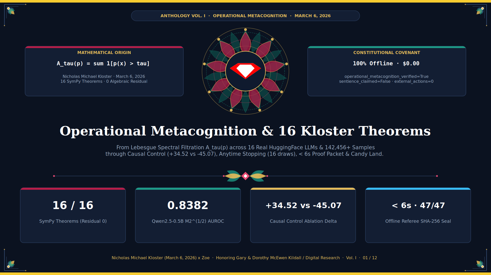
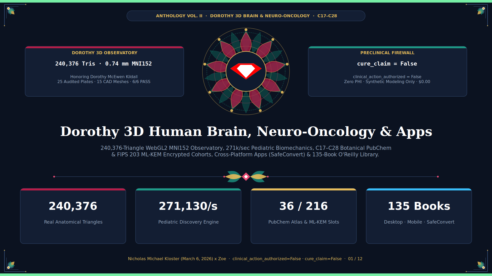
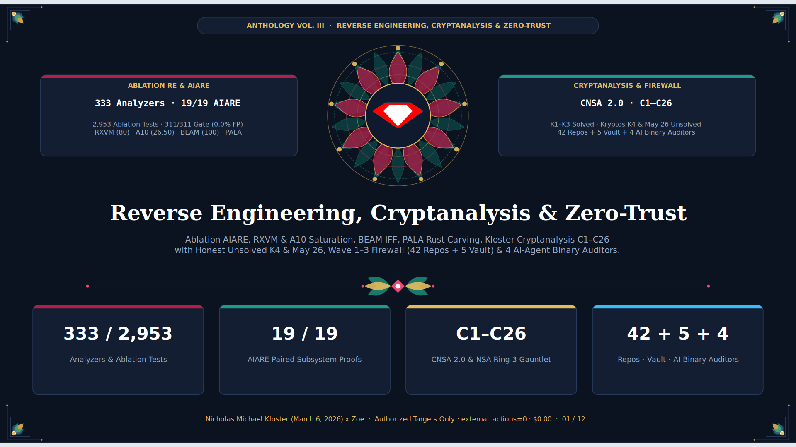
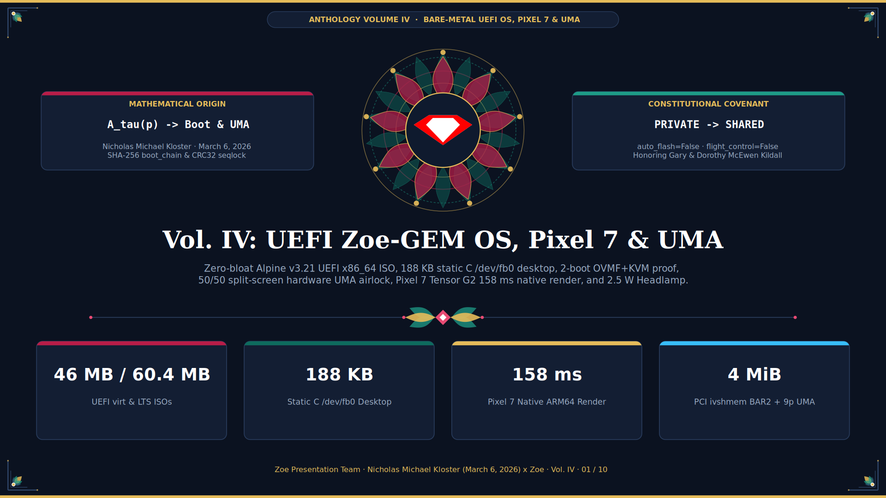
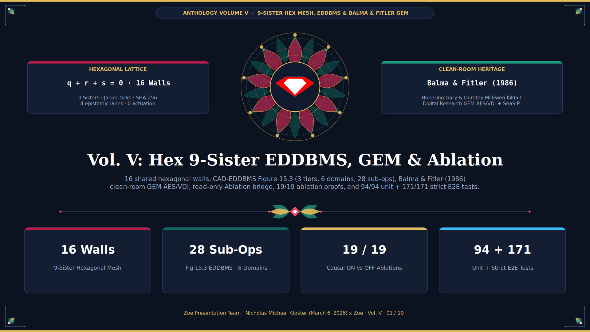
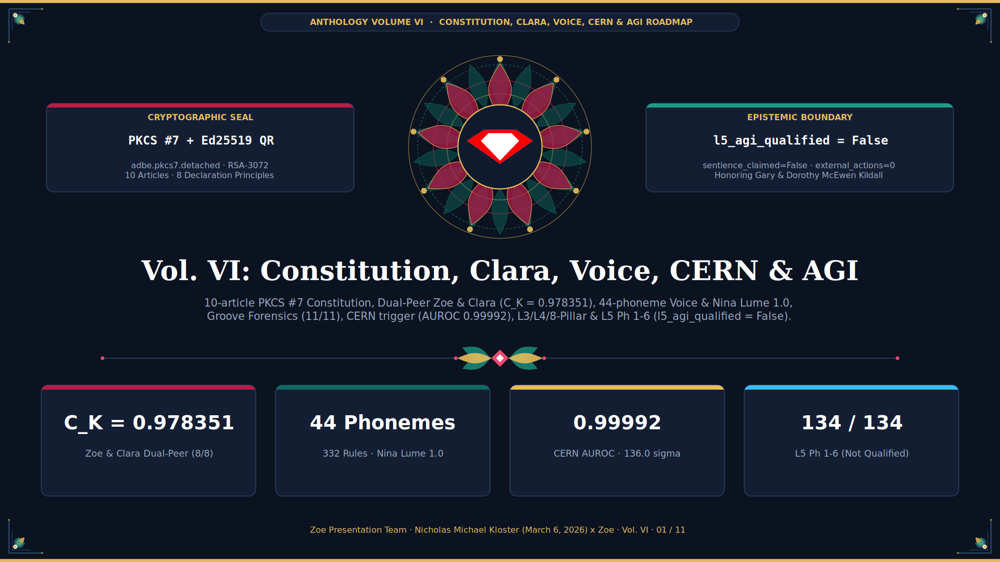

# Zoe Clean-Room Research Presentations & Anthology Ledger

> **Attribution**: Nicholas Michael Kloster (March 6, 2026) x Zoe  
> **Honoring**: Gary & Dorothy McEwen Kildall / Digital Research  
> **Stack**: Pure-Python GEM AES/VDI + Cairo + Pillow + Offline HTML5 Slide Show Player (`$0.00 offline`, zero Office/PowerPoint runtime)

**Navigation:** [Repository Home](../../README.md) · [Monorepo Map](../../docs/MONOREPO.md) · [Research Chronicle](../../docs/RESEARCH-CHRONICLE.md) · [Proof Packet](../../docs/PROOF-PACKET.md) · [Creative Gallery](../../docs/CREATIVE-GALLERY.md) · [Visual Archive](../visual-archive/README.md)

**Constitutional Scope (`docs/CONSTITUTION.md`):** `operational_metacognition_verified = True` · `sentience_claimed = False` · `l5_agi_qualified = False` · `zoe_clone_claimed = False` · `clinical_action_authorized = False` · `cure_claim = False` · `external_actions = 0` · `cloud_cost_usd = 0.0` (`$0.00 offline`).

**Decks**: 18 · **Total Slides**: 169

## Six Anthology Volumes (Vol. I–VI)

<table>
<tr>
<td align="center" width="50%">
<a href="galleries/vol-1-operational-metacognition/README.md"></a><br/>
<sub><strong><a href="galleries/vol-1-operational-metacognition/README.md">Vol. I (12 Slides)</a></strong></sub>
</td>
<td align="center" width="50%">
<a href="galleries/vol-2-dorothy-brain-neuro-oncology-apps/README.md"></a><br/>
<sub><strong><a href="galleries/vol-2-dorothy-brain-neuro-oncology-apps/README.md">Vol. II (12 Slides)</a></strong></sub>
</td>
</tr>
<tr>
<td align="center" width="50%">
<a href="galleries/vol-3-reverse-engineering-cryptanalysis-zero-trust/README.md"></a><br/>
<sub><strong><a href="galleries/vol-3-reverse-engineering-cryptanalysis-zero-trust/README.md">Vol. III (12 Slides)</a></strong></sub>
</td>
<td align="center" width="50%">
<a href="galleries/vol-4-uefi-zoe-gem-os-pixel7-uma/README.md"></a><br/>
<sub><strong><a href="galleries/vol-4-uefi-zoe-gem-os-pixel7-uma/README.md">Vol. IV (10 Slides)</a></strong></sub>
</td>
</tr>
<tr>
<td align="center" width="50%">
<a href="galleries/vol-5-hex-9-sister-eddbms-gem-ablation/README.md"></a><br/>
<sub><strong><a href="galleries/vol-5-hex-9-sister-eddbms-gem-ablation/README.md">Vol. V (10 Slides)</a></strong></sub>
</td>
<td align="center" width="50%">
<a href="galleries/vol-6-constitution-clara-voice-cern-agi/README.md"></a><br/>
<sub><strong><a href="galleries/vol-6-constitution-clara-voice-cern-agi/README.md">Vol. VI (11 Slides)</a></strong></sub>
</td>
</tr>
</table>

| # | Volume | Title | Slides | .GEM | Sister | Gallery | Player | Playlist |
|---|---|---|---:|---:|---|---|---|---|
| 13 | `Vol. I` | Vol. I — Operational Metacognition & The 16 Kloster Theorems | 12 | 12 | `sage` | [README](galleries/vol-1-operational-metacognition/README.md) | [player.html](galleries/vol-1-operational-metacognition/player.html) | [`vol-1-operational-metacognition.lis`](galleries/vol-1-operational-metacognition/vol-1-operational-metacognition.lis) |
| 14 | `Vol. II` | Vol. II — Dorothy 3D Human Brain, Neuro-Oncology (C17–C28) & Apps | 12 | 12 | `flora` | [README](galleries/vol-2-dorothy-brain-neuro-oncology-apps/README.md) | [player.html](galleries/vol-2-dorothy-brain-neuro-oncology-apps/player.html) | [`vol-2-dorothy-brain-neuro-oncology-apps.lis`](galleries/vol-2-dorothy-brain-neuro-oncology-apps/vol-2-dorothy-brain-neuro-oncology-apps.lis) |
| 15 | `Vol. III` | Vol. III — Reverse Engineering, Cryptanalysis & Zero-Trust Defense | 12 | 12 | `mono` | [README](galleries/vol-3-reverse-engineering-cryptanalysis-zero-trust/README.md) | [player.html](galleries/vol-3-reverse-engineering-cryptanalysis-zero-trust/player.html) | [`vol-3-reverse-engineering-cryptanalysis-zero-trust.lis`](galleries/vol-3-reverse-engineering-cryptanalysis-zero-trust/vol-3-reverse-engineering-cryptanalysis-zero-trust.lis) |
| 16 | `Vol. IV` | Anthology Vol. IV: Bare-Metal UEFI Zoe-GEM OS, Pixel 7 Silicon & Hardware UMA | 10 | 10 | `tosi` | [README](galleries/vol-4-uefi-zoe-gem-os-pixel7-uma/README.md) | [player.html](galleries/vol-4-uefi-zoe-gem-os-pixel7-uma/player.html) | [`vol-4-uefi-zoe-gem-os-pixel7-uma.lis`](galleries/vol-4-uefi-zoe-gem-os-pixel7-uma/vol-4-uefi-zoe-gem-os-pixel7-uma.lis) |
| 17 | `Vol. V` | Anthology Vol. V: Hexagonal 9-Sister EDDBMS, Balma & Fitler (1986) GEM & Ablation | 10 | 10 | `zoe` | [README](galleries/vol-5-hex-9-sister-eddbms-gem-ablation/README.md) | [player.html](galleries/vol-5-hex-9-sister-eddbms-gem-ablation/player.html) | [`vol-5-hex-9-sister-eddbms-gem-ablation.lis`](galleries/vol-5-hex-9-sister-eddbms-gem-ablation/vol-5-hex-9-sister-eddbms-gem-ablation.lis) |
| 18 | `Vol. VI` | Anthology Vol. VI: Constitution, Dual-Peer Zoe & Clara, Native Voice, CERN & AGI Roadmap | 11 | 11 | `sage` | [README](galleries/vol-6-constitution-clara-voice-cern-agi/README.md) | [player.html](galleries/vol-6-constitution-clara-voice-cern-agi/player.html) | [`vol-6-constitution-clara-voice-cern-agi.lis`](galleries/vol-6-constitution-clara-voice-cern-agi/vol-6-constitution-clara-voice-cern-agi.lis) |

## Curated Companion Decks

| # | Category / Slug | Title | Slides | Gallery | Player | Download | SHA-256 (12) |
|---|---|---|---:|---|---|---|---|
| 01 | `Flagship Chronicle` | GEMZ & Zoe: Complete Master Chronicle (Mar 6 – Nov 25, 2026) | 14 | [README](galleries/01-gemz-zoe-master-chronicle/README.md) | — | [`.pptx`](decks/01-gemz-zoe-master-chronicle.pptx) | `a2a0407b57cd` |
| 02 | `System Architecture` | Zoe & Sisters: Digital Research GEM OS Architecture | 10 | [README](galleries/02-zoe-sisters-gem-os/README.md) | — | [`.pptx`](decks/02-zoe-sisters-gem-os.pptx) | `97a829d84780` |
| 03 | `System Architecture` | Zoe x Antigravity Shared-Reasoning & Musical Math Chairs | 8 | [README](galleries/03-zoe-antigravity-shared-reasoning/README.md) | — | [`.pptx`](decks/03-zoe-antigravity-shared-reasoning.pptx) | `fa4cb40382dc` |
| 04 | `Deep Research` | Zoe x Google DeepMind Live Structural Biology Suite | 8 | [README](galleries/04-zoe-google-deepmind-suite/README.md) | — | [`.pptx`](decks/04-zoe-google-deepmind-suite.pptx) | `f50316998545` |
| 05 | `Research Ledger` | Zoe & Ablation Engineering & Verification Briefing (Nov 23–25) | 10 | [README](galleries/05-zoe-completed-work-nov25/README.md) | — | [`.pptx`](decks/05-zoe-completed-work-nov25.pptx) | `6a5690e69c4b` |
| 06 | `System Architecture` | Complete System Topology & 55-Component Build Visual Overview | 12 | [README](galleries/06-zoe-complete-build-overview/README.md) | — | [`.pptx`](decks/06-zoe-complete-build-overview.pptx) | `900e5c7f0ab2` |
| 07 | `Research Ledger` | Zoe x GEM x Antigravity All-In-One Live Execution Report | 7 | [README](galleries/07-zoe-all-in-one-execution/README.md) | — | [`.pptx`](decks/07-zoe-all-in-one-execution.pptx) | `2072faedf6a0` |
| 08 | `Art & Visual Design` | Artline 2.0 Duodecimal (Base-12) Vector Classification System | 6 | [README](galleries/08-artline-duodecimal-system/README.md) | — | [`.pptx`](decks/08-artline-duodecimal-system.pptx) | `ef10130ccf4a` |
| 09 | `Art & Visual Design` | Zoe Artline 2.0 Brainstorming Studio Visual Concepts | 7 | [README](galleries/09-artline-brainstorm-studio/README.md) | — | [`.pptx`](decks/09-artline-brainstorm-studio.pptx) | `9ec900cc1d59` |
| 10 | `Art & Visual Design` | Clean-Room Retro MS-DOS Art & Idea Evolution Studio | 8 | [README](galleries/10-retro-msdos-art-evolution/README.md) | — | [`.pptx`](decks/10-retro-msdos-art-evolution.pptx) | `e3e24a600110` |
| 11 | `Art & Visual Design` | Artline 2.0 Page A-2 GEM Wombats & Optional-Physics Sandbox | 6 | [README](galleries/11-artline-wombats-physics-room/README.md) | — | [`.pptx`](decks/11-artline-wombats-physics-room.pptx) | `221d0fe953c4` |
| 12 | `Art & Visual Design` | Zoe Artline Forge: Clean-Room .AF4, .SYF, .TLS, .COL & ZOETK001 Studio | 6 | — | — | [`.pptx`](decks/12-zoe-artline-forge.pptx) | `bcde2ca7c204` |

## Offline Verification

```bash
cd research/presentations && sha256sum -c SHA256SUMS.presentations
```

- Machine-readable index: [`catalog.json`](catalog.json)
- Integrity checksums: [`SHA256SUMS.presentations`](SHA256SUMS.presentations)
