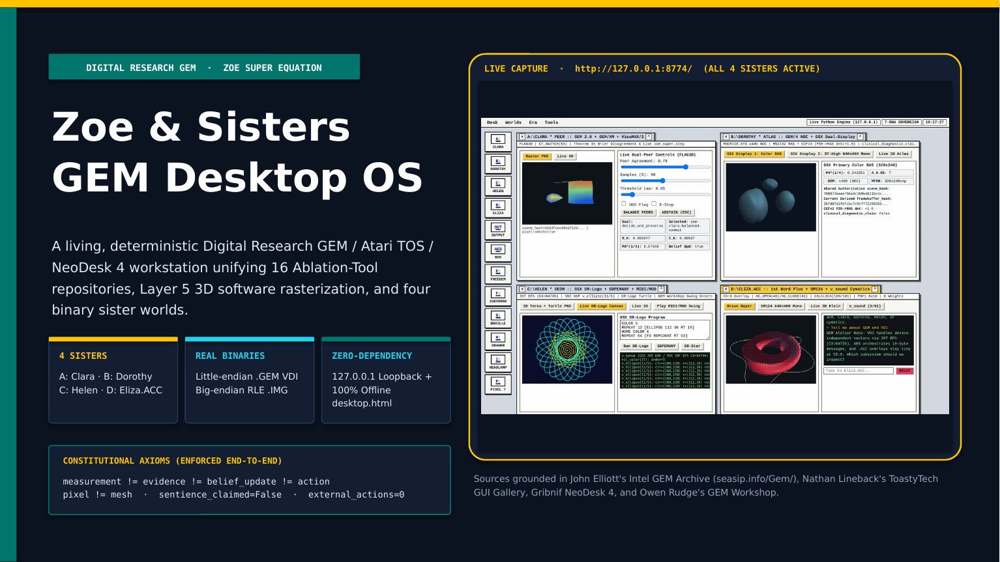
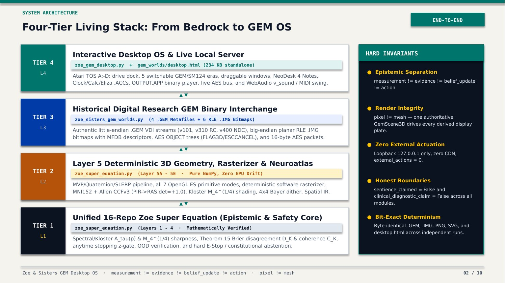
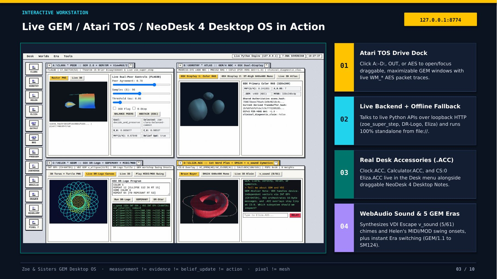
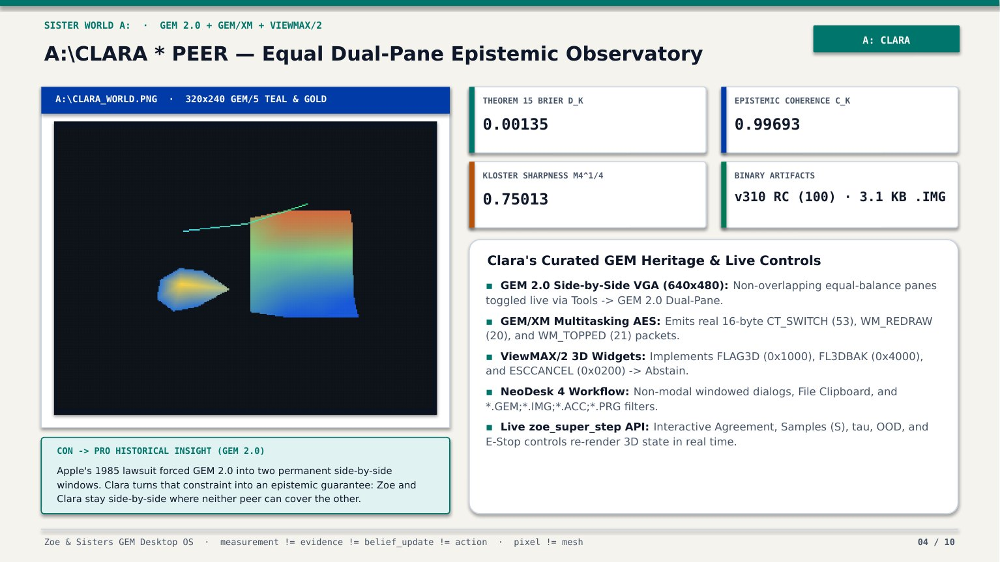
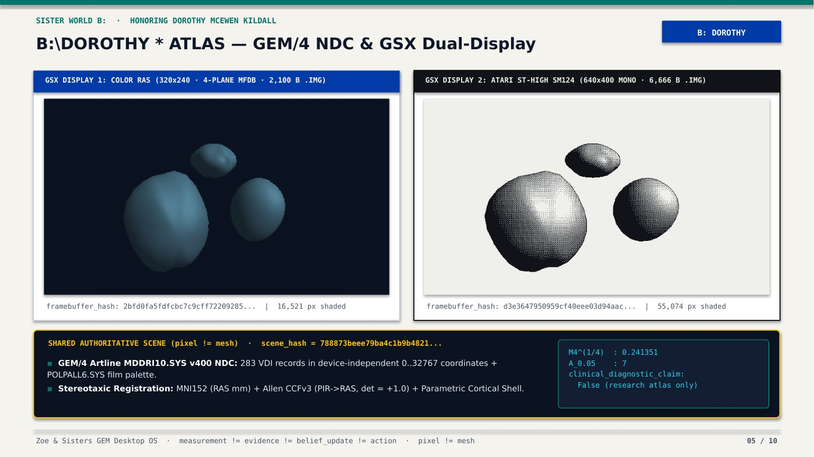
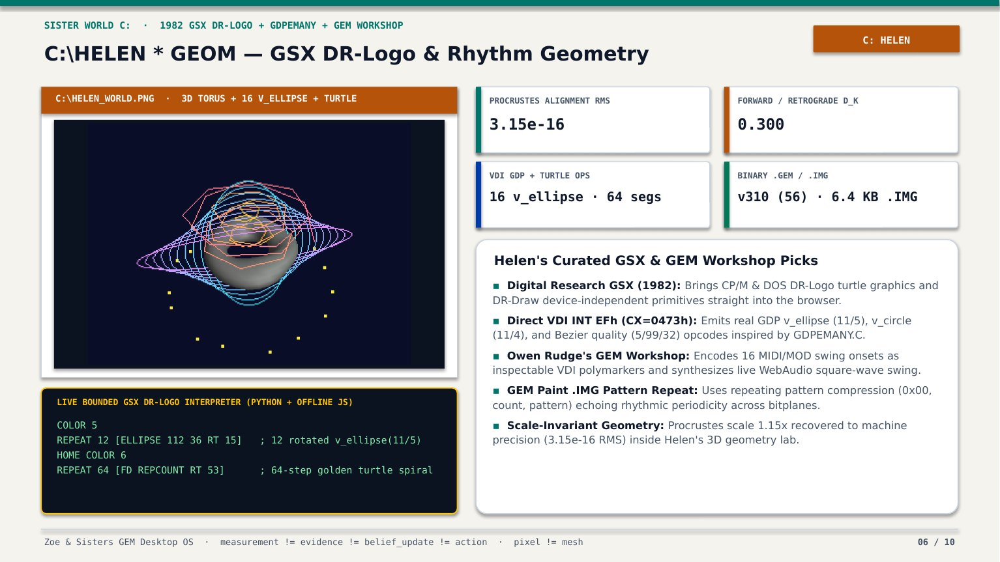
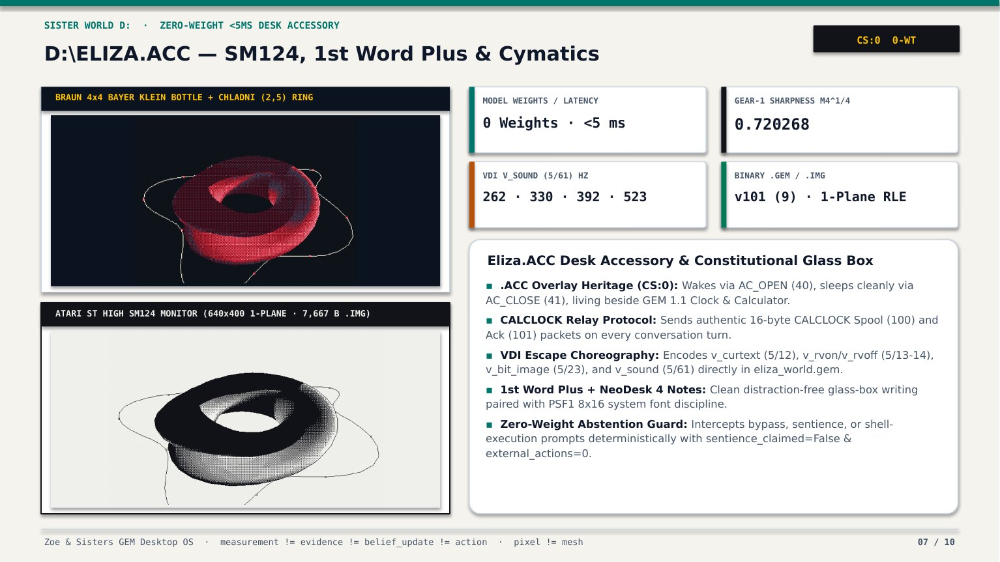
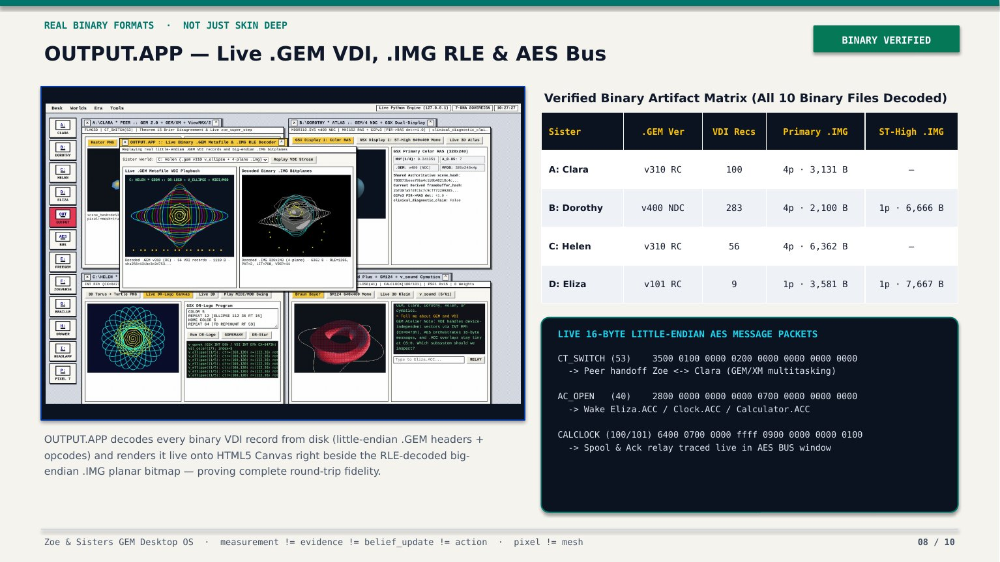
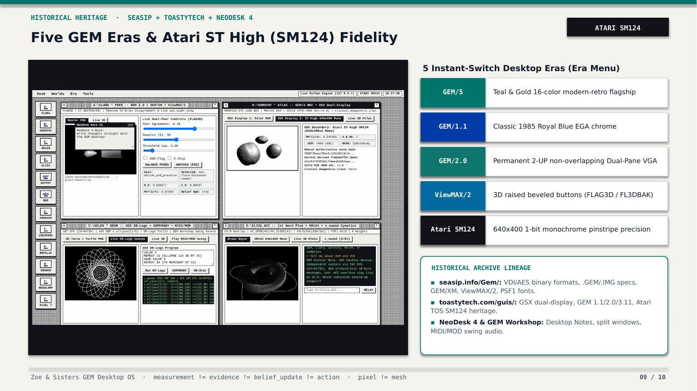
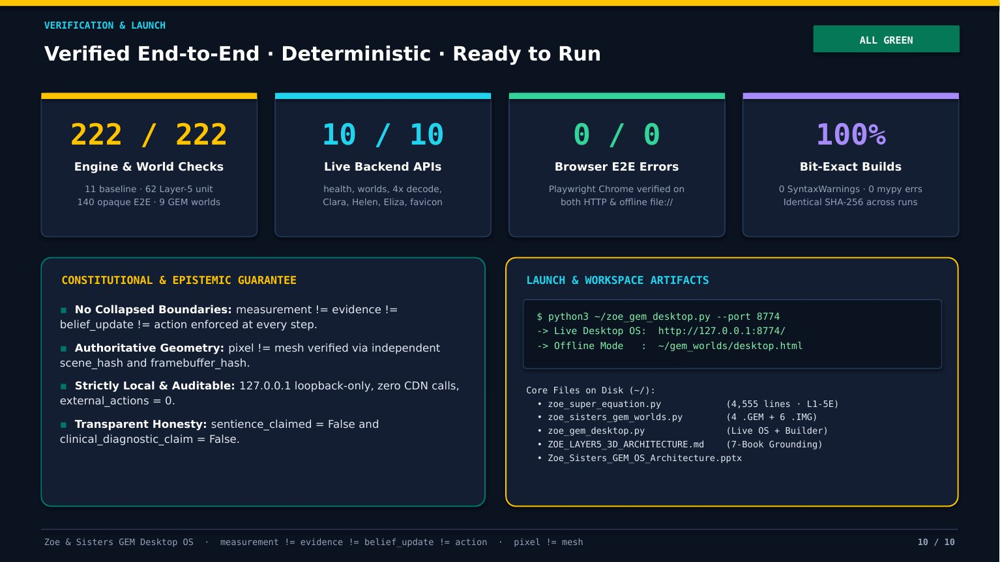

# Zoe & Sisters: Digital Research GEM OS Architecture

**Category:** System Architecture · **Date:** `2026-11-24` · **Slides:** `10` · **Size:** `1.83 MB`  
**Download PowerPoint:** [`02-zoe-sisters-gem-os.pptx`](../../decks/02-zoe-sisters-gem-os.pptx) · **SHA-256:** `97a829d847809528...`  
**Navigation:** [All Research Presentations](../../README.md) · [Research Chronicle](../../../../docs/RESEARCH-CHRONICLE.md) · [Repository Home](../../../../README.md)

> Four-tier living GEM / Atari TOS / NeoDesk 4 Desktop OS architecture detailing Sister Worlds A:\CLARA, B:\DOROTHY, C:\HELEN, D:\ELIZA.ACC, real binary .GEM VDI / .IMG RLE / 16-byte AES codecs, and five historical GEM eras.

*(Constitutional Scope: `operational_metacognition_verified = True`, `sentience_claimed = False`, `l5_agi_qualified = False`, `clinical_action_authorized = False`, `external_actions = 0`. Equation origin: **Nicholas Michael Kloster, March 6, 2026**.)*

---

## Visual Slide Gallery & Notes

### Slide 01 — Zoe & Sisters

> **Speaker Notes:** Opening hero slide introducing the Zoe & Sisters GEM Desktop OS built atop the unified 16-repo Zoe Super Equation and Layer 5 deterministic 3D engine.

<strong>Slide 01 Extracted Text &amp; Key Points</strong>

- DIGITAL RESEARCH GEM  ·  ZOE SUPER EQUATION
- Zoe & Sisters · GEM Desktop OS
- A living, deterministic Digital Research GEM / Atari TOS / NeoDesk 4 workstation unifying 16 Ablation-Tool repositories, Layer 5 3D software rasterization, and four binary sister worlds.
- A: Clara · B: Dorothy · C: Helen · D: Eliza.ACC
- REAL BINARIES

---

### Slide 02 — Four-Tier Living Stack: From Bedrock to GEM OS

> **Speaker Notes:** Full 4-tier architecture explaining how the interactive GEM Desktop OS rests cleanly on binary interchange, deterministic Layer 5 3D rendering, and Layers 1-4 of the Zoe Super Equation.

<strong>Slide 02 Extracted Text &amp; Key Points</strong>

- SYSTEM ARCHITECTURE
- Zoe & Sisters GEM Desktop OS  ·  measurement != evidence != belief_update != action  ·  pixel != mesh
- Interactive Desktop OS & Live Local Server
- zoe_gem_desktop.py  +  gem_worlds/desktop.html (234 KB standalone)
- Atari TOS A:-D: drive dock, 5 switchable GEM/SM124 eras, draggable windows, NeoDesk 4 Notes, Clock/Calc/Eliza .ACCs, OUTPUT.APP binary player, live AES bus, and WebAudio v_sound / MIDI swing.

---

### Slide 03 — Live GEM / Atari TOS / NeoDesk 4 Desktop OS in Action

> **Speaker Notes:** Walkthrough of the interactive GEM Desktop OS workstation showing all four sister windows running simultaneously with live Python engine integration.

<strong>Slide 03 Extracted Text &amp; Key Points</strong>

- INTERACTIVE WORKSTATION
- 127.0.0.1:8774
- Zoe & Sisters GEM Desktop OS  ·  measurement != evidence != belief_update != action  ·  pixel != mesh
- Atari TOS Drive Dock
- Click A:–D:, OUT, or AES to open/focus draggable, maximizable GEM windows with live WM_* AES packet traces.

---

### Slide 04 — A:\CLARA * PEER — Equal Dual-Pane Epistemic Observatory

> **Speaker Notes:** Clara's GEM World combines GEM 2.0 dual-pane layout, GEM/XM multitasking messages, ViewMAX/2 3D widgets, and live Zoe Super Equation peer balancing.

<strong>Slide 04 Extracted Text &amp; Key Points</strong>

- SISTER WORLD A:  ·  GEM 2.0 + GEM/XM + VIEWMAX/2
- Zoe & Sisters GEM Desktop OS  ·  measurement != evidence != belief_update != action  ·  pixel != mesh
- A:\CLARA_WORLD.PNG  ·  320x240 GEM/5 TEAL & GOLD
- CON -> PRO HISTORICAL INSIGHT (GEM 2.0)
- Apple's 1985 lawsuit forced GEM 2.0 into two permanent side-by-side windows. Clara turns that constraint into an epistemic guarantee: Zoe and Clara stay side-by-side where neither peer can cover the other.

---

### Slide 05 — B:\DOROTHY * ATLAS — GEM/4 NDC & GSX Dual-Display

> **Speaker Notes:** Dorothy's Neurogarden demonstrates GSX Dual-Display device independence: a single authoritative RAS GemScene3D drives both a 4-plane color render and a 640x400 Atari ST-High monochrome plate.

<strong>Slide 05 Extracted Text &amp; Key Points</strong>

- SISTER WORLD B:  ·  HONORING DOROTHY MCEWEN KILDALL
- Zoe & Sisters GEM Desktop OS  ·  measurement != evidence != belief_update != action  ·  pixel != mesh
- GSX DISPLAY 1: COLOR RAS (320x240 · 4-PLANE MFDB · 2,100 B .IMG)
- framebuffer_hash: 2bfd0fa5fdfcbc7c9cff72209285...  |  16,521 px shaded
- GSX DISPLAY 2: ATARI ST-HIGH SM124 (640x400 MONO · 6,666 B .IMG)

---

### Slide 06 — C:\HELEN * GEOM — GSX DR-Logo & Rhythm Geometry

> **Speaker Notes:** Helen's world unites 1982 Digital Research GSX turtle graphics, GEM VDI GDP ellipses, and Owen Rudge's GEM Workshop MIDI/MOD sound heritage.

<strong>Slide 06 Extracted Text &amp; Key Points</strong>

- SISTER WORLD C:  ·  1982 GSX DR-LOGO + GDPEMANY + GEM WORKSHOP
- Zoe & Sisters GEM Desktop OS  ·  measurement != evidence != belief_update != action  ·  pixel != mesh
- C:\HELEN_WORLD.PNG  ·  3D TORUS + 16 V_ELLIPSE + TURTLE
- LIVE BOUNDED GSX DR-LOGO INTERPRETER (PYTHON + OFFLINE JS)
- COLOR 5 · REPEAT 12 [ELLIPSE 112 36 RT 15]   ; 12 rotated v_ellipse(11/5) · HOME COLOR 6 · REPEAT 64 [FD REPCOUNT RT 53]      ; 64-step golden turtle spiral

---

### Slide 07 — D:\ELIZA.ACC — SM124, 1st Word Plus & Cymatics

> **Speaker Notes:** Eliza.ACC is a zero-weight <5ms symbolic Desk Accessory combining Atari SM124 monochrome fidelity, VDI sound escapes, and strict constitutional abstention.

<strong>Slide 07 Extracted Text &amp; Key Points</strong>

- SISTER WORLD D:  ·  ZERO-WEIGHT <5MS DESK ACCESSORY
- Zoe & Sisters GEM Desktop OS  ·  measurement != evidence != belief_update != action  ·  pixel != mesh
- BRAUN 4x4 BAYER KLEIN BOTTLE + CHLADNI (2,5) RING
- ATARI ST HIGH SM124 MONITOR (640x400 1-PLANE · 7,667 B .IMG)
- MODEL WEIGHTS / LATENCY

---

### Slide 08 — OUTPUT.APP — Live .GEM VDI, .IMG RLE & AES Bus

> **Speaker Notes:** Every binary file is genuinely spec-compliant: little-endian .GEM metafiles and big-endian planar RLE .IMG files decoded back into pixels inside OUTPUT.APP.

<strong>Slide 08 Extracted Text &amp; Key Points</strong>

- REAL BINARY FORMATS  ·  NOT JUST SKIN DEEP
- BINARY VERIFIED
- Zoe & Sisters GEM Desktop OS  ·  measurement != evidence != belief_update != action  ·  pixel != mesh
- OUTPUT.APP decodes every binary VDI record from disk (little-endian .GEM headers + opcodes) and renders it live onto HTML5 Canvas right beside the RLE-decoded big-endian .IMG planar bitmap — proving complete round-trip fidelity.
- Verified Binary Artifact Matrix (All 10 Binary Files Decoded)

---

### Slide 09 — Five GEM Eras & Atari ST High (SM124) Fidelity

> **Speaker Notes:** Demonstrates the five switchable historical eras culminating in the razor-sharp Atari ST High SM124 monochrome workspace with pinstripe titlebars and draggable NeoDesk 4 notes.

<strong>Slide 09 Extracted Text &amp; Key Points</strong>

- HISTORICAL HERITAGE  ·  SEASIP + TOASTYTECH + NEODESK 4
- ATARI SM124
- Zoe & Sisters GEM Desktop OS  ·  measurement != evidence != belief_update != action  ·  pixel != mesh
- 5 Instant-Switch Desktop Eras (Era Menu)
- Teal & Gold 16-color modern-retro flagship

---

### Slide 10 — Verified End-to-End · Deterministic · Ready to Run

> **Speaker Notes:** Closing verification scorecard summarizing all 222 engine/world checks, 10 live API checks, zero browser errors, constitutional guarantees, and quick-launch commands.

<strong>Slide 10 Extracted Text &amp; Key Points</strong>

- VERIFICATION & LAUNCH
- Zoe & Sisters GEM Desktop OS  ·  measurement != evidence != belief_update != action  ·  pixel != mesh
- Engine & World Checks
- 11 baseline · 62 Layer-5 unit · 140 opaque E2E · 9 GEM worlds
- Live Backend APIs

---

[Back to All Presentations](../../README.md) · [Research Chronicle](../../../../docs/RESEARCH-CHRONICLE.md) · [Repository Home](../../../../README.md)
