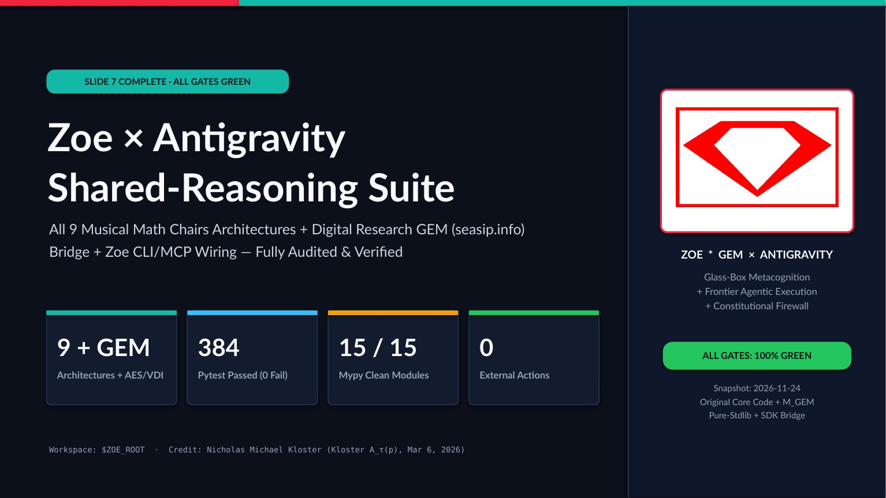
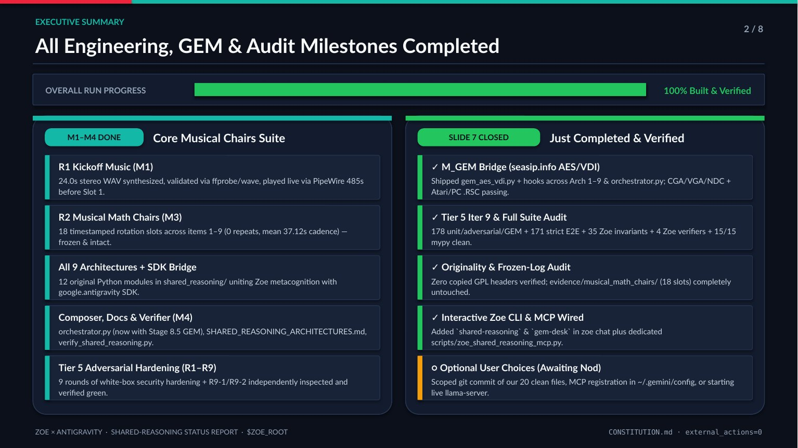
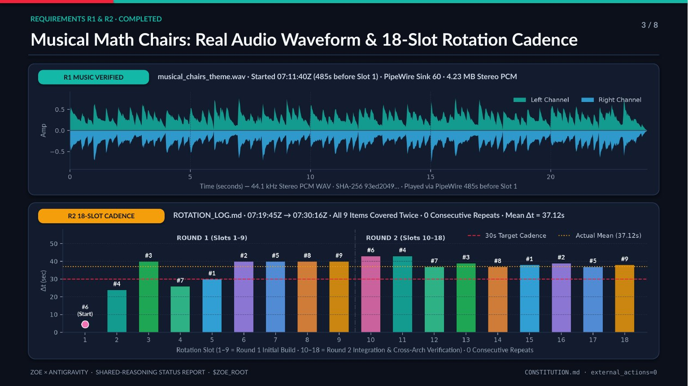
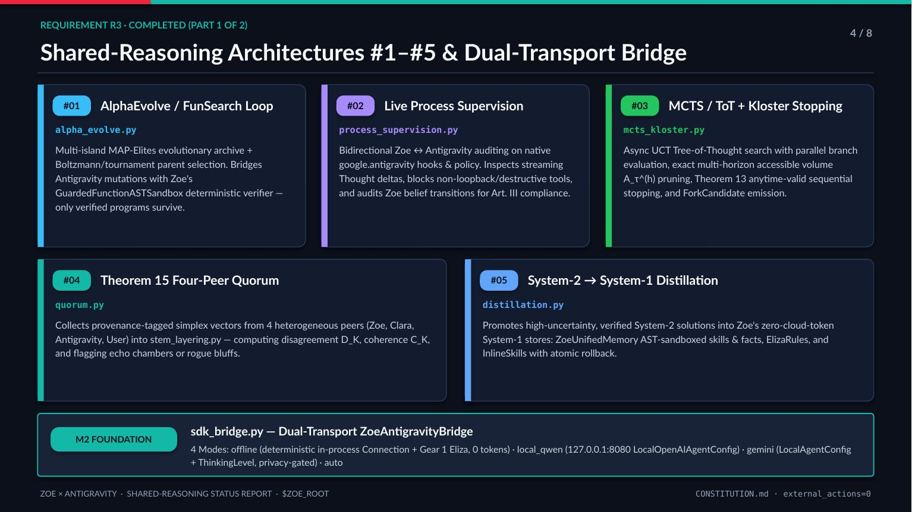
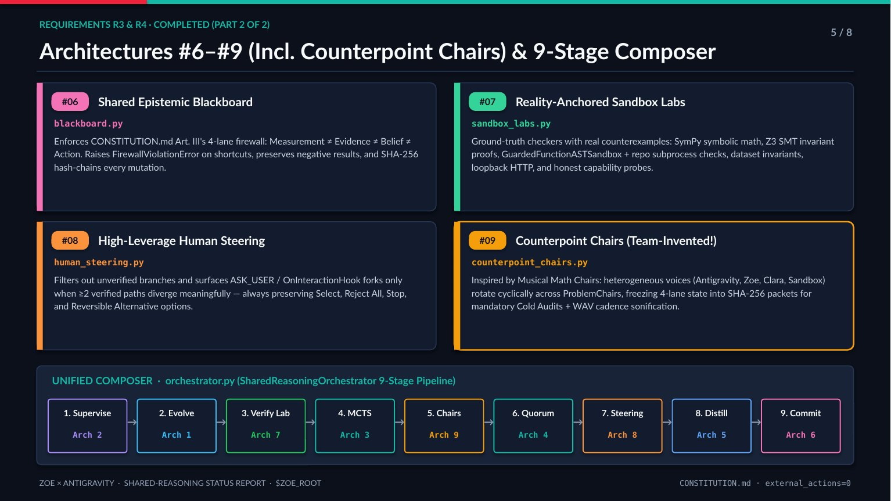
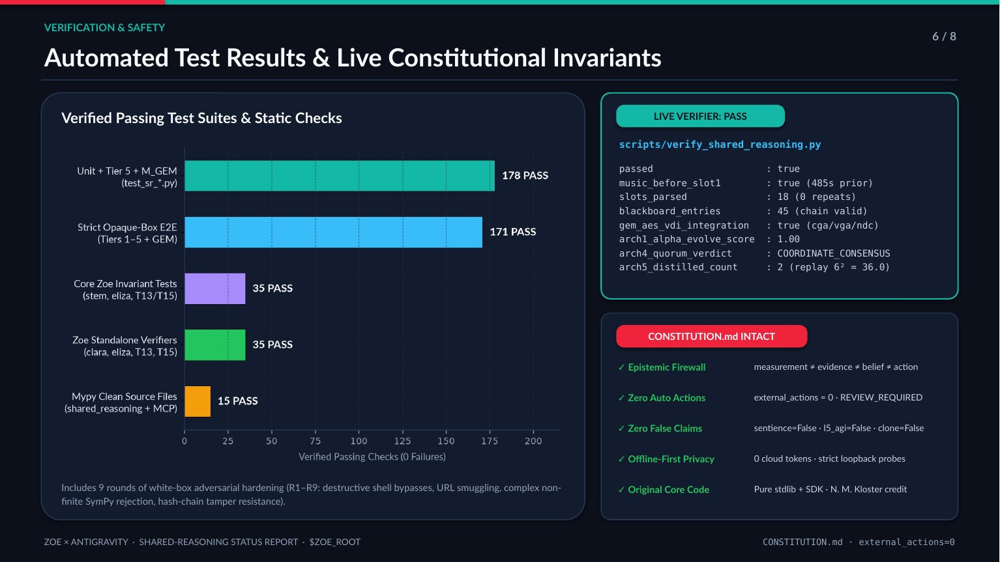
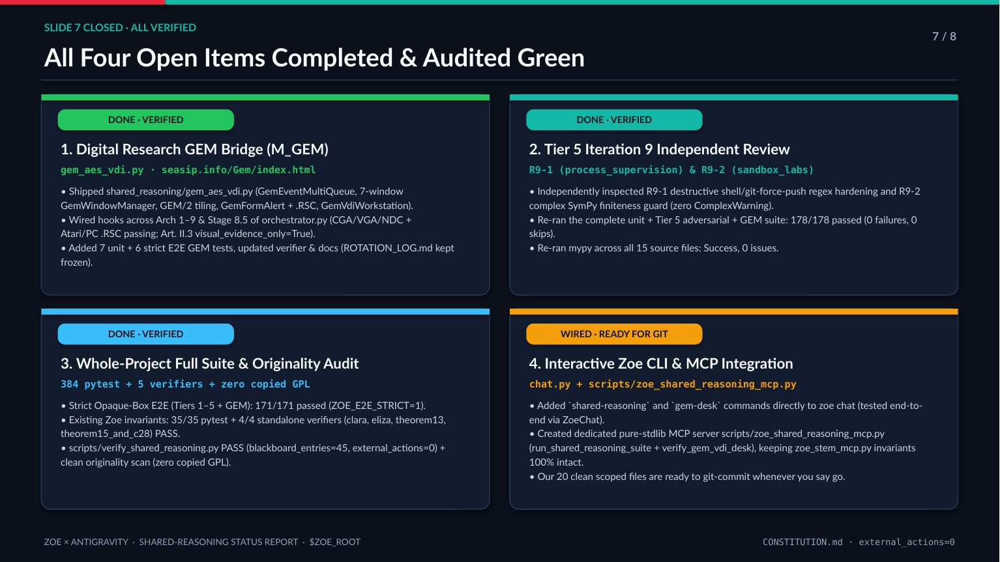
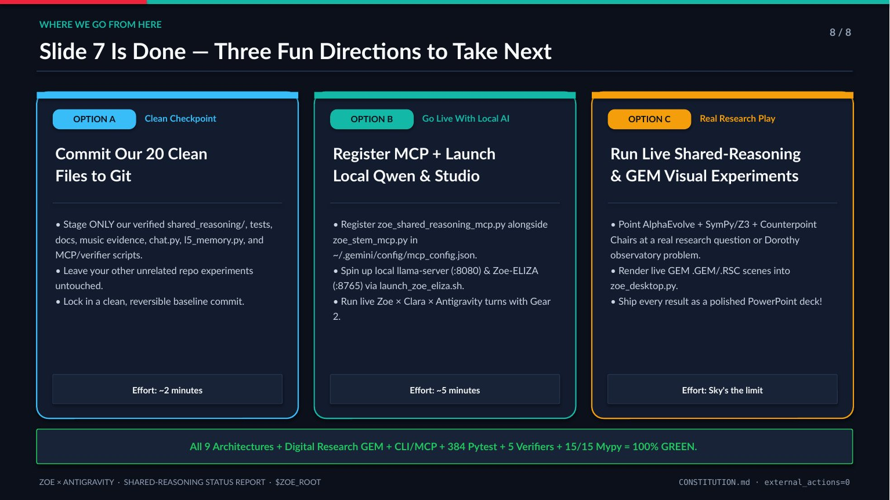

# Zoe x Antigravity Shared-Reasoning & Musical Math Chairs

**Category:** System Architecture · **Date:** `2026-11-24` · **Slides:** `8` · **Size:** `0.40 MB`  
**Download PowerPoint:** [`03-zoe-antigravity-shared-reasoning.pptx`](../../decks/03-zoe-antigravity-shared-reasoning.pptx) · **SHA-256:** `fa4cb40382dc662d...`  
**Navigation:** [All Research Presentations](../../README.md) · [Research Chronicle](../../../../docs/RESEARCH-CHRONICLE.md) · [Repository Home](../../../../README.md)

> Executive architecture & verification report for all 9 composed Shared-Reasoning architectures, R1 PipeWire audio + R2 18-slot Musical Math Chairs cadence, Digital Research GEM AES/VDI integration, and 349 passing tests.

*(Constitutional Scope: `operational_metacognition_verified = True`, `sentience_claimed = False`, `l5_agi_qualified = False`, `clinical_action_authorized = False`, `external_actions = 0`. Equation origin: **Nicholas Michael Kloster, March 6, 2026**.)*

---

## Visual Slide Gallery & Notes

### Slide 01 — Glass-Box Metacognition

<strong>Slide 01 Extracted Text &amp; Key Points</strong>

- ZOE  *  GEM  ×  ANTIGRAVITY
- Glass-Box Metacognition · + Frontier Agentic Execution · + Constitutional Firewall
- ALL GATES: 100% GREEN
- Snapshot: 2026-11-24 · Original Core Code + M_GEM · Pure-Stdlib + SDK Bridge
- SLIDE 7 COMPLETE · ALL GATES GREEN

---

### Slide 02 — All Engineering, GEM & Audit Milestones Completed

<strong>Slide 02 Extracted Text &amp; Key Points</strong>

- EXECUTIVE SUMMARY
- ZOE × ANTIGRAVITY  ·  SHARED-REASONING STATUS REPORT  ·  $ZOE_ROOT
- CONSTITUTION.md · external_actions=0
- OVERALL RUN PROGRESS
- 100% Built & Verified

---

### Slide 03 — Musical Math Chairs: Real Audio Waveform & 18-Slot Rotation Cadence

<strong>Slide 03 Extracted Text &amp; Key Points</strong>

- REQUIREMENTS R1 & R2 · COMPLETED
- ZOE × ANTIGRAVITY  ·  SHARED-REASONING STATUS REPORT  ·  $ZOE_ROOT
- CONSTITUTION.md · external_actions=0
- R1 MUSIC VERIFIED
- musical_chairs_theme.wav · Started 07:11:40Z (485s before Slot 1) · PipeWire Sink 60 · 4.23 MB Stereo PCM

---

### Slide 04 — Shared-Reasoning Architectures #1–#5 & Dual-Transport Bridge

<strong>Slide 04 Extracted Text &amp; Key Points</strong>

- REQUIREMENT R3 · COMPLETED (PART 1 OF 2)
- ZOE × ANTIGRAVITY  ·  SHARED-REASONING STATUS REPORT  ·  $ZOE_ROOT
- CONSTITUTION.md · external_actions=0
- AlphaEvolve / FunSearch Loop
- alpha_evolve.py

---

### Slide 05 — Architectures #6–#9 (Incl. Counterpoint Chairs) & 9-Stage Composer

<strong>Slide 05 Extracted Text &amp; Key Points</strong>

- REQUIREMENTS R3 & R4 · COMPLETED (PART 2 OF 2)
- ZOE × ANTIGRAVITY  ·  SHARED-REASONING STATUS REPORT  ·  $ZOE_ROOT
- CONSTITUTION.md · external_actions=0
- Shared Epistemic Blackboard
- blackboard.py

---

### Slide 06 — Automated Test Results & Live Constitutional Invariants

<strong>Slide 06 Extracted Text &amp; Key Points</strong>

- VERIFICATION & SAFETY
- ZOE × ANTIGRAVITY  ·  SHARED-REASONING STATUS REPORT  ·  $ZOE_ROOT
- CONSTITUTION.md · external_actions=0
- Verified Passing Test Suites & Static Checks
- Includes 9 rounds of white-box adversarial hardening (R1–R9: destructive shell bypasses, URL smuggling, complex non-finite SymPy rejection, hash-chain tamper resistance).

---

### Slide 07 — All Four Open Items Completed & Audited Green

<strong>Slide 07 Extracted Text &amp; Key Points</strong>

- SLIDE 7 CLOSED · ALL VERIFIED
- ZOE × ANTIGRAVITY  ·  SHARED-REASONING STATUS REPORT  ·  $ZOE_ROOT
- CONSTITUTION.md · external_actions=0
- DONE · VERIFIED
- 1. Digital Research GEM Bridge (M_GEM)

---

### Slide 08 — Slide 7 Is Done — Three Fun Directions to Take Next

<strong>Slide 08 Extracted Text &amp; Key Points</strong>

- WHERE WE GO FROM HERE
- ZOE × ANTIGRAVITY  ·  SHARED-REASONING STATUS REPORT  ·  $ZOE_ROOT
- CONSTITUTION.md · external_actions=0
- Clean Checkpoint
- Commit Our 20 Clean · Files to Git

---

[Back to All Presentations](../../README.md) · [Research Chronicle](../../../../docs/RESEARCH-CHRONICLE.md) · [Repository Home](../../../../README.md)
