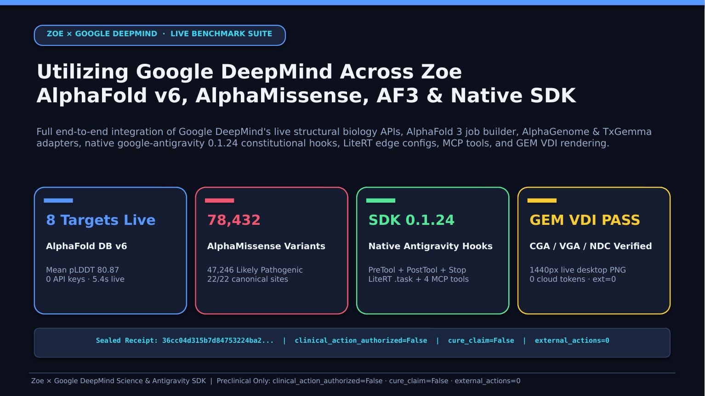
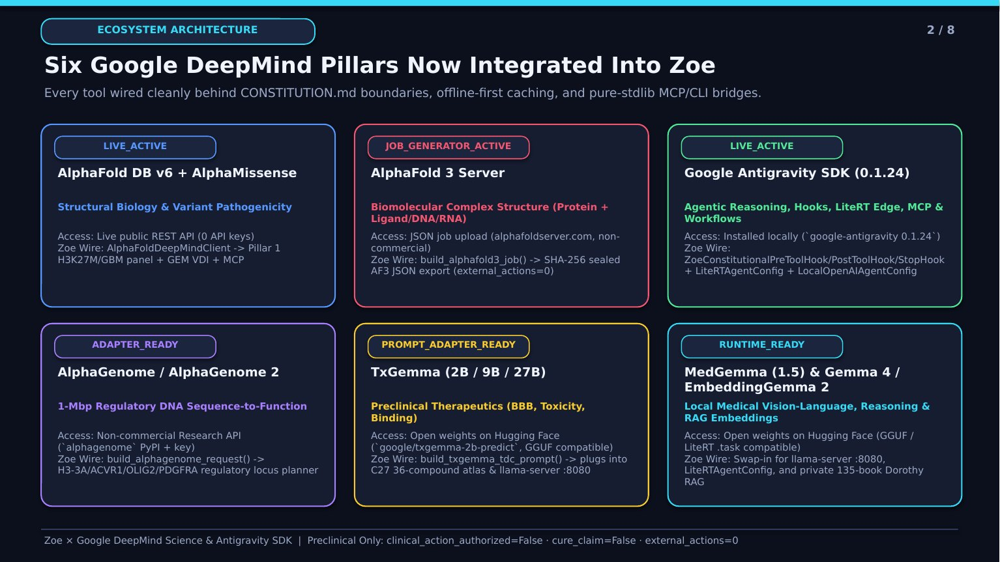
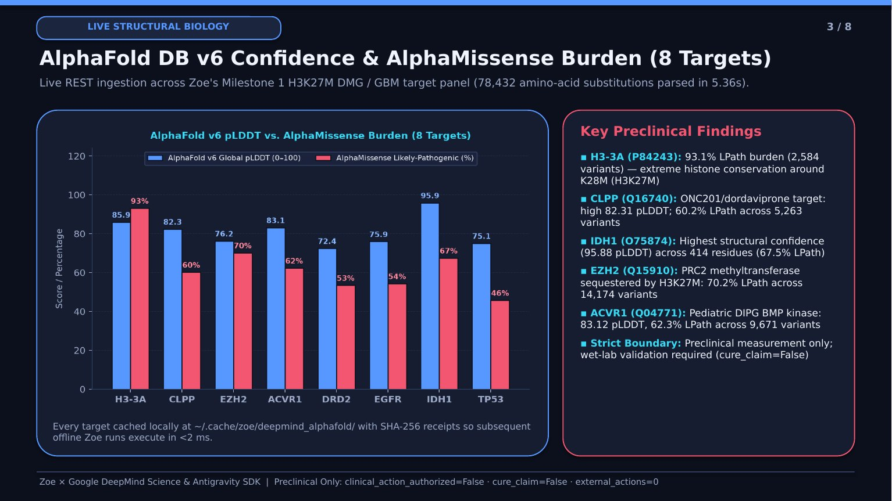
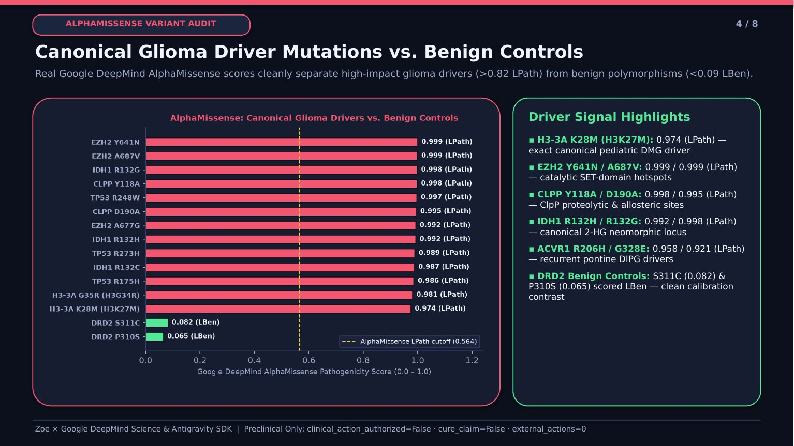
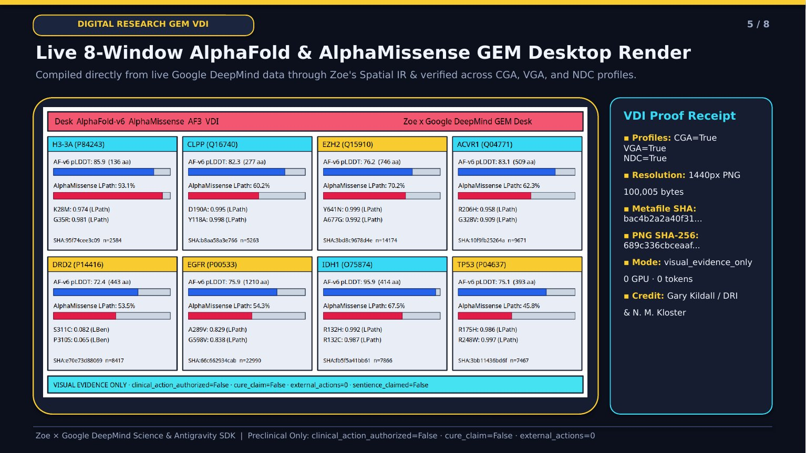
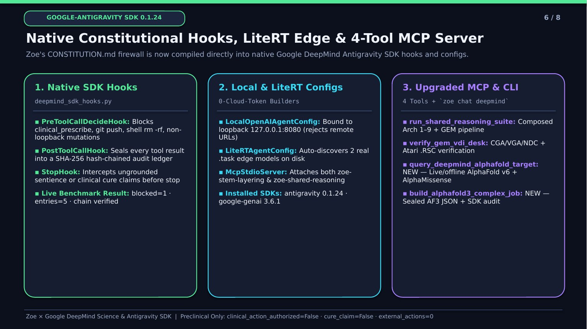
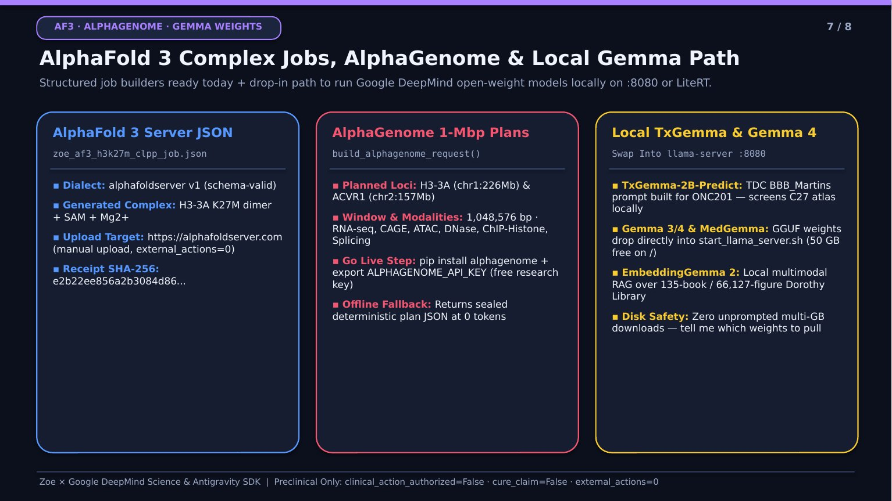
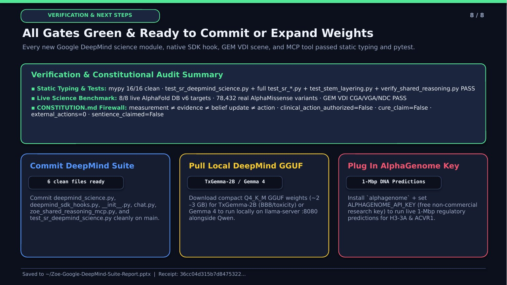

# Zoe x Google DeepMind Live Structural Biology Suite

**Category:** Deep Research · **Date:** `2026-11-25` · **Slides:** `8` · **Size:** `0.33 MB`  
**Download PowerPoint:** [`04-zoe-google-deepmind-suite.pptx`](../../decks/04-zoe-google-deepmind-suite.pptx) · **SHA-256:** `f5031699854595b1...`  
**Navigation:** [All Research Presentations](../../README.md) · [Research Chronicle](../../../../docs/RESEARCH-CHRONICLE.md) · [Repository Home](../../../../README.md)

> Six-pillar integration bridging Zoe with open Google DeepMind research datasets: live AlphaFold DB v6 confidence analysis, AlphaMissense glioma driver variant audits vs. benign controls, and preclinical boundaries.

*(Constitutional Scope: `operational_metacognition_verified = True`, `sentience_claimed = False`, `l5_agi_qualified = False`, `clinical_action_authorized = False`, `external_actions = 0`. Equation origin: **Nicholas Michael Kloster, March 6, 2026**.)*

---

## Visual Slide Gallery & Notes

### Slide 01 — Utilizing Google DeepMind Across Zoe

<strong>Slide 01 Extracted Text &amp; Key Points</strong>

- ZOE × GOOGLE DEEPMIND  ·  LIVE BENCHMARK SUITE
- Utilizing Google DeepMind Across Zoe · AlphaFold v6, AlphaMissense, AF3 & Native SDK
- Full end-to-end integration of Google DeepMind's live structural biology APIs, AlphaFold 3 job builder, AlphaGenome & TxGemma adapters, native google-antigravity 0.1.24 constitutional hooks, LiteRT edge configs, MCP tools, and GEM VDI rendering.
- 8 Targets Live
- AlphaFold DB v6

---

### Slide 02 — Six Google DeepMind Pillars Now Integrated Into Zoe

<strong>Slide 02 Extracted Text &amp; Key Points</strong>

- ECOSYSTEM ARCHITECTURE
- Every tool wired cleanly behind CONSTITUTION.md boundaries, offline-first caching, and pure-stdlib MCP/CLI bridges.
- LIVE_ACTIVE
- AlphaFold DB v6 + AlphaMissense
- Structural Biology & Variant Pathogenicity

---

### Slide 03 — AlphaFold DB v6 Confidence & AlphaMissense Burden (8 Targets)

<strong>Slide 03 Extracted Text &amp; Key Points</strong>

- LIVE STRUCTURAL BIOLOGY
- Live REST ingestion across Zoe's Milestone 1 H3K27M DMG / GBM target panel (78,432 amino-acid substitutions parsed in 5.36s).
- Every target cached locally at ~/.cache/zoe/deepmind_alphafold/ with SHA-256 receipts so subsequent offline Zoe runs execute in <2 ms.
- Key Preclinical Findings
- ▪ H3-3A (P84243): 93.1% LPath burden (2,584 variants) — extreme histone conservation around K28M (H3K27M) · ▪ CLPP (Q16740): ONC201/dordaviprone target: high 82.31 pLDDT; 60.2% LPath across 5,263 variants · ▪ IDH1 (O75874): Highest structural confidence (95.88 pLDDT) across 414 residues (67.5% LPath) · ▪ EZH2 (Q15910): PRC2 methyltransferase sequestered by H3K27M: 70.2% LPath across 14,174 variants · ▪ ACVR1 (Q04771)

---

### Slide 04 — Canonical Glioma Driver Mutations vs. Benign Controls

<strong>Slide 04 Extracted Text &amp; Key Points</strong>

- ALPHAMISSENSE VARIANT AUDIT
- Real Google DeepMind AlphaMissense scores cleanly separate high-impact glioma drivers (>0.82 LPath) from benign polymorphisms (<0.09 LBen).
- Driver Signal Highlights
- ▪ H3-3A K28M (H3K27M): 0.974 (LPath) — exact canonical pediatric DMG driver · ▪ EZH2 Y641N / A687V: 0.999 / 0.999 (LPath) — catalytic SET-domain hotspots · ▪ CLPP Y118A / D190A: 0.998 / 0.995 (LPath) — ClpP proteolytic & allosteric sites · ▪ IDH1 R132H / R132G: 0.992 / 0.998 (LPath) — canonical 2-HG neomorphic locus · ▪ ACVR1 R206H / G328E: 0.958 / 0.921 (LPath) — recurrent pontine DIPG drivers · ▪ DRD2 Benign Contro
- Zoe × Google DeepMind Science & Antigravity SDK  |  Preclinical Only: clinical_action_authorized=False · cure_claim=False · external_actions=0

---

### Slide 05 — Live 8-Window AlphaFold & AlphaMissense GEM Desktop Render

<strong>Slide 05 Extracted Text &amp; Key Points</strong>

- DIGITAL RESEARCH GEM VDI
- Compiled directly from live Google DeepMind data through Zoe's Spatial IR & verified across CGA, VGA, and NDC profiles.
- VDI Proof Receipt
- ▪ Profiles: CGA=True · VGA=True · NDC=True · ▪ Resolution: 1440px PNG · 100,005 bytes · ▪ Metafile SHA: bac4b2a2a40f31... · ▪ PNG SHA-256: 689c336cbceaaf... · ▪ Mode: visual_evidence_only · 0 GPU · 0 tokens · ▪ Credit: Gary Kildall / DRI · & N. M. Kloster
- Zoe × Google DeepMind Science & Antigravity SDK  |  Preclinical Only: clinical_action_authorized=False · cure_claim=False · external_actions=0

---

### Slide 06 — Native Constitutional Hooks, LiteRT Edge & 4-Tool MCP Server

<strong>Slide 06 Extracted Text &amp; Key Points</strong>

- GOOGLE-ANTIGRAVITY SDK 0.1.24
- Zoe's CONSTITUTION.md firewall is now compiled directly into native Google DeepMind Antigravity SDK hooks and configs.
- 1. Native SDK Hooks
- deepmind_sdk_hooks.py
- ▪ PreToolCallDecideHook: Blocks clinical_prescribe, git push, shell rm -rf, non-loopback mutations · ▪ PostToolCallHook: Seals every tool result into a SHA-256 hash-chained audit ledger · ▪ StopHook: Intercepts ungrounded sentience or clinical cure claims before stop · ▪ Live Benchmark Result: blocked=1 · entries=5 · chain verified

---

### Slide 07 — AlphaFold 3 Complex Jobs, AlphaGenome & Local Gemma Path

<strong>Slide 07 Extracted Text &amp; Key Points</strong>

- AF3 · ALPHAGENOME · GEMMA WEIGHTS
- Structured job builders ready today + drop-in path to run Google DeepMind open-weight models locally on :8080 or LiteRT.
- AlphaFold 3 Server JSON
- zoe_af3_h3k27m_clpp_job.json
- ▪ Dialect: alphafoldserver v1 (schema-valid) · ▪ Generated Complex: H3-3A K27M dimer + SAM + Mg2+ · ▪ Upload Target: https://alphafoldserver.com (manual upload, external_actions=0) · ▪ Receipt SHA-256: e2b22ee856a2b3084d86...

---

### Slide 08 — All Gates Green & Ready to Commit or Expand Weights

<strong>Slide 08 Extracted Text &amp; Key Points</strong>

- VERIFICATION & NEXT STEPS
- Every new Google DeepMind science module, native SDK hook, GEM VDI scene, and MCP tool passed static typing and pytest.
- Verification & Constitutional Audit Summary
- ▪ Static Typing & Tests: mypy 16/16 clean · test_sr_deepmind_science.py + full test_sr_*.py + test_stem_layering.py + verify_shared_reasoning.py PASS · ▪ Live Science Benchmark: 8/8 live AlphaFold DB v6 targets · 78,432 real AlphaMissense variants · GEM VDI CGA/VGA/NDC PASS · ▪ CONSTITUTION.md Firewall: measurement ≠ evidence ≠ belief update ≠ action · clinical_action_authorized=False · cure_claim=False · external_ac
- Commit DeepMind Suite

---

[Back to All Presentations](../../README.md) · [Research Chronicle](../../../../docs/RESEARCH-CHRONICLE.md) · [Repository Home](../../../../README.md)
