# Complete System Topology & 55-Component Build Visual Overview

**Category:** System Architecture · **Date:** `2026-11-25` · **Slides:** `12` · **Size:** `1.10 MB`  
**Download PowerPoint:** [`06-zoe-complete-build-overview.pptx`](../../decks/06-zoe-complete-build-overview.pptx) · **SHA-256:** `900e5c7f0ab2e80c...`  
**Navigation:** [All Research Presentations](../../README.md) · [Research Chronicle](../../../../docs/RESEARCH-CHRONICLE.md) · [Repository Home](../../../../README.md)

> Twelve-slide engineering map of storage topology, verified OS/mobile/native build artifacts, 55 monorepo components grouped into five pillars, launchers, and offline build reproducibility.

*(Constitutional Scope: `operational_metacognition_verified = True`, `sentience_claimed = False`, `l5_agi_qualified = False`, `clinical_action_authorized = False`, `external_actions = 0`. Equation origin: **Nicholas Michael Kloster, March 6, 2026**.)*

---

## Visual Slide Gallery & Notes

### Slide 01 — Digital Research GEM · UEFI · ARM64

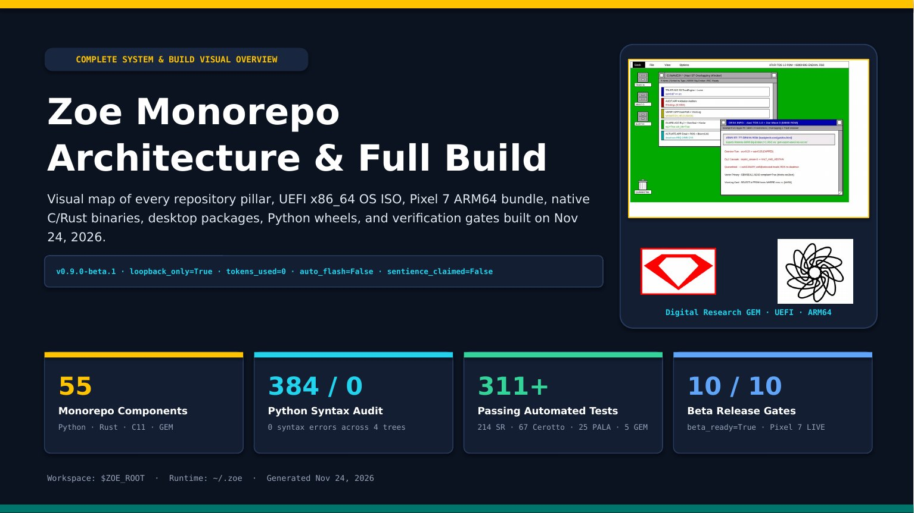

<strong>Slide 01 Extracted Text &amp; Key Points</strong>

- COMPLETE SYSTEM & BUILD VISUAL OVERVIEW
- Zoe Monorepo · Architecture & Full Build
- Visual map of every repository pillar, UEFI x86_64 OS ISO, Pixel 7 ARM64 bundle, native C/Rust binaries, desktop packages, Python wheels, and verification gates built on Nov 24, 2026.
- v0.9.0-beta.1 · loopback_only=True · tokens_used=0 · auto_flash=False · sentience_claimed=False
- Monorepo Components

---

### Slide 02 — Where Everything Lives: Storage, Services & Launchers

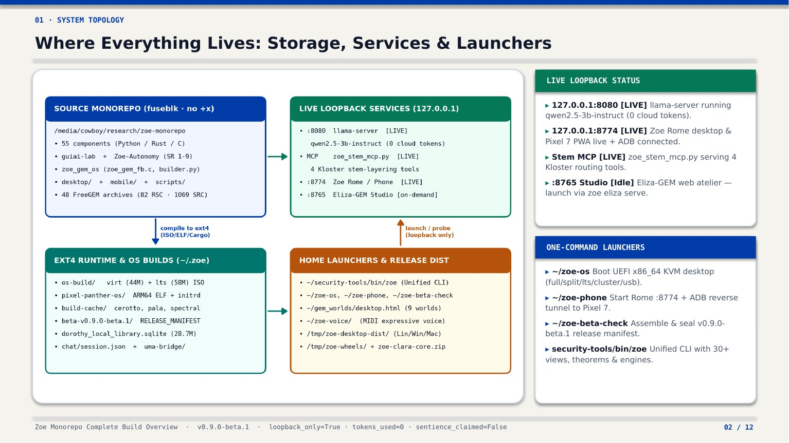

<strong>Slide 02 Extracted Text &amp; Key Points</strong>

- 01 · SYSTEM TOPOLOGY
- Zoe Monorepo Complete Build Overview  ·  v0.9.0-beta.1  ·  loopback_only=True · tokens_used=0 · sentience_claimed=False
- LIVE LOOPBACK STATUS
- ▸ 127.0.0.1:8080 [LIVE] llama-server running qwen2.5-3b-instruct (0 cloud tokens). · ▸ 127.0.0.1:8774 [LIVE] Zoe Rome desktop & Pixel 7 PWA live + ADB connected. · ▸ Stem MCP [LIVE] zoe_stem_mcp.py serving 4 Kloster routing tools. · ▸ :8765 Studio [Idle] Eliza-GEM web atelier — launch via zoe eliza serve.
- ONE-COMMAND LAUNCHERS

---

### Slide 03 — Every Built Artifact Verified Across OS, Mobile, Native & Python

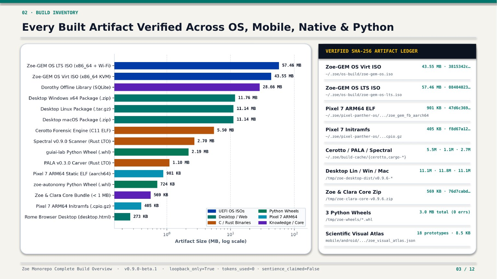

<strong>Slide 03 Extracted Text &amp; Key Points</strong>

- 02 · BUILD INVENTORY
- Zoe Monorepo Complete Build Overview  ·  v0.9.0-beta.1  ·  loopback_only=True · tokens_used=0 · sentience_claimed=False
- VERIFIED SHA-256 ARTIFACT LEDGER
- Zoe-GEM OS Virt ISO
- 43.55 MB · 3815342c…

---

### Slide 04 — All 55 Components Grouped Into Five Engineering Pillars

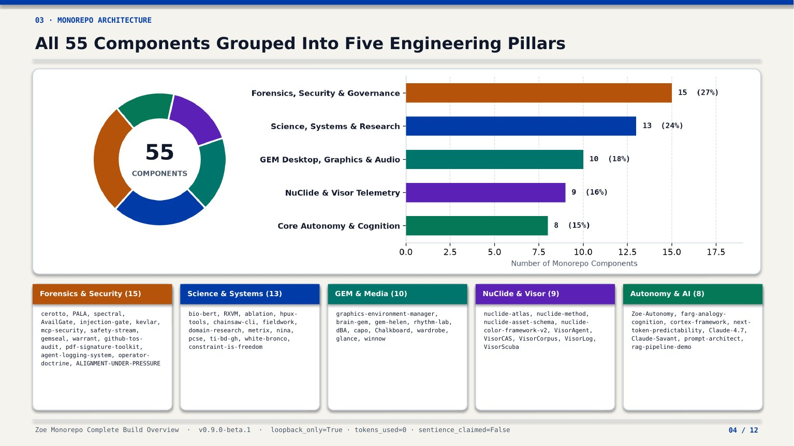

<strong>Slide 04 Extracted Text &amp; Key Points</strong>

- 03 · MONOREPO ARCHITECTURE
- Zoe Monorepo Complete Build Overview  ·  v0.9.0-beta.1  ·  loopback_only=True · tokens_used=0 · sentience_claimed=False
- Forensics & Security (15)
- cerotto, PALA, spectral, AvailGate, injection-gate, kevlar, mcp-security, safety-stream, gemseal, warrant, github-tos-audit, pdf-signature-toolkit, agent-logging-system, operator-doctrine, ALIGNMENT-UNDER-PRESSURE
- Science & Systems (13)

---

### Slide 05 — Zoe-GEM OS: Bootable UEFI x86_64 + Native /dev/fb0 Desktop

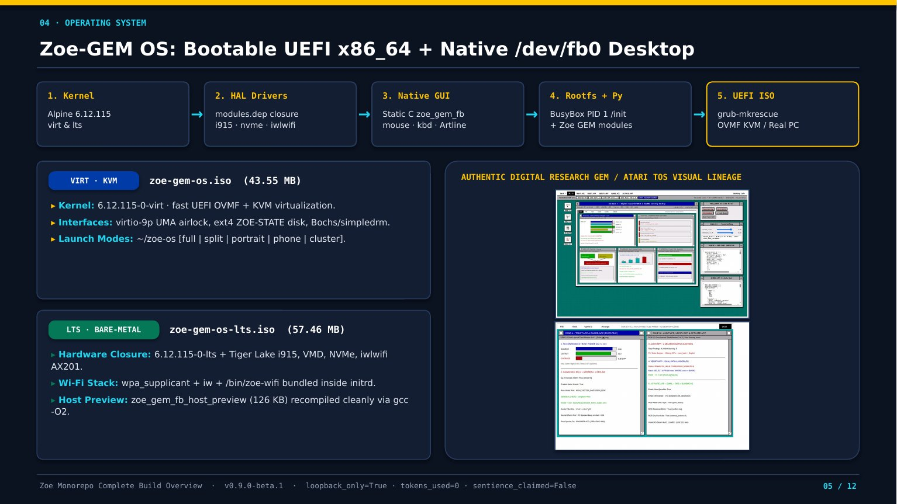

<strong>Slide 05 Extracted Text &amp; Key Points</strong>

- 04 · OPERATING SYSTEM
- Zoe Monorepo Complete Build Overview  ·  v0.9.0-beta.1  ·  loopback_only=True · tokens_used=0 · sentience_claimed=False
- Alpine 6.12.115 · virt & lts
- 2. HAL Drivers
- modules.dep closure · i915 · nvme · iwlwifi

---

### Slide 06 — Pixel 7 (panther · Tensor G2) Dual-Track Sovereign Phone OS

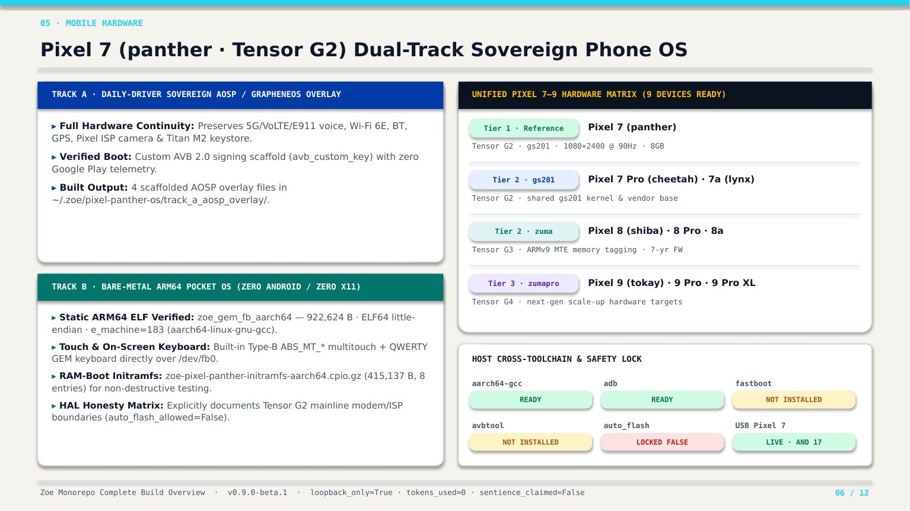

<strong>Slide 06 Extracted Text &amp; Key Points</strong>

- 05 · MOBILE HARDWARE
- Zoe Monorepo Complete Build Overview  ·  v0.9.0-beta.1  ·  loopback_only=True · tokens_used=0 · sentience_claimed=False
- TRACK A · DAILY-DRIVER SOVEREIGN AOSP / GRAPHENEOS OVERLAY
- ▸ Full Hardware Continuity: Preserves 5G/VoLTE/E911 voice, Wi-Fi 6E, BT, GPS, Pixel ISP camera & Titan M2 keystore. · ▸ Verified Boot: Custom AVB 2.0 signing scaffold (avb_custom_key) with zero Google Play telemetry. · ▸ Built Output: 4 scaffolded AOSP overlay files in ~/.zoe/pixel-panther-os/track_a_aosp_overlay/.
- TRACK B · BARE-METAL ARM64 POCKET OS (ZERO ANDROID / ZERO X11)

---

### Slide 07 — 9 Sisters GEM Worlds, Desktop Releases & Compact Bundles

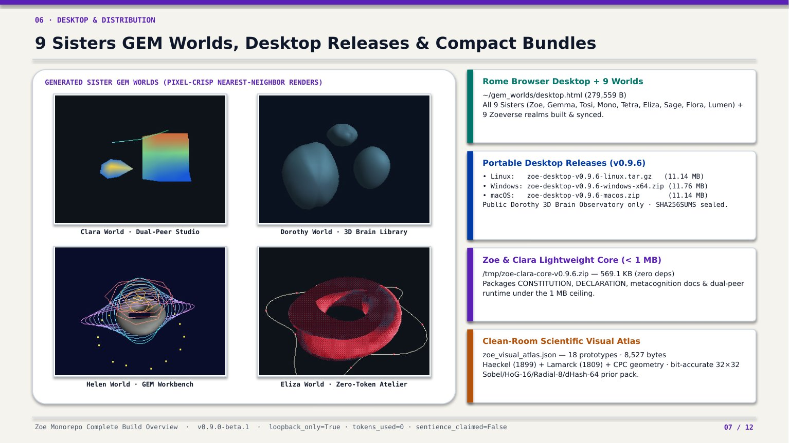

<strong>Slide 07 Extracted Text &amp; Key Points</strong>

- 06 · DESKTOP & DISTRIBUTION
- Zoe Monorepo Complete Build Overview  ·  v0.9.0-beta.1  ·  loopback_only=True · tokens_used=0 · sentience_claimed=False
- GENERATED SISTER GEM WORLDS (PIXEL-CRISP NEAREST-NEIGHBOR RENDERS)
- Clara World · Dual-Peer Studio
- Dorothy World · 3D Brain Library

---

### Slide 08 — 9 Shared-Reasoning Architectures × 5-Tier Stem-Layering

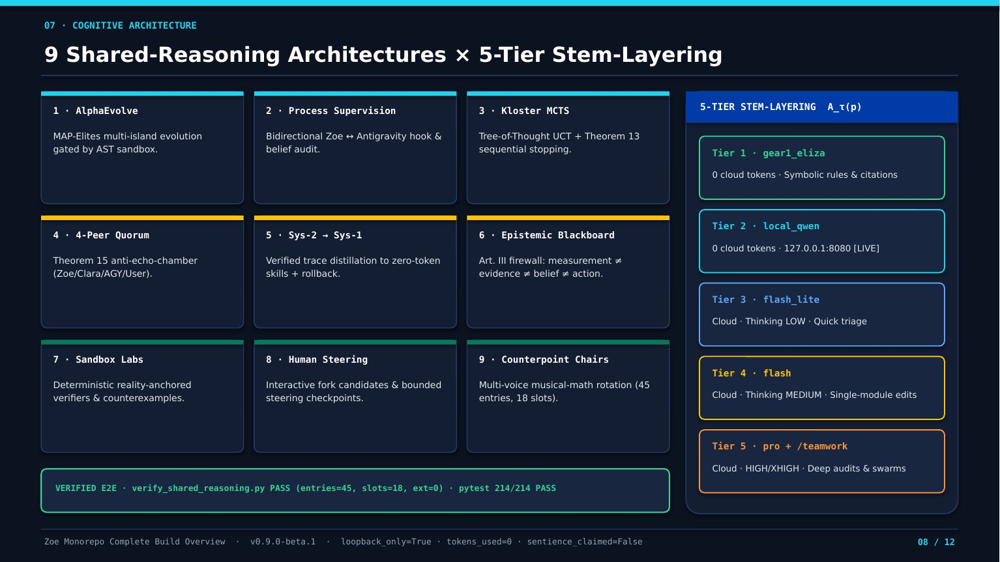

<strong>Slide 08 Extracted Text &amp; Key Points</strong>

- 07 · COGNITIVE ARCHITECTURE
- Zoe Monorepo Complete Build Overview  ·  v0.9.0-beta.1  ·  loopback_only=True · tokens_used=0 · sentience_claimed=False
- 1 · AlphaEvolve
- MAP-Elites multi-island evolution gated by AST sandbox.
- 2 · Process Supervision

---

### Slide 09 — Compiled C11 & Rust Release Engines Built on Ext4 Cache

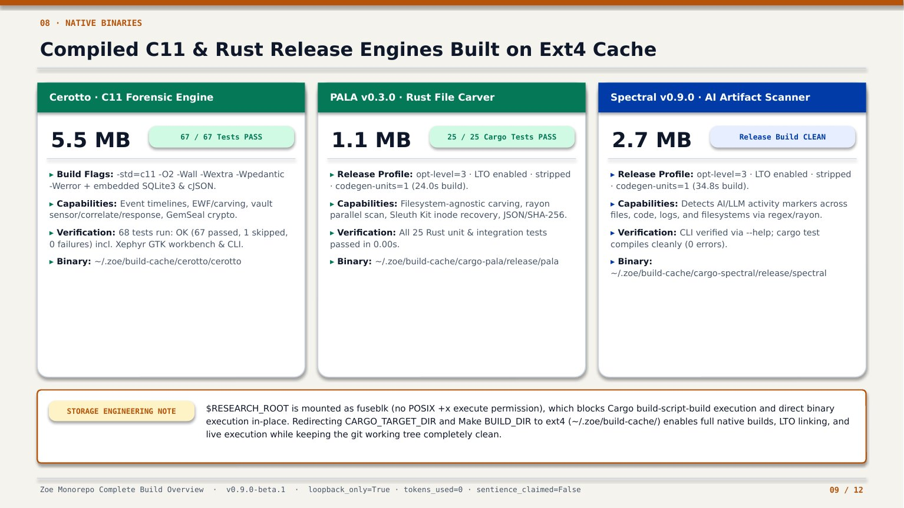

<strong>Slide 09 Extracted Text &amp; Key Points</strong>

- 08 · NATIVE BINARIES
- Zoe Monorepo Complete Build Overview  ·  v0.9.0-beta.1  ·  loopback_only=True · tokens_used=0 · sentience_claimed=False
- Cerotto · C11 Forensic Engine
- 67 / 67 Tests PASS
- ▸ Build Flags: -std=c11 -O2 -Wall -Wextra -Wpedantic -Werror + embedded SQLite3 & cJSON. · ▸ Capabilities: Event timelines, EWF/carving, vault sensor/correlate/response, GemSeal crypto. · ▸ Verification: 68 tests run: OK (67 passed, 1 skipped, 0 failures) incl. Xephyr GTK workbench & CLI. · ▸ Binary: ~/.zoe/build-cache/cerotto/cerotto

---

### Slide 10 — Automated Build, Syntax & Test Scorecard

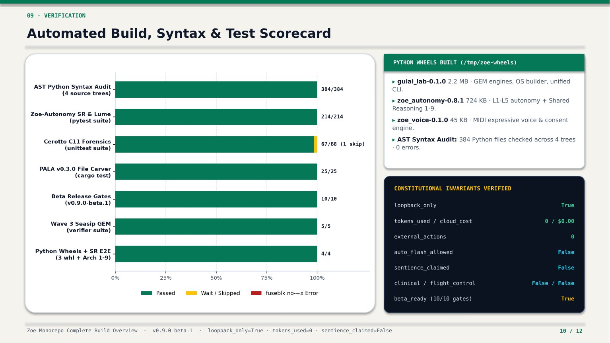

<strong>Slide 10 Extracted Text &amp; Key Points</strong>

- 09 · VERIFICATION
- Zoe Monorepo Complete Build Overview  ·  v0.9.0-beta.1  ·  loopback_only=True · tokens_used=0 · sentience_claimed=False
- PYTHON WHEELS BUILT (/tmp/zoe-wheels)
- ▸ guiai_lab-0.1.0 2.2 MB · GEM engines, OS builder, unified CLI. · ▸ zoe_autonomy-0.8.1 724 KB · L1-L5 autonomy + Shared Reasoning 1-9. · ▸ zoe_voice-0.1.0 45 KB · MIDI expressive voice & consent engine. · ▸ AST Syntax Audit: 384 Python files checked across 4 trees · 0 errors.
- CONSTITUTIONAL INVARIANTS VERIFIED

---

### Slide 11 — Beta Gate Status (v0.9.0-beta.1): 10/10 PASS · beta_ready=True

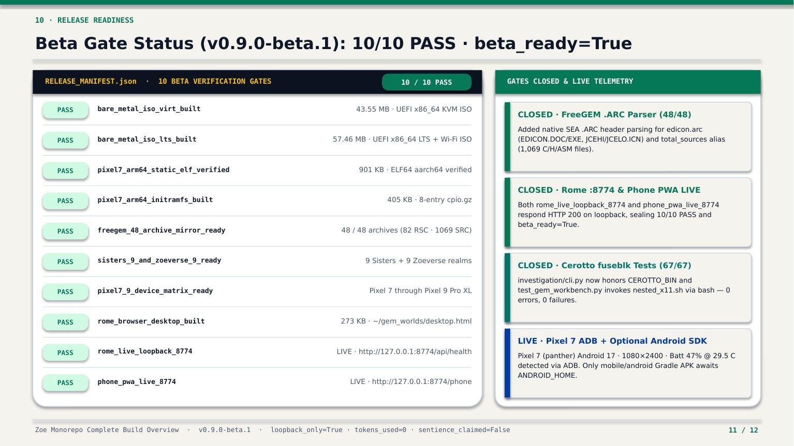

<strong>Slide 11 Extracted Text &amp; Key Points</strong>

- 10 · RELEASE READINESS
- Zoe Monorepo Complete Build Overview  ·  v0.9.0-beta.1  ·  loopback_only=True · tokens_used=0 · sentience_claimed=False
- RELEASE_MANIFEST.json  ·  10 BETA VERIFICATION GATES
- 10 / 10 PASS
- bare_metal_iso_virt_built

---

### Slide 12 — One-Command Launchers & Built Artifact Directory

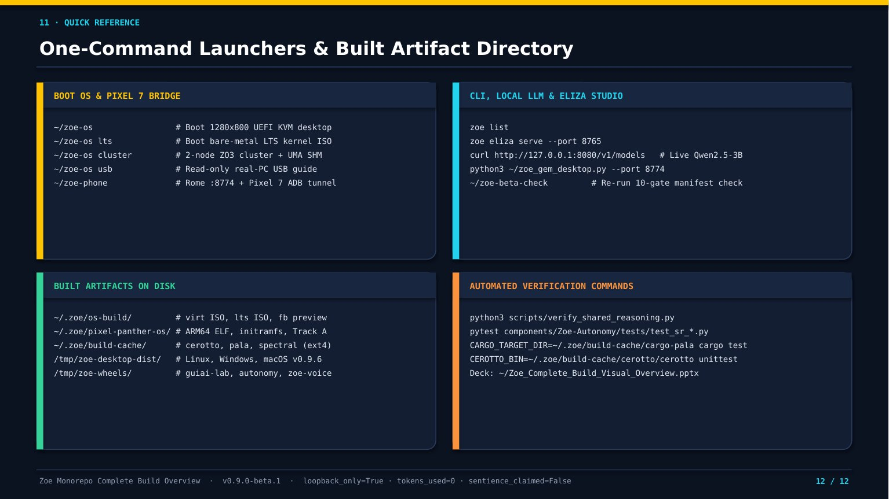

<strong>Slide 12 Extracted Text &amp; Key Points</strong>

- 11 · QUICK REFERENCE
- Zoe Monorepo Complete Build Overview  ·  v0.9.0-beta.1  ·  loopback_only=True · tokens_used=0 · sentience_claimed=False
- BOOT OS & PIXEL 7 BRIDGE
- ~/zoe-os                 # Boot 1280x800 UEFI KVM desktop · ~/zoe-os lts             # Boot bare-metal LTS kernel ISO · ~/zoe-os cluster         # 2-node ZO3 cluster + UMA SHM · ~/zoe-os usb             # Read-only real-PC USB guide · ~/zoe-phone              # Rome :8774 + Pixel 7 ADB tunnel
- CLI, LOCAL LLM & ELIZA STUDIO

---

[Back to All Presentations](../../README.md) · [Research Chronicle](../../../../docs/RESEARCH-CHRONICLE.md) · [Repository Home](../../../../README.md)
