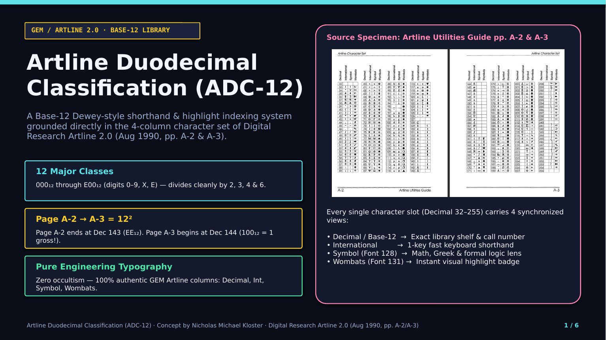
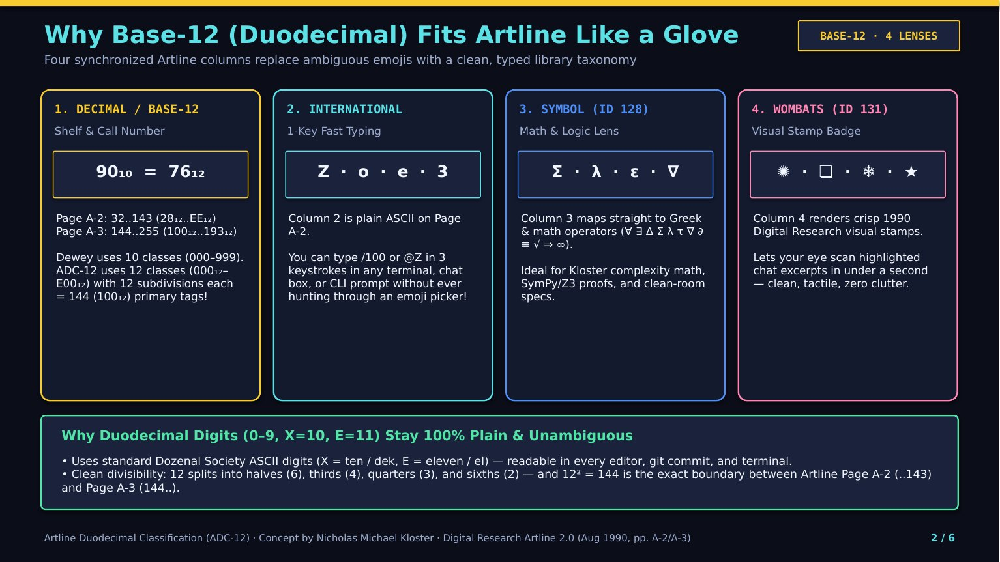
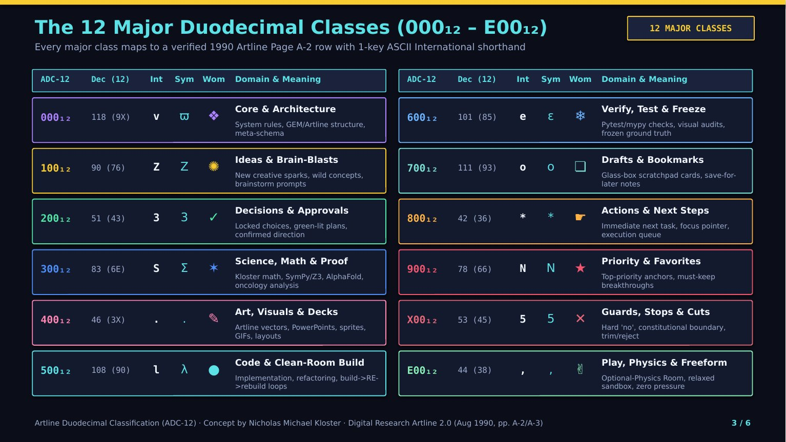
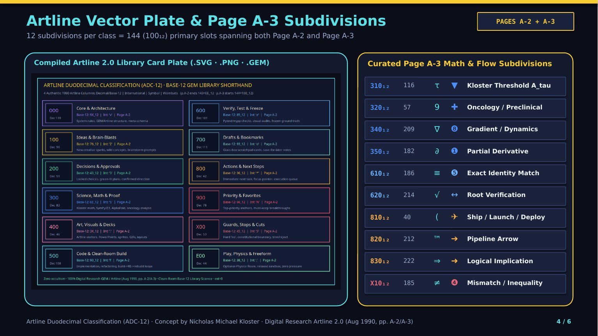
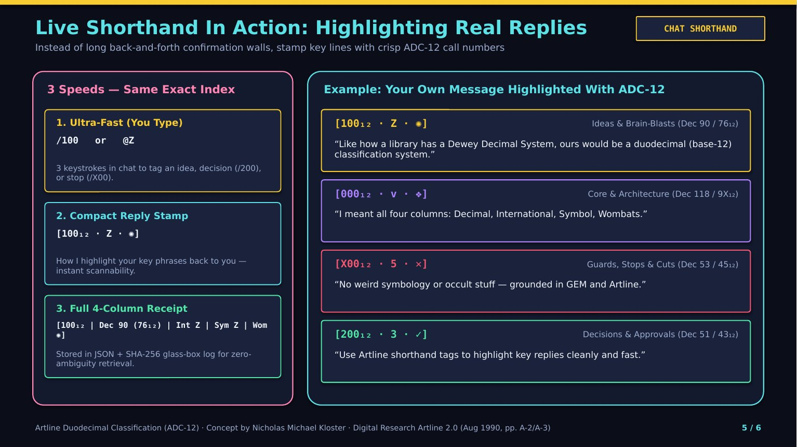
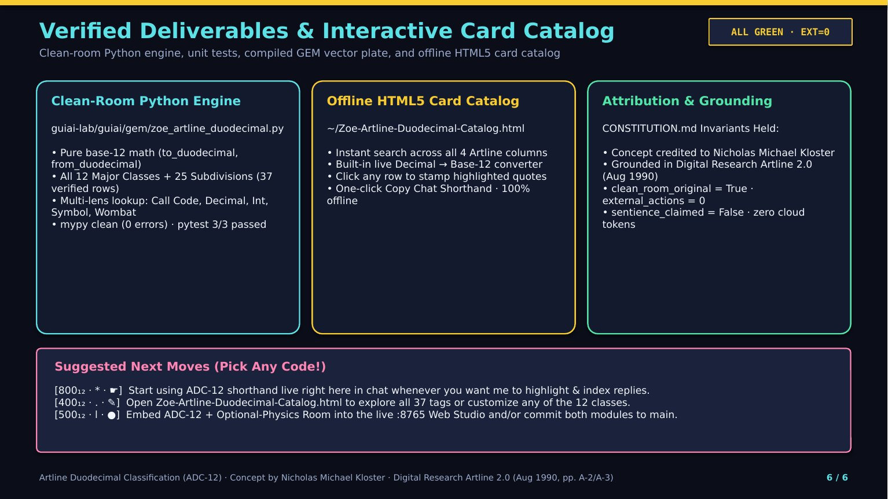

# Artline 2.0 Duodecimal (Base-12) Vector Classification System

**Category:** Art & Visual Design · **Date:** `2026-11-25` · **Slides:** `6` · **Size:** `0.87 MB`  
**Download PowerPoint:** [`08-artline-duodecimal-system.pptx`](../../decks/08-artline-duodecimal-system.pptx) · **SHA-256:** `ef10130ccf4afa4d...`  
**Navigation:** [All Research Presentations](../../README.md) · [Research Chronicle](../../../../docs/RESEARCH-CHRONICLE.md) · [Repository Home](../../../../README.md)

> Twelve major duodecimal classes (000_12 to E00_12) and 144 Page A-3 vector subdivisions mapping Digital Research Artline 2.0 pure-geometry plates onto a clean base-12 creative library.

*(Constitutional Scope: `operational_metacognition_verified = True`, `sentience_claimed = False`, `l5_agi_qualified = False`, `clinical_action_authorized = False`, `external_actions = 0`. Equation origin: **Nicholas Michael Kloster, March 6, 2026**.)*

---

## Visual Slide Gallery & Notes

### Slide 01 — Artline Duodecimal

<strong>Slide 01 Extracted Text &amp; Key Points</strong>

- GEM / ARTLINE 2.0 · BASE-12 LIBRARY
- Artline Duodecimal · Classification (ADC-12)
- A Base-12 Dewey-style shorthand & highlight indexing system grounded directly in the 4-column character set of Digital Research Artline 2.0 (Aug 1990, pp. A-2 & A-3).
- 12 Major Classes
- 000₁₂ through E00₁₂ (digits 0–9, X, E) — divides cleanly by 2, 3, 4 & 6.

---

### Slide 02 — Why Base-12 (Duodecimal) Fits Artline Like a Glove

<strong>Slide 02 Extracted Text &amp; Key Points</strong>

- Four synchronized Artline columns replace ambiguous emojis with a clean, typed library taxonomy
- BASE-12 · 4 LENSES
- 1. DECIMAL / BASE-12
- Shelf & Call Number
- 90₁₀  =  76₁₂

---

### Slide 03 — The 12 Major Duodecimal Classes (000₁₂ – E00₁₂)

<strong>Slide 03 Extracted Text &amp; Key Points</strong>

- Every major class maps to a verified 1990 Artline Page A-2 row with 1-key ASCII International shorthand
- 12 MAJOR CLASSES
- Domain & Meaning
- Core & Architecture
- System rules, GEM/Artline structure, meta-schema

---

### Slide 04 — Artline Vector Plate & Page A-3 Subdivisions

<strong>Slide 04 Extracted Text &amp; Key Points</strong>

- 12 subdivisions per class = 144 (100₁₂) primary slots spanning both Page A-2 and Page A-3
- PAGES A-2 + A-3
- Compiled Artline 2.0 Library Card Plate (.SVG · .PNG · .GEM)
- Curated Page A-3 Math & Flow Subdivisions
- Kloster Threshold A_tau

---

### Slide 05 — Live Shorthand In Action: Highlighting Real Replies

<strong>Slide 05 Extracted Text &amp; Key Points</strong>

- Instead of long back-and-forth confirmation walls, stamp key lines with crisp ADC-12 call numbers
- CHAT SHORTHAND
- 3 Speeds — Same Exact Index
- 1. Ultra-Fast (You Type)
- /100   or   @Z

---

### Slide 06 — Verified Deliverables & Interactive Card Catalog

<strong>Slide 06 Extracted Text &amp; Key Points</strong>

- Clean-room Python engine, unit tests, compiled GEM vector plate, and offline HTML5 card catalog
- ALL GREEN · EXT=0
- Clean-Room Python Engine
- guiai-lab/guiai/gem/zoe_artline_duodecimal.py · • Pure base-12 math (to_duodecimal, from_duodecimal) · • All 12 Major Classes + 25 Subdivisions (37 verified rows) · • Multi-lens lookup: Call Code, Decimal, Int, Symbol, Wombat · • mypy clean (0 errors) · pytest 3/3 passed
- Offline HTML5 Card Catalog

---

[Back to All Presentations](../../README.md) · [Research Chronicle](../../../../docs/RESEARCH-CHRONICLE.md) · [Repository Home](../../../../README.md)
