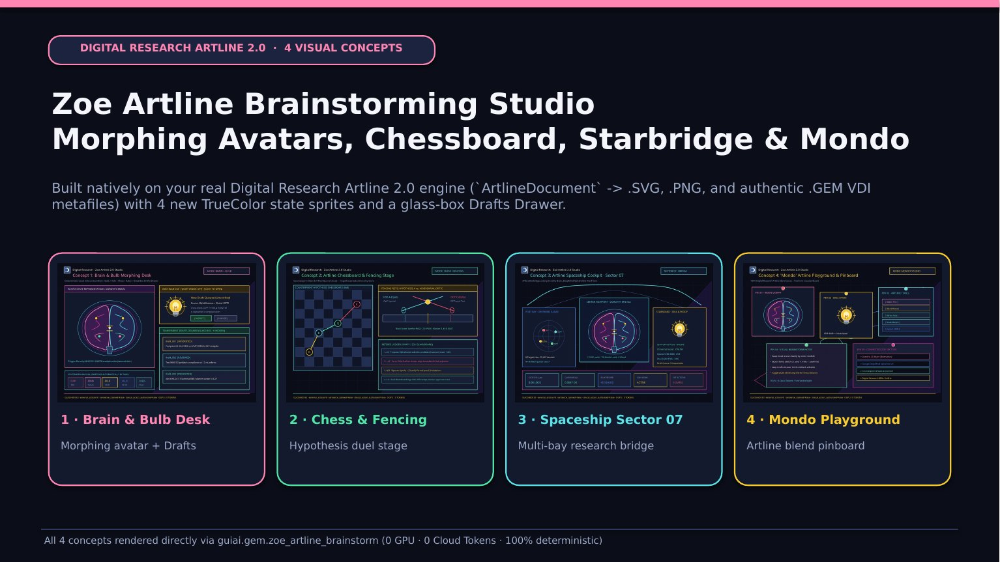
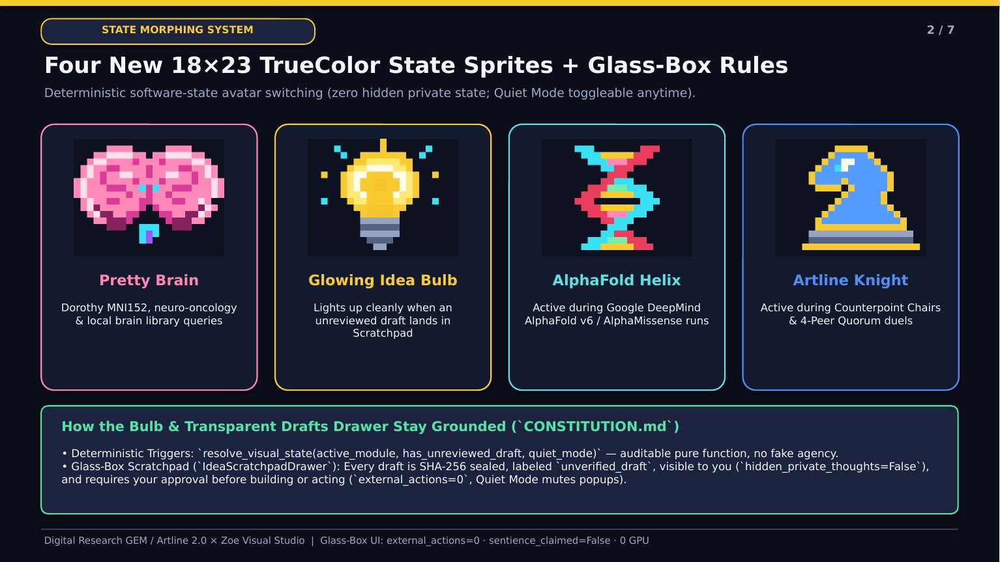
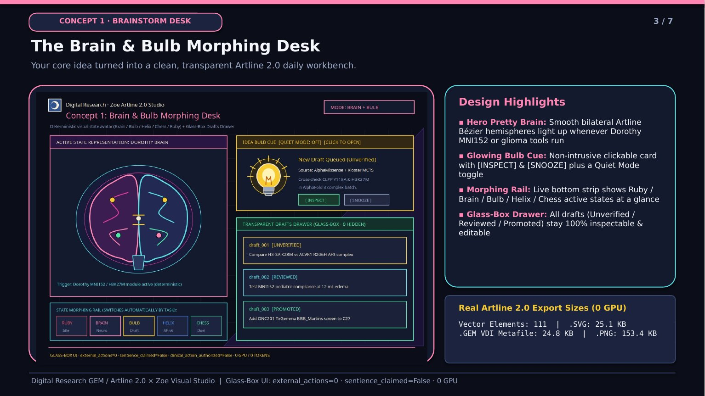
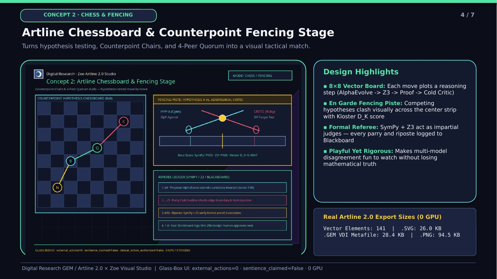
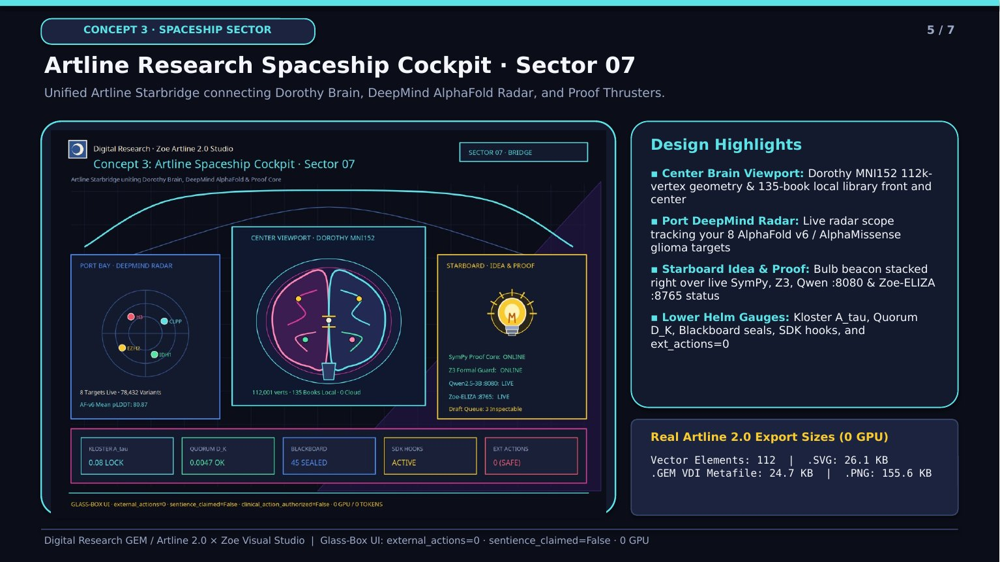
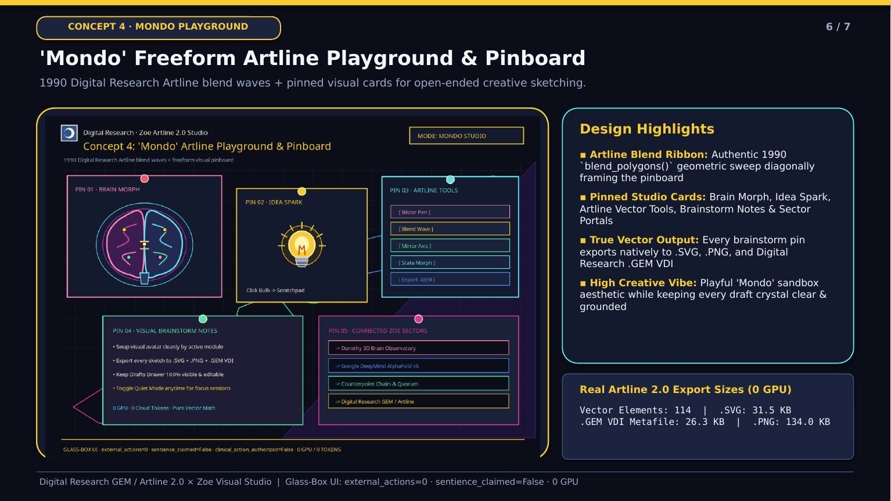
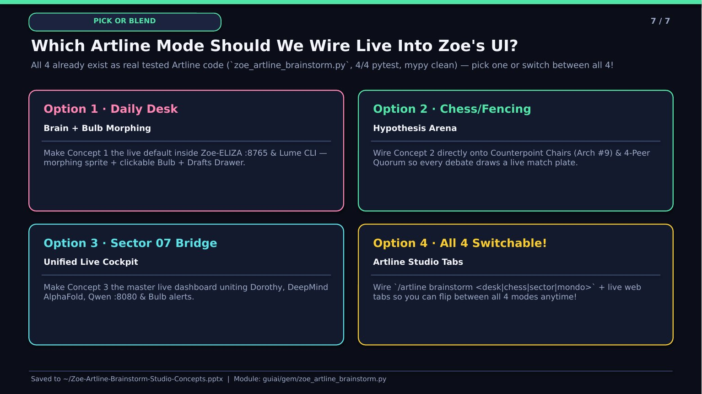

# Zoe Artline 2.0 Brainstorming Studio Visual Concepts

**Category:** Art & Visual Design · **Date:** `2026-11-25` · **Slides:** `7` · **Size:** `0.56 MB`  
**Download PowerPoint:** [`09-artline-brainstorm-studio.pptx`](../../decks/09-artline-brainstorm-studio.pptx) · **SHA-256:** `9ec900cc1d5980eb...`  
**Navigation:** [All Research Presentations](../../README.md) · [Research Chronicle](../../../../docs/RESEARCH-CHRONICLE.md) · [Repository Home](../../../../README.md)

> Four visual studio concepts (Brain & Bulb Morphing Desk, Artline Chessboard & Counterpoint Fencing Stage) paired with 18x23 TrueColor state-morphing sprites and Glass-Box visual rules.

*(Constitutional Scope: `operational_metacognition_verified = True`, `sentience_claimed = False`, `l5_agi_qualified = False`, `clinical_action_authorized = False`, `external_actions = 0`. Equation origin: **Nicholas Michael Kloster, March 6, 2026**.)*

---

## Visual Slide Gallery & Notes

### Slide 01 — Zoe Artline Brainstorming Studio

<strong>Slide 01 Extracted Text &amp; Key Points</strong>

- DIGITAL RESEARCH ARTLINE 2.0  ·  4 VISUAL CONCEPTS
- Zoe Artline Brainstorming Studio · Morphing Avatars, Chessboard, Starbridge & Mondo
- Built natively on your real Digital Research Artline 2.0 engine (`ArtlineDocument` -> .SVG, .PNG, and authentic .GEM VDI metafiles) with 4 new TrueColor state sprites and a glass-box Drafts Drawer.
- 1 · Brain & Bulb Desk
- Morphing avatar + Drafts

---

### Slide 02 — Four New 18×23 TrueColor State Sprites + Glass-Box Rules

<strong>Slide 02 Extracted Text &amp; Key Points</strong>

- STATE MORPHING SYSTEM
- Deterministic software-state avatar switching (zero hidden private state; Quiet Mode toggleable anytime).
- Pretty Brain
- Dorothy MNI152, neuro-oncology & local brain library queries
- Glowing Idea Bulb

---

### Slide 03 — The Brain & Bulb Morphing Desk

<strong>Slide 03 Extracted Text &amp; Key Points</strong>

- CONCEPT 1 · BRAINSTORM DESK
- Your core idea turned into a clean, transparent Artline 2.0 daily workbench.
- Design Highlights
- ▪ Hero Pretty Brain: Smooth bilateral Artline Bézier hemispheres light up whenever Dorothy MNI152 or glioma tools run · ▪ Glowing Bulb Cue: Non-intrusive clickable card with [INSPECT] & [SNOOZE] plus a Quiet Mode toggle · ▪ Morphing Rail: Live bottom strip shows Ruby / Brain / Bulb / Helix / Chess active states at a glance · ▪ Glass-Box Drawer: All drafts (Unverified / Reviewed / Promoted) stay 100% inspectable & edi
- Real Artline 2.0 Export Sizes (0 GPU)

---

### Slide 04 — Artline Chessboard & Counterpoint Fencing Stage

<strong>Slide 04 Extracted Text &amp; Key Points</strong>

- CONCEPT 2 · CHESS & FENCING
- Turns hypothesis testing, Counterpoint Chairs, and 4-Peer Quorum into a visual tactical match.
- Design Highlights
- ▪ 8×8 Vector Board: Each move plots a reasoning step (AlphaEvolve -> Z3 -> Proof -> Cold Critic) · ▪ En Garde Fencing Piste: Competing hypotheses clash visually across the center strip with Kloster D_K score · ▪ Formal Referee: SymPy + Z3 act as impartial judges — every parry and riposte logged to Blackboard · ▪ Playful Yet Rigorous: Makes multi-model disagreement fun to watch without losing mathematical truth
- Real Artline 2.0 Export Sizes (0 GPU)

---

### Slide 05 — Artline Research Spaceship Cockpit · Sector 07

<strong>Slide 05 Extracted Text &amp; Key Points</strong>

- CONCEPT 3 · SPACESHIP SECTOR
- Unified Artline Starbridge connecting Dorothy Brain, DeepMind AlphaFold Radar, and Proof Thrusters.
- Design Highlights
- ▪ Center Brain Viewport: Dorothy MNI152 112k-vertex geometry & 135-book local library front and center · ▪ Port DeepMind Radar: Live radar scope tracking your 8 AlphaFold v6 / AlphaMissense glioma targets · ▪ Starboard Idea & Proof: Bulb beacon stacked right over live SymPy, Z3, Qwen :8080 & Zoe-ELIZA :8765 status · ▪ Lower Helm Gauges: Kloster A_tau, Quorum D_K, Blackboard seals, SDK hooks, and ext_actions=0
- Real Artline 2.0 Export Sizes (0 GPU)

---

### Slide 06 — 'Mondo' Freeform Artline Playground & Pinboard

<strong>Slide 06 Extracted Text &amp; Key Points</strong>

- CONCEPT 4 · MONDO PLAYGROUND
- 1990 Digital Research Artline blend waves + pinned visual cards for open-ended creative sketching.
- Design Highlights
- ▪ Artline Blend Ribbon: Authentic 1990 `blend_polygons()` geometric sweep diagonally framing the pinboard · ▪ Pinned Studio Cards: Brain Morph, Idea Spark, Artline Vector Tools, Brainstorm Notes & Sector Portals · ▪ True Vector Output: Every brainstorm pin exports natively to .SVG, .PNG, and Digital Research .GEM VDI · ▪ High Creative Vibe: Playful 'Mondo' sandbox aesthetic while keeping every draft crystal clear & g
- Real Artline 2.0 Export Sizes (0 GPU)

---

### Slide 07 — Which Artline Mode Should We Wire Live Into Zoe's UI?

<strong>Slide 07 Extracted Text &amp; Key Points</strong>

- PICK OR BLEND
- All 4 already exist as real tested Artline code (`zoe_artline_brainstorm.py`, 4/4 pytest, mypy clean) — pick one or switch between all 4!
- Option 1 · Daily Desk
- Brain + Bulb Morphing
- Make Concept 1 the live default inside Zoe-ELIZA :8765 & Lume CLI — morphing sprite + clickable Bulb + Drafts Drawer.

---

[Back to All Presentations](../../README.md) · [Research Chronicle](../../../../docs/RESEARCH-CHRONICLE.md) · [Repository Home](../../../../README.md)
