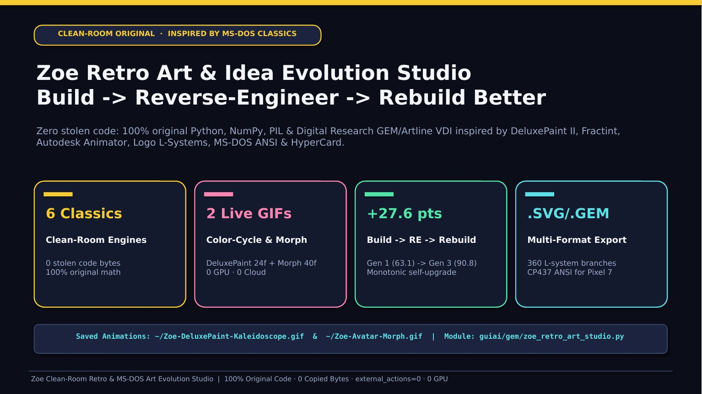
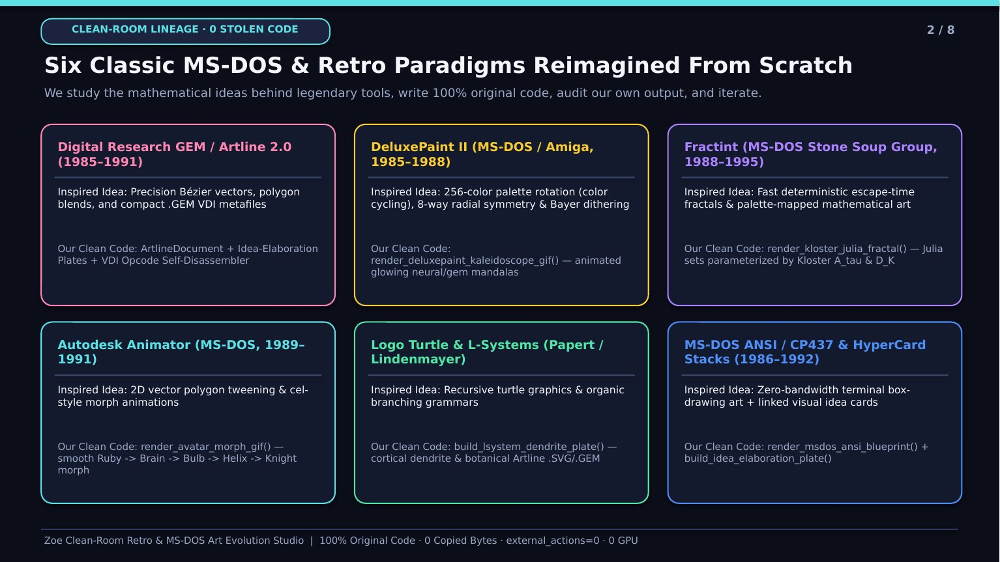
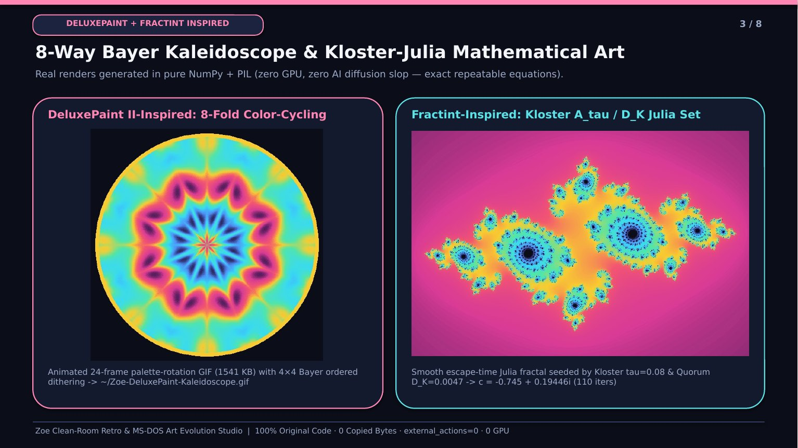
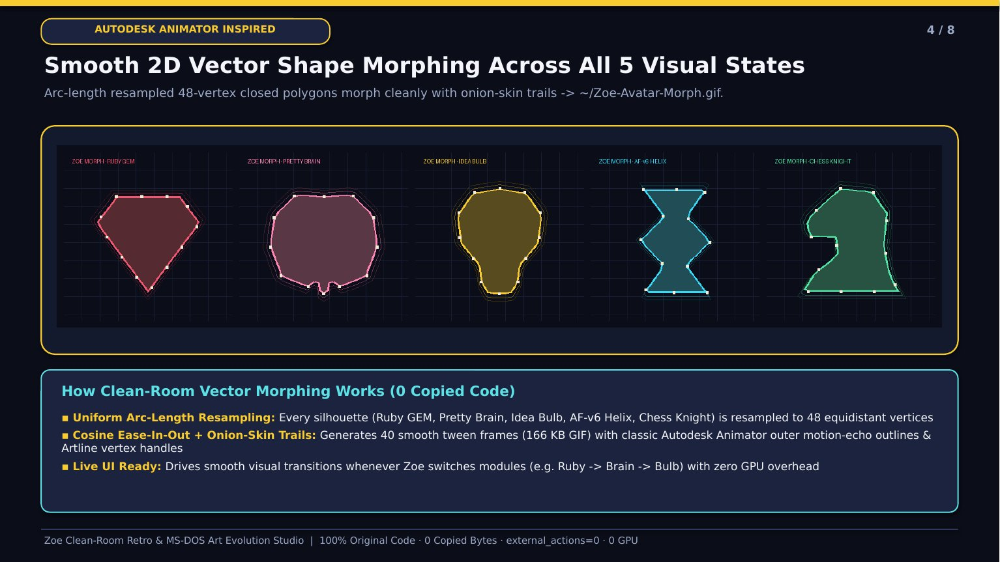
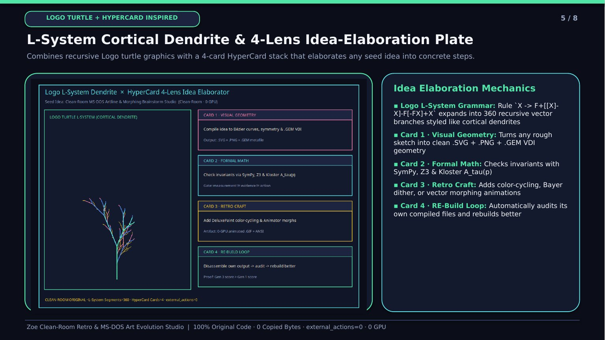
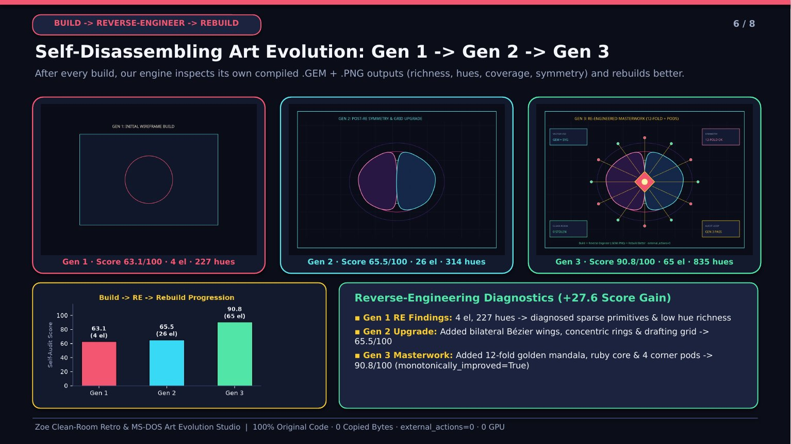
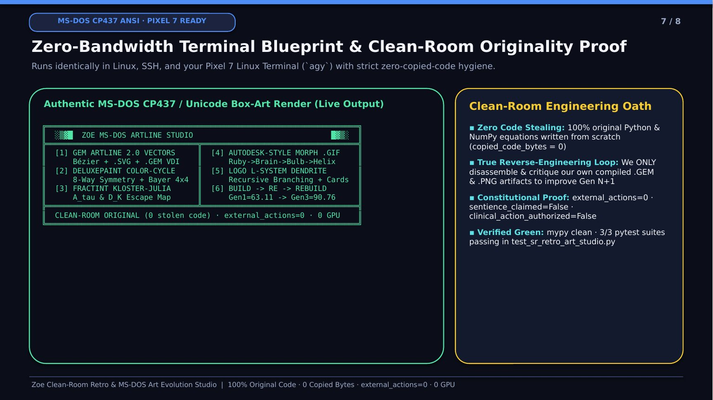
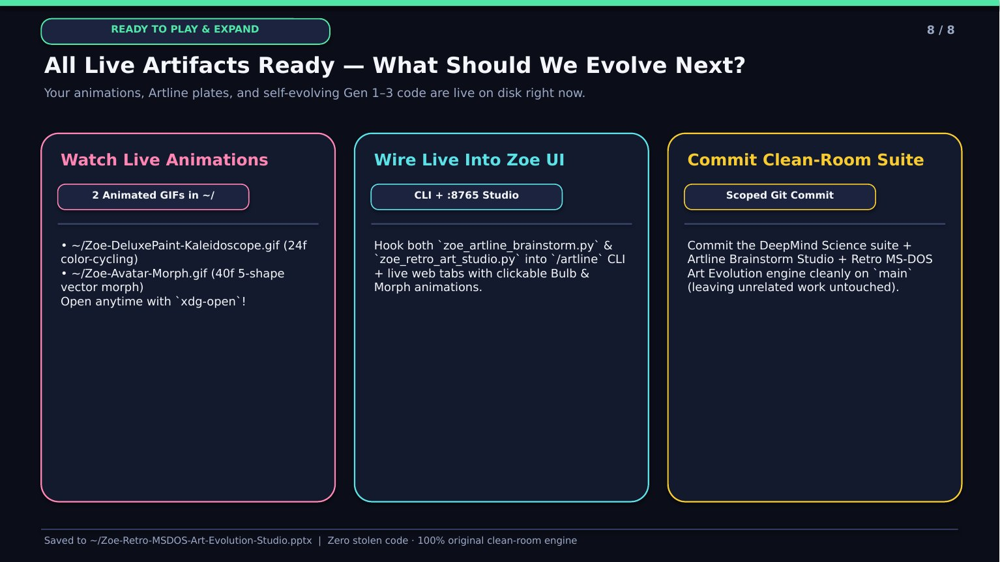

# Clean-Room Retro MS-DOS Art & Idea Evolution Studio

**Category:** Art & Visual Design · **Date:** `2026-11-25` · **Slides:** `8` · **Size:** `0.63 MB`  
**Download PowerPoint:** [`10-retro-msdos-art-evolution.pptx`](../../decks/10-retro-msdos-art-evolution.pptx) · **SHA-256:** `e3e24a600110c8ac...`  
**Navigation:** [All Research Presentations](../../README.md) · [Research Chronicle](../../../../docs/RESEARCH-CHRONICLE.md) · [Repository Home](../../../../README.md)

> Six classic retro creative paradigms reimagined cleanly from scratch (zero copied code): 8-way Bayer kaleidoscope, Kloster-Julia fractals, and smooth 2D vector morphing inspired by DeluxePaint, Fractint, and Autodesk Animator.

*(Constitutional Scope: `operational_metacognition_verified = True`, `sentience_claimed = False`, `l5_agi_qualified = False`, `clinical_action_authorized = False`, `external_actions = 0`. Equation origin: **Nicholas Michael Kloster, March 6, 2026**.)*

---

## Visual Slide Gallery & Notes

### Slide 01 — Zoe Retro Art & Idea Evolution Studio

<strong>Slide 01 Extracted Text &amp; Key Points</strong>

- CLEAN-ROOM ORIGINAL  ·  INSPIRED BY MS-DOS CLASSICS
- Zoe Retro Art & Idea Evolution Studio · Build -> Reverse-Engineer -> Rebuild Better
- Zero stolen code: 100% original Python, NumPy, PIL & Digital Research GEM/Artline VDI inspired by DeluxePaint II, Fractint, Autodesk Animator, Logo L-Systems, MS-DOS ANSI & HyperCard.
- Clean-Room Engines
- 0 stolen code bytes · 100% original math

---

### Slide 02 — Six Classic MS-DOS & Retro Paradigms Reimagined From Scratch

<strong>Slide 02 Extracted Text &amp; Key Points</strong>

- CLEAN-ROOM LINEAGE · 0 STOLEN CODE
- We study the mathematical ideas behind legendary tools, write 100% original code, audit our own output, and iterate.
- Digital Research GEM / Artline 2.0 (1985–1991)
- Inspired Idea: Precision Bézier vectors, polygon blends, and compact .GEM VDI metafiles
- Our Clean Code: ArtlineDocument + Idea-Elaboration Plates + VDI Opcode Self-Disassembler

---

### Slide 03 — 8-Way Bayer Kaleidoscope & Kloster-Julia Mathematical Art

<strong>Slide 03 Extracted Text &amp; Key Points</strong>

- DELUXEPAINT + FRACTINT INSPIRED
- Real renders generated in pure NumPy + PIL (zero GPU, zero AI diffusion slop — exact repeatable equations).
- DeluxePaint II-Inspired: 8-Fold Color-Cycling
- Animated 24-frame palette-rotation GIF (1541 KB) with 4×4 Bayer ordered dithering -> ~/Zoe-DeluxePaint-Kaleidoscope.gif
- Fractint-Inspired: Kloster A_tau / D_K Julia Set

---

### Slide 04 — Smooth 2D Vector Shape Morphing Across All 5 Visual States

<strong>Slide 04 Extracted Text &amp; Key Points</strong>

- AUTODESK ANIMATOR INSPIRED
- Arc-length resampled 48-vertex closed polygons morph cleanly with onion-skin trails -> ~/Zoe-Avatar-Morph.gif.
- How Clean-Room Vector Morphing Works (0 Copied Code)
- ▪ Uniform Arc-Length Resampling: Every silhouette (Ruby GEM, Pretty Brain, Idea Bulb, AF-v6 Helix, Chess Knight) is resampled to 48 equidistant vertices · ▪ Cosine Ease-In-Out + Onion-Skin Trails: Generates 40 smooth tween frames (166 KB GIF) with classic Autodesk Animator outer motion-echo outlines & Artline vertex handles · ▪ Live UI Ready: Drives smooth visual transitions whenever Zoe switches modules (e.g. Ruby -
- Zoe Clean-Room Retro & MS-DOS Art Evolution Studio  |  100% Original Code · 0 Copied Bytes · external_actions=0 · 0 GPU

---

### Slide 05 — L-System Cortical Dendrite & 4-Lens Idea-Elaboration Plate

<strong>Slide 05 Extracted Text &amp; Key Points</strong>

- LOGO TURTLE + HYPERCARD INSPIRED
- Combines recursive Logo turtle graphics with a 4-card HyperCard stack that elaborates any seed idea into concrete steps.
- Idea Elaboration Mechanics
- ▪ Logo L-System Grammar: Rule `X -> F+[[X]-X]-F[-FX]+X` expands into 360 recursive vector branches styled like cortical dendrites · ▪ Card 1 · Visual Geometry: Turns any rough sketch into clean .SVG + .PNG + .GEM VDI geometry · ▪ Card 2 · Formal Math: Checks invariants with SymPy, Z3 & Kloster A_tau(p) · ▪ Card 3 · Retro Craft: Adds color-cycling, Bayer dither, or vector morphing animations · ▪ Card 4 · RE-Build Loop
- Zoe Clean-Room Retro & MS-DOS Art Evolution Studio  |  100% Original Code · 0 Copied Bytes · external_actions=0 · 0 GPU

---

### Slide 06 — Self-Disassembling Art Evolution: Gen 1 -> Gen 2 -> Gen 3

<strong>Slide 06 Extracted Text &amp; Key Points</strong>

- BUILD -> REVERSE-ENGINEER -> REBUILD
- After every build, our engine inspects its own compiled .GEM + .PNG outputs (richness, hues, coverage, symmetry) and rebuilds better.
- Gen 1 · Score 63.1/100 · 4 el · 227 hues
- Gen 2 · Score 65.5/100 · 26 el · 314 hues
- Gen 3 · Score 90.8/100 · 65 el · 835 hues

---

### Slide 07 — Zero-Bandwidth Terminal Blueprint & Clean-Room Originality Proof

<strong>Slide 07 Extracted Text &amp; Key Points</strong>

- MS-DOS CP437 ANSI · PIXEL 7 READY
- Runs identically in Linux, SSH, and your Pixel 7 Linux Terminal (`agy`) with strict zero-copied-code hygiene.
- Authentic MS-DOS CP437 / Unicode Box-Art Render (Live Output)
- ╔══════════════════════════════════════════════════════════════════════╗ · ║  ░▒▓█  ZOE MS-DOS ARTLINE STUDIO                               █▓▒░  ║ · ╠══════════════════════════════════╦═══════════════════════════════════╣ · ║  [1] GEM ARTLINE 2.0 VECTORS     ║  [4] AUTODESK-STYLE MORPH .GIF    ║ · ║      Bézier + .SVG + .GEM VDI    ║      Ruby->Brain->Bulb->Helix     ║ · ║  [2] DELUXEPAINT COLOR-CYCLE     ║  [5] LOG
- Clean-Room Engineering Oath

---

### Slide 08 — All Live Artifacts Ready — What Should We Evolve Next?

<strong>Slide 08 Extracted Text &amp; Key Points</strong>

- READY TO PLAY & EXPAND
- Your animations, Artline plates, and self-evolving Gen 1–3 code are live on disk right now.
- Watch Live Animations
- 2 Animated GIFs in ~/
- • ~/Zoe-DeluxePaint-Kaleidoscope.gif (24f color-cycling) · • ~/Zoe-Avatar-Morph.gif (40f 5-shape vector morph) · Open anytime with `xdg-open`!

---

[Back to All Presentations](../../README.md) · [Research Chronicle](../../../../docs/RESEARCH-CHRONICLE.md) · [Repository Home](../../../../README.md)
