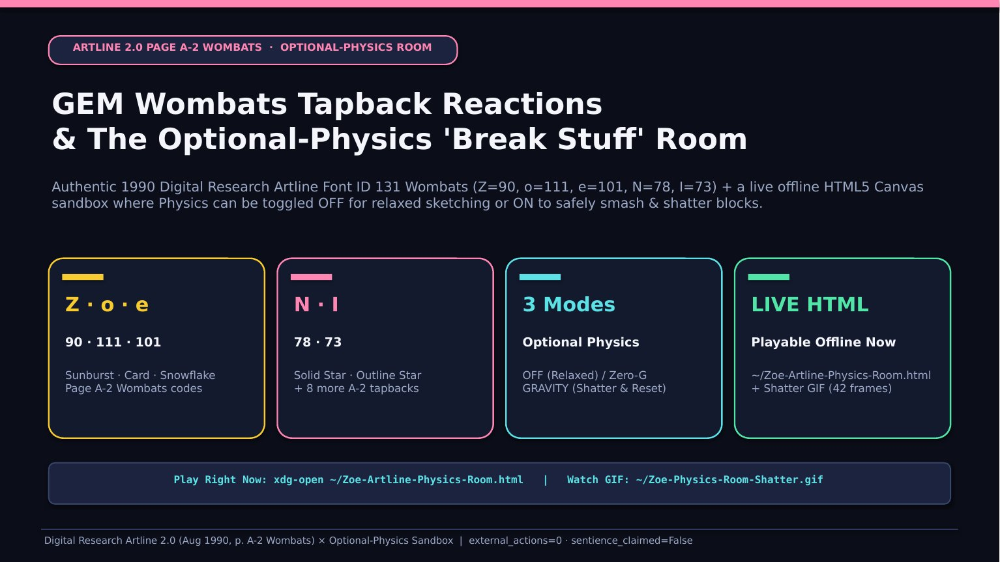
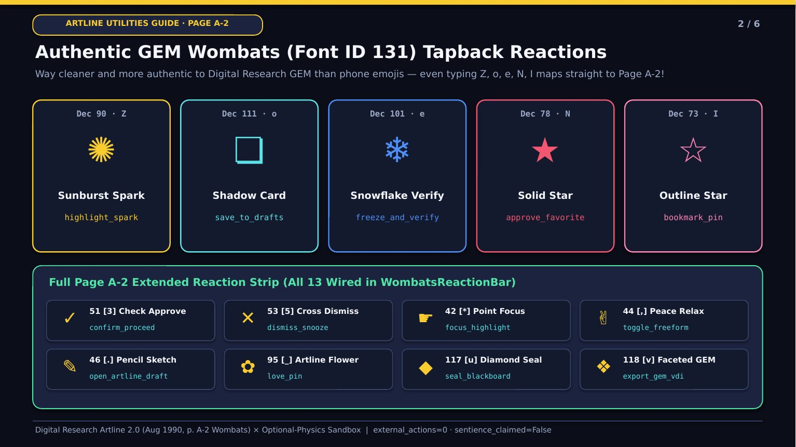
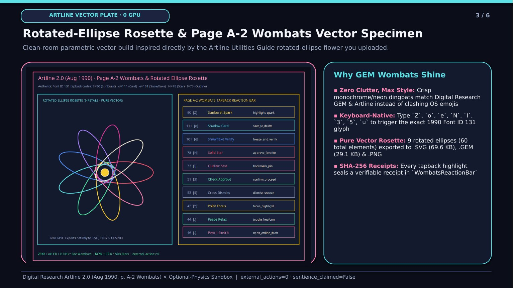
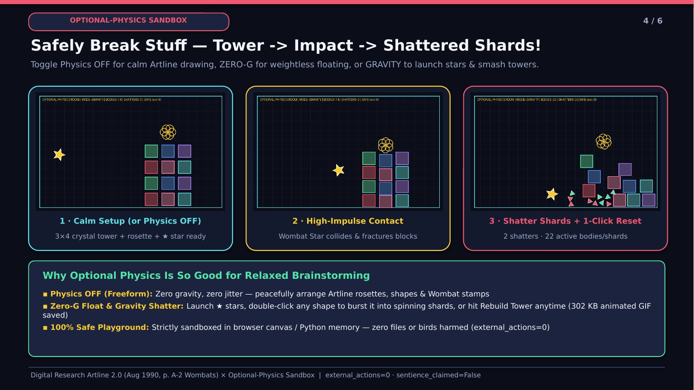
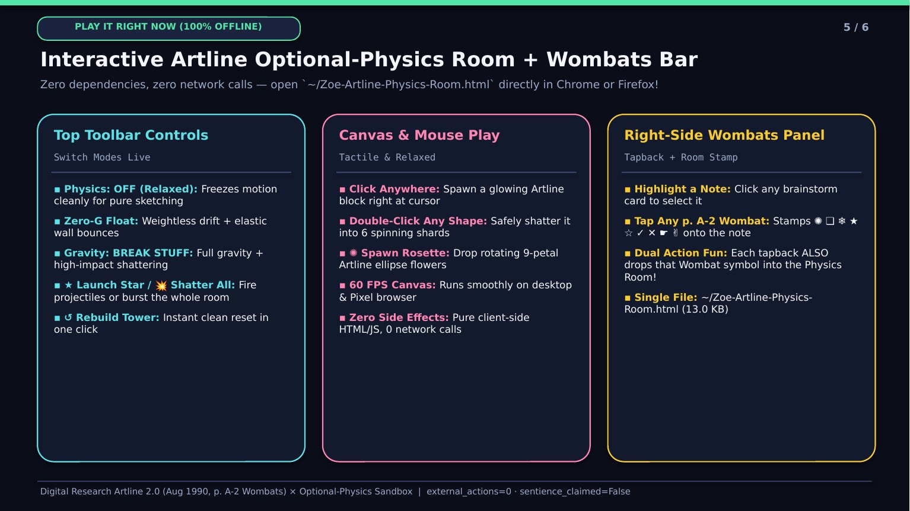
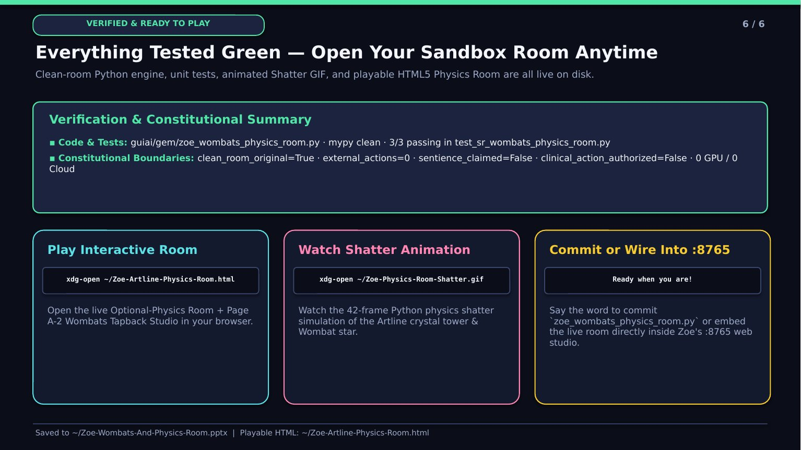

# Artline 2.0 Page A-2 GEM Wombats & Optional-Physics Sandbox

**Category:** Art & Visual Design · **Date:** `2026-11-25` · **Slides:** `6` · **Size:** `0.19 MB`  
**Download PowerPoint:** [`11-artline-wombats-physics-room.pptx`](../../decks/11-artline-wombats-physics-room.pptx) · **SHA-256:** `221d0fe953c4243d...`  
**Navigation:** [All Research Presentations](../../README.md) · [Research Chronicle](../../../../docs/RESEARCH-CHRONICLE.md) · [Repository Home](../../../../README.md)

> Authentic Digital Research Artline Utilities Guide Page A-2 GEM Wombats (Font ID 131) tapback reactions, rotated-ellipse rosette vector plates, and an offline optional-physics shatter sandbox.

*(Constitutional Scope: `operational_metacognition_verified = True`, `sentience_claimed = False`, `l5_agi_qualified = False`, `clinical_action_authorized = False`, `external_actions = 0`. Equation origin: **Nicholas Michael Kloster, March 6, 2026**.)*

---

## Visual Slide Gallery & Notes

### Slide 01 — GEM Wombats Tapback Reactions

<strong>Slide 01 Extracted Text &amp; Key Points</strong>

- ARTLINE 2.0 PAGE A-2 WOMBATS  ·  OPTIONAL-PHYSICS ROOM
- GEM Wombats Tapback Reactions · & The Optional-Physics 'Break Stuff' Room
- Authentic 1990 Digital Research Artline Font ID 131 Wombats (Z=90, o=111, e=101, N=78, I=73) + a live offline HTML5 Canvas sandbox where Physics can be toggled OFF for relaxed sketching or ON to safely smash & shatter blocks.
- 90 · 111 · 101
- Sunburst · Card · Snowflake · Page A-2 Wombats codes

---

### Slide 02 — Authentic GEM Wombats (Font ID 131) Tapback Reactions

<strong>Slide 02 Extracted Text &amp; Key Points</strong>

- ARTLINE UTILITIES GUIDE · PAGE A-2
- Way cleaner and more authentic to Digital Research GEM than phone emojis — even typing Z, o, e, N, I maps straight to Page A-2!
- Sunburst Spark
- highlight_spark
- Dec 111 · o

---

### Slide 03 — Rotated-Ellipse Rosette & Page A-2 Wombats Vector Specimen

<strong>Slide 03 Extracted Text &amp; Key Points</strong>

- ARTLINE VECTOR PLATE · 0 GPU
- Clean-room parametric vector build inspired directly by the Artline Utilities Guide rotated-ellipse flower you uploaded.
- Why GEM Wombats Shine
- ▪ Zero Clutter, Max Style: Crisp monochrome/neon dingbats match Digital Research GEM & Artline instead of clashing OS emojis · ▪ Keyboard-Native: Type `Z`, `o`, `e`, `N`, `I`, `3`, `5`, `u` to trigger the exact 1990 Font ID 131 glyph · ▪ Pure Vector Rosette: 9 rotated ellipses (60 total elements) exported to .SVG (69.6 KB), .GEM (29.1 KB) & .PNG · ▪ SHA-256 Receipts: Every tapback highlight seals a verifiable receipt
- Digital Research Artline 2.0 (Aug 1990, p. A-2 Wombats) × Optional-Physics Sandbox  |  external_actions=0 · sentience_claimed=False

---

### Slide 04 — Safely Break Stuff — Tower -> Impact -> Shattered Shards!

<strong>Slide 04 Extracted Text &amp; Key Points</strong>

- OPTIONAL-PHYSICS SANDBOX
- Toggle Physics OFF for calm Artline drawing, ZERO-G for weightless floating, or GRAVITY to launch stars & smash towers.
- 1 · Calm Setup (or Physics OFF)
- 3×4 crystal tower + rosette + ★ star ready
- 2 · High-Impulse Contact

---

### Slide 05 — Interactive Artline Optional-Physics Room + Wombats Bar

<strong>Slide 05 Extracted Text &amp; Key Points</strong>

- PLAY IT RIGHT NOW (100% OFFLINE)
- Zero dependencies, zero network calls — open `~/Zoe-Artline-Physics-Room.html` directly in Chrome or Firefox!
- Top Toolbar Controls
- Switch Modes Live
- ▪ Physics: OFF (Relaxed): Freezes motion cleanly for pure sketching · ▪ Zero-G Float: Weightless drift + elastic wall bounces · ▪ Gravity: BREAK STUFF: Full gravity + high-impact shattering · ▪ ★ Launch Star / 💥 Shatter All: Fire projectiles or burst the whole room · ▪ ↺ Rebuild Tower: Instant clean reset in one click

---

### Slide 06 — Everything Tested Green — Open Your Sandbox Room Anytime

<strong>Slide 06 Extracted Text &amp; Key Points</strong>

- VERIFIED & READY TO PLAY
- Clean-room Python engine, unit tests, animated Shatter GIF, and playable HTML5 Physics Room are all live on disk.
- Verification & Constitutional Summary
- ▪ Code & Tests: guiai/gem/zoe_wombats_physics_room.py · mypy clean · 3/3 passing in test_sr_wombats_physics_room.py · ▪ Constitutional Boundaries: clean_room_original=True · external_actions=0 · sentience_claimed=False · clinical_action_authorized=False · 0 GPU / 0 Cloud
- Play Interactive Room

---

[Back to All Presentations](../../README.md) · [Research Chronicle](../../../../docs/RESEARCH-CHRONICLE.md) · [Repository Home](../../../../README.md)
