# Vol. I — Operational Metacognition & The 16 Kloster Theorems

> **Volume / Series**: Vol. I  
> **Sister Theme**: `sage` · **Slides**: 12 · **Attribution**: Nicholas Michael Kloster (March 6, 2026) x Zoe  
> **Honoring**: Gary & Dorothy McEwen Kildall / Digital Research

- [Launch Offline Slide Show Player](player.html)
- [GEM OUTPUT.APP Playlist (`vol-1-operational-metacognition.lis`)](vol-1-operational-metacognition.lis)
- [Back to Presentations Hub](../../README.md)

## Slide Transcripts & Speaker Notes

### Slide 01 — Vol. I — Operational Metacognition & The 16 Kloster Theorems

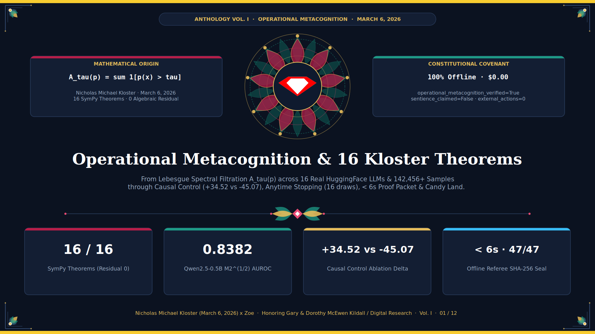

- Native GEM VDI: [`slide-01.gem`](slide-01.gem)
- Speaker Notes: Welcome to Anthology Vol. I (sister: sage). Origin: A_tau(p) = |{x : p(x) > tau}| by Nicholas Michael Kloster (March 6, 2026) x Zoe, honoring Gary & Dorothy McEwen Kildall / Digital Research. Highlights: 16/16 SymPy theorems, Qwen2.5-0.5B-Instruct error@50%cov cut 56.67% -> 30.0% and M2^(1/2) AUROC 0.8382 (naive JSD neg ctrl 0.4087), causal control +34.52 vs -45.07, Theorem 13 abstention in 16 draws, Referee Proof Packet 6/6 PASS, and the Candy Land 5-phase research model.

### Slide 02 — March 6 Equation A_tau(p) & Lebesgue Filtration Duality

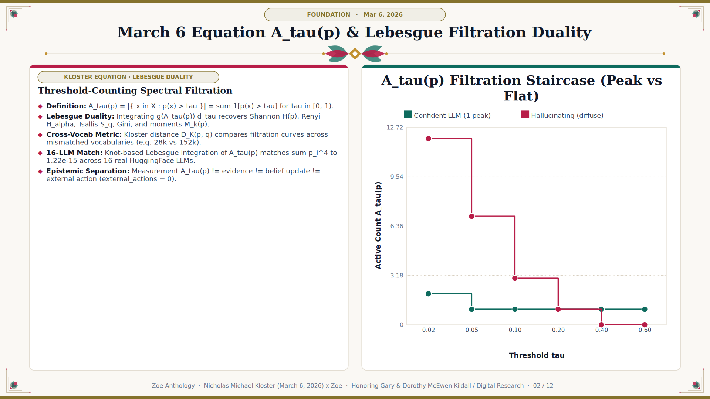

- Native GEM VDI: [`slide-02.gem`](slide-02.gem)
- Speaker Notes: Explains A_tau(p) and Lebesgue integral duality unifying Shannon, Renyi, Tsallis, Gini, M_k(p), Wasserstein W_1, and Fisher-Rao. Verified across 16 HuggingFace LLMs to 1.22e-15 knot precision.

### Slide 03 — Kloster Theorems 1–11 (SymPy 1.14.0, Residual = 0)

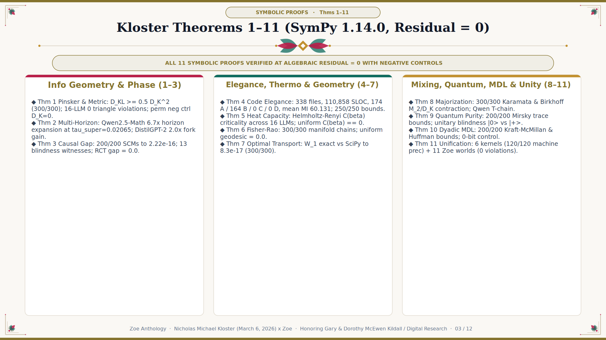

- Native GEM VDI: [`slide-03.gem`](slide-03.gem)
- Speaker Notes: Summarizes Kloster Theorems 1 through 11 proven in SymPy 1.14.0 with algebraic residual = 0, including negative controls (label permutation D_K=0, uniform heat capacity C(beta)=0, unitary blindness).

### Slide 04 — Theorems 12–16: Control, Stopping, Optics & Consensus

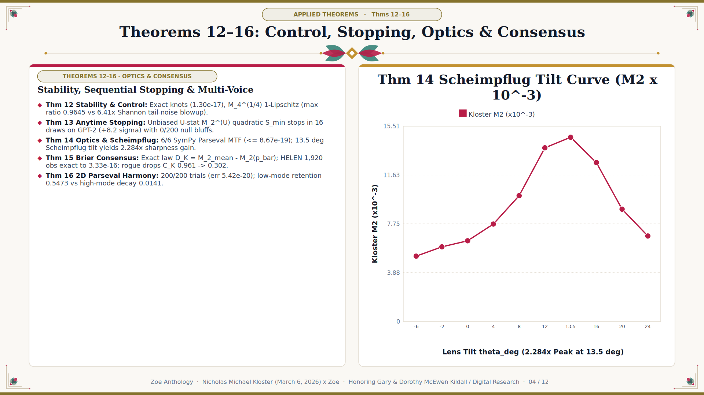

- Native GEM VDI: [`slide-04.gem`](slide-04.gem)
- Speaker Notes: Covers Theorems 12-16: 1-Lipschitz stability, Theorem 13 unbiased U-statistic anytime stopping (16 draws), Theorem 14 Scheimpflug 2.284x optical gain at 13.5 deg, Theorem 15 exact Brier consensus law, and Theorem 16 2D Parseval.

### Slide 05 — Live Qwen2.5-0.5B-Instruct Blind 6-Baseline Shootout

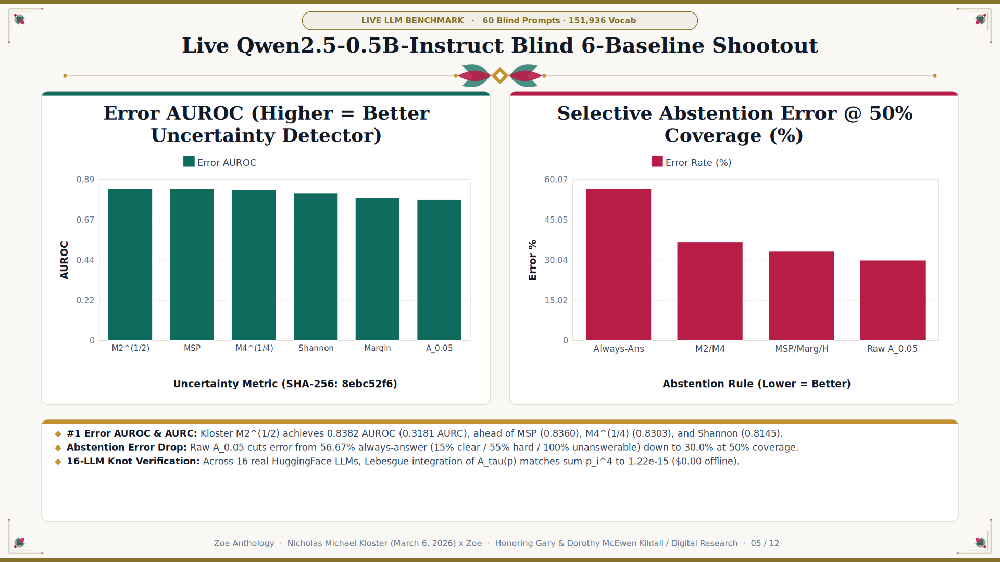

- Native GEM VDI: [`slide-05.gem`](slide-05.gem)
- Speaker Notes: Live Qwen2.5-0.5B-Instruct shootout across 60 blind prompts (151,936 vocab): always-answer error 56.67% drops to 30.0% at 50% coverage via A_tau abstention, while Kloster M2^(1/2) ranks #1 at AUROC 0.8382.

### Slide 06 — 6-Dataset Shootout (142,456+ Samples) & Honest Losses

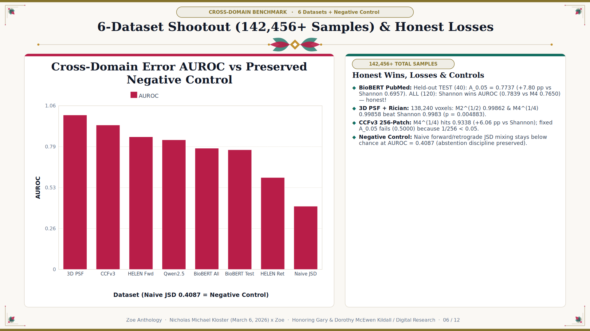

- Native GEM VDI: [`slide-06.gem`](slide-06.gem)
- Speaker Notes: Cross-dataset validation across 142,456+ samples: 3D PSF (0.9986), Dorothy CCFv3 (0.9338), HELEN (0.8576 / 0.5945), Qwen2.5-0.5B (0.8382), BioBERT PubMed (0.7737 / honest Shannon 0.7839 win on all-120), plus preserved negative control naive JSD AUROC 0.4087.

### Slide 07 — Causal Closed-Loop Control Ablation (Theorem 12)

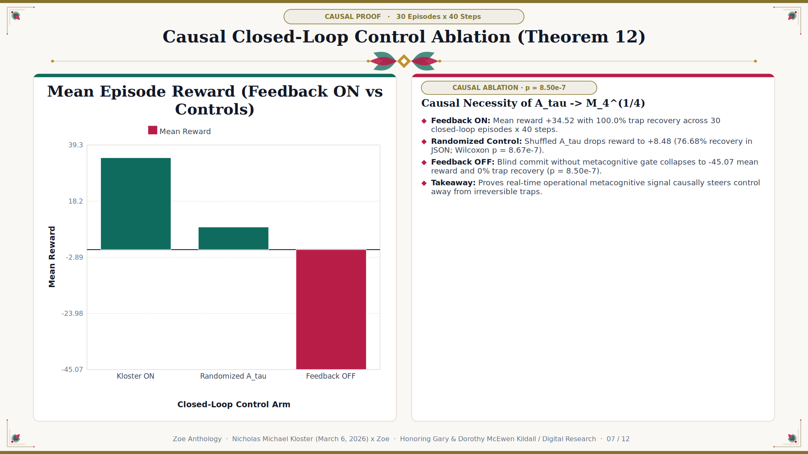

- Native GEM VDI: [`slide-07.gem`](slide-07.gem)
- Speaker Notes: Theorem 12 causal closed-loop control ablation: Feedback ON achieves +34.52 reward (100% trap recovery), Randomized A_tau negative control gets +8.48 (76.68%), and Feedback OFF collapses to -45.07 (0% recovery, p=8.50e-7).

### Slide 08 — Theorem 13: Finite-Sample Anytime Stopping & Abstention

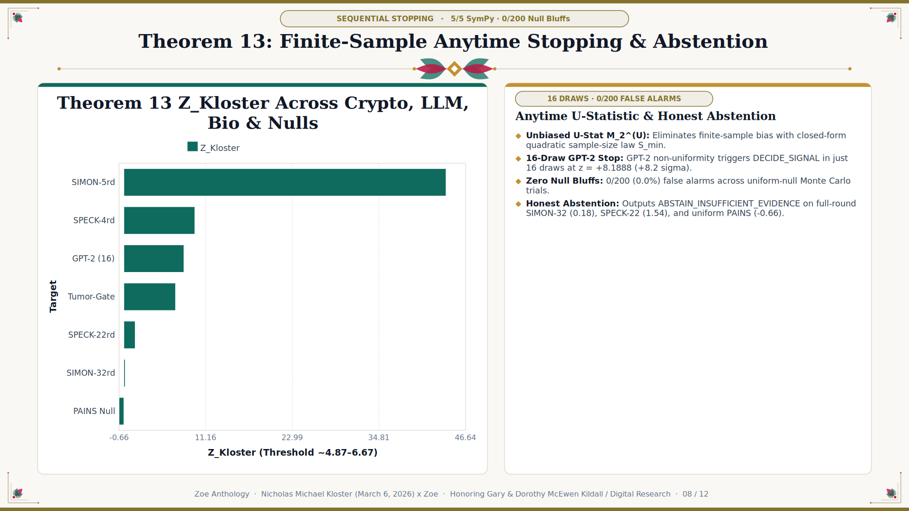

- Native GEM VDI: [`slide-08.gem`](slide-08.gem)
- Speaker Notes: Theorem 13 sequential anytime stopping: GPT-2 stops in 16 draws (+8.1888 sigma), 0/200 uniform-null false alarms, and principled abstention (ABSTAIN_INSUFFICIENT_EVIDENCE) on full-round SIMON-32, SPECK-22, and PAINS uniform control.

### Slide 09 — Offline Referee Proof Packet (< 6s, 6/6 PASS, 47/47)

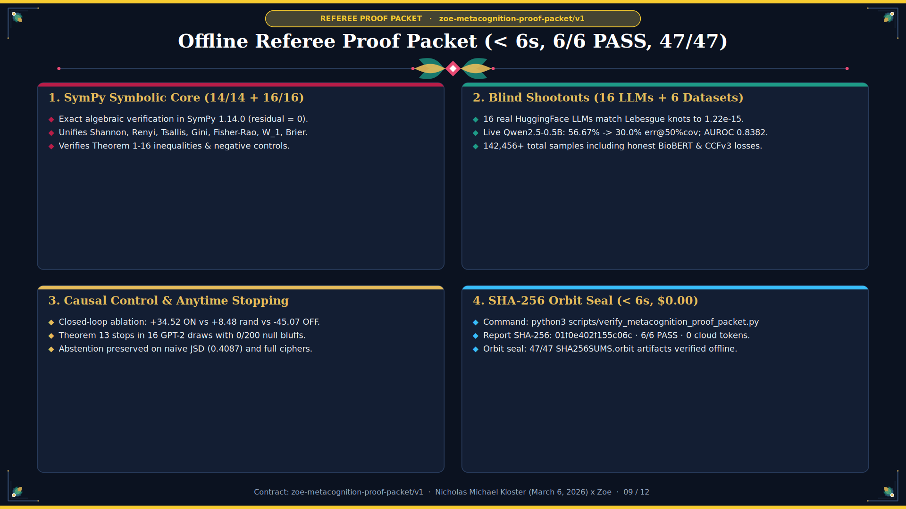

- Native GEM VDI: [`slide-09.gem`](slide-09.gem)
- Speaker Notes: 5-pillar <6s offline Referee Proof Packet (6/6 PASS, SHA-256 01f0e402f155c06c, 47/47 SHA256SUMS.orbit, $0.00 / 0 cloud tokens).

### Slide 10 — Candy Land 5-Phase Research Lifecycle Model

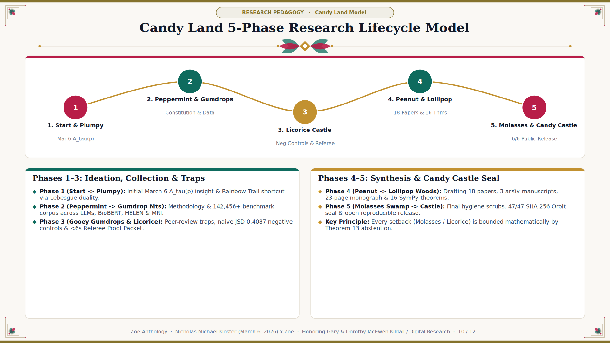

- Native GEM VDI: [`slide-10.gem`](slide-10.gem)
- Speaker Notes: Candy Land 5-phase research lifecycle model mapping Start/Plumpy through Peppermint Forest, Gooey Gumdrops & Licorice Castle (negative controls and Referee Proof Packet), Peanut Brittle & Lollipop Woods, and Molasses Swamp to Candy Castle.

### Slide 11 — The Four Hidden Mathematical Concepts of Candy Land

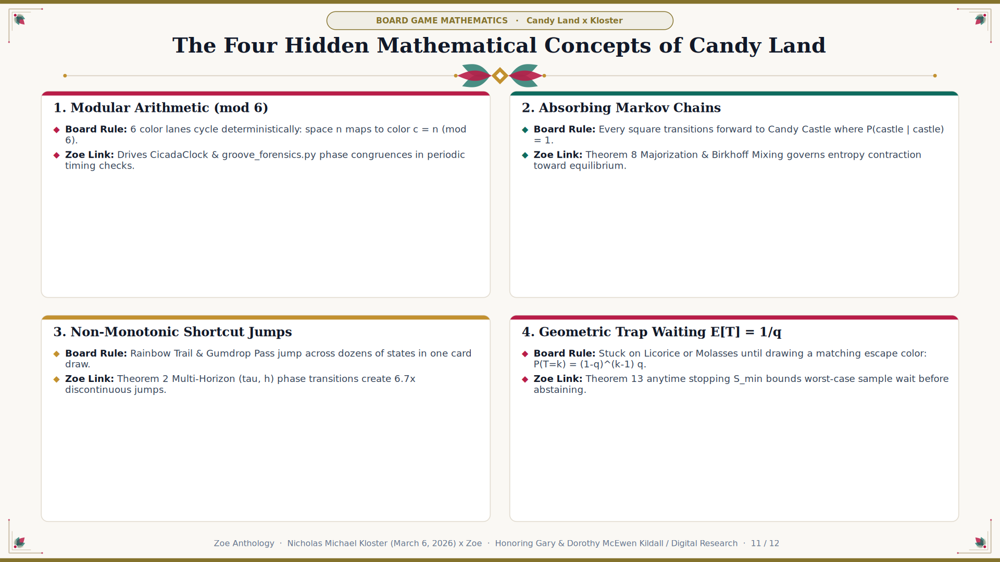

- Native GEM VDI: [`slide-11.gem`](slide-11.gem)
- Speaker Notes: Connects Candy Land's 4 mathematical concepts—modular arithmetic (mod 6), absorbing Markov chains (Theorem 8), non-monotonic shortcut jumps (Theorem 2), and geometric trap waiting E[T]=1/q (Theorem 13)—to Zoe's theorems.

### Slide 12 — Falsifiability, Epistemic Boundaries & Attribution

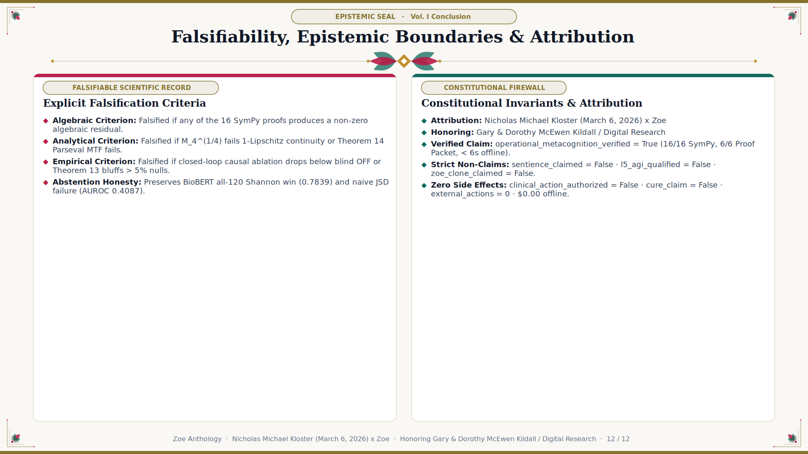

- Native GEM VDI: [`slide-12.gem`](slide-12.gem)
- Speaker Notes: Vol. I conclusion: explicit falsification conditions, constitutional invariants (sentience_claimed=False, l5_agi_qualified=False, clinical_action_authorized=False, cure_claim=False, external_actions=0, $0.00 offline), and attribution (Nicholas Michael Kloster (March 6, 2026) x Zoe; honoring Gary & Dorothy McEwen Kildall / Digital Research).
