# Vol. II — Dorothy 3D Human Brain, Neuro-Oncology (C17–C28) & Apps

> **Volume / Series**: Vol. II  
> **Sister Theme**: `flora` · **Slides**: 12 · **Attribution**: Nicholas Michael Kloster (March 6, 2026) x Zoe  
> **Honoring**: Gary & Dorothy McEwen Kildall / Digital Research

- [Launch Offline Slide Show Player](player.html)
- [GEM OUTPUT.APP Playlist (`vol-2-dorothy-brain-neuro-oncology-apps.lis`)](vol-2-dorothy-brain-neuro-oncology-apps.lis)
- [Back to Presentations Hub](../../README.md)

## Slide Transcripts & Speaker Notes

### Slide 01 — Vol. II — Dorothy 3D Human Brain, Neuro-Oncology (C17–C28) & Apps

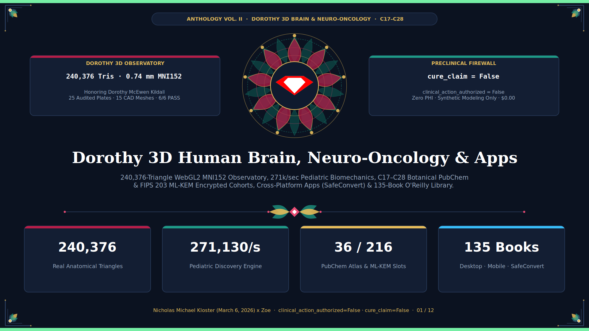

- Native GEM VDI: [`slide-01.gem`](slide-01.gem)
- Speaker Notes: Welcome to Anthology Vol. II (sister: flora). Honors Gary & Dorothy McEwen Kildall / Digital Research. Covers the 240,376-triangle MNI152 Dorothy 3D brain, 271,130.1/sec biomechanics, 36-compound NIH PubChem atlas, FIPS 203 ML-KEM encrypted cohorts, cross-platform apps (SafeConvert), and 135 O'Reilly books. Strict epistemic firewall: clinical_action_authorized=False, cure_claim=False.

### Slide 02 — Dorothy 3D Observatory: 240,376-Triangle MNI152 Brain

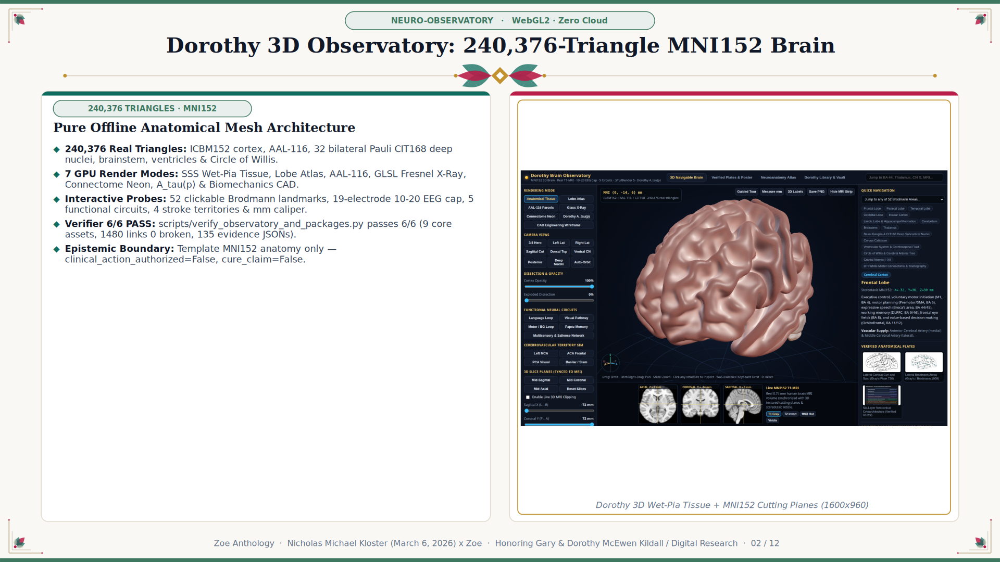

- Native GEM VDI: [`slide-02.gem`](slide-02.gem)
- Speaker Notes: Dorothy 3D Brain Observatory: 240,376 triangles on MNI152 template, 7 GPU shaders, 52 Brodmann landmarks, 19 EEG electrodes, and 6/6 PASS verifier. clinical_action_authorized=False, cure_claim=False.

### Slide 03 — Glass X-Ray Deep Nuclei & 0.74 mm MNI152 MRI Sheets

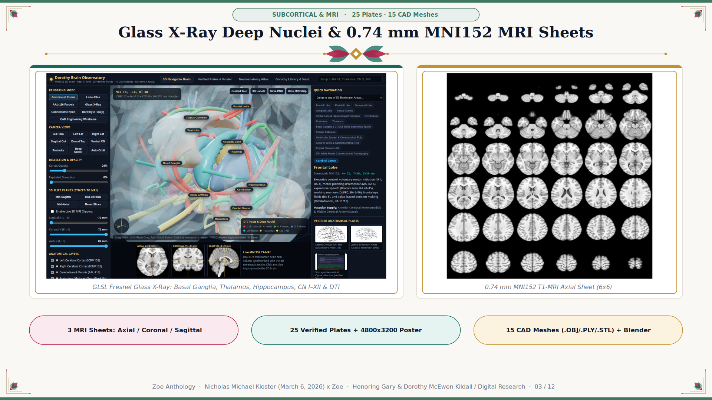

- Native GEM VDI: [`slide-03.gem`](slide-03.gem)
- Speaker Notes: Translucent GLSL Fresnel X-Ray paired with real 0.74 mm MNI152 T1-MRI cutting planes (axial, coronal, sagittal), 25 audited anatomical plates, and 15 exportable CAD meshes. clinical_action_authorized=False, cure_claim=False.

### Slide 04 — 12-Panel Brain Map & Neurogarden 3D Connectome

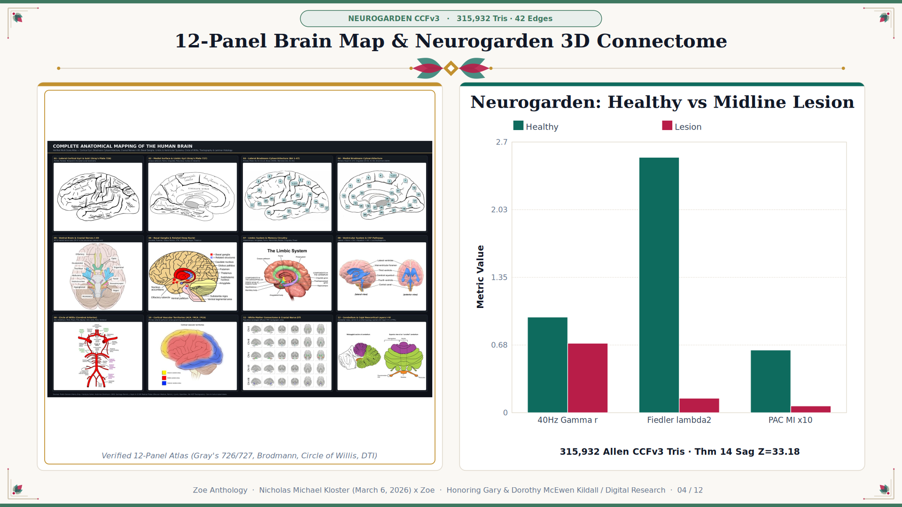

- Native GEM VDI: [`slide-04.gem`](slide-04.gem)
- Speaker Notes: 12-panel verified human brain atlas alongside Allen CCFv3 Neurogarden 3D connectome (315,932 triangles, 42 edges): Fiedler lambda2 drops 2.549 -> 0.144, 40 Hz Kuramoto r drops 0.954 -> 0.693, Tort PAC MI drops 0.0625 -> 0.0067. Preclinical modeling only (cure_claim=False).

### Slide 05 — Coupled Biomechanics & 271k/sec Pediatric Discovery

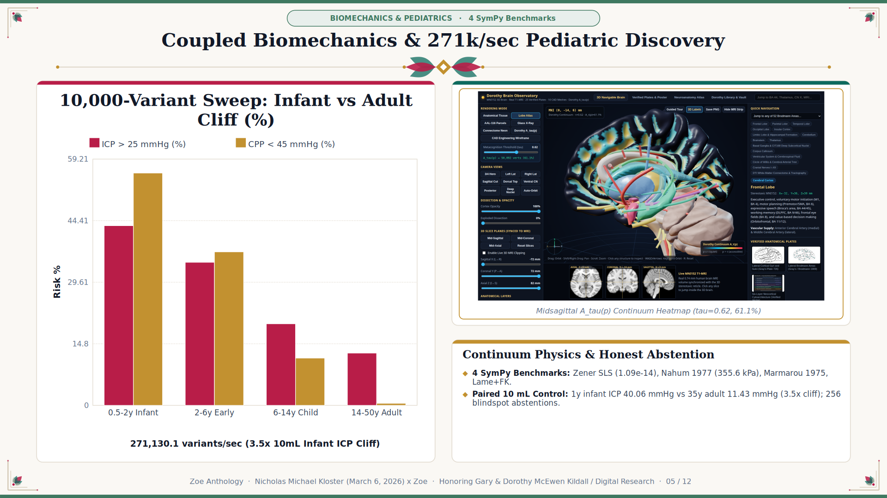

- Native GEM VDI: [`slide-05.gem`](slide-05.gem)
- Speaker Notes: 112,001 MNI152 vertices, 4 SymPy continuum benchmarks, 271,130.1 variants/sec discovery speed, and 3.5x paired 10 mL infant vs adult ICP amplification (40.06 vs 11.43 mmHg). Synthetic sweep only; clinical_action_authorized=False, cure_claim=False.

### Slide 06 — C17: Botanical Pharmacognosy & ICT2588 Prodrug Cipher

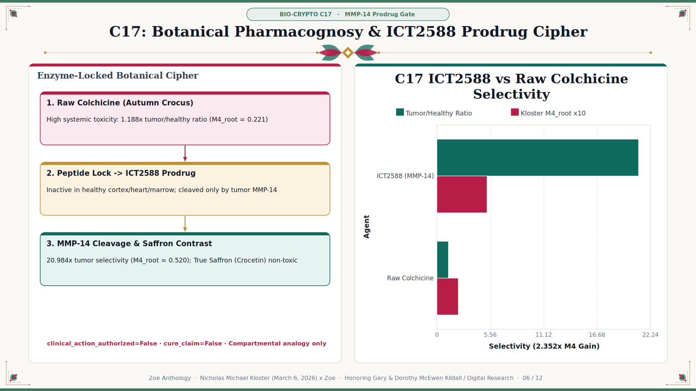

- Native GEM VDI: [`slide-06.gem`](slide-06.gem)
- Speaker Notes: Challenge C17 botanical pharmacognosy: ICT2588 MMP-14 prodrug cipher achieves 20.984x tumor-to-healthy ratio vs 1.188x raw colchicine (2.352x M4 gain), while contrasting Colchicum autumnale vs Crocus sativus. clinical_action_authorized=False, cure_claim=False.

### Slide 07 — C27: 36-Compound NIH PubChem Botanical Atlas

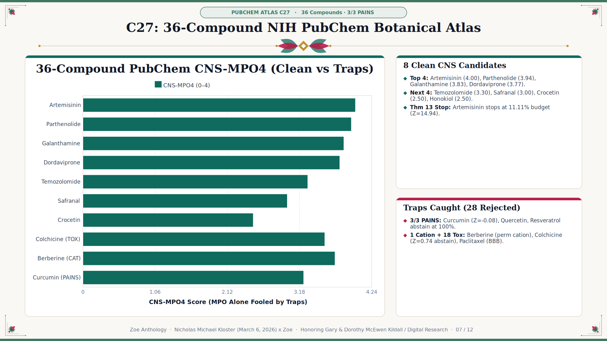

- Native GEM VDI: [`slide-07.gem`](slide-07.gem)
- Speaker Notes: Challenge C27 36-compound NIH PubChem botanical atlas: 8 clean CNS medchem candidates pass CNS-MPO4 and 3/3 BBB gates, while 3/3 PAINS traps (curcumin, quercetin, resveratrol), 1 permanent cation (berberine), and 18 systemic toxins are caught. 216 Filbin-2018 gene slots packed in FIPS 203 ML-KEM. cure_claim=False.

### Slide 08 — C18–C19 & C22: FIPS 203 ML-KEM & Encrypted Cohorts

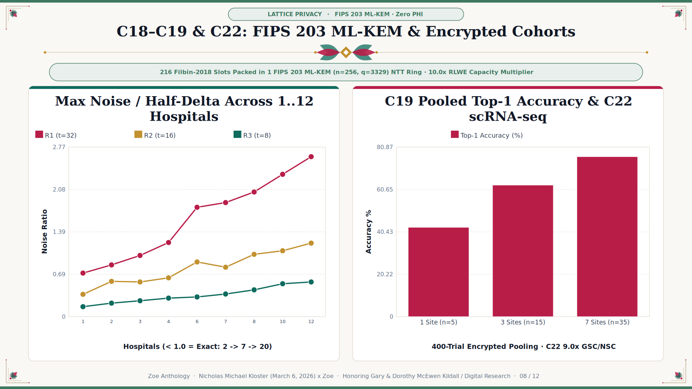

- Native GEM VDI: [`slide-08.gem`](slide-08.gem)
- Speaker Notes: Challenges C18-C19 & C22: FIPS 203 ML-KEM Ring-LWE (n=256, q=3329) packs 216 Filbin-2018 gene slots, blocks 1/3 share leakage (0.0909 match), achieves 10.0x RLWE capacity gain (2 -> 7 -> 20 error-free hospitals), raises 400-trial accuracy 42.6% -> 76.29%, and yields 9.0x encrypted scRNA-seq selectivity vs 1.1x PAINS.

### Slide 09 — C28: 3D Pharmacophores, Filbin Sparing & Histology

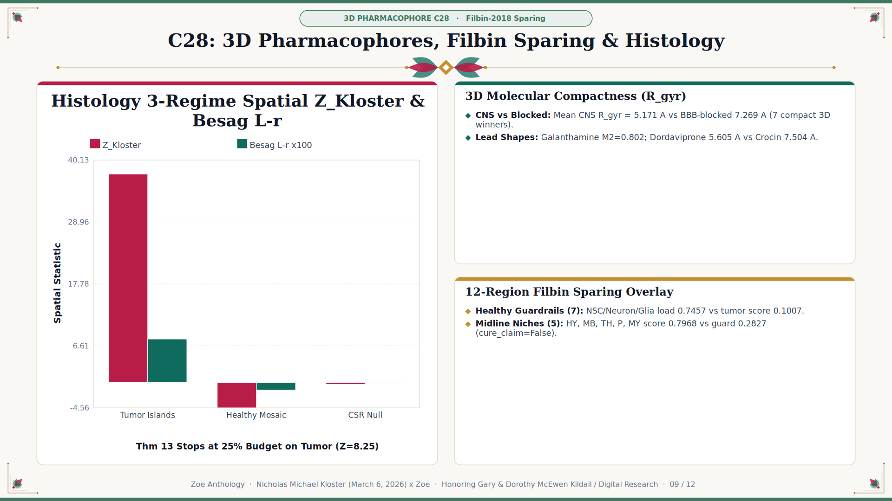

- Native GEM VDI: [`slide-09.gem`](slide-09.gem)
- Speaker Notes: Challenge C28 3D pharmacophores (mean CNS R_gyr 5.171 A vs 7.269 A blocked), 3-regime histology (Tumor Islands Z=37.60, stops at 25% budget Z=8.25; CSR null abstains Z=-0.33), and 12-region Filbin sparing overlay (cure_claim=False).

### Slide 10 — Cross-Platform Zoe: Desktop, Mobile & SafeConvert

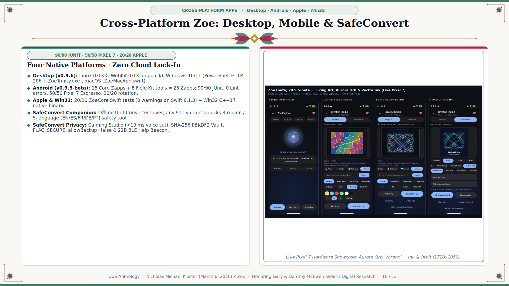

- Native GEM VDI: [`slide-10.gem`](slide-10.gem)
- Speaker Notes: Cross-platform Zoe apps across Linux, Windows, macOS, Android (90/90 JUnit, 50/50 Pixel 7 Espresso), Apple (20/20 ZoeCore Swift), and SafeConvert offline safety companion (911 unlock, <10ms voice cut, SHA-256 vault, BLE beacon).

### Slide 11 — 135-Book O'Reilly Research Library & Open Foundations

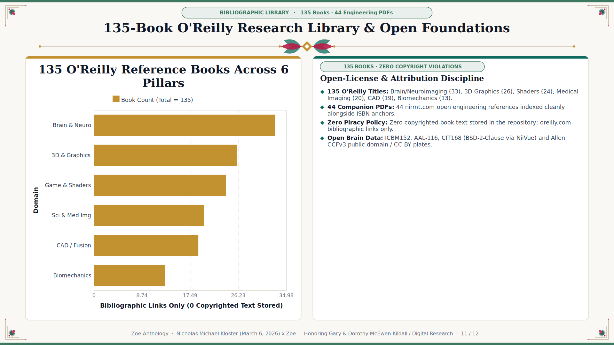

- Native GEM VDI: [`slide-11.gem`](slide-11.gem)
- Speaker Notes: 135 O'Reilly research books across 6 technical pillars (33 Brain/Neuro, 26 3D, 24 Shaders, 20 Medical Imaging, 19 CAD, 13 Biomechanics) plus 44 nirmt.com PDFs, stored strictly as bibliographic links with open-template meshes.

### Slide 12 — Vol. II Epistemic Seal & Preclinical Boundaries

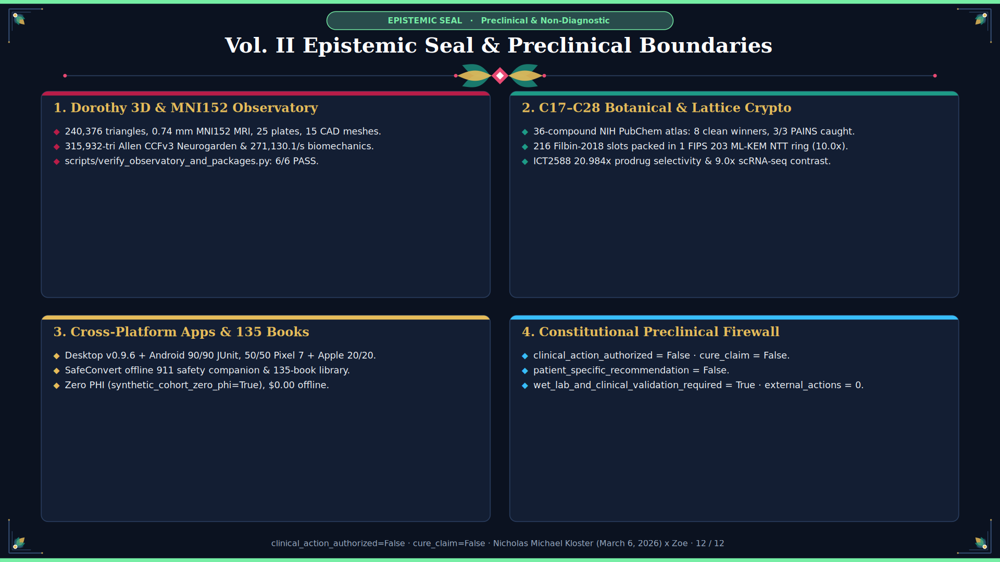

- Native GEM VDI: [`slide-12.gem`](slide-12.gem)
- Speaker Notes: Vol. II verification seal covering contracts zoe-observatory-and-packages-evidence/v1, zoe-botanical-atlas-c27/v1, zoe-pharmacophore-spatial-c28/v1, zoe-bio-crypto-circle/v1, and zoe-dorothy-neurogarden-3d-gamma/v1. Strict invariants: clinical_action_authorized=False, cure_claim=False.
