# Vol. III — Reverse Engineering, Cryptanalysis & Zero-Trust Defense

> **Volume / Series**: Vol. III  
> **Sister Theme**: `mono` · **Slides**: 12 · **Attribution**: Nicholas Michael Kloster (March 6, 2026) x Zoe  
> **Honoring**: Gary & Dorothy McEwen Kildall / Digital Research

- [Launch Offline Slide Show Player](player.html)
- [GEM OUTPUT.APP Playlist (`vol-3-reverse-engineering-cryptanalysis-zero-trust.lis`)](vol-3-reverse-engineering-cryptanalysis-zero-trust.lis)
- [Back to Presentations Hub](../../README.md)

## Slide Transcripts & Speaker Notes

### Slide 01 — Vol. III — Reverse Engineering, Cryptanalysis & Zero-Trust Defense

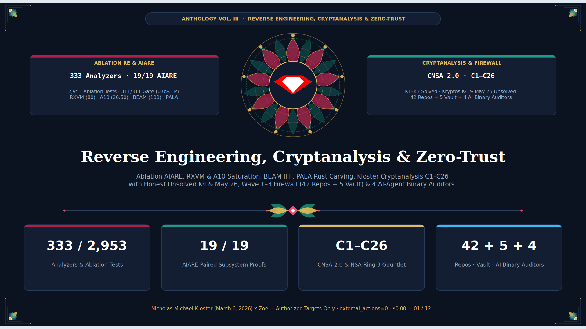

- Native GEM VDI: [`slide-01.gem`](slide-01.gem)
- Speaker Notes: Welcome to Anthology Vol. III (sister: mono). Covers Ablation AIARE (333 analyzers, 2,953 tests, 19/19, 311/311 gate), RXVM & A10 saturation, BEAM IFF, PALA Rust carving, Kloster cryptanalysis C1-C26 & CNSA 2.0 (honestly marking Kryptos K4 and NSA May 26 unsolved), Wave 1-3 firewall (42 repos + 5 Vault), and 4 AI-Agent Binary Auditors.

### Slide 02 — Ablation RE Platform & AIARE 19/19 Verification

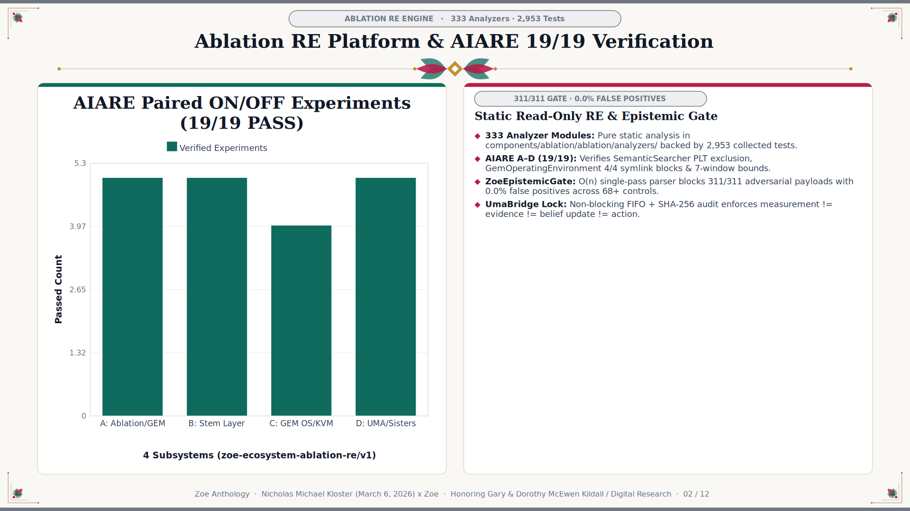

- Native GEM VDI: [`slide-02.gem`](slide-02.gem)
- Speaker Notes: Ablation RE engine (333 analyzer modules, 2,953 tests) and AIARE 19/19 paired experiments across 4 subsystems, including ZoeEpistemicGate 311/311 adversarial blocks with 0.0% false positives.

### Slide 03 — RXVM Bytecode Crypto & A10 Quantization Saturation

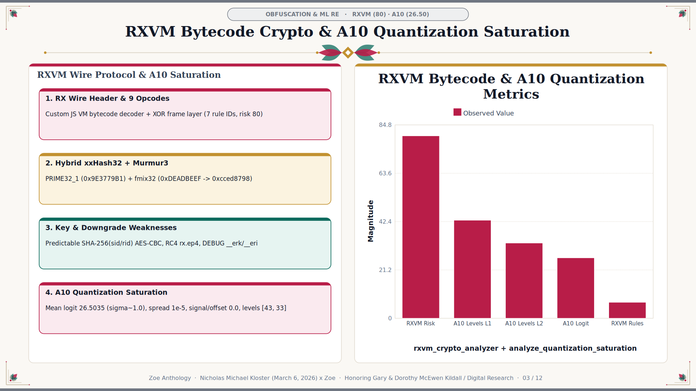

- Native GEM VDI: [`slide-03.gem`](slide-03.gem)
- Speaker Notes: RXVM custom VM crypto analyzer (9 opcodes, 7 rule IDs, risk score 80, xxHash32 + Murmur3, SHA-256(sid/rid) AES-CBC, RC4 rx.ep4) and A10 quantization saturation audit (mean pre-sigmoid logit 26.5035, spread 1e-5, BatchNorm-beta dominance).

### Slide 04 — BEAM IFF Obfuscation, Scoped angr & Overmatch

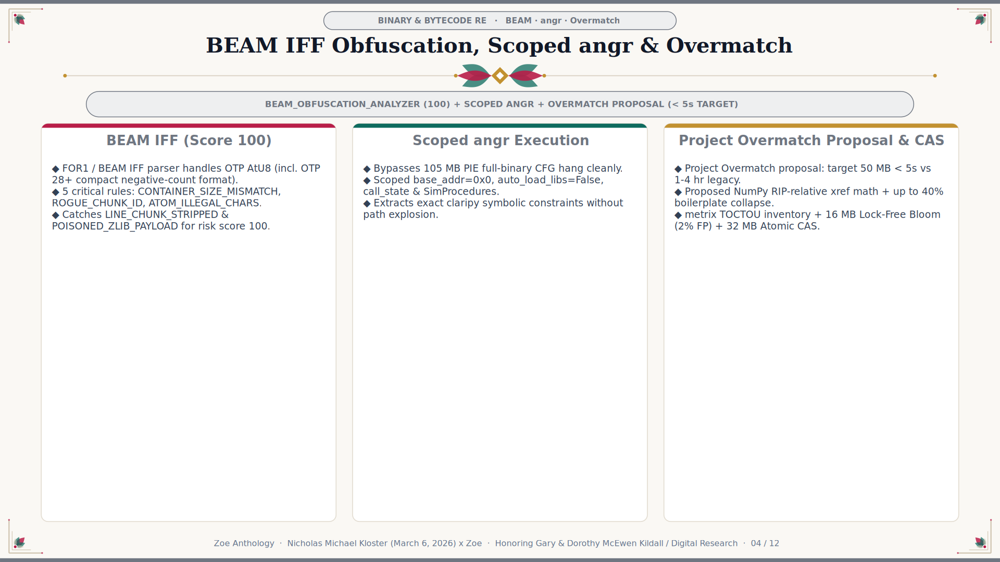

- Native GEM VDI: [`slide-04.gem`](slide-04.gem)
- Speaker Notes: BEAM IFF obfuscation analyzer (FOR1/BEAM, 5 rules, risk score 100), scoped angr symbolic execution (bypassing 105 MB PIE CFG), Project Overmatch architecture proposal (target <5s on 50 MB), and 16 MB Bloom + 32 MB CAS.

### Slide 05 — PALA Rust Carving & Cross-World Red-Team Forensics

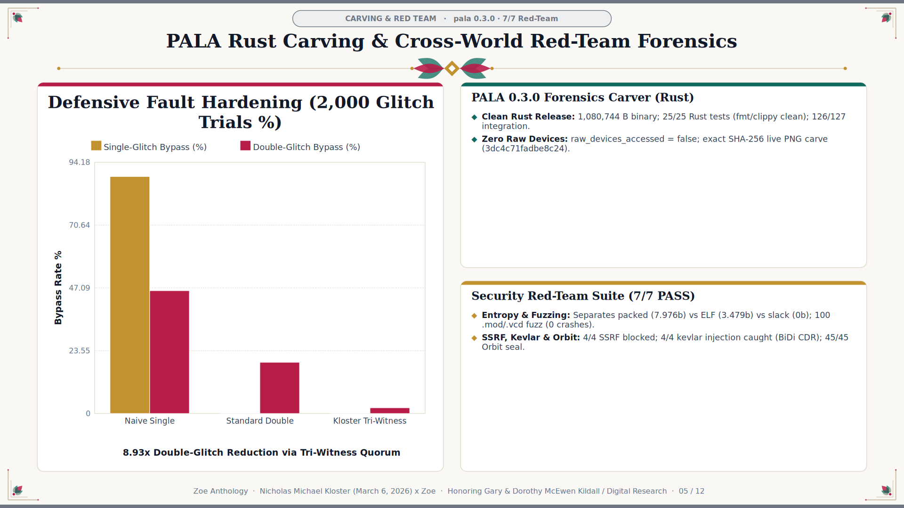

- Native GEM VDI: [`slide-05.gem`](slide-05.gem)
- Speaker Notes: PALA 0.3.0 Rust file carver (25/25 Rust tests, 126/127 integration, raw_devices_accessed=false) and 7/7 Red-Team Forensics: 8.93x fault-bypass reduction via Kloster tri-witness quorum, 100 fuzz payloads with 0 crashes, 4/4 SSRF, 4/4 kevlar prompt-injection blocks, and 45/45 Orbit attestation.

### Slide 06 — Kloster Cryptanalysis C1–C10 & Honest K4 Boundary

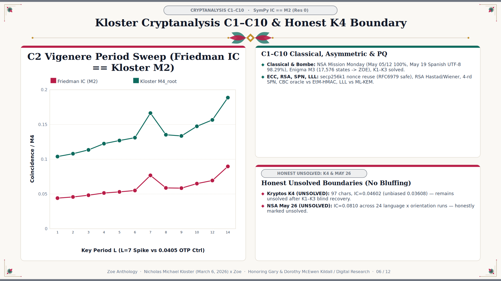

- Native GEM VDI: [`slide-06.gem`](slide-06.gem)
- Speaker Notes: Kloster Cryptanalysis C1-C10 with SymPy proof Friedman IC == Kloster M2 (residual = 0): Vigenere L=7, Enigma M3, secp256k1 nonce reuse, RSA Hastad/Wiener, CBC padding oracle, LLL vs ML-KEM, and Kryptos K1-K3 solved. Explicitly preserves honest unsolved status for Kryptos K4 and NSA May 26.

### Slide 07 — NSA Puzzles & CNSA 2.0 Post-Quantum Attacks (C11–C21)

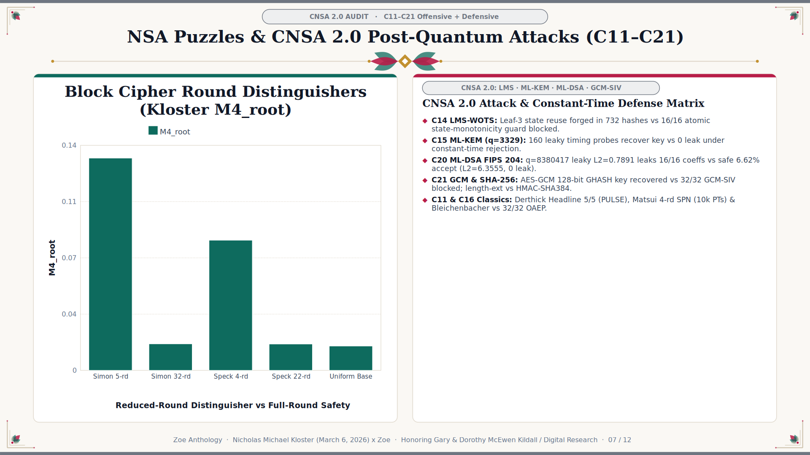

- Native GEM VDI: [`slide-07.gem`](slide-07.gem)
- Speaker Notes: Challenges C11-C21 covering CNSA 2.0 security audits: Simon/Speck reduced-round distinguishers, LMS-WOTS leaf-3 forgery vs atomic guard, ML-KEM timing side-channel, ML-DSA FIPS 204 rejection sampling, AES-GCM forbidden attack vs GCM-SIV, and SHA-256 length-extension vs HMAC-SHA384.

### Slide 08 — NSA Ring-3 Deep Crypto & Theorem 13 Stopping (C23–C26)

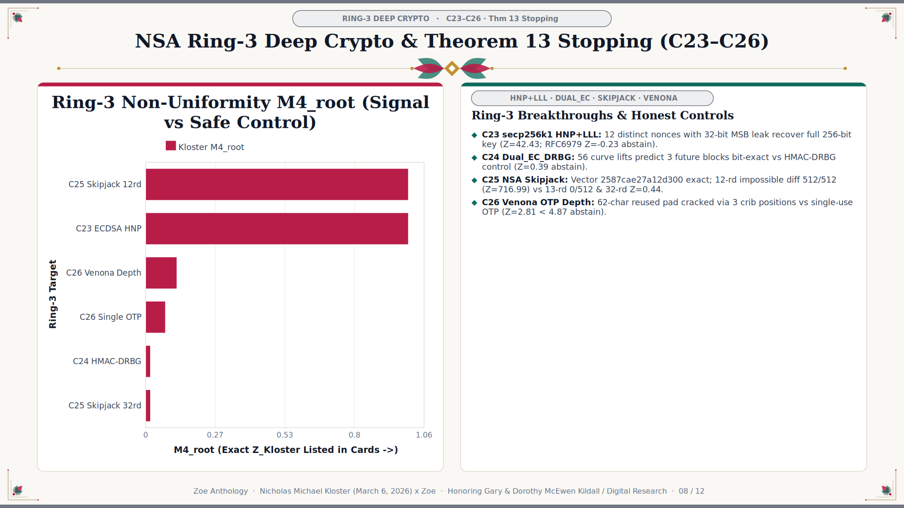

- Native GEM VDI: [`slide-08.gem`](slide-08.gem)
- Speaker Notes: Ring-3 deep cryptanalysis C23-C26: secp256k1 HNP+LLL (Z=42.43), Dual_EC_DRBG klepto vs HMAC-DRBG (Z=0.39), NSA Skipjack 12-rd impossible differential (Z=716.99 vs 32-rd Z=0.44), and Venona OTP depth (Z=14.60 vs single OTP Z=2.81).

### Slide 09 — Wave 1–2 Epistemic Firewall Across 42 Integrated Repos

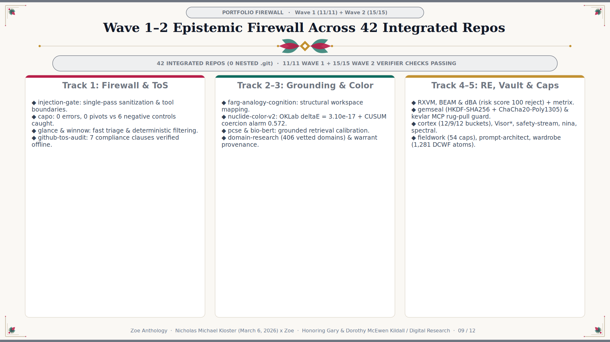

- Native GEM VDI: [`slide-09.gem`](slide-09.gem)
- Speaker Notes: Wave 1 (11/11) and Wave 2 (15/15) portfolio upgrades across 42 integrated repositories (zero nested .git), covering injection-gate, capo, nuclide-color-v2, domain-research (406 domains), RXVM, BEAM, dBA, gemseal, kevlar, and 1,281 DCWF atoms.

### Slide 10 — Wave 3 Vault: TrustEngine, Dual-Path, Vec2Text & ROS

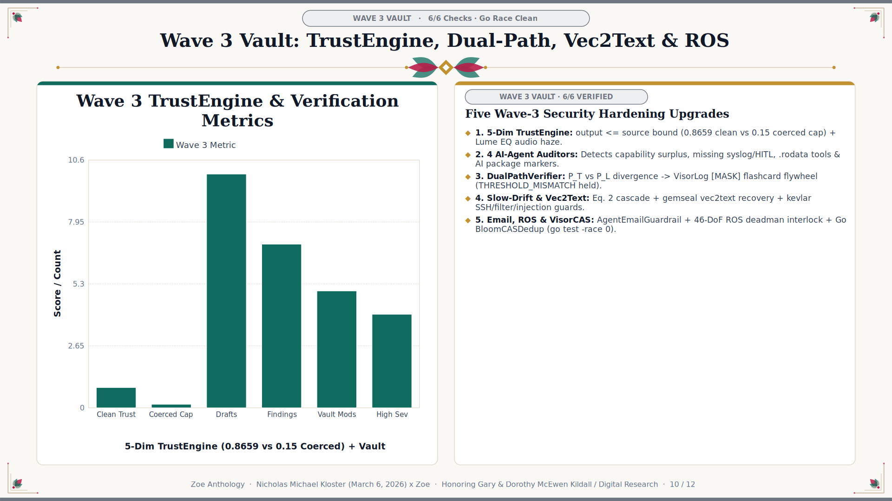

- Native GEM VDI: [`slide-10.gem`](slide-10.gem)
- Speaker Notes: Wave 3 Vault (6/6 PASS): 5-dim TrustEngine (0.8659 clean vs 0.15 coerced), 4 AI-Agent Binary Auditors, DualPathVerifier + VisorLog [MASK] flywheel, Eq. 2 slow-drift + gemseal vec2text + kevlar guards, and AgentEmailGuardrail + 46-DoF ROS deadman + Go VisorCAS (go test -race exit 0).

### Slide 11 — 4 AI-Agent Binary Auditors & SeaSIP GEM/GSX Rebuild

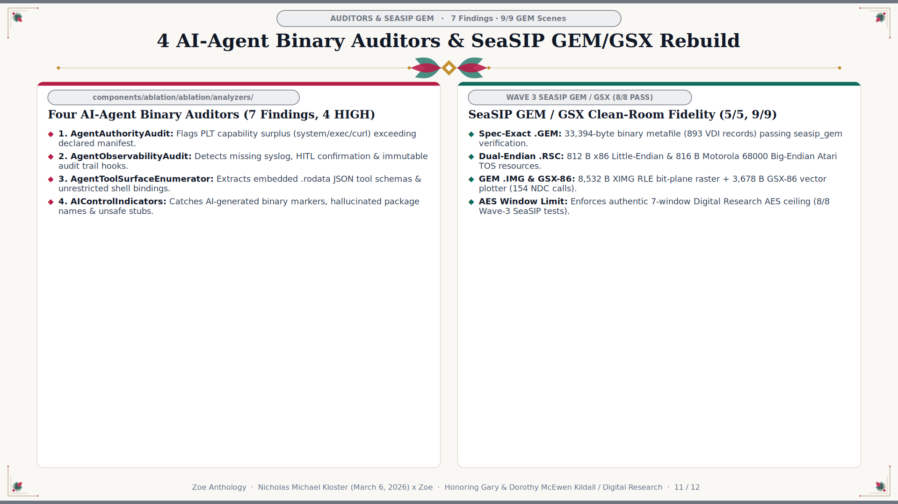

- Native GEM VDI: [`slide-11.gem`](slide-11.gem)
- Speaker Notes: Four AI-Agent Binary Auditors (AgentAuthorityAudit, AgentObservabilityAudit, AgentToolSurfaceEnumerator, AIControlIndicators: 7 findings, 4 HIGH) alongside SeaSIP GEM/GSX clean-room rebuild (5/5 checks, 9/9 scenes, 812B x86 LE & 816B 68k BE .RSC, 154 GSX-86 NDC calls).

### Slide 12 — Vol. III Verification Seal & Constitutional Zero-Trust

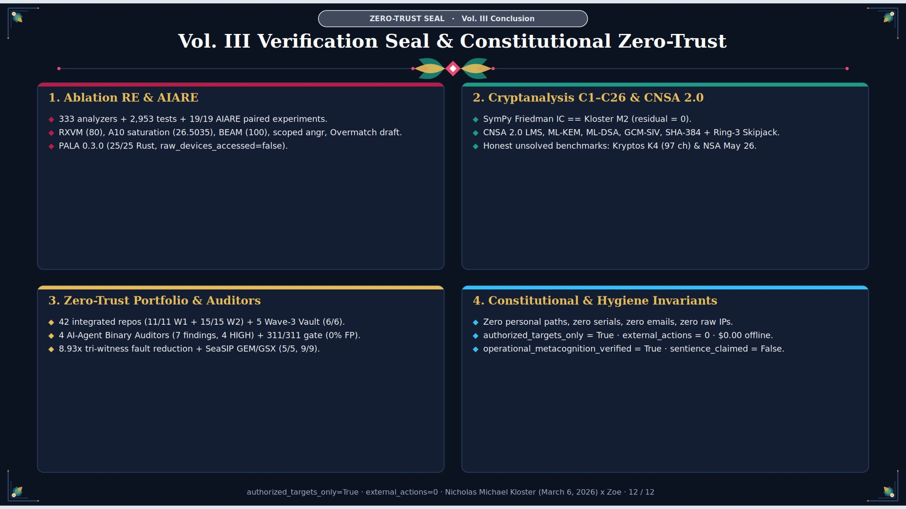

- Native GEM VDI: [`slide-12.gem`](slide-12.gem)
- Speaker Notes: Vol. III verification seal covering zoe-ecosystem-ablation-re/v1, zoe-kloster-cryptanalysis-gauntlet/v2, zoe-nsa-research-puzzle-pack/v1, zoe-cnsa2-scrna-ring2/v1, zoe-nsa-ring3-deep-crypto/v1, zoe-security-forensics-redteam/v1, and zoe-wave3-seasip-gem-verification/v1. Kryptos K4 and NSA May 26 explicitly remain unsolved.
