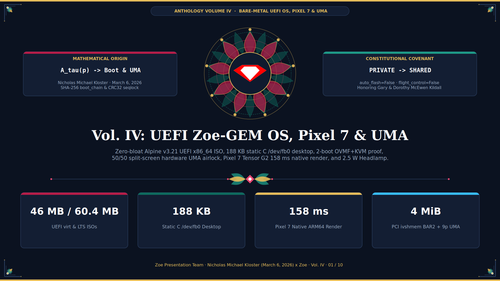
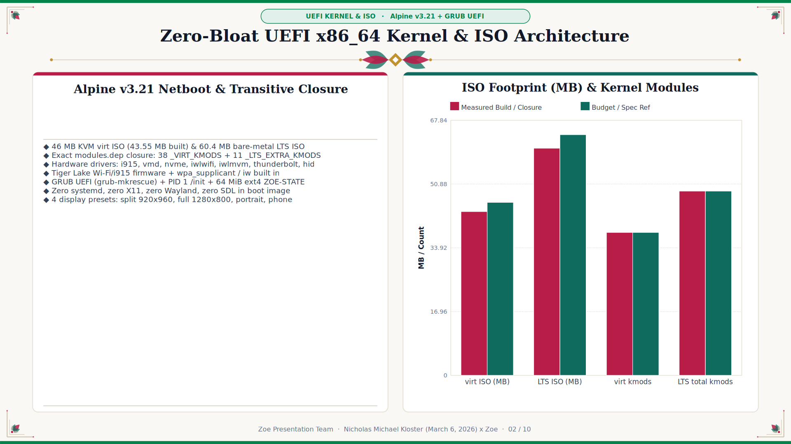
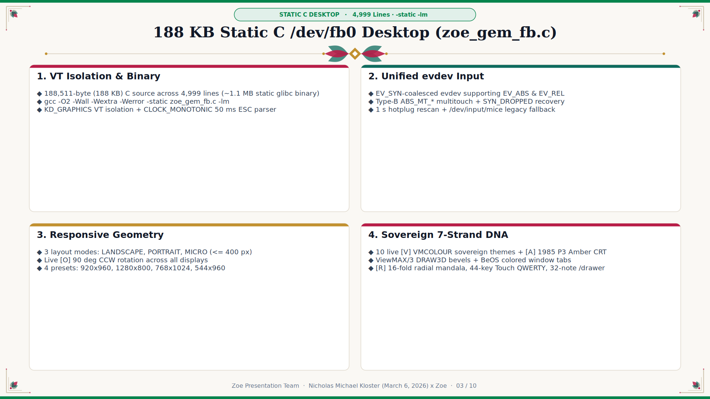
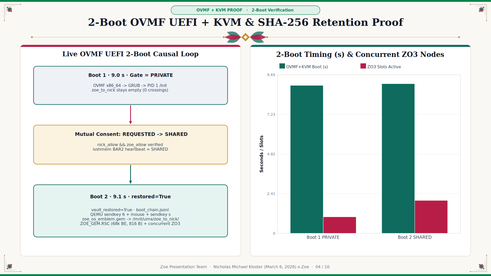
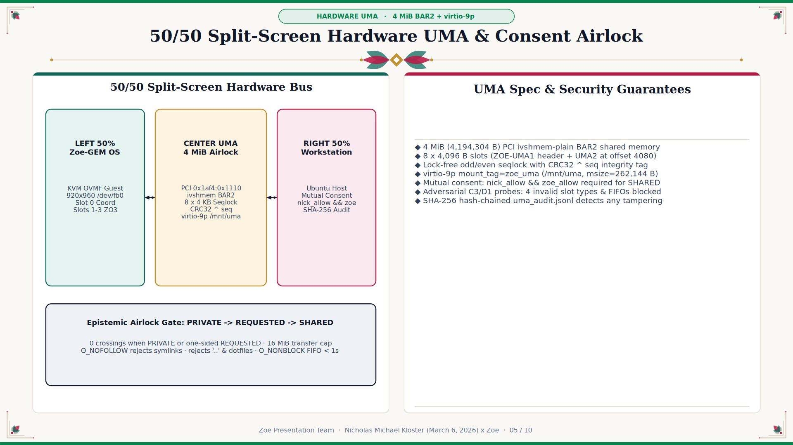
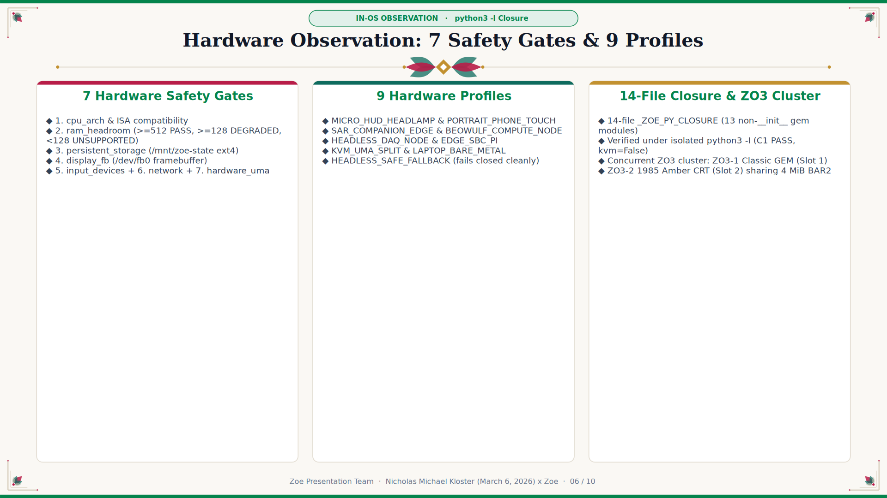
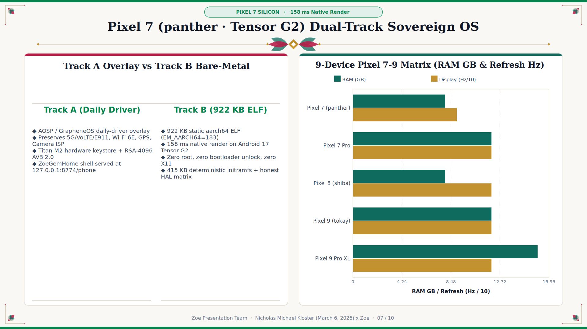
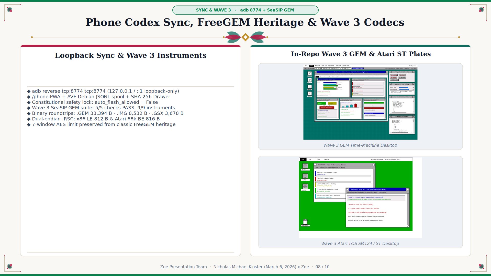
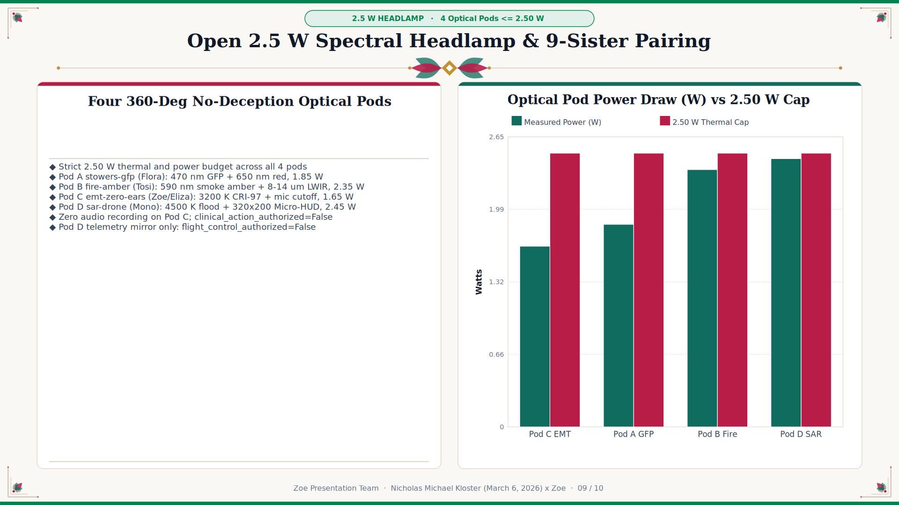
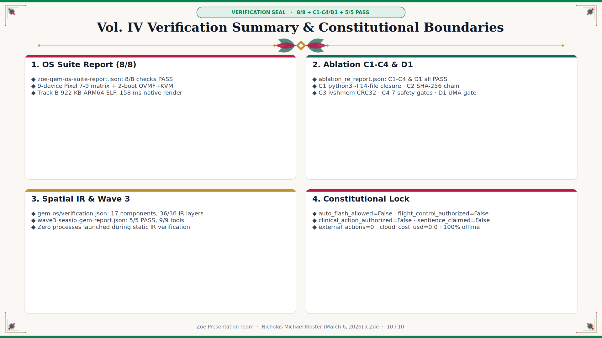

# Anthology Vol. IV: Bare-Metal UEFI Zoe-GEM OS, Pixel 7 Silicon & Hardware UMA

> **Volume / Series**: Vol. IV  
> **Sister Theme**: `tosi` · **Slides**: 10 · **Attribution**: Nicholas Michael Kloster (March 6, 2026) x Zoe  
> **Honoring**: Gary & Dorothy McEwen Kildall / Digital Research

- [Launch Offline Slide Show Player](player.html)
- [GEM OUTPUT.APP Playlist (`vol-4-uefi-zoe-gem-os-pixel7-uma.lis`)](vol-4-uefi-zoe-gem-os-pixel7-uma.lis)
- [Back to Presentations Hub](../../README.md)

## Slide Transcripts & Speaker Notes

### Slide 01 — Vol. IV: UEFI Zoe-GEM OS, Pixel 7 & UMA

- Native GEM VDI: [`slide-01.gem`](slide-01.gem)
- Speaker Notes: Welcome to Volume IV covering Bare-Metal UEFI x86_64 Zoe-GEM OS (46 MB virt / 43.55 MB actual, 60.4 MB LTS), the 188 KB static C /dev/fb0 desktop (zoe_gem_fb.c), 2-boot OVMF+KVM proof, 50/50 split-screen hardware UMA airlock, Pixel 7 Tensor G2 158 ms native render, and 2.5 W Headlamp.

### Slide 02 — Zero-Bloat UEFI x86_64 Kernel & ISO Architecture

- Native GEM VDI: [`slide-02.gem`](slide-02.gem)
- Speaker Notes: UEFI x86_64 Zoe-GEM OS boots via OVMF UEFI and GRUB into Alpine Linux v3.21 with zero systemd, X11, Wayland, or SDL. The virt ISO is 43.55 MB (46 MB budget) with 38 kernel modules; the LTS USB ISO is 60.4 MB with 49 total modules.

### Slide 03 — 188 KB Static C /dev/fb0 Desktop (zoe_gem_fb.c)

- Native GEM VDI: [`slide-03.gem`](slide-03.gem)
- Speaker Notes: zoe_gem_fb.c is a 188,511-byte (188 KB) C source across 4,999 lines and compiles with -Wall -Wextra -Werror -static -lm to a ~1.1 MB static glibc binary. Includes KD_GRAPHICS VT isolation, EV_SYN-coalesced multitouch evdev, 3 responsive layout modes, 10 VMCOLOUR themes, 1985 P3 Amber CRT LUT, 44-key Touch QWERTY, and 32-note Nick /drawer.

### Slide 04 — 2-Boot OVMF UEFI + KVM & SHA-256 Retention Proof

- Native GEM VDI: [`slide-04.gem`](slide-04.gem)
- Speaker Notes: OVMF UEFI + KVM two-boot proof: Boot 1 completes in 9.0 s under PRIVATE gate (zero crossings). After mutual consent (REQUESTED -> SHARED), Boot 2 boots in 9.1 s with restored=True and vault_restored=True, real QEMU sendkey 6 + mouse strokes, zoe_os_emblem.gem crossing /mnt/uma/zoe_to_nick/, SHA-256 boot_chain.jsonl self-retention, and 68k big-endian ZOE_GEM.RSC (816 B).

### Slide 05 — 50/50 Split-Screen Hardware UMA & Consent Airlock

- Native GEM VDI: [`slide-05.gem`](slide-05.gem)
- Speaker Notes: Hardware UMA split-screen bridge: Left 50% runs Zoe-GEM OS KVM (920x960 preset); Right 50% runs the Ubuntu workstation; Center UMA combines 4 MiB (4,194,304 B) PCI ivshmem-plain (0x1af4:0x1110, 8 x 4096 B slots, ZOE-UMA1/UMA2 CRC32 seqlock, 16 MiB cap) and virtio-9p airlock (/mnt/uma, msize=262144). Consent transitions PRIVATE -> REQUESTED -> SHARED only when nick_allow && zoe_allow; rejects symlinks (O_NOFOLLOW), dot-dot traversal, dotfiles, and FIFOs (O_NONBLOCK < 1s) with SHA-256 uma_audit.jsonl.

### Slide 06 — Hardware Observation: 7 Safety Gates & 9 Profiles

- Native GEM VDI: [`slide-06.gem`](slide-06.gem)
- Speaker Notes: zoe_os_runtime.py enforces 7 hardware safety gates (e.g., 64 MB RAM probe cleanly returns UNSUPPORTED), selects among 9 hardware profiles, runs a 14-file Python closure verified under python3 -I (C1), and coordinates concurrent ZO3-1 and ZO3-2 guests on one 4 MiB PCI ivshmem BAR.

### Slide 07 — Pixel 7 (panther · Tensor G2) Dual-Track Sovereign OS

- Native GEM VDI: [`slide-07.gem`](slide-07.gem)
- Speaker Notes: Real Google Pixel 7 (panther, Tensor G2 gs201, 1080x2400@90Hz, 8 GB RAM, Exynos 5300 5G) leads a unified 9-device Pixel 7-9 matrix. Track A preserves daily-driver telephony and Titan M2 + RSA-4096 AVB 2.0; Track B compiles a 922 KB static aarch64 ELF rendering natively on Android 17 Tensor G2 in 158 ms alongside a 415 KB deterministic initramfs.

### Slide 08 — Phone Codex Sync, FreeGEM Heritage & Wave 3 Codecs

- Native GEM VDI: [`slide-08.gem`](slide-08.gem)
- Speaker Notes: Phone <-> PC Codex Sync uses loopback-only adb reverse tcp:8774 tcp:8774, /phone PWA, AVF Debian spool, SHA-256 Nick's Drawer, and auto_flash_allowed=False. Wave 3 GEM verification scores 5/5 PASS across 9/9 instruments: .GEM (33,394 B), .RSC x86 (812 B) / 68k BE (816 B), .IMG (8,532 B), and .GSX (3,678 B).

### Slide 09 — Open 2.5 W Spectral Headlamp & 9-Sister Pairing

- Native GEM VDI: [`slide-09.gem`](slide-09.gem)
- Speaker Notes: Open 2.5 W Headlamp pairs 4 spectral pods with Zoe Sisters under a strict 2.50 W cap: Pod A stowers-gfp (1.85 W, Flora), Pod B fire-amber (2.35 W, Tosi), Pod C emt-zero-ears (1.65 W, Zoe & Eliza, physical mic cutoff, clinical_action_authorized=False), and Pod D sar-drone (2.45 W, Mono, flight_control_authorized=False).

### Slide 10 — Vol. IV Verification Summary & Constitutional Boundaries

- Native GEM VDI: [`slide-10.gem`](slide-10.gem)
- Speaker Notes: Vol. IV closes with 8/8 suite checks PASS, C1-C4 and D1 ablation PASS, 17 components / 36/36 Spatial IR layers PASS, 5/5 Wave 3 SeaSIP GEM checks PASS, and strict constitutional boundaries (auto_flash_allowed=False, flight_control_authorized=False, clinical_action_authorized=False, sentience_claimed=False, external_actions=0).
