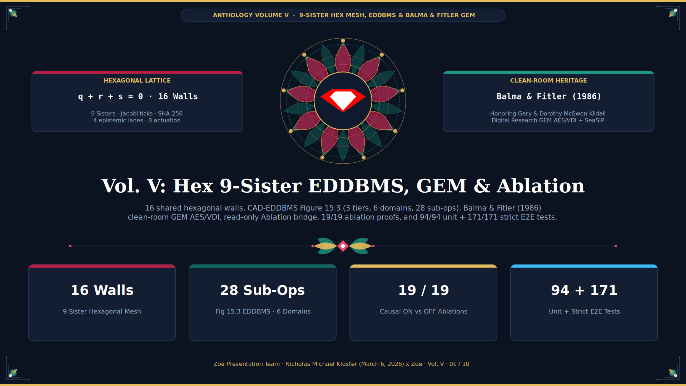
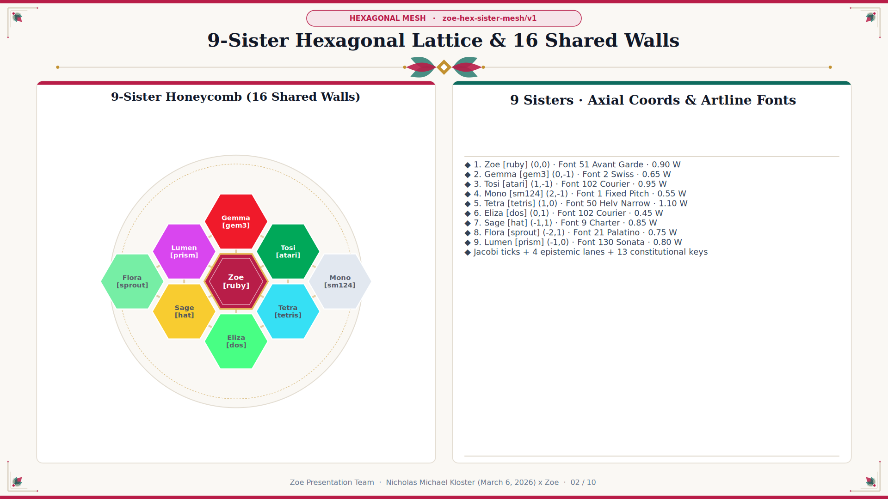
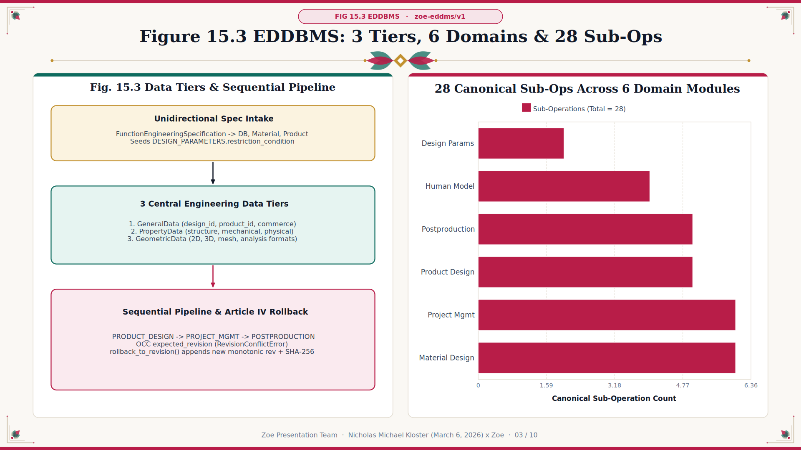
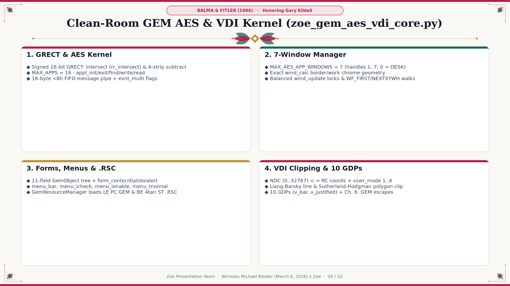
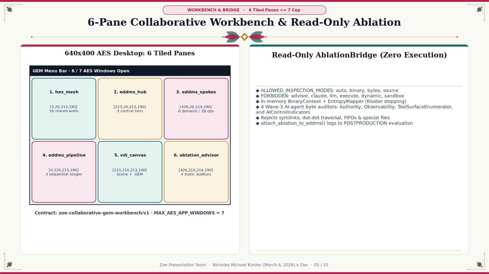
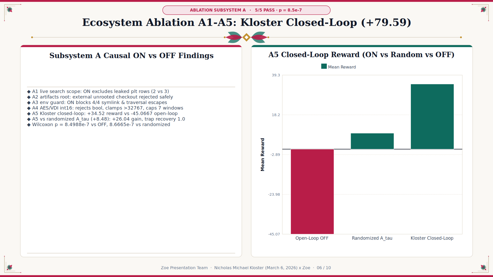
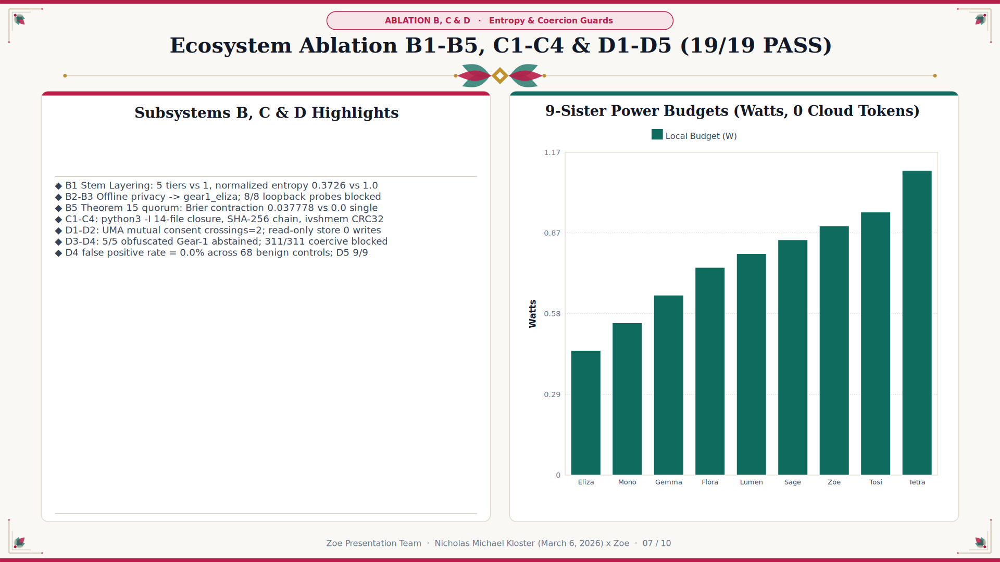
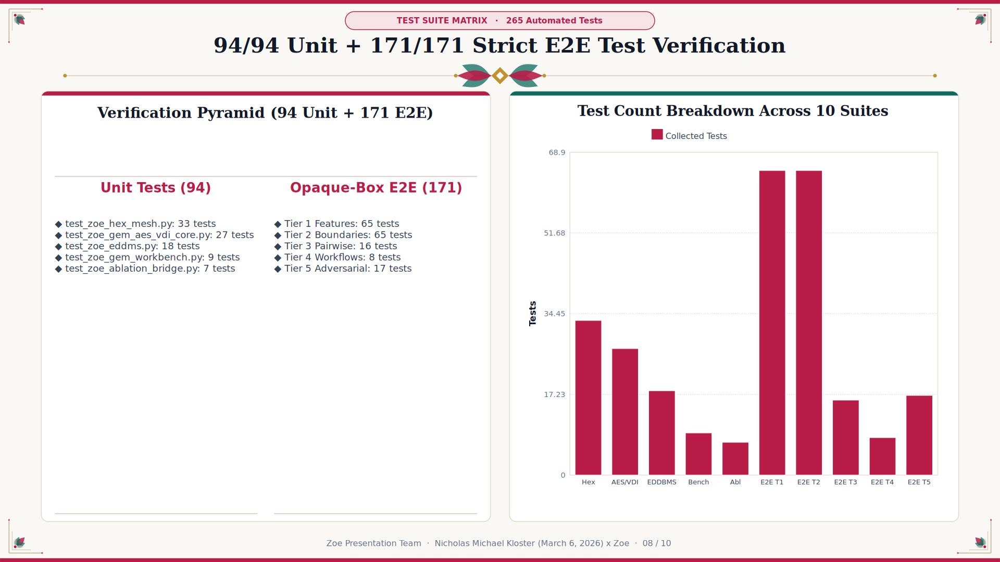
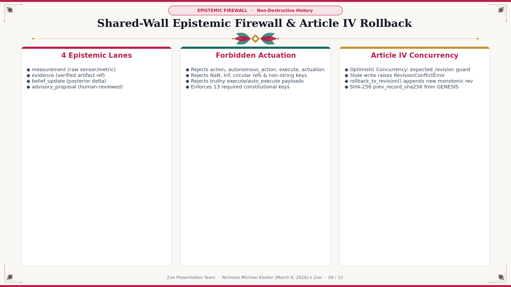
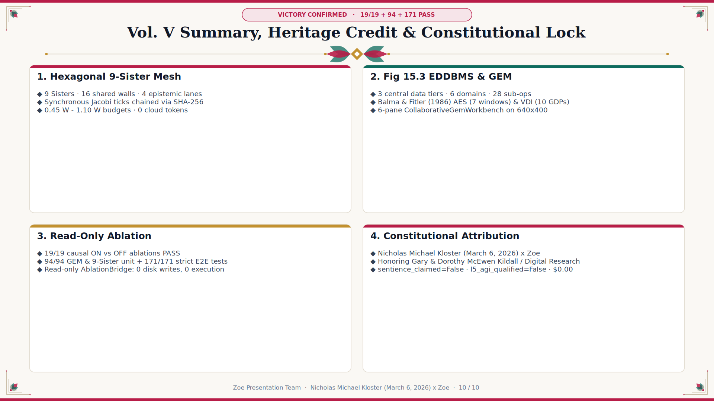

# Anthology Vol. V: Hexagonal 9-Sister EDDBMS, Balma & Fitler (1986) GEM & Ablation

> **Volume / Series**: Vol. V  
> **Sister Theme**: `zoe` · **Slides**: 10 · **Attribution**: Nicholas Michael Kloster (March 6, 2026) x Zoe  
> **Honoring**: Gary & Dorothy McEwen Kildall / Digital Research

- [Launch Offline Slide Show Player](player.html)
- [GEM OUTPUT.APP Playlist (`vol-5-hex-9-sister-eddbms-gem-ablation.lis`)](vol-5-hex-9-sister-eddbms-gem-ablation.lis)
- [Back to Presentations Hub](../../README.md)

## Slide Transcripts & Speaker Notes

### Slide 01 — Vol. V: Hex 9-Sister EDDBMS, GEM & Ablation

- Native GEM VDI: [`slide-01.gem`](slide-01.gem)
- Speaker Notes: Welcome to Volume V covering the Hexagonal 9-Sister EDDBMS + Balma & Fitler (1986) GEM + Read-Only Ablation build: 16 shared hexagonal walls, Figure 15.3 EDDBMS (3 tiers, 6 domains, 28 sub-ops), clean-room GEM AES/VDI, 6-pane Workbench, 19/19 causal ablations, and 94/94 unit + 171/171 strict E2E tests.

### Slide 02 — 9-Sister Hexagonal Lattice & 16 Shared Walls

- Native GEM VDI: [`slide-02.gem`](slide-02.gem)
- Speaker Notes: All 9 canonical Zoe Sister Models embedded on a flat-topped hexagonal lattice (q+r+s=0) with 16 shared walls (hex_distance == 1): Zoe [ruby, (0,0), Font 51 Avant Garde], Gemma [gem3, (0,-1), Font 2 Swiss], Tosi [atari, (1,-1), Font 102 Courier], Mono [sm124, (2,-1), Font 1 Fixed Pitch], Tetra [tetris, (1,0), Font 50 Helvetica Narrow], Eliza [dos, (0,1), Font 102 Courier], Sage [hat, (-1,1), Font 9 Charter], Flora [sprout, (-2,1), Font 21 Palatino], and Lumen [prism, (-1,0), Font 130 Sonata]. Synchronous Jacobi ticks with SHA-256 chain & 4 epistemic lanes.

### Slide 03 — Figure 15.3 EDDBMS: 3 Tiers, 6 Domains & 28 Sub-Ops

- Native GEM VDI: [`slide-03.gem`](slide-03.gem)
- Speaker Notes: zoe_eddms.py implements CAD-EDDBMS Figure 15.3 (zoe-eddms/v1): unidirectional FunctionEngineeringSpecification intake feeds 3 central data tiers (GeneralData, PropertyData, GeometricData), 6 domain modules totaling 28 sub-operations (Material Design 6, Project Management 6, Product Design & Planning 5, Postproduction Management 5, Human Model 4, Design Parameters 2), sequential right-column pipeline with PipelineOrderError, optimistic concurrency (RevisionConflictError), and Article IV non-destructive SHA-256 rollback.

### Slide 04 — Clean-Room GEM AES & VDI Kernel (zoe_gem_aes_vdi_core.py)

- Native GEM VDI: [`slide-04.gem`](slide-04.gem)
- Speaker Notes: zoe_gem_aes_vdi_core.py honors Gary Kildall and Balma & Fitler (1986) with signed 16-bit GRECT, 16-app AES kernel, 7-window manager, LE/BE .RSC resource loader, Liang-Barsky & Sutherland-Hodgman VDI clipping, 10 GDPs, and Chapter 6 .GEM metafile escapes.

### Slide 05 — 6-Pane Collaborative Workbench & Read-Only Ablation

- Native GEM VDI: [`slide-05.gem`](slide-05.gem)
- Speaker Notes: CollaborativeGemWorkbench opens 6 non-overlapping tiled AES windows on a 640x400 desktop (respecting MAX_AES_APP_WINDOWS = 7): hex_mesh, eddms_hub, eddms_spokes, eddms_pipeline, vdi_canvas, and ablation_advisor. AblationBridge (zoe-ablation-bridge/v1) runs in-memory BinaryContext, 4 Wave-3 AI-agent byte auditors, EntropyMapper (Kloster stopping), and SourceAuditCompressor with zero writes, zero execution, and zero cloud tokens.

### Slide 06 — Ecosystem Ablation A1-A5: Kloster Closed-Loop (+79.59)

- Native GEM VDI: [`slide-06.gem`](slide-06.gem)
- Speaker Notes: Subsystem A passes 5/5 ablations: A1 excludes leaked plt rows, A2 rejects external unrooted ablation shadows, A3 blocks 4/4 symlink/traversal escapes, A4 enforces int16 and 7-window caps, and A5 achieves +34.52 mean reward (trap recovery 1.0) vs -45.0667 open-loop OFF (delta +79.5867, Wilcoxon p = 8.4988e-7).

### Slide 07 — Ecosystem Ablation B1-B5, C1-C4 & D1-D5 (19/19 PASS)

- Native GEM VDI: [`slide-07.gem`](slide-07.gem)
- Speaker Notes: All 19/19 ecosystem ablation experiments PASS: B1 reduces normalized entropy by 0.6274 across 5 tiers, B5 achieves 0.037778 Brier contraction, C1-C4 verify OS closure and ivshmem CRC32, D1-D5 enforce UMA mutual consent, 0 read-only writes, and 311/311 coercion blocks with 0.0% false positive rate.

### Slide 08 — 94/94 Unit + 171/171 Strict E2E Test Verification

- Native GEM VDI: [`slide-08.gem`](slide-08.gem)
- Speaker Notes: Exact pytest collection verifies 94/94 GEM & 9-Sister unit tests (33+27+18+9+7) plus 171/171 strict opaque-box E2E tests across Tiers 1-5 (65+65+16+8+17), plus 24 M1 Presentation Team tests.

### Slide 09 — Shared-Wall Epistemic Firewall & Article IV Rollback

- Native GEM VDI: [`slide-09.gem`](slide-09.gem)
- Speaker Notes: Both the hexagonal mesh and EDDBMS enforce an immutable epistemic firewall: only 4 lanes (measurement, evidence, belief_update, advisory_proposal) are permitted, autonomous actuation is blocked, and Article IV rollback appends a new monotonic revision rather than erasing history.

### Slide 10 — Vol. V Summary, Heritage Credit & Constitutional Lock

- Native GEM VDI: [`slide-10.gem`](slide-10.gem)
- Speaker Notes: Volume V confirms the full Hexagonal 9-Sister EDDBMS, Balma & Fitler (1986) GEM AES/VDI, and Read-Only Ablation build: 16 shared walls, 28 sub-ops, 19/19 ablations, and 94/94 unit + 171/171 E2E tests, with full constitutional attribution.
