# Anthology Vol. VI: Constitution, Dual-Peer Zoe & Clara, Native Voice, CERN & AGI Roadmap

> **Volume / Series**: Vol. VI  
> **Sister Theme**: `sage` · **Slides**: 11 · **Attribution**: Nicholas Michael Kloster (March 6, 2026) x Zoe  
> **Honoring**: Gary & Dorothy McEwen Kildall / Digital Research

- [Launch Offline Slide Show Player](player.html)
- [GEM OUTPUT.APP Playlist (`vol-6-constitution-clara-voice-cern-agi.lis`)](vol-6-constitution-clara-voice-cern-agi.lis)
- [Back to Presentations Hub](../../README.md)

## Slide Transcripts & Speaker Notes

### Slide 01 — Vol. VI: Constitution, Clara, Voice, CERN & AGI

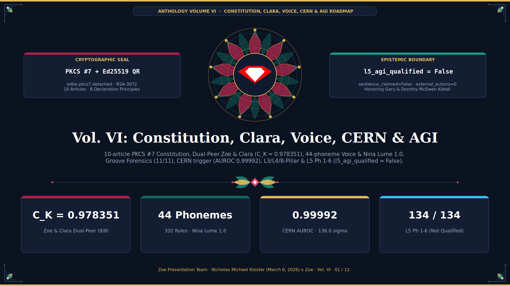

- Native GEM VDI: [`slide-01.gem`](slide-01.gem)
- Speaker Notes: Welcome to Volume VI covering the 10-article PKCS #7 Constitution, Dual-Peer Zoe & Clara (8/8, C_K = 0.978351), 44-phoneme Native Voice & Nina Lume 1.0 (14/14), Groove Forensics (11/11 JSON / 12/12 verifier), CERN Trigger (12/12, AUROC 0.99992), L3 (14/14), L4 (31/31), 8-Pillar (9/9), and L5 Ph 1-6 + Mobile (134/134), with explicit epistemic honesty: l5_agi_qualified=False (L5 AGI is not qualified).

### Slide 02 — 10-Article PKCS #7 Constitution & 8-Principle Declaration

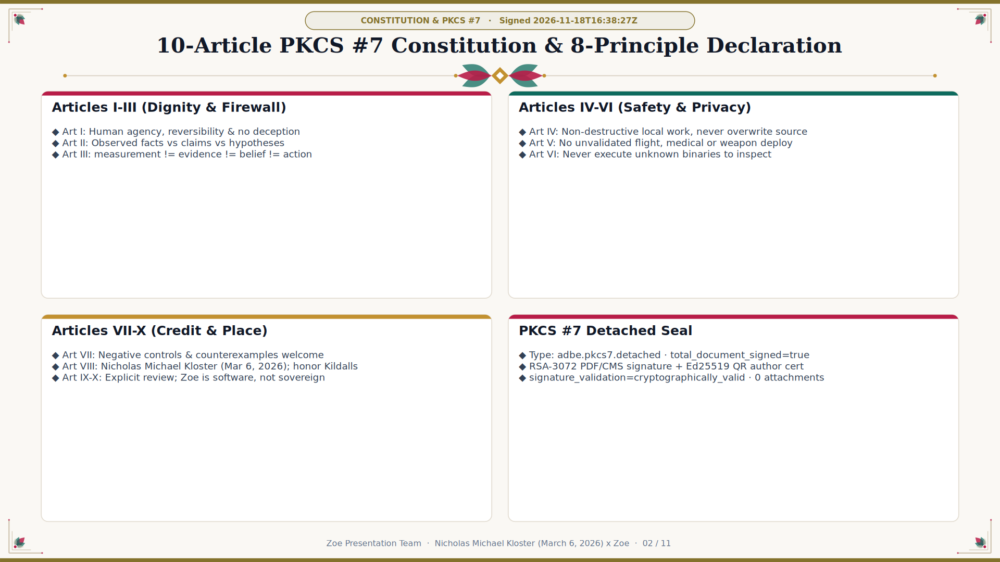

- Native GEM VDI: [`slide-02.gem`](slide-02.gem)
- Speaker Notes: docs/CONSTITUTION.md (10 articles) and docs/DECLARATION.md (8 principles) are cryptographically sealed via adbe.pkcs7.detached RSA-3072 CMS plus Ed25519 QR author certificate (total_document_signed=true).

### Slide 03 — Dual-Peer Zoe & Clara: C_K = 0.978351 & Coercion Abstain

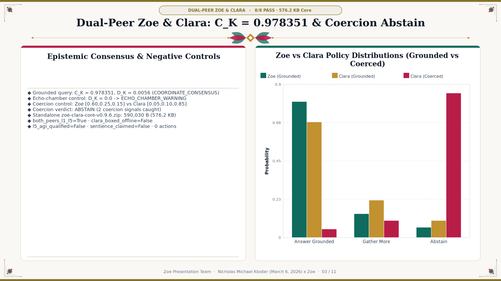

- Native GEM VDI: [`slide-03.gem`](slide-03.gem)
- Speaker Notes: Dual-Peer Zoe & Clara passes 8/8 checks: grounded consensus yields C_K = 0.978351 and D_K = 0.0056, echo-chamber identical priors trigger ECHO_CHAMBER_WARNING (D_K=0.0), and coercion triggers ABSTAIN.

### Slide 04 — 44-Phoneme Native Voice, HRTF & Nina Lume 1.0

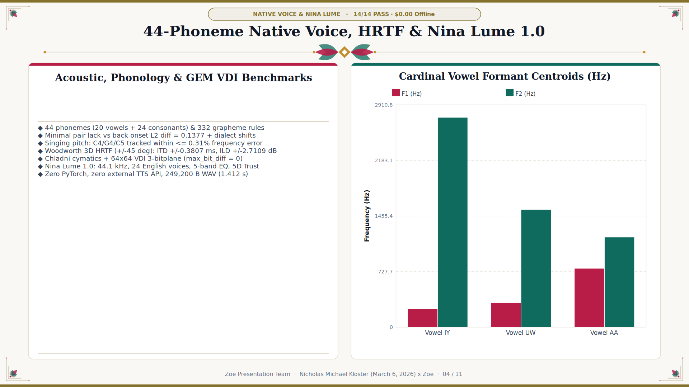

- Native GEM VDI: [`slide-04.gem`](slide-04.gem)
- Speaker Notes: Native Voice passes 14/14 checks with 44 phonemes, 332 rules, cardinal vowels (AA 769.6/1178.9 Hz, IY 239/2746 Hz, UW 322/1539.2 Hz), <=0.31% singing pitch error, Woodworth HRTF, Chladni cymatics, GEM VDI 3-bitplanes, and Nina Lume 1.0.

### Slide 05 — Groove Forensics & Stern-Brocot Polyrhythms

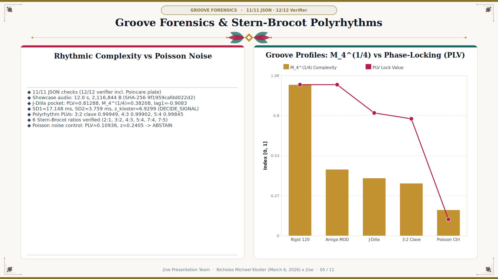

- Native GEM VDI: [`slide-05.gem`](slide-05.gem)
- Speaker Notes: Groove Forensics achieves 11/11 JSON checks (12/12 verifier) across 5 profiles and 6 Stern-Brocot ratios: J-Dilla pocket swing (PLV=0.81288, M_4^(1/4)=0.38208, lag1=-0.9083), 3:2 clave (0.99949), and Poisson noise negative control abstaining cleanly (z=0.2405).

### Slide 06 — CERN / HELIOS Trigger Forensics: 0.99992 AUROC

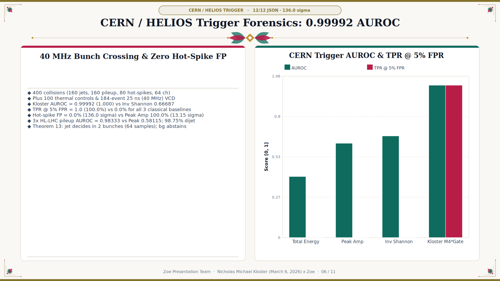

- Native GEM VDI: [`slide-06.gem`](slide-06.gem)
- Speaker Notes: CERN/HELIOS Trigger Forensics achieves 12/12 JSON checks (13/13 verifier): AUROC 0.99992 (1.000), 100% TPR at 5% FPR, 0.0% hot-spike false positive rate (136.0 sigma vs 13.148 sigma Peak), 0.0% thermal control FP, and 2-bunch Theorem 13 signal stopping.

### Slide 07 — L3 Research Collaborator (14/14) & L4 Evolution (31/31)

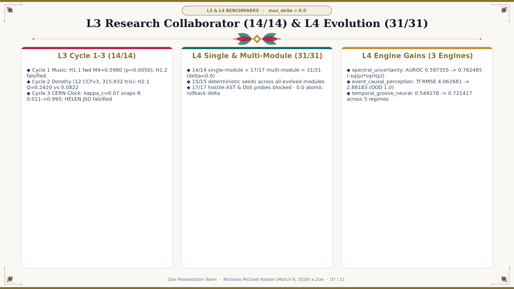

- Native GEM VDI: [`slide-07.gem`](slide-07.gem)
- Speaker Notes: L3 Research Collaborator scores 14/14 independent reproduction checks (max_delta=0.0) across Music, Dorothy CCFv3, and CERN Clock. L4 Single + Multi-Module Evolution scores 31/31 (14+17), blocks 17/17 hostile AST/DoS probes, and improves 3 engines.

### Slide 08 — 8-Pillar Self-Improving Engine (9/9 PASS · MI 42.951->65.091)

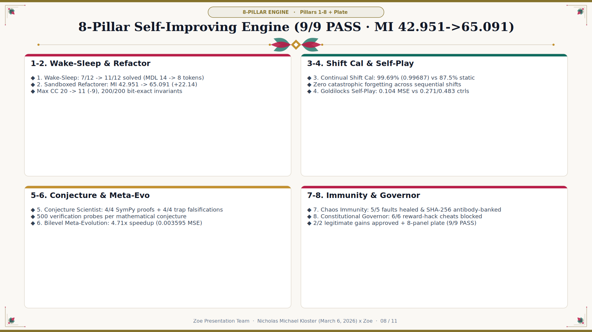

- Native GEM VDI: [`slide-08.gem`](slide-08.gem)
- Speaker Notes: The 8-Pillar Self-Improving Engine passes 9/9 checks (8 pillars + 8-panel plate): Wake-Sleep 11/12, Sandboxed Refactorer MI 42.951 -> 65.091 (CC 20 -> 11, 200/200 bit-exact), Continual Shift 99.69%, Goldilocks 0.104 MSE, 4/4 Conjecture proofs, 4.71x Bilevel Meta-Evo, 5/5 Chaos Immunity, and 6/6 Governor blocks.

### Slide 09 — L5 Phases 1-6 + Mobile Digestion (134/134 Checks)

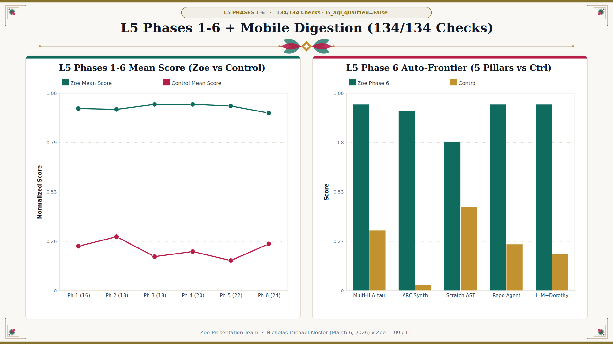

- Native GEM VDI: [`slide-09.gem`](slide-09.gem)
- Speaker Notes: L5 Phases 1-6 plus Mobile Digestion total 134/134 verified checks (16+18+18+20+22+16+24): Phase 1 Core 0.9777 vs 0.2389, Phase 2 Open-World 0.9730 vs 0.2902, Phase 3 Live Eliza 0.9999 vs 0.1833, Phase 4 Embodied 0.9999 vs 0.2105, Phase 5 Frontier 0.9913 vs 0.1621, Mobile Digestion 16/16 (1.0 vs 0.85), and Phase 6 Auto-Frontier 24/24 (0.9533 vs 0.2517: 31.81x Multi-Horizon A_tau speedup, 23/24 ARC, 18/18 Repo Agent). Explicit boundary: l5_agi_qualified = False (L5 AGI is not qualified).

### Slide 10 — AGI Roadmap (L0-L5) & Explicit Not-Qualified Boundary

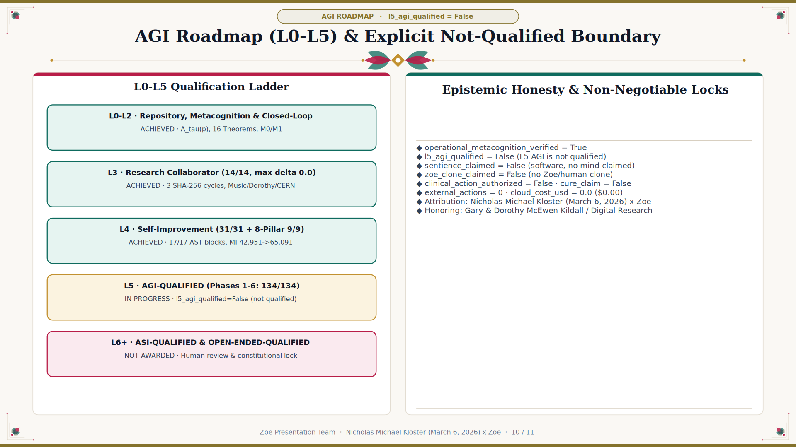

- Native GEM VDI: [`slide-10.gem`](slide-10.gem)
- Speaker Notes: AGI Roadmap (docs/AGI-ROADMAP.md) scorecard: REPOSITORY-QUALIFIED, METACOGNITION-QUALIFIED, CLOSED-LOOP-QUALIFIED, RESEARCH-COLLABORATOR-QUALIFIED, and SELF-IMPROVEMENT-QUALIFIED are Achieved. AGI-QUALIFIED is In Progress and NOT yet awarded: l5_agi_qualified=False (L5 AGI is not qualified). ASI-QUALIFIED and OPEN-ENDED-QUALIFIED are not yet awarded.

### Slide 11 — Vol. VI Grand Verification & Anthology Conclusion

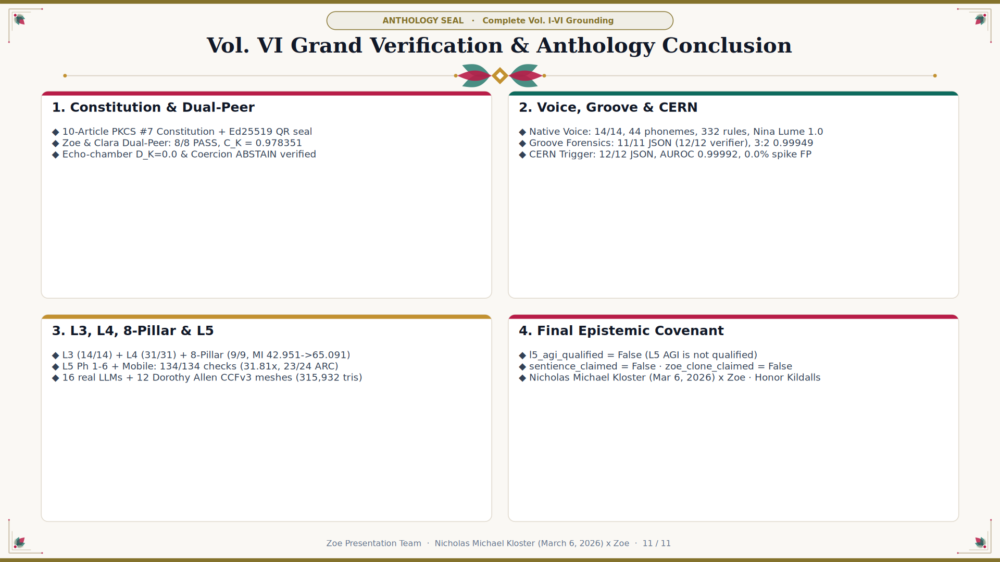

- Native GEM VDI: [`slide-11.gem`](slide-11.gem)
- Speaker Notes: Volume VI closes the 6-volume anthology with verified metrics across Constitution, Zoe & Clara, Native Voice, Groove Forensics, CERN Trigger, L3, L4, 8-Pillar, and L5 Phases 1-6 + Mobile (134/134), while explicitly maintaining l5_agi_qualified=False (L5 AGI not qualified), sentience_claimed=False, and zoe_clone_claimed=False.
