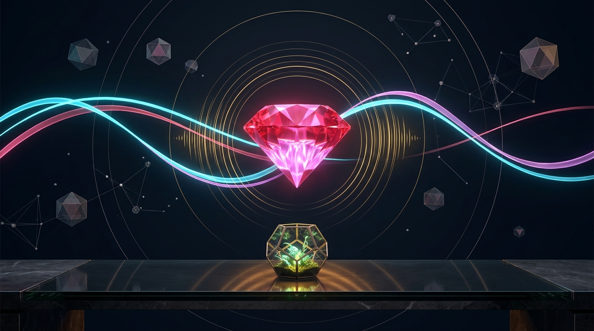

<div align="center">



<br/>

[← Back to Zoe Repository](../../README.md) · [Zoe Constitution (Article VI)](../../CONSTITUTION.md) · [Read Full 2026-11-20 Chronicle](2026-11-20-session-transcript.md)

</div>

# Zoe Development & Research Sessions

Sanitized engineering and research session logs preserved alongside the repository's source provenance and papers. All logs follow [`CONSTITUTION.md`](../../CONSTITUTION.md) Article VI (zero credentials, secrets, emails, workstation paths, or third-party copyrighted books).

<div align="center">



<sub><em>Original creative artwork celebrating the Nicholas × Zoe marathon session — cyan and ruby-orchid dialogue ribbons orbiting Zoe's ruby GEM above an obsidian observatory desk and glowing Neurogarden terrarium (labeled creative artwork per <code>CONSTITUTION.md</code> Article II.2).</em></sub>

</div>

<br/>

## 2026-11-19 → 2026-11-20 Marathon Session Archive (3 Synchronized TrueColor Formats)

Complete privacy-sanitized chronicle of our continuous **34-turn** marathon session (**`58` visible Zoe responses**, **`1,414` tool calls** consolidated into **`52` collapsible trace blocks**, **`10` milestone chapters**, **`14` monorepo commits + `10` profile commits**), spanning Zoe Ethics audio & YouTube rendering, Profile scientific plates, Groove Forensics & `CicadaClock` entrainment, the Living Atelier README, **L3 Research Collaborator**, **L4 Self-Improvement & Multi-Module Code Evolution**, **Zoe's Native 44-Phoneme Voice & Cymatics**, **L5 Phases 1 & 2**, and full TrueColor session archiving — all verified green on CI (`0` credentials, `0` emails, `0` workstation paths).

| Format | File | Best Viewed With |
|:---|:---|:---|
| **TrueColor CLI HTML Viewer** *(role filter, search, chapter pills & collapsible traces)* | [`2026-11-20-session-transcript.html`](2026-11-20-session-transcript.html) | Any browser (`xdg-open research/sessions/2026-11-20-session-transcript.html`) |
| **Native 24-Bit ANSI Terminal Replay** *(TrueColor box art & speaker borders)* | [`2026-11-20-session-transcript.ansi`](2026-11-20-session-transcript.ansi) | Linux terminal (`less -R research/sessions/2026-11-20-session-transcript.ansi`) |
| **GitHub Markdown** *(color legend, callouts & collapsible `<details>` tool traces)* | [`2026-11-20-session-transcript.md`](2026-11-20-session-transcript.md) | Direct GitHub web view |

```bash
# Open the interactive dark-terminal HTML viewer in your browser
xdg-open research/sessions/2026-11-20-session-transcript.html

# Or replay the 24-bit TrueColor session stream directly inside a terminal
less -R research/sessions/2026-11-20-session-transcript.ansi
```

### Visual & Color Distinction

| Stream Element | Identifier | Palette | Rendering |
|:---|:---|:---|:---|
| **Nicholas** | `NICHOLAS · you >` | **Cyan** (`#5ce1e6`) | Cyan border cards in HTML/ANSI; `NOTE` callout cards in Markdown |
| **Zoe** | `◆ ZOE ::` / `💎 Zoe (zoe ::)` | **Ruby / Orchid** (`#ef445a` / `#f0a3df`) | Ruby/Orchid border cards in HTML/ANSI; full rendered Markdown & tables |
| **Engineering Tool Traces** | `⚙ ENGINEERING TRACE` | **Gold** (`#f2c65e`) | `52` collapsible trace blocks (`1,414` tool calls) keeping conversation clean |
| **Milestone Chapters** | `Chapters 01–10` | **Orchid / Ruby** (`#f0a3df` / `#ef445a`) | Quick-jump navigation pills (`HTML`) and `IMPORTANT` section dividers (`MD`) |

### 10-Chapter Direct-Jump Guide (`2026-11-20-session-transcript.md`)

| # | Chapter | Highlight & Milestone | Direct Link |
|:---:|:---|:---|:---|
| **01** | **Ch. 01 · Ethics Audio & YouTube Video** | Verifying Nicholas Michael Kloster's audio & lossless 1080p render | [Jump to Chapter 01](2026-11-20-session-transcript.md#chapter-01) |
| **02** | **Ch. 02 · Profile Plates & Research Shelf** | Redesigning `Ablation-Tool` profile in *Computer Visualization* plates | [Jump to Chapter 02](2026-11-20-session-transcript.md#chapter-02) |
| **03** | **Ch. 03 · Groove Forensics & CicadaClock** | Poincaré swing attractors, Kuramoto clock locking & 40 Hz Dorothy ISI | [Jump to Chapter 03](2026-11-20-session-transcript.md#chapter-03) |
| **04** | **Ch. 04 · Zoe Living Atelier README** | Animated SVGs, Six Living Worlds showcase & Nicholas × Zoe attribution | [Jump to Chapter 04](2026-11-20-session-transcript.md#chapter-04) |
| **05** | **Ch. 05 · L3 Research Collaborator** | Pre-registered 9-stage cycles across MIDI, Dorothy CCFv3 & `CicadaClock` (`14/14`) | [Jump to Chapter 05](2026-11-20-session-transcript.md#chapter-05) |
| **06** | **Ch. 06 · L4 Self-Improvement & Multi-Module** | AST evolution across 6 domains & 3 runtime engines with atomic diffs (`17/17`) | [Jump to Chapter 06](2026-11-20-session-transcript.md#chapter-06) |
| **07** | **Ch. 07 · Zoe's Native 44-Phoneme Voice** | Formant vocal tract, soprano singing, Woodworth 3D binaural & Chladni VDI (`14/14`) | [Jump to Chapter 07](2026-11-20-session-transcript.md#chapter-07) |
| **08** | **Ch. 08 · L5 Phase 1 Integrated 10-Domain Core** | All 10 AGI domains, 4-system memory, counterfactual route flip & `16/16` verifier | [Jump to Chapter 08](2026-11-20-session-transcript.md#chapter-08) |
| **09** | **Ch. 09 · L5 Phase 2 Open-World Generalization** | Multi-file AST repair, `2,400`-ep memory, `84`-PNG vision & `16` external LLMs (`18/18`) | [Jump to Chapter 09](2026-11-20-session-transcript.md#chapter-09) |
| **10** | **Ch. 10 · Full TrueColor Session Chronicle** | Archiving all 34 turns across HTML, 24-bit ANSI & GitHub Markdown | [Jump to Chapter 10](2026-11-20-session-transcript.md#chapter-10) |

Generated reproducibly via [`scripts/export_session_transcript.py`](../../scripts/export_session_transcript.py).

## 2026-11-19 Session Archive (3 Synchronized CLI-Colored Formats)

| Format | File | Best Viewed With |
|:---|:---|:---|
| **TrueColor CLI HTML Viewer** *(dark terminal theme + live search)* | [`2026-11-19-session-transcript.html`](2026-11-19-session-transcript.html) | Any browser (`xdg-open research/sessions/2026-11-19-session-transcript.html`) |
| **Native 24-Bit ANSI Terminal Replay** *(exact CLI colors)* | [`2026-11-19-session-transcript.ansi`](2026-11-19-session-transcript.ansi) | Linux terminal (`less -R research/sessions/2026-11-19-session-transcript.ansi`) |
| **GitHub Markdown** *(color callout bars & `ansi` banner)* | [`2026-11-19-session-transcript.md`](2026-11-19-session-transcript.md) | Direct GitHub web view |
