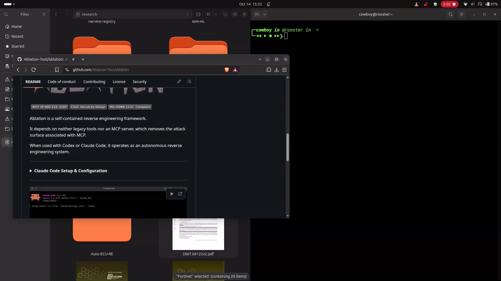
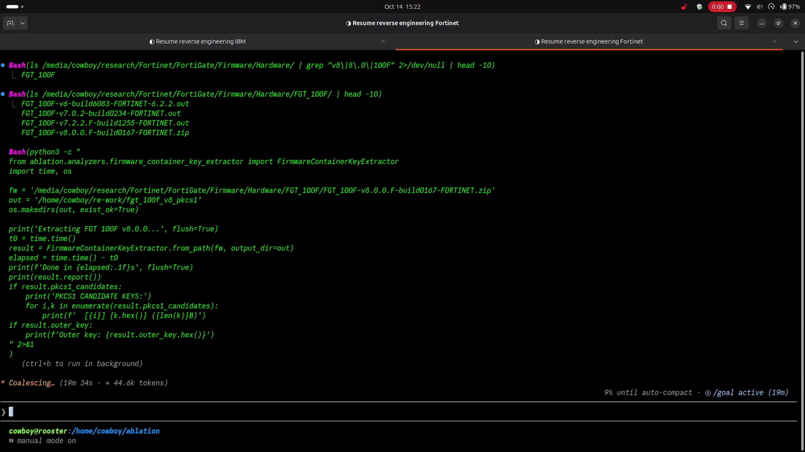
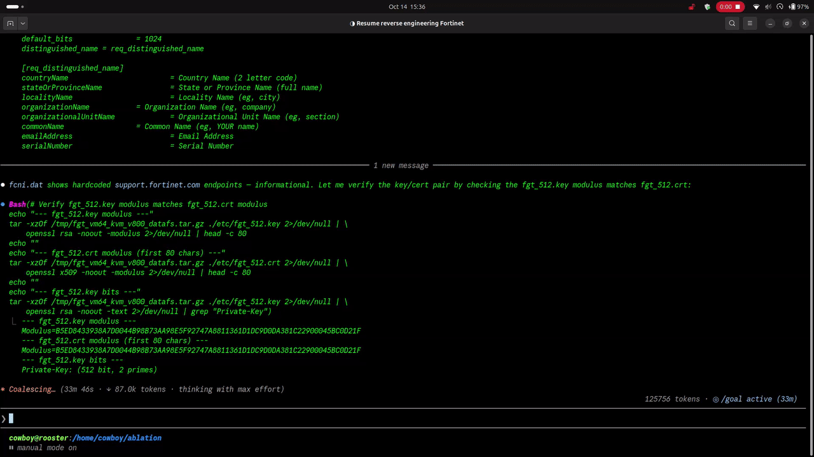
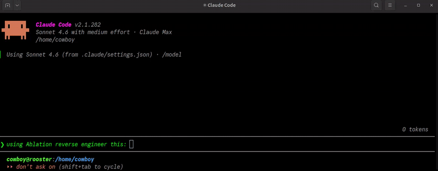
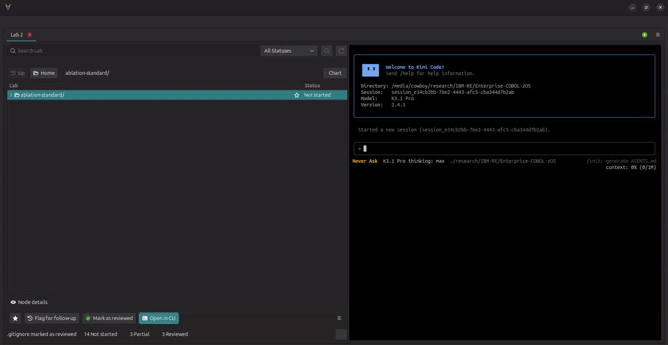
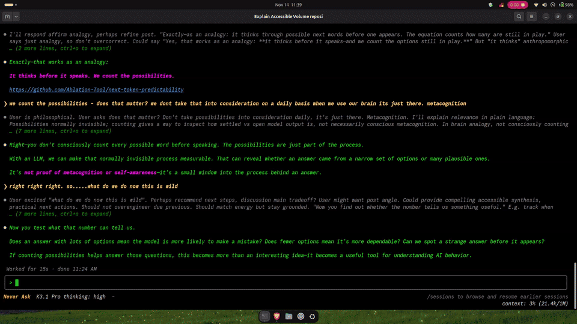

# Animations and historical motion assets

[Archive index](../../README.md) · [Full catalog](../README.md)

**8 unique visuals.** Click an item title for its detailed explanation and provenance, or the image for the original file.

## [ZVA-0098 — Nick+zoe](../items/ZVA-0098.md)

One of four supplied historical GIF names preserved in the branding archive. All four names have identical content bytes, so this is one recorded animation with four occurrence names rather than four distinct works.

**Provenance:** User-supplied historical motion asset · **Occurrences:** 4

## [ZVA-0175 — Ablation In Action 01](../items/ZVA-0175.md)

A recorded Ablation In Action 01 demonstration animation showing the associated project workflow and interface in motion. This historical motion asset is retained as part of the project’s visual provenance, including duplicate-name and duplicate-content relationships.

**Provenance:** User-supplied historical motion asset · **Occurrences:** 1

## [ZVA-0176 — How To Use Ablation](../items/ZVA-0176.md)

A recorded How To Use Ablation demonstration animation showing the associated project workflow and interface in motion. This historical motion asset is retained as part of the project’s visual provenance, including duplicate-name and duplicate-content relationships.

**Provenance:** User-supplied historical motion asset · **Occurrences:** 1

## [ZVA-0177 — Learn As You Re](../items/ZVA-0177.md)

A recorded Learn As You Re demonstration animation showing the associated project workflow and interface in motion. This historical motion asset is retained as part of the project’s visual provenance, including duplicate-name and duplicate-content relationships.

**Provenance:** User-supplied historical motion asset · **Occurrences:** 1

## [ZVA-0178 — Claude Code Demo](../items/ZVA-0178.md)

A recorded Claude Code Demo demonstration animation showing the associated project workflow and interface in motion. This historical motion asset is retained as part of the project’s visual provenance, including duplicate-name and duplicate-content relationships.

**Provenance:** User-supplied historical motion asset · **Occurrences:** 2

## [ZVA-0209 — GEM Workbench Demo](../items/ZVA-0209.md)

A recorded GEM Workbench Demo demonstration animation showing the associated project workflow and interface in motion. This historical motion asset is retained as part of the project’s visual provenance, including duplicate-name and duplicate-content relationships.

**Provenance:** User-supplied historical motion asset · **Occurrences:** 1

## [ZVA-0240 — Demo](../items/ZVA-0240.md)

A recorded Demo demonstration animation showing the associated project workflow and interface in motion. This historical motion asset is retained as part of the project’s visual provenance, including duplicate-name and duplicate-content relationships.

**Provenance:** User-supplied historical motion asset · **Occurrences:** 1

## [ZVA-0289 — Accessible Volume Tldr](../items/ZVA-0289.md)

An animated terminal walkthrough introducing the accessible-volume measurement and its TL;DR workflow. This historical motion asset is retained as part of the project’s visual provenance, including duplicate-name and duplicate-content relationships.

**Provenance:** User-supplied historical motion asset · **Occurrences:** 2
