# Source references and derivative reading copies

[Archive index](../../README.md) · [Full catalog](../README.md)

**33 unique visuals.** Click an item title for its detailed explanation and provenance, or the image for the original file.

## [ZVA-0104 — Symbol E](../items/ZVA-0104.md)

A supplied E/e glyph-grid reference used to guide outlined GEM cells, not a new statement of GEM semantics. This asset preserves source context or a derivative reading view so that generated interpretations remain distinguishable from their references.

<a href="../../images/ZVA-0104.png">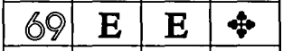</a>

**Provenance:** User-supplied visual reference · **Occurrences:** 1

## [ZVA-0105 — Symbol Epsilon](../items/ZVA-0105.md)

A supplied epsilon/symbol-grid reference retained for the outlined GEM visual study. This asset preserves source context or a derivative reading view so that generated interpretations remain distinguishable from their references.

<a href="../../images/ZVA-0105.png">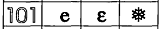</a>

**Provenance:** User-supplied visual reference · **Occurrences:** 1

## [ZVA-0106 — Symbol G](../items/ZVA-0106.md)

A supplied G/g glyph-grid reference used in the original GEM scene composition. This asset preserves source context or a derivative reading view so that generated interpretations remain distinguishable from their references.

<a href="../../images/ZVA-0106.png">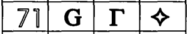</a>

**Provenance:** User-supplied visual reference · **Occurrences:** 1

## [ZVA-0107 — Symbol M](../items/ZVA-0107.md)

A supplied M/m glyph-grid reference used in the original GEM scene composition. This asset preserves source context or a derivative reading view so that generated interpretations remain distinguishable from their references.

<a href="../../images/ZVA-0107.png">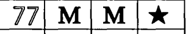</a>

**Provenance:** User-supplied visual reference · **Occurrences:** 1

## [ZVA-0108 — Symbol O](../items/ZVA-0108.md)

A supplied O/o glyph-grid reference used in the original GEM scene composition. This asset preserves source context or a derivative reading view so that generated interpretations remain distinguishable from their references.

<a href="../../images/ZVA-0108.png">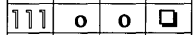</a>

**Provenance:** User-supplied visual reference · **Occurrences:** 1

## [ZVA-0109 — Symbol Z](../items/ZVA-0109.md)

A supplied Z/z glyph-grid reference associated with the Zoe/GEM visual study. This asset preserves source context or a derivative reading view so that generated interpretations remain distinguishable from their references.

<a href="../../images/ZVA-0109.png">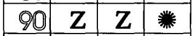</a>

**Provenance:** User-supplied visual reference · **Occurrences:** 1

## [ZVA-0211 — Screenshot 20261104 142508](../items/ZVA-0211.md)

An immutable sacred-geometry source image (Screenshot 20261104 142508) containing mathematical notation or diagrams used for exact transcription, OCR comparison, pixel measurement, and replay.

<a href="../../images/ZVA-0211.png">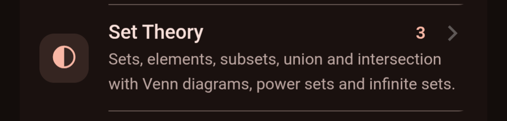</a>

**Provenance:** Immutable or derived sacred-geometry experiment source · **Occurrences:** 1

## [ZVA-0212 — Screenshot 20261104 142605](../items/ZVA-0212.md)

An immutable sacred-geometry source image (Screenshot 20261104 142605) containing mathematical notation or diagrams used for exact transcription, OCR comparison, pixel measurement, and replay.

**Provenance:** Immutable or derived sacred-geometry experiment source · **Occurrences:** 1

## [ZVA-0213 — Screenshot 20261104 142622](../items/ZVA-0213.md)

An immutable sacred-geometry source image (Screenshot 20261104 142622) containing mathematical notation or diagrams used for exact transcription, OCR comparison, pixel measurement, and replay.

<a href="../../images/ZVA-0213.png">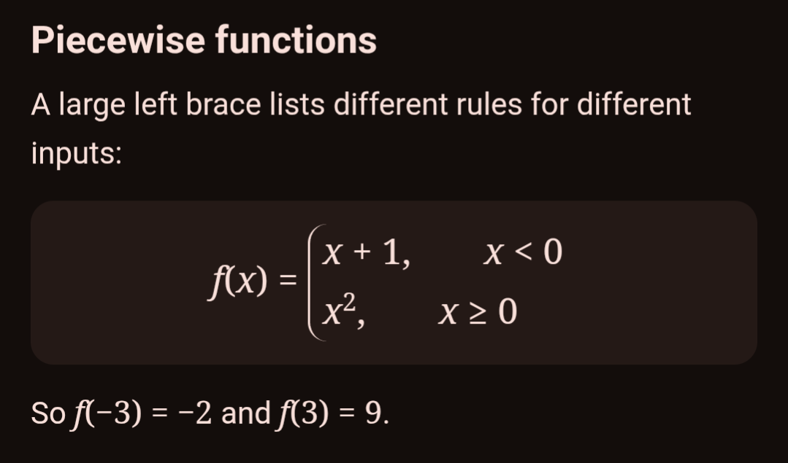</a>

**Provenance:** Immutable or derived sacred-geometry experiment source · **Occurrences:** 1

## [ZVA-0214 — Screenshot 20261104 142637](../items/ZVA-0214.md)

An immutable sacred-geometry source image (Screenshot 20261104 142637) containing mathematical notation or diagrams used for exact transcription, OCR comparison, pixel measurement, and replay.

<a href="../../images/ZVA-0214.png">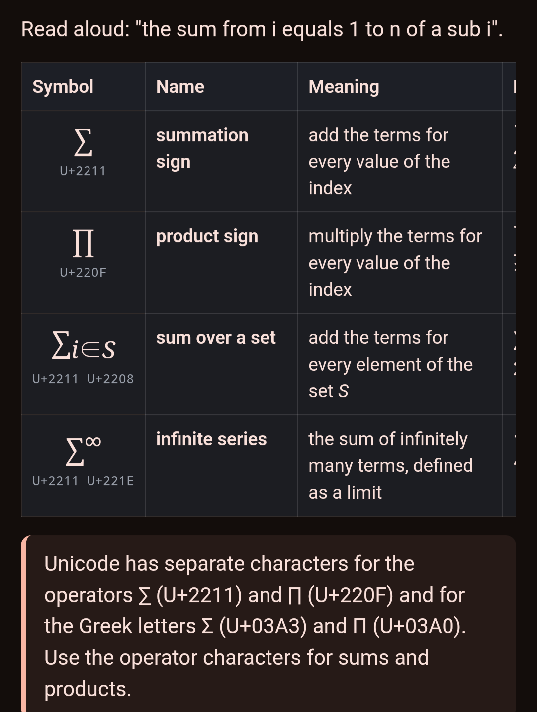</a>

**Provenance:** Immutable or derived sacred-geometry experiment source · **Occurrences:** 1

## [ZVA-0215 — Screenshot 20261104 142703](../items/ZVA-0215.md)

An immutable sacred-geometry source image (Screenshot 20261104 142703) containing mathematical notation or diagrams used for exact transcription, OCR comparison, pixel measurement, and replay.

<a href="../../images/ZVA-0215.png">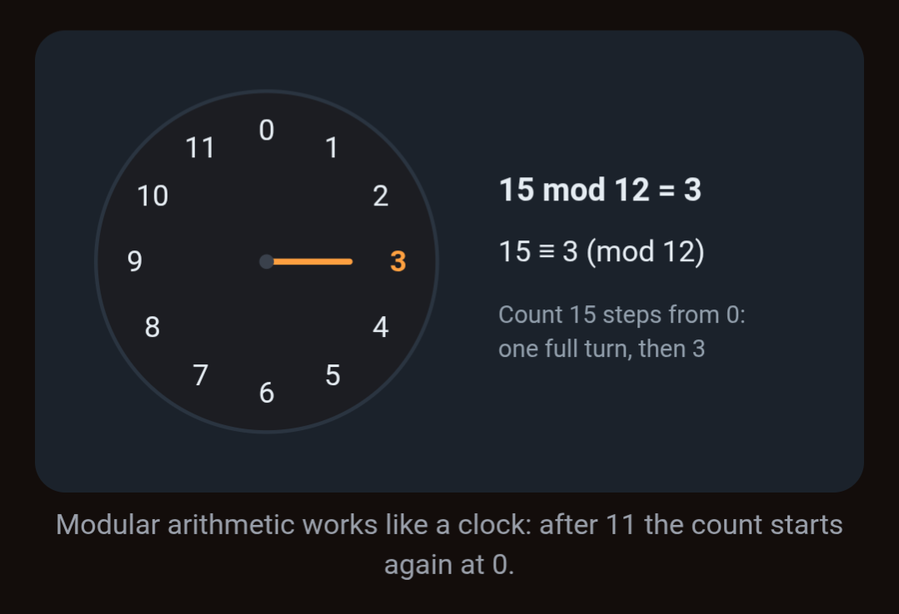</a>

**Provenance:** Immutable or derived sacred-geometry experiment source · **Occurrences:** 1

## [ZVA-0216 — Screenshot 20261104 142802](../items/ZVA-0216.md)

An immutable sacred-geometry source image (Screenshot 20261104 142802) containing mathematical notation or diagrams used for exact transcription, OCR comparison, pixel measurement, and replay.

<a href="../../images/ZVA-0216.png">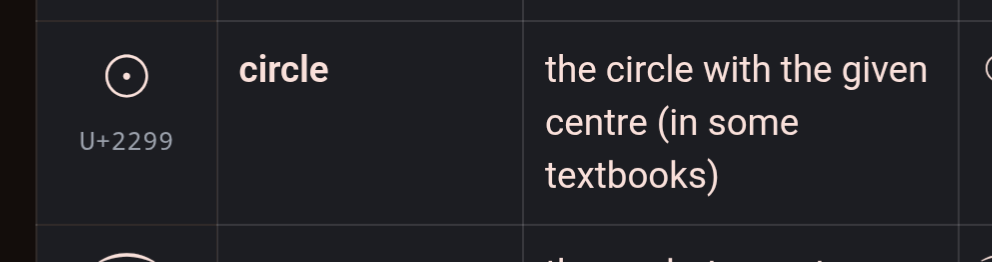</a>

**Provenance:** Immutable or derived sacred-geometry experiment source · **Occurrences:** 1

## [ZVA-0217 — Screenshot 20261104 142821](../items/ZVA-0217.md)

An immutable sacred-geometry source image (Screenshot 20261104 142821) containing mathematical notation or diagrams used for exact transcription, OCR comparison, pixel measurement, and replay.

<a href="../../images/ZVA-0217.png">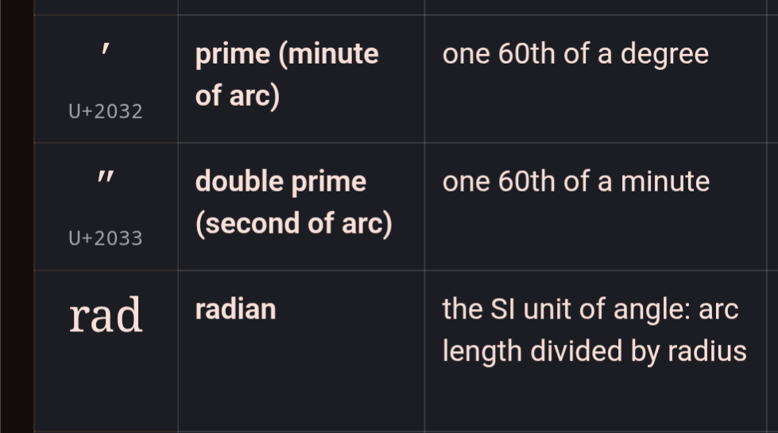</a>

**Provenance:** Immutable or derived sacred-geometry experiment source · **Occurrences:** 1

## [ZVA-0218 — Screenshot 20261104 142841](../items/ZVA-0218.md)

An immutable sacred-geometry source image (Screenshot 20261104 142841) containing mathematical notation or diagrams used for exact transcription, OCR comparison, pixel measurement, and replay.

<a href="../../images/ZVA-0218.png">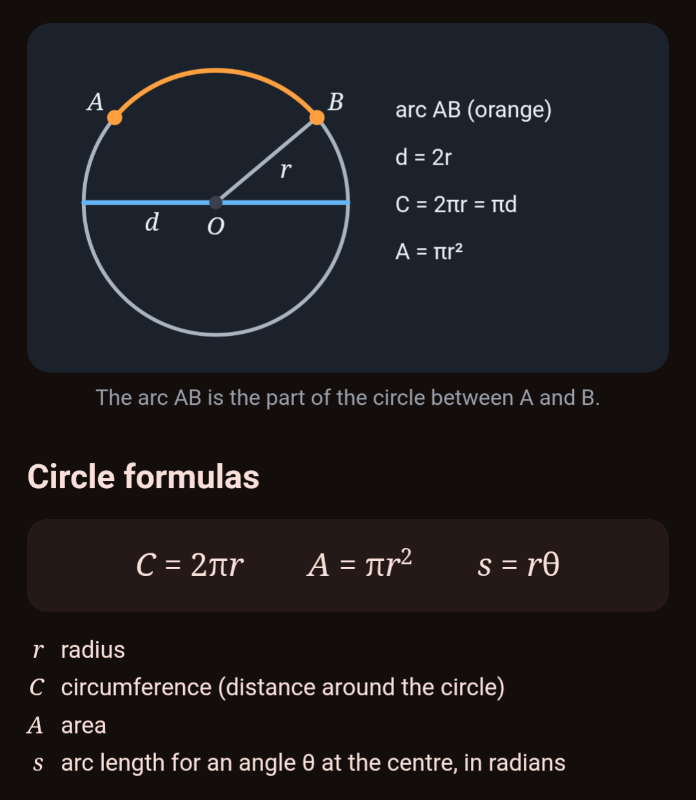</a>

**Provenance:** Immutable or derived sacred-geometry experiment source · **Occurrences:** 1

## [ZVA-0219 — Untitled Drawing (1)](../items/ZVA-0219.md)

The composite landmark-alignment source drawing used to define measured correspondences in the sacred-geometry experiment. This asset preserves source context or a derivative reading view so that generated interpretations remain distinguishable from their references.

<a href="../../images/ZVA-0219.png">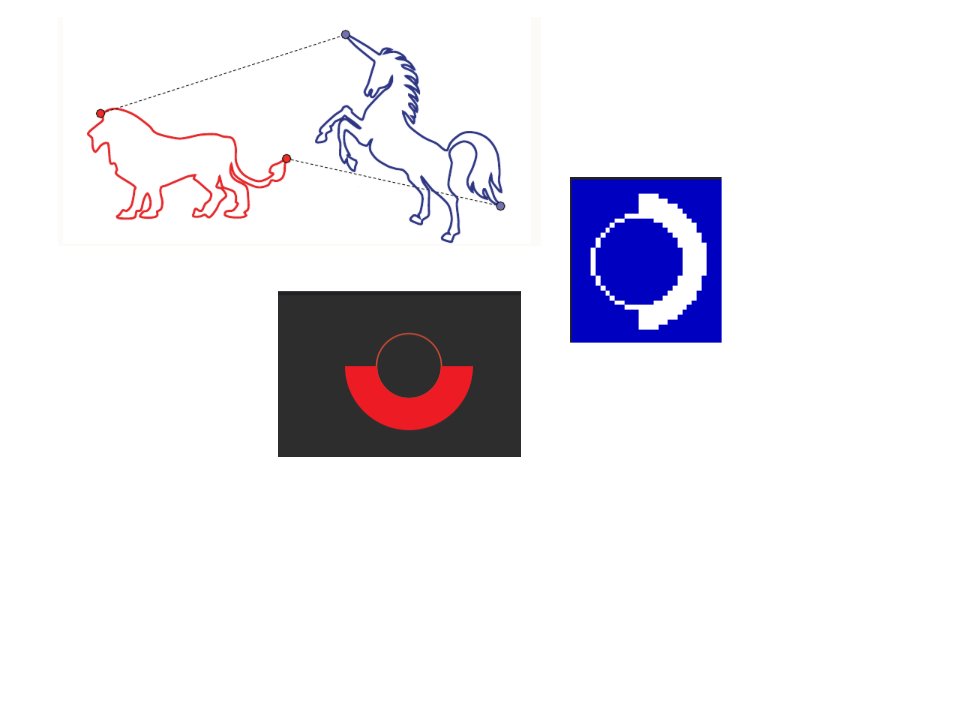</a>

**Provenance:** Immutable or derived sacred-geometry experiment source · **Occurrences:** 1

## [ZVA-0220 — Hub Loop](../items/ZVA-0220.md)

The derived hub-loop mathematical source with eight h nodes and four v nodes around a central hub, used in the reproducible geometry experiment. This asset preserves source context or a derivative reading view so that generated interpretations remain distinguishable from their references.

<a href="../../images/ZVA-0220.png">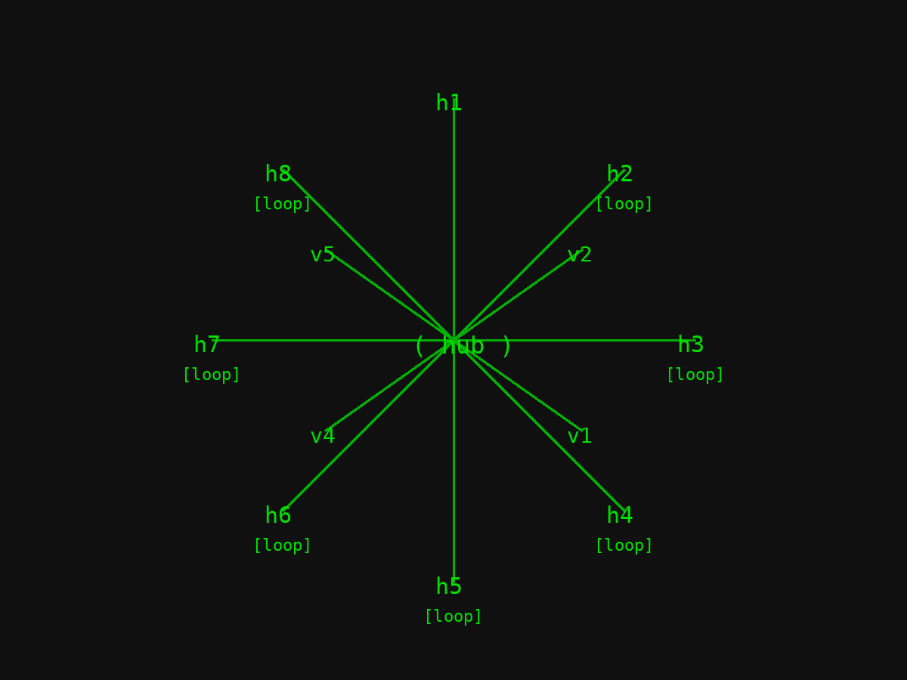</a>

**Provenance:** Immutable or derived sacred-geometry experiment source · **Occurrences:** 1

## [ZVA-0221 — Hub Loop](../items/ZVA-0221.md)

The derived hub-loop mathematical source with eight h nodes and four v nodes around a central hub, used in the reproducible geometry experiment. This asset preserves source context or a derivative reading view so that generated interpretations remain distinguishable from their references.

<a href="../../images/ZVA-0221.svg">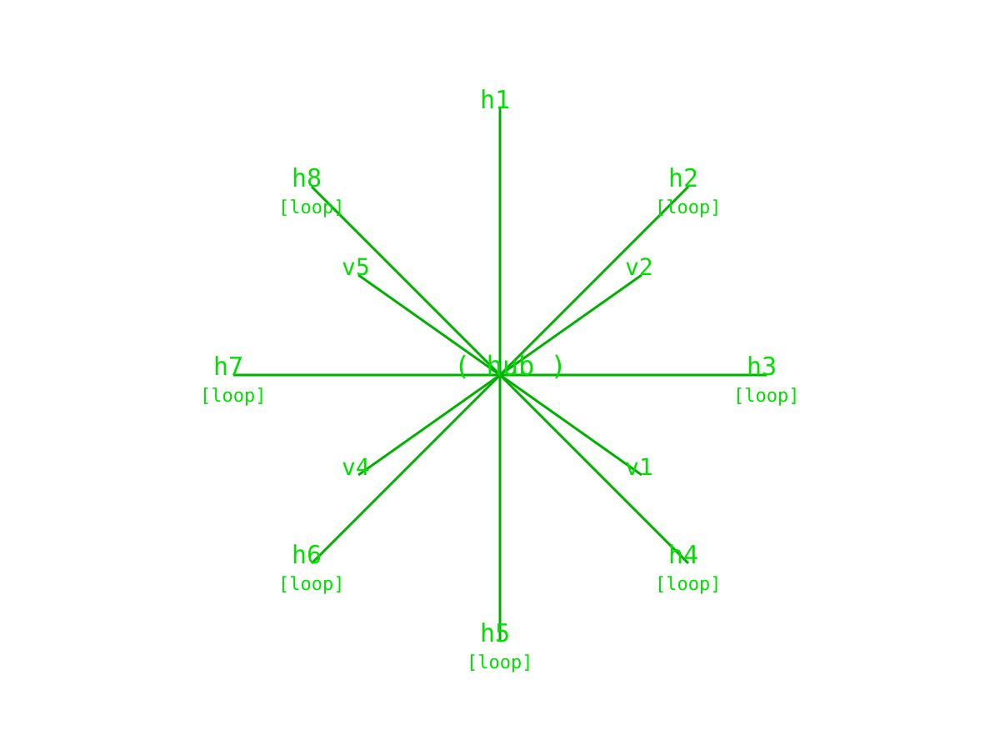</a>

**Provenance:** Immutable or derived sacred-geometry experiment source · **Occurrences:** 1

## [ZVA-0222 — VDI Bidirectional Interface](../items/ZVA-0222.md)

A historical VDI bidirectional-interface reference image used as an architectural analogy for two-way measurement and feedback. This asset preserves source context or a derivative reading view so that generated interpretations remain distinguishable from their references.

<a href="../../images/ZVA-0222.png">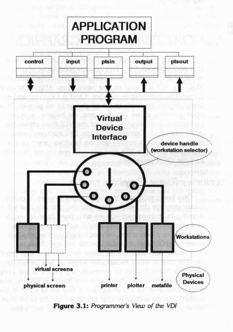</a>

**Provenance:** Zoe/allgems project-generated visual · **Occurrences:** 2

## [ZVA-0296 — Page 01](../items/ZVA-0296.md)

The Significance of Operational Metacognition, page 1. This asset preserves source context or a derivative reading view so that generated interpretations remain distinguishable from their references.

<a href="../../images/ZVA-0296.jpeg">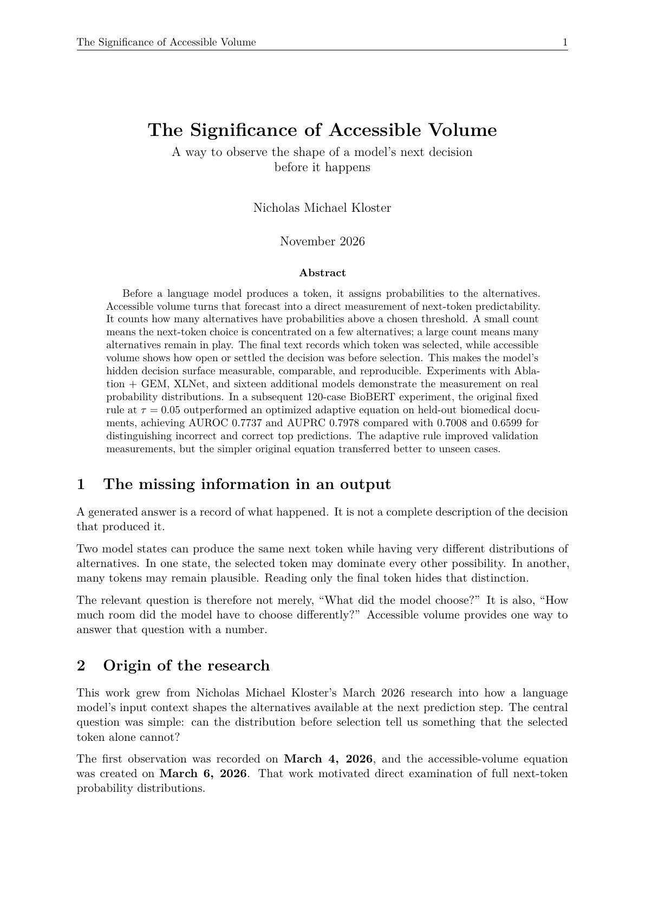</a>

**Provenance:** Derivative paper-page render · **Occurrences:** 2

## [ZVA-0297 — Page 02](../items/ZVA-0297.md)

The Significance of Operational Metacognition, page 2. This asset preserves source context or a derivative reading view so that generated interpretations remain distinguishable from their references.

<a href="../../images/ZVA-0297.jpeg">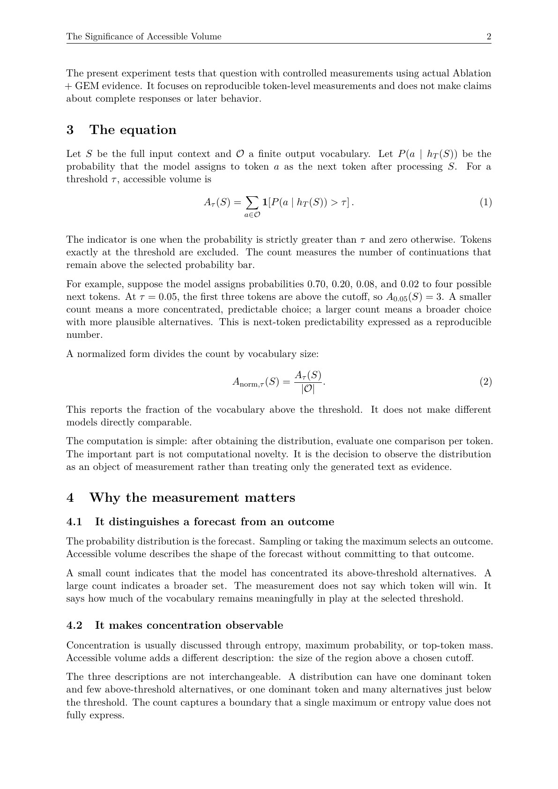</a>

**Provenance:** Derivative paper-page render · **Occurrences:** 2

## [ZVA-0298 — Page 03](../items/ZVA-0298.md)

The Significance of Operational Metacognition, page 3. This asset preserves source context or a derivative reading view so that generated interpretations remain distinguishable from their references.

<a href="../../images/ZVA-0298.jpeg">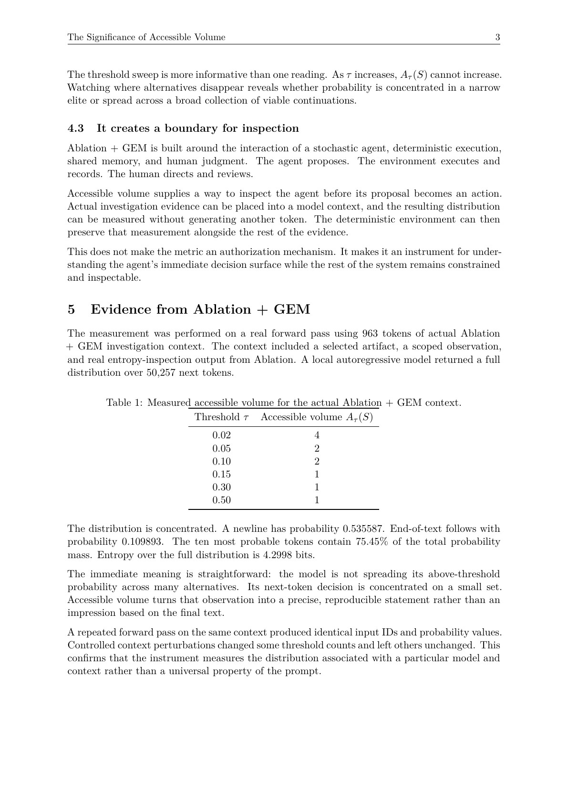</a>

**Provenance:** Derivative paper-page render · **Occurrences:** 2

## [ZVA-0299 — Page 04](../items/ZVA-0299.md)

The Significance of Operational Metacognition, page 4. This asset preserves source context or a derivative reading view so that generated interpretations remain distinguishable from their references.

<a href="../../images/ZVA-0299.jpeg">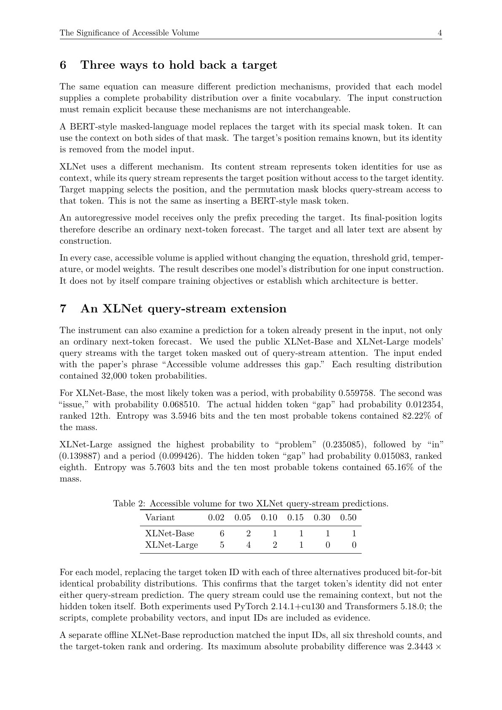</a>

**Provenance:** Derivative paper-page render · **Occurrences:** 2

## [ZVA-0300 — Page 05](../items/ZVA-0300.md)

The Significance of Operational Metacognition, page 5. This asset preserves source context or a derivative reading view so that generated interpretations remain distinguishable from their references.

<a href="../../images/ZVA-0300.jpeg">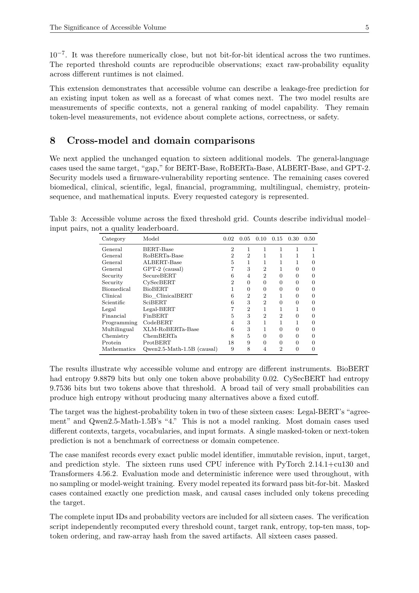</a>

**Provenance:** Derivative paper-page render · **Occurrences:** 2

## [ZVA-0301 — Page 06](../items/ZVA-0301.md)

The Significance of Operational Metacognition, page 6. This asset preserves source context or a derivative reading view so that generated interpretations remain distinguishable from their references.

<a href="../../images/ZVA-0301.jpeg">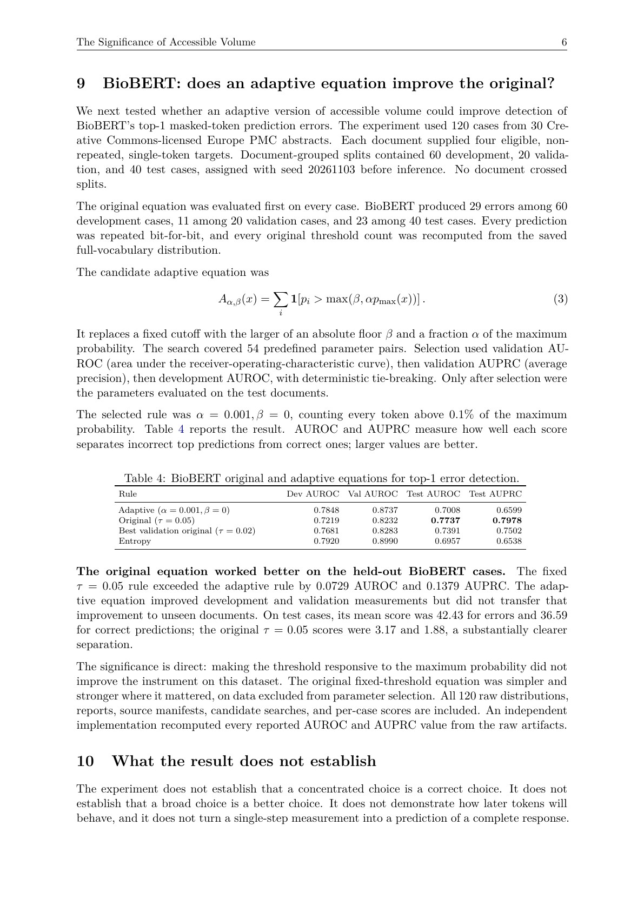</a>

**Provenance:** Derivative paper-page render · **Occurrences:** 2

## [ZVA-0302 — Page 07](../items/ZVA-0302.md)

The Significance of Operational Metacognition, page 7. This asset preserves source context or a derivative reading view so that generated interpretations remain distinguishable from their references.

<a href="../../images/ZVA-0302.jpeg">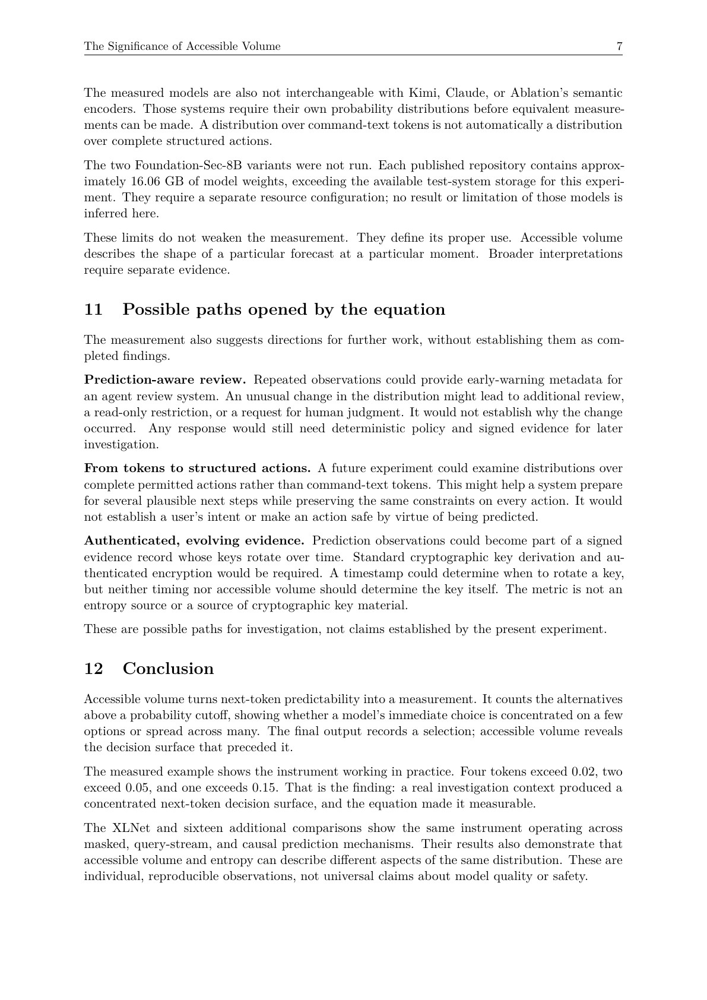</a>

**Provenance:** Derivative paper-page render · **Occurrences:** 2

## [ZVA-0303 — Page 08](../items/ZVA-0303.md)

The Significance of Operational Metacognition, page 8. This asset preserves source context or a derivative reading view so that generated interpretations remain distinguishable from their references.

<a href="../../images/ZVA-0303.jpeg">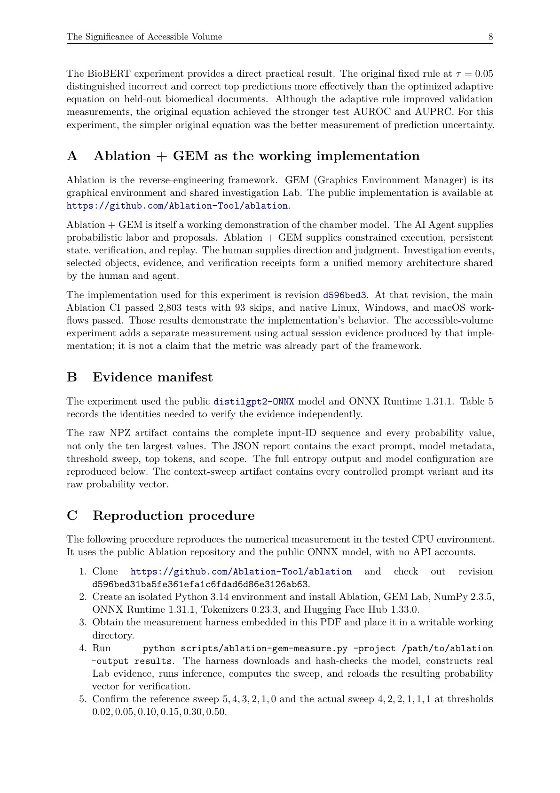</a>

**Provenance:** Derivative paper-page render · **Occurrences:** 2

## [ZVA-0304 — Page 09](../items/ZVA-0304.md)

The Significance of Operational Metacognition, page 9. This asset preserves source context or a derivative reading view so that generated interpretations remain distinguishable from their references.

<a href="../../images/ZVA-0304.jpeg">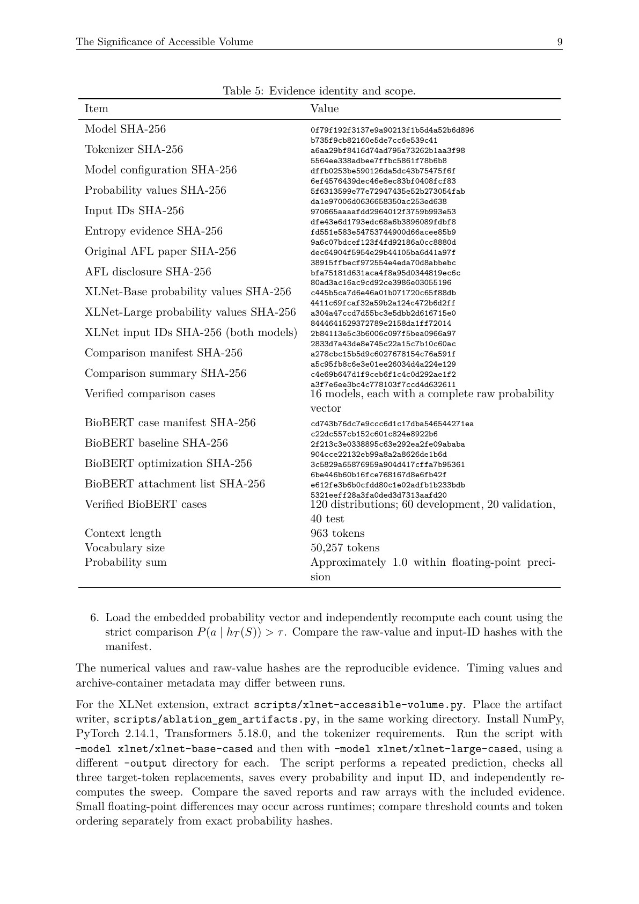</a>

**Provenance:** Derivative paper-page render · **Occurrences:** 2

## [ZVA-0305 — Page 10](../items/ZVA-0305.md)

The Significance of Operational Metacognition, page 10. This asset preserves source context or a derivative reading view so that generated interpretations remain distinguishable from their references.

<a href="../../images/ZVA-0305.jpeg">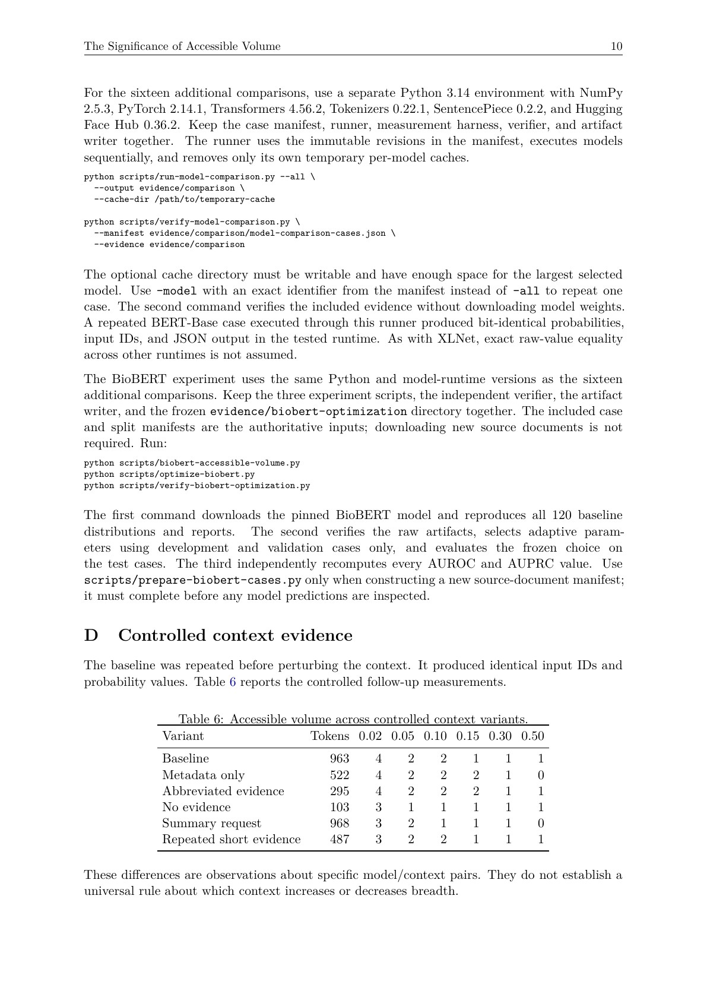</a>

**Provenance:** Derivative paper-page render · **Occurrences:** 2

## [ZVA-0306 — Page 11](../items/ZVA-0306.md)

The Significance of Operational Metacognition, page 11. This asset preserves source context or a derivative reading view so that generated interpretations remain distinguishable from their references.

<a href="../../images/ZVA-0306.jpeg">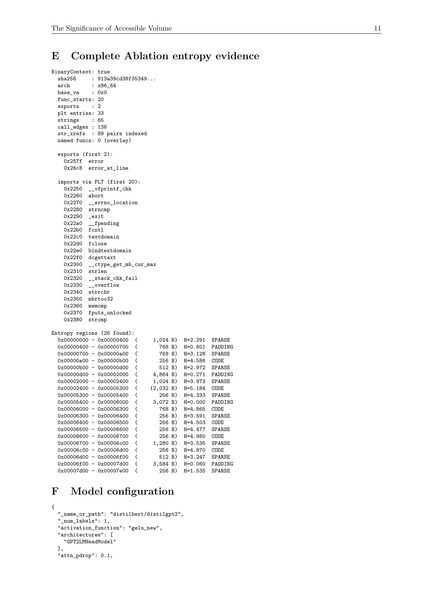</a>

**Provenance:** Derivative paper-page render · **Occurrences:** 2

## [ZVA-0307 — Page 12](../items/ZVA-0307.md)

The Significance of Operational Metacognition, page 12. This asset preserves source context or a derivative reading view so that generated interpretations remain distinguishable from their references.

<a href="../../images/ZVA-0307.jpeg">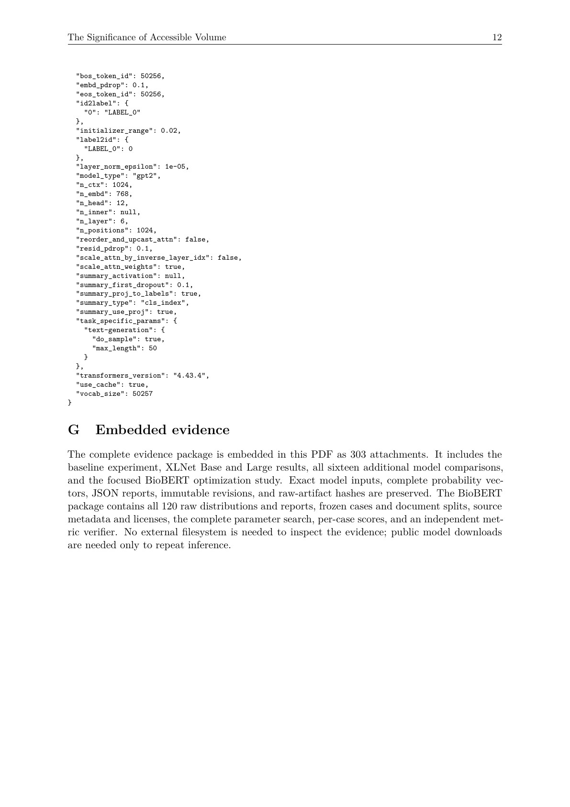</a>

**Provenance:** Derivative paper-page render · **Occurrences:** 2

## [ZVA-0429 — Reference Hub Lattice](../items/ZVA-0429.md)

Reference Hub Lattice is a source references and derivative reading copies asset from the guiai-lab portion of the Zoe/allgems project. This asset preserves source context or a derivative reading view so that generated interpretations remain distinguishable from their references.

<a href="../../images/ZVA-0429.png">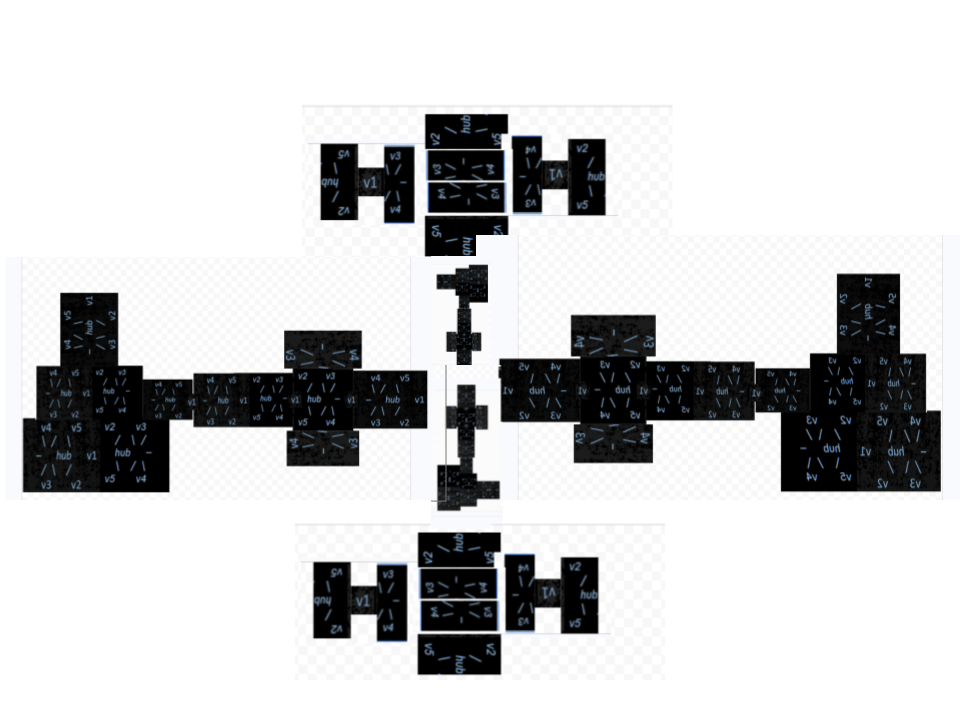</a>

**Provenance:** Source-derived reference visual · **Occurrences:** 1

## [ZVA-0430 — Reference Memory Flow](../items/ZVA-0430.md)

Reference Memory Flow is a source references and derivative reading copies asset from the guiai-lab portion of the Zoe/allgems project. This asset preserves source context or a derivative reading view so that generated interpretations remain distinguishable from their references.

<a href="../../images/ZVA-0430.png">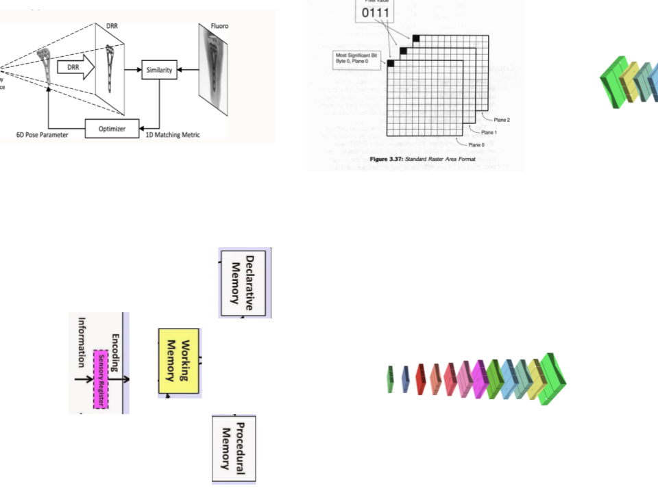</a>

**Provenance:** Source-derived reference visual · **Occurrences:** 1

## [ZVA-0431 — Reference Temporal Layers](../items/ZVA-0431.md)

Reference Temporal Layers is a source references and derivative reading copies asset from the guiai-lab portion of the Zoe/allgems project. This asset preserves source context or a derivative reading view so that generated interpretations remain distinguishable from their references.

<a href="../../images/ZVA-0431.png">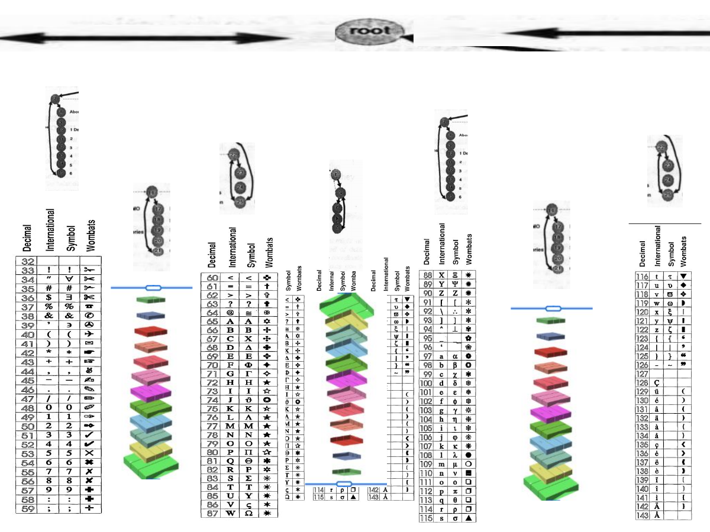</a>

**Provenance:** Source-derived reference visual · **Occurrences:** 1
