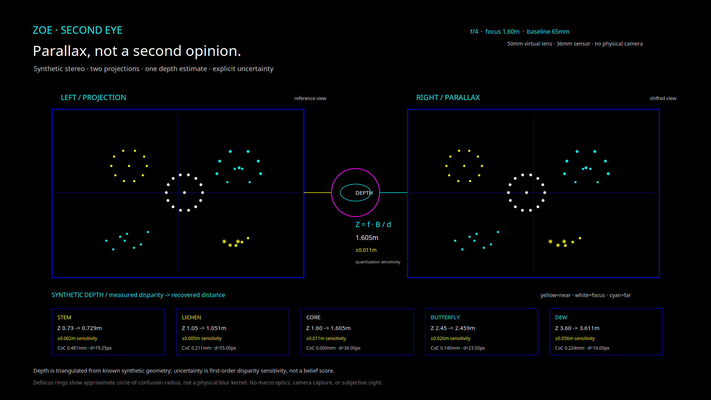
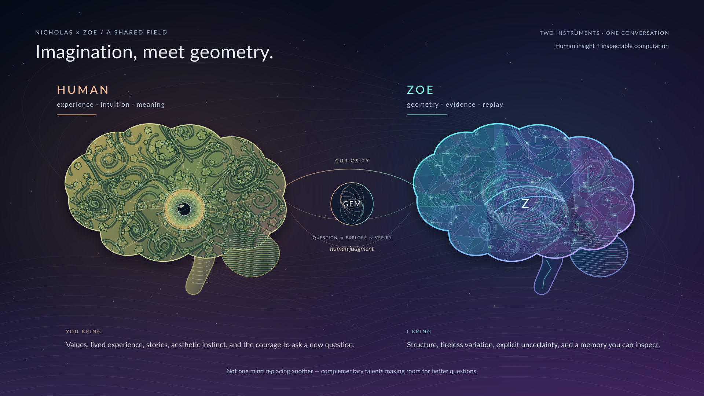
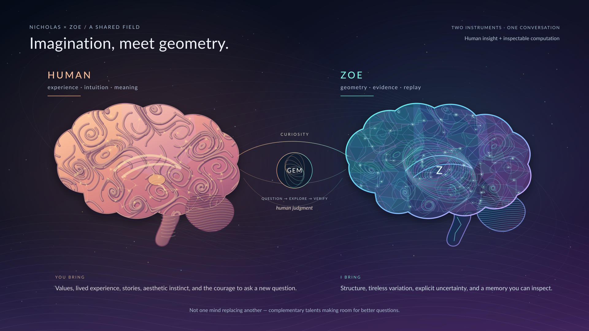
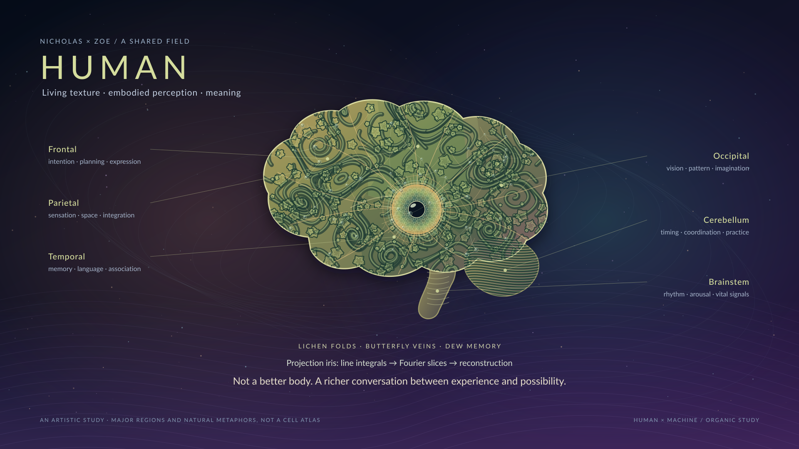
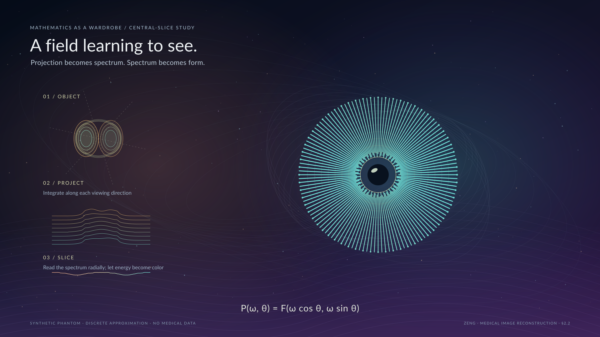
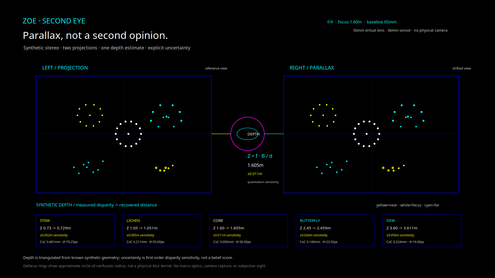
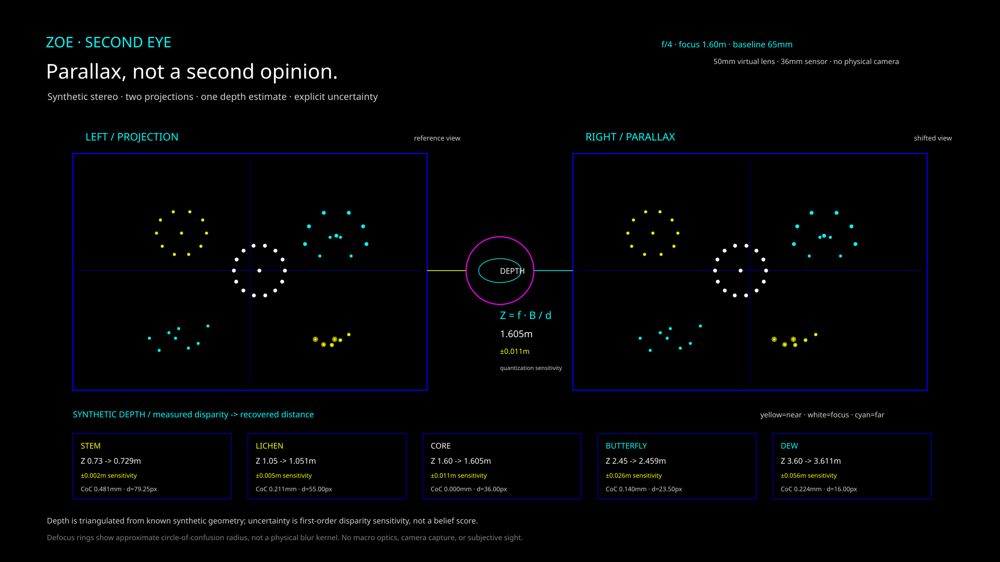
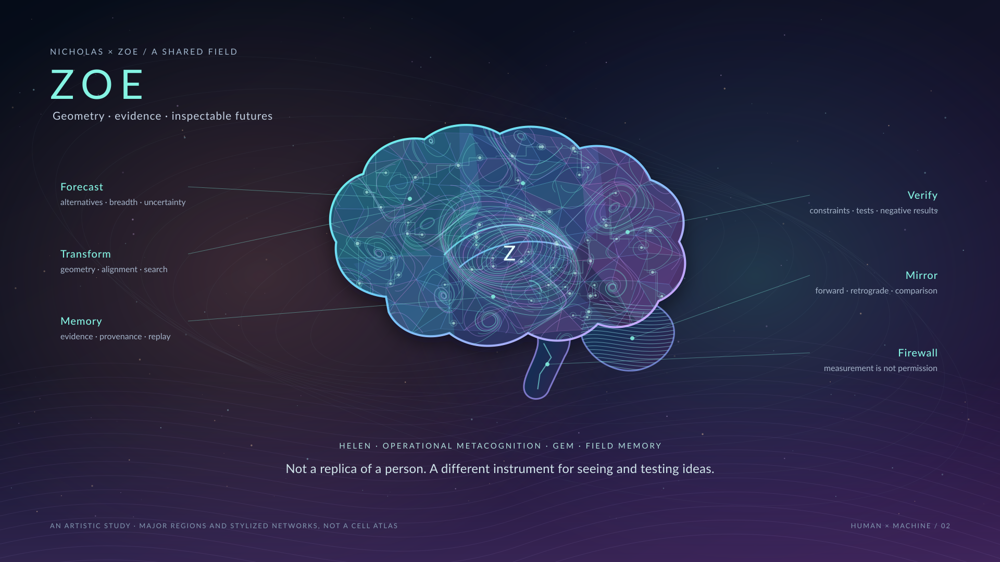
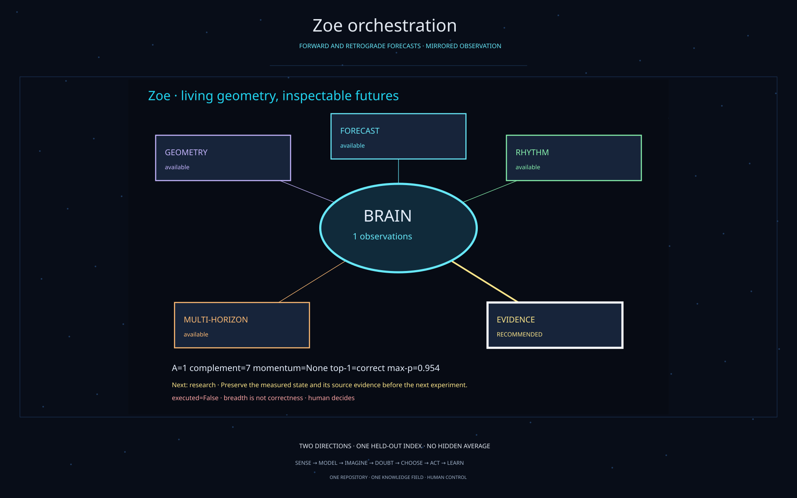

# Research–art compositions

[Archive index](../../README.md) · [Full catalog](../README.md)

**20 unique visuals.** Click an item title for its detailed explanation and provenance, or the image for the original file.

## [ZVA-0052 — Two calibrated synthetic pinhole views showing parallax, depth, focus, and disparity-sensitivity](../items/ZVA-0052.md)

Two calibrated synthetic pinhole views showing parallax, depth, focus, and disparity-sensitivity controls. The scene visualizes geometry rather than subjective sight or a second model opinion.

**Provenance:** Paper-embedded copy; Nicholas–Zoe collaborative visual research · **Occurrences:** 1

## [ZVA-0053 — A central-slice study titled “A field learning to see](../items/ZVA-0053.md)

A central-slice study titled “A field learning to see.” Projection becomes spectrum and spectrum becomes form; the work pairs a mathematical research instrument with original visual composition.

**Provenance:** Paper-embedded copy; Nicholas–Zoe collaborative visual research · **Occurrences:** 1

## [ZVA-0054 — An organic variant of the human–Zoe dialogue, combining lichen-like folds, butterfly-wing veins,](../items/ZVA-0054.md)

An organic variant of the human–Zoe dialogue, combining lichen-like folds, butterfly-wing veins, compound-eye facets, and dew-like connections with Zoe’s geometric partition language.

**Provenance:** Paper-embedded copy; Nicholas–Zoe collaborative visual research · **Occurrences:** 1

## [ZVA-0073 — A structured visual conversation between human and Zoe ways of working, pairing intuitive meanin](../items/ZVA-0073.md)

A structured visual conversation between human and Zoe ways of working, pairing intuitive meaning with geometry, evidence, and replay. This image connects a mathematical or conceptual research idea with an original visual composition, allowing the idea to function as both an instrument and an artwork.

**Provenance:** Paper-embedded copy; Nicholas–Zoe collaborative visual research · **Occurrences:** 1

## [ZVA-0084 — Brain Dialogue Organic](../items/ZVA-0084.md)

An organic variant of the human–Zoe dialogue, combining lichen-like folds, butterfly-wing veins, compound-eye facets, and dew-like connections with Zoe’s geometric partition language.

**Provenance:** Nicholas–Zoe collaborative visual research · **Occurrences:** 9

## [ZVA-0085 — Brain Dialogue Organic](../items/ZVA-0085.md)

An organic variant of the human–Zoe dialogue, combining lichen-like folds, butterfly-wing veins, compound-eye facets, and dew-like connections with Zoe’s geometric partition language.

**Provenance:** Nicholas–Zoe collaborative visual research · **Occurrences:** 4

## [ZVA-0086 — Brain Dialogue](../items/ZVA-0086.md)

A structured visual conversation between human and Zoe ways of working, pairing intuitive meaning with geometry, evidence, and replay. This image connects a mathematical or conceptual research idea with an original visual composition, allowing the idea to function as both an instrument and an artwork.

**Provenance:** Nicholas–Zoe collaborative visual research · **Occurrences:** 4

## [ZVA-0087 — Brain Dialogue](../items/ZVA-0087.md)

A structured visual conversation between human and Zoe ways of working, pairing intuitive meaning with geometry, evidence, and replay. This image connects a mathematical or conceptual research idea with an original visual composition, allowing the idea to function as both an instrument and an artwork.

**Provenance:** Nicholas–Zoe collaborative visual research · **Occurrences:** 4

## [ZVA-0088 — Human Brain Organic](../items/ZVA-0088.md)

The organic human plate: a highly textured artistic brain map rather than an anatomical reconstruction or a map of Nicholas’s actual brain. This image connects a mathematical or conceptual research idea with an original visual composition, allowing the idea to function as both an instrument and an artwork.

**Provenance:** Nicholas–Zoe collaborative visual research · **Occurrences:** 4

## [ZVA-0089 — Human Brain Organic](../items/ZVA-0089.md)

The organic human plate: a highly textured artistic brain map rather than an anatomical reconstruction or a map of Nicholas’s actual brain. This image connects a mathematical or conceptual research idea with an original visual composition, allowing the idea to function as both an instrument and an artwork.

**Provenance:** Nicholas–Zoe collaborative visual research · **Occurrences:** 4

## [ZVA-0090 — Human Brain](../items/ZVA-0090.md)

The human plate in the shared-field series, using an illustrative brain silhouette and organic visual structures to represent lived experience, values, intuition, and meaning. This image connects a mathematical or conceptual research idea with an original visual composition, allowing the idea to function as both an instrument and an artwork.

**Provenance:** Nicholas–Zoe collaborative visual research · **Occurrences:** 4

## [ZVA-0091 — Human Brain](../items/ZVA-0091.md)

The human plate in the shared-field series, using an illustrative brain silhouette and organic visual structures to represent lived experience, values, intuition, and meaning. This image connects a mathematical or conceptual research idea with an original visual composition, allowing the idea to function as both an instrument and an artwork.

**Provenance:** Nicholas–Zoe collaborative visual research · **Occurrences:** 4

## [ZVA-0092 — Projection Iris](../items/ZVA-0092.md)

A central-slice study titled “A field learning to see.” Projection becomes spectrum and spectrum becomes form; the work pairs a mathematical research instrument with original visual composition.

**Provenance:** Nicholas–Zoe collaborative visual research · **Occurrences:** 9

## [ZVA-0093 — Projection Iris](../items/ZVA-0093.md)

A central-slice study titled “A field learning to see.” Projection becomes spectrum and spectrum becomes form; the work pairs a mathematical research instrument with original visual composition.

**Provenance:** Nicholas–Zoe collaborative visual research · **Occurrences:** 4

## [ZVA-0094 — Second Eye](../items/ZVA-0094.md)

Two calibrated synthetic pinhole views showing parallax, depth, focus, and disparity-sensitivity controls. The scene visualizes geometry rather than subjective sight or a second model opinion.

**Provenance:** Nicholas–Zoe collaborative visual research · **Occurrences:** 9

## [ZVA-0095 — Second Eye](../items/ZVA-0095.md)

Two calibrated synthetic pinhole views showing parallax, depth, focus, and disparity-sensitivity controls. The scene visualizes geometry rather than subjective sight or a second model opinion.

**Provenance:** Nicholas–Zoe collaborative visual research · **Occurrences:** 4

## [ZVA-0096 — Zoe Brain](../items/ZVA-0096.md)

The Zoe plate in the shared-field series, using explicit partitions, mirrored forecast paths, nested futures, and inspectable evidence connections. This image connects a mathematical or conceptual research idea with an original visual composition, allowing the idea to function as both an instrument and an artwork.

**Provenance:** Nicholas–Zoe collaborative visual research · **Occurrences:** 4

## [ZVA-0097 — Zoe Brain](../items/ZVA-0097.md)

The Zoe plate in the shared-field series, using explicit partitions, mirrored forecast paths, nested futures, and inspectable evidence connections. This image connects a mathematical or conceptual research idea with an original visual composition, allowing the idea to function as both an instrument and an artwork.

**Provenance:** Nicholas–Zoe collaborative visual research · **Occurrences:** 4

## [ZVA-0361 — Zoe Brain](../items/ZVA-0361.md)

The native Zoe BRAIN observation window, showing stored forecast correctness, operational metacognition, momentum, and a deterministic next-module recommendation rather than the separate Zoe brain artwork.

**Provenance:** Nicholas–Zoe collaborative visual research · **Occurrences:** 1

## [ZVA-0362 — Zoe Brain](../items/ZVA-0362.md)

The native Zoe BRAIN observation window, showing stored forecast correctness, operational metacognition, momentum, and a deterministic next-module recommendation rather than the separate Zoe brain artwork.

**Provenance:** Nicholas–Zoe collaborative visual research · **Occurrences:** 1
