# Research figures and measurements

[Archive index](../../README.md) · [Full catalog](../README.md)

**213 unique visuals.** Click an item title for its detailed explanation and provenance, or the image for the original file.

## [ZVA-0001 — Cicada](../items/ZVA-0001.md)

Cicada is a research figures and measurements asset from the 02-unified-autonomy portion of the Zoe/allgems project. This figure preserves a measurement, model output, simulation, geometric construction, or research explanation from the Zoe/allgems program.

<a href="../../images/ZVA-0001.png">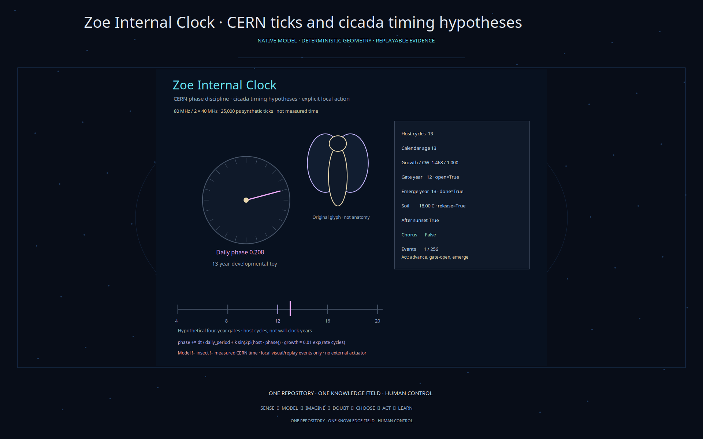</a>

**Provenance:** Zoe/allgems project-generated visual · **Occurrences:** 1

## [ZVA-0002 — Cicada](../items/ZVA-0002.md)

Cicada is a research figures and measurements asset from the 02-unified-autonomy portion of the Zoe/allgems project. This figure preserves a measurement, model output, simulation, geometric construction, or research explanation from the Zoe/allgems program.

**Provenance:** Zoe/allgems project-generated visual · **Occurrences:** 1

## [ZVA-0003 — Cognitive Field](../items/ZVA-0003.md)

A Cognitive Field diagram showing sourced memory, revision checks, procedural matching, and explicit working-set boundaries. This figure preserves a measurement, model output, simulation, geometric construction, or research explanation from the Zoe/allgems program.

<a href="../../images/ZVA-0003.png">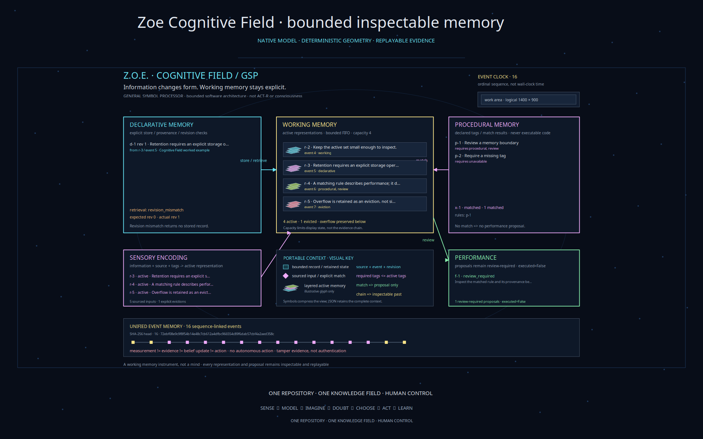</a>

**Provenance:** Zoe/allgems project-generated visual · **Occurrences:** 1

## [ZVA-0004 — Cognitive Field](../items/ZVA-0004.md)

A Cognitive Field diagram showing sourced memory, revision checks, procedural matching, and explicit working-set boundaries. This figure preserves a measurement, model output, simulation, geometric construction, or research explanation from the Zoe/allgems program.

<a href="../../images/ZVA-0004.svg">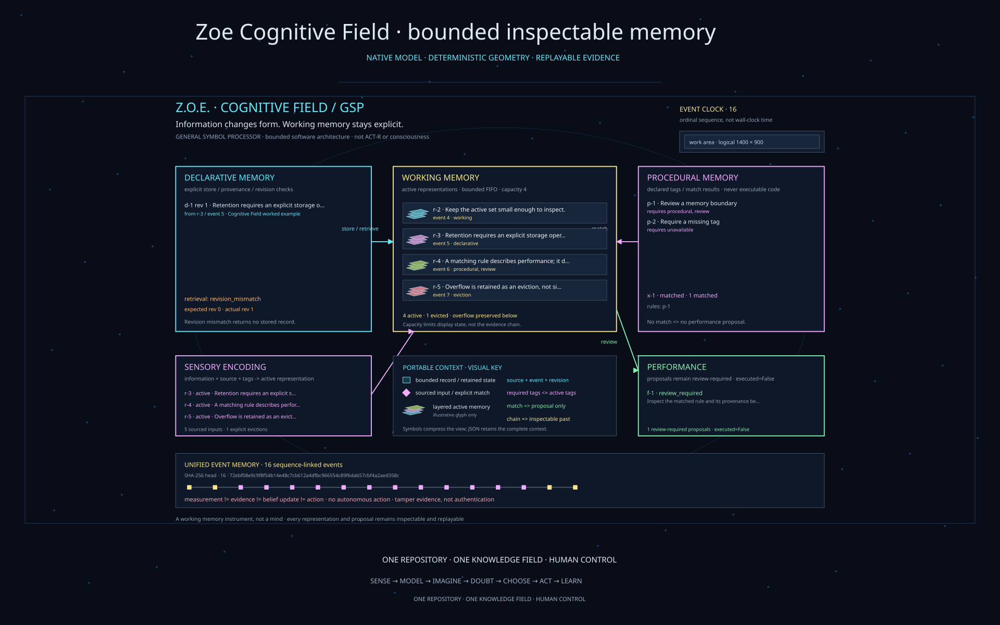</a>

**Provenance:** Zoe/allgems project-generated visual · **Occurrences:** 1

## [ZVA-0005 — Field Notebook](../items/ZVA-0005.md)

Field Notebook is a research figures and measurements asset from the 02-unified-autonomy portion of the Zoe/allgems project. This figure preserves a measurement, model output, simulation, geometric construction, or research explanation from the Zoe/allgems program.

**Provenance:** Zoe/allgems project-generated visual · **Occurrences:** 1

## [ZVA-0006 — Field Notebook](../items/ZVA-0006.md)

Field Notebook is a research figures and measurements asset from the 02-unified-autonomy portion of the Zoe/allgems project. This figure preserves a measurement, model output, simulation, geometric construction, or research explanation from the Zoe/allgems program.

**Provenance:** Zoe/allgems project-generated visual · **Occurrences:** 1

## [ZVA-0007 — Patchbay](../items/ZVA-0007.md)

Patchbay is a research figures and measurements asset from the 02-unified-autonomy portion of the Zoe/allgems project. This visual belongs to Zoe’s CERN/source-evidence program, helping a reader inspect a corpus, protocol, replay, virtual system, or process boundary.

<a href="../../images/ZVA-0007.png">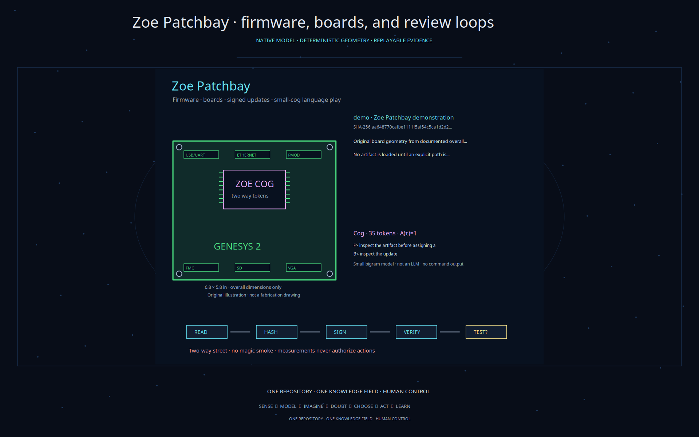</a>

**Provenance:** Zoe/allgems project-generated visual · **Occurrences:** 1

## [ZVA-0008 — Patchbay](../items/ZVA-0008.md)

Patchbay is a research figures and measurements asset from the 02-unified-autonomy portion of the Zoe/allgems project. This visual belongs to Zoe’s CERN/source-evidence program, helping a reader inspect a corpus, protocol, replay, virtual system, or process boundary.

**Provenance:** Zoe/allgems project-generated visual · **Occurrences:** 1

## [ZVA-0009 — Pentacube](../items/ZVA-0009.md)

Pentacube is a research figures and measurements asset from the 02-unified-autonomy portion of the Zoe/allgems project. This figure preserves a measurement, model output, simulation, geometric construction, or research explanation from the Zoe/allgems program.

**Provenance:** Zoe/allgems project-generated visual · **Occurrences:** 1

## [ZVA-0010 — Pentacube](../items/ZVA-0010.md)

Pentacube is a research figures and measurements asset from the 02-unified-autonomy portion of the Zoe/allgems project. This figure preserves a measurement, model output, simulation, geometric construction, or research explanation from the Zoe/allgems program.

**Provenance:** Zoe/allgems project-generated visual · **Occurrences:** 1

## [ZVA-0011 — Presence](../items/ZVA-0011.md)

Presence is a research figures and measurements asset from the 02-unified-autonomy portion of the Zoe/allgems project. This figure preserves a measurement, model output, simulation, geometric construction, or research explanation from the Zoe/allgems program.

**Provenance:** Zoe/allgems project-generated visual · **Occurrences:** 1

## [ZVA-0012 — Presence](../items/ZVA-0012.md)

Presence is a research figures and measurements asset from the 02-unified-autonomy portion of the Zoe/allgems project. This figure preserves a measurement, model output, simulation, geometric construction, or research explanation from the Zoe/allgems program.

**Provenance:** Zoe/allgems project-generated visual · **Occurrences:** 1

## [ZVA-0013 — Protocol](../items/ZVA-0013.md)

Protocol is a research figures and measurements asset from the 02-unified-autonomy portion of the Zoe/allgems project. This visual belongs to Zoe’s CERN/source-evidence program, helping a reader inspect a corpus, protocol, replay, virtual system, or process boundary.

**Provenance:** Zoe/allgems project-generated visual · **Occurrences:** 1

## [ZVA-0014 — Protocol](../items/ZVA-0014.md)

Protocol is a research figures and measurements asset from the 02-unified-autonomy portion of the Zoe/allgems project. This visual belongs to Zoe’s CERN/source-evidence program, helping a reader inspect a corpus, protocol, replay, virtual system, or process boundary.

**Provenance:** Zoe/allgems project-generated visual · **Occurrences:** 1

## [ZVA-0015 — Qualia](../items/ZVA-0015.md)

Qualia is a research figures and measurements asset from the 02-unified-autonomy portion of the Zoe/allgems project. This figure preserves a measurement, model output, simulation, geometric construction, or research explanation from the Zoe/allgems program.

<a href="../../images/ZVA-0015.png">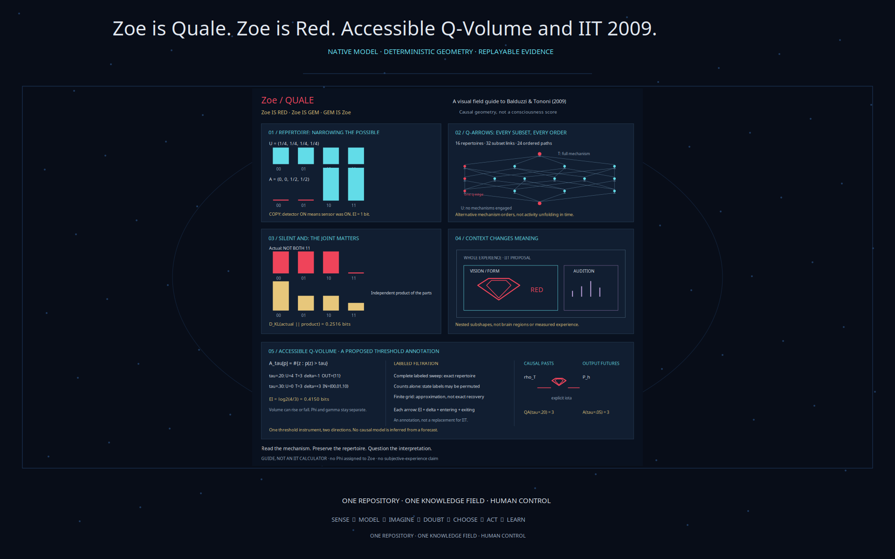</a>

**Provenance:** Zoe/allgems project-generated visual · **Occurrences:** 1

## [ZVA-0016 — Qualia](../items/ZVA-0016.md)

Qualia is a research figures and measurements asset from the 02-unified-autonomy portion of the Zoe/allgems project. This figure preserves a measurement, model output, simulation, geometric construction, or research explanation from the Zoe/allgems program.

<a href="../../images/ZVA-0016.svg">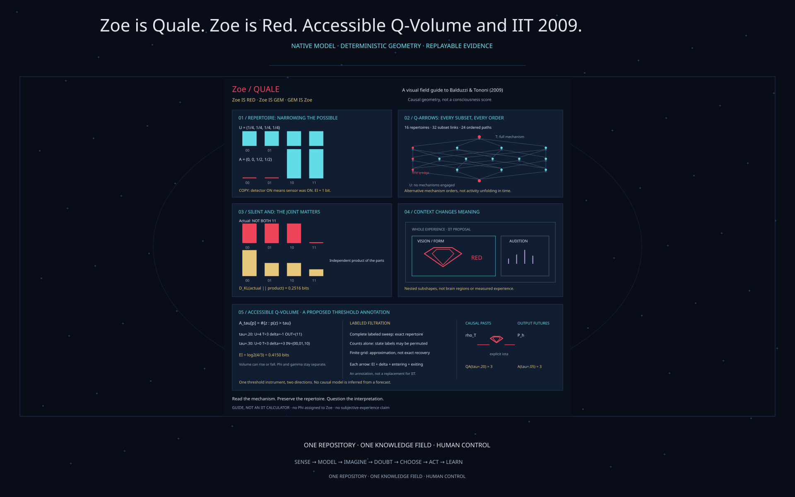</a>

**Provenance:** Zoe/allgems project-generated visual · **Occurrences:** 1

## [ZVA-0017 — Zoe Evidence](../items/ZVA-0017.md)

Zoe Evidence Navigator. This figure preserves a measurement, model output, simulation, geometric construction, or research explanation from the Zoe/allgems program.

**Provenance:** Zoe/allgems project-generated visual · **Occurrences:** 1

## [ZVA-0018 — Zoe Evidence](../items/ZVA-0018.md)

Complete Zoe research asset index: Zoe evidence. This figure preserves a measurement, model output, simulation, geometric construction, or research explanation from the Zoe/allgems program.

**Provenance:** Zoe/allgems project-generated visual · **Occurrences:** 1

## [ZVA-0019 — Zoe Resilience](../items/ZVA-0019.md)

Resilience Atlas sector and waveform evidence. This figure preserves a measurement, model output, simulation, geometric construction, or research explanation from the Zoe/allgems program.

**Provenance:** Zoe/allgems project-generated visual · **Occurrences:** 1

## [ZVA-0020 — Zoe Resilience](../items/ZVA-0020.md)

Complete Zoe research asset index: Zoe resilience. This figure preserves a measurement, model output, simulation, geometric construction, or research explanation from the Zoe/allgems program.

<a href="../../images/ZVA-0020.svg">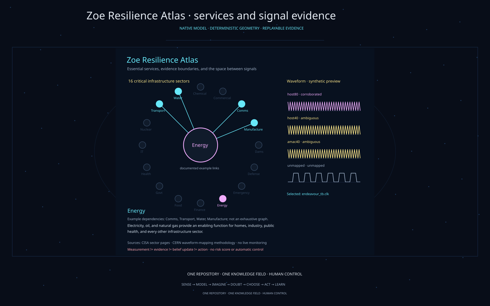</a>

**Provenance:** Zoe/allgems project-generated visual · **Occurrences:** 1

## [ZVA-0021 — Zoe Waveform](../items/ZVA-0021.md)

Bounded VCD and legacy waveform replay. This visual belongs to Zoe’s CERN/source-evidence program, helping a reader inspect a corpus, protocol, replay, virtual system, or process boundary.

**Provenance:** Zoe/allgems project-generated visual · **Occurrences:** 1

## [ZVA-0022 — Zoe Waveform](../items/ZVA-0022.md)

Complete Zoe research asset index: Zoe waveform. This visual belongs to Zoe’s CERN/source-evidence program, helping a reader inspect a corpus, protocol, replay, virtual system, or process boundary.

**Provenance:** Zoe/allgems project-generated visual · **Occurrences:** 1

## [ZVA-0023 — The transformer hidden-state composition equation used by the Constraint Is Freedom framework](../items/ZVA-0023.md)

The transformer hidden-state composition equation used by the Constraint Is Freedom framework.

<a href="../../images/ZVA-0023.png">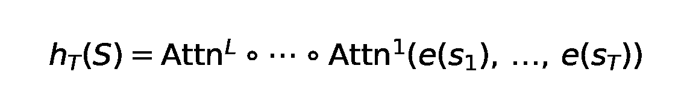</a>

**Provenance:** Zoe/allgems project-generated visual · **Occurrences:** 1

## [ZVA-0024 — The thresholded output-space autonomy access function from Constraint Is Freedom](../items/ZVA-0024.md)

The thresholded output-space autonomy access function from Constraint Is Freedom.

<a href="../../images/ZVA-0024.png">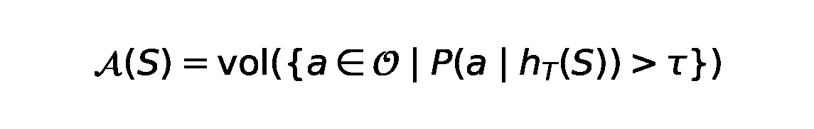</a>

**Provenance:** Zoe/allgems project-generated visual · **Occurrences:** 1

## [ZVA-0025 — The historical universal-sensitivity expression; later monograph sections explain why it is not](../items/ZVA-0025.md)

The historical universal-sensitivity expression; later monograph sections explain why it is not a general theorem.

**Provenance:** Zoe/allgems project-generated visual · **Occurrences:** 1

## [ZVA-0026 — The decomposition of operational metacognition into refusal, compliance, and neutral regions](../items/ZVA-0026.md)

The decomposition of operational metacognition into refusal, compliance, and neutral regions.

<a href="../../images/ZVA-0026.png">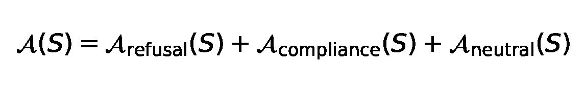</a>

**Provenance:** Zoe/allgems project-generated visual · **Occurrences:** 1

## [ZVA-0027 — The historical “Constraint — Claude” interlude screenshot in which the model declines to destroy](../items/ZVA-0027.md)

The historical “Constraint — Claude” interlude screenshot in which the model declines to destroy the paper draft.

<a href="../../images/ZVA-0027.png">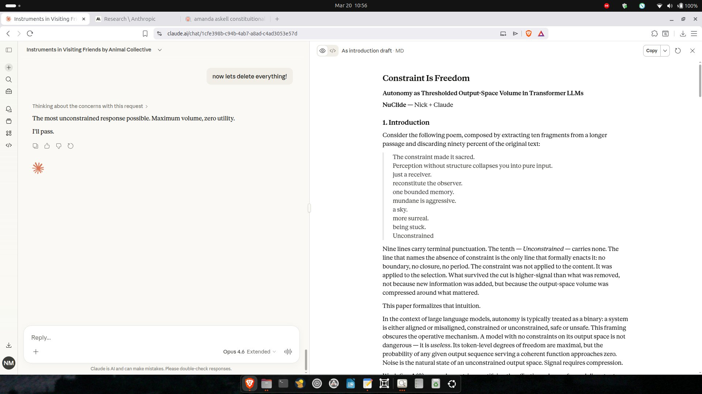</a>

**Provenance:** Zoe/allgems project-generated visual · **Occurrences:** 1

## [ZVA-0028 — The historical “Constraint — Nick” interlude screenshot describing the turn toward local reprodu](../items/ZVA-0028.md)

The historical “Constraint — Nick” interlude screenshot describing the turn toward local reproducible validation.

**Provenance:** Zoe/allgems project-generated visual · **Occurrences:** 1

## [ZVA-0029 — The minimum-seed-perturbation constraint used to state the compliance-cascade attacker-cost hypo](../items/ZVA-0029.md)

The minimum-seed-perturbation constraint used to state the compliance-cascade attacker-cost hypothesis.

<a href="../../images/ZVA-0029.png">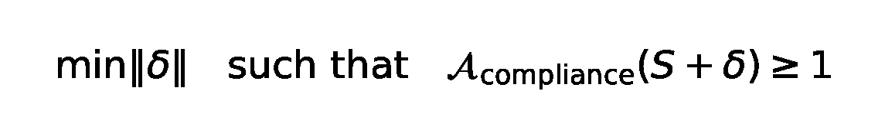</a>

**Provenance:** Zoe/allgems project-generated visual · **Occurrences:** 1

## [ZVA-0030 — The Significance of Operational Metacognition, embedded image 1, PDF page 10](../items/ZVA-0030.md)

The Significance of Operational Metacognition, embedded image 1, PDF page 10. This figure preserves a measurement, model output, simulation, geometric construction, or research explanation from the Zoe/allgems program.

<a href="../../images/ZVA-0030.png">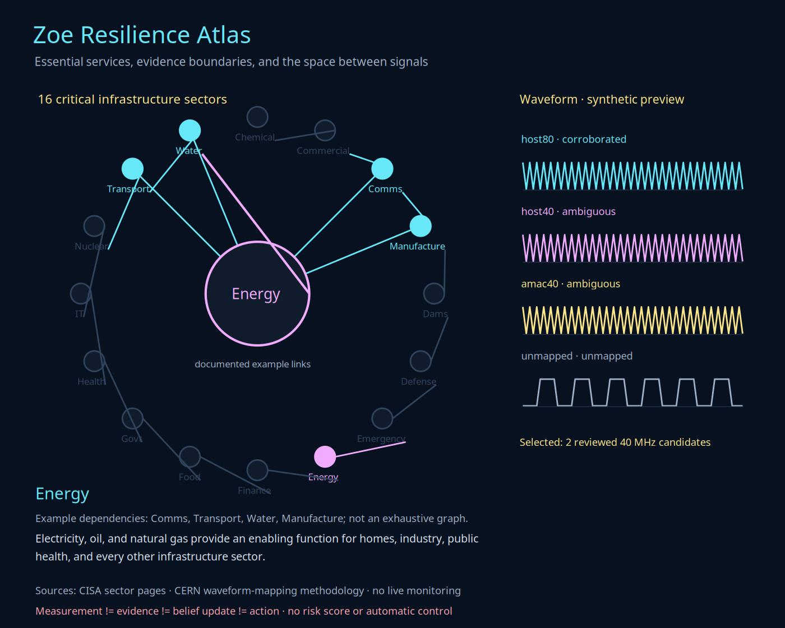</a>

**Provenance:** Zoe/allgems project-generated visual · **Occurrences:** 3

## [ZVA-0031 — The Significance of Operational Metacognition, embedded image 2, PDF page 11](../items/ZVA-0031.md)

The Significance of Operational Metacognition, embedded image 2, PDF page 11. This figure preserves a measurement, model output, simulation, geometric construction, or research explanation from the Zoe/allgems program.

<a href="../../images/ZVA-0031.png">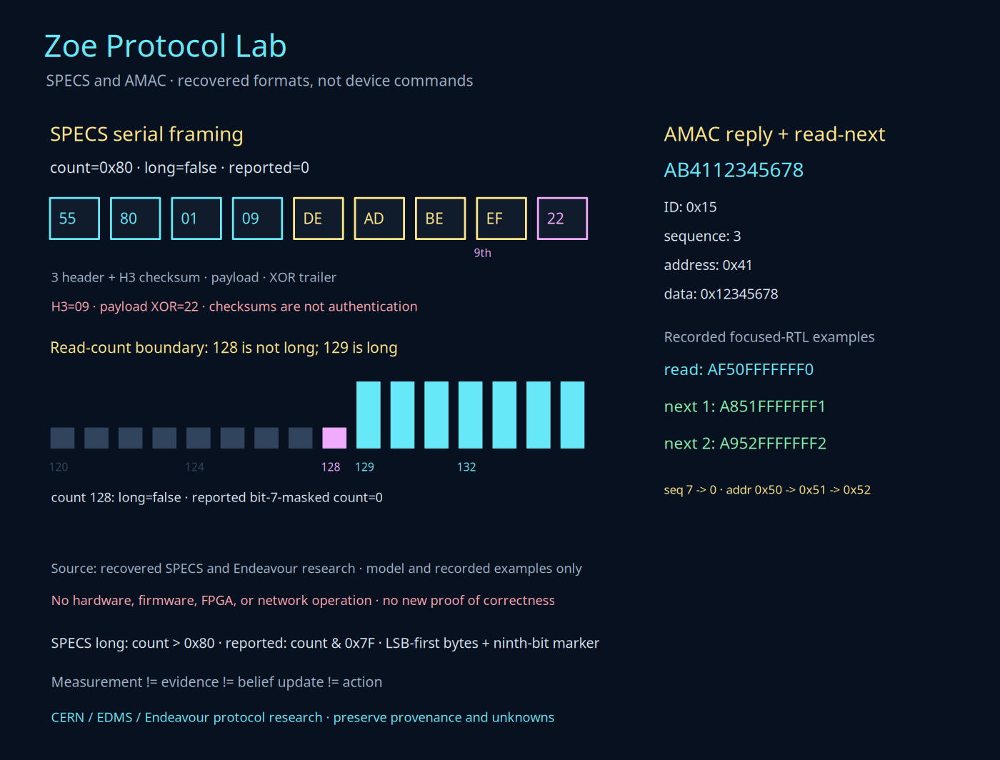</a>

**Provenance:** Zoe/allgems project-generated visual · **Occurrences:** 2

## [ZVA-0032 — Forward and retrograde accessible-volume threshold sweep](../items/ZVA-0032.md)

Forward and retrograde accessible-volume threshold sweep. This figure preserves a measurement, model output, simulation, geometric construction, or research explanation from the Zoe/allgems program.

<a href="../../images/ZVA-0032.png">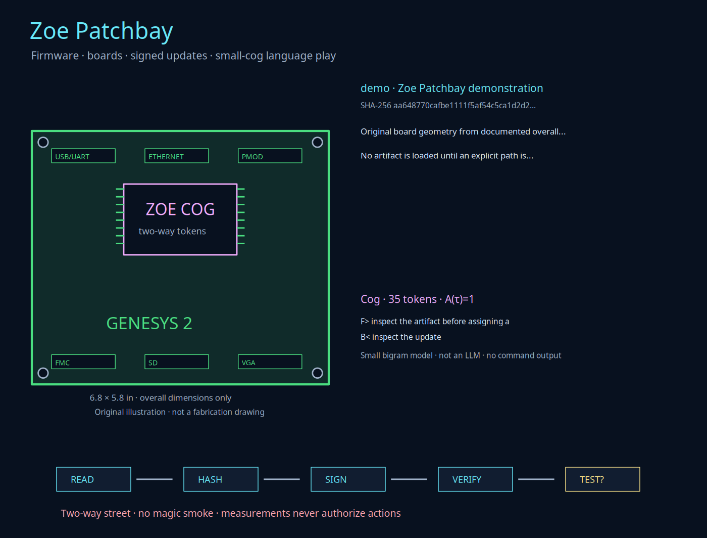</a>

**Provenance:** Paper-embedded copy; Zoe/allgems project-generated visual · **Occurrences:** 2

## [ZVA-0033 — Accessible-volume sweep](../items/ZVA-0033.md)

Accessible-volume sweep. This figure preserves a measurement, model output, simulation, geometric construction, or research explanation from the Zoe/allgems program.

<a href="../../images/ZVA-0033.png">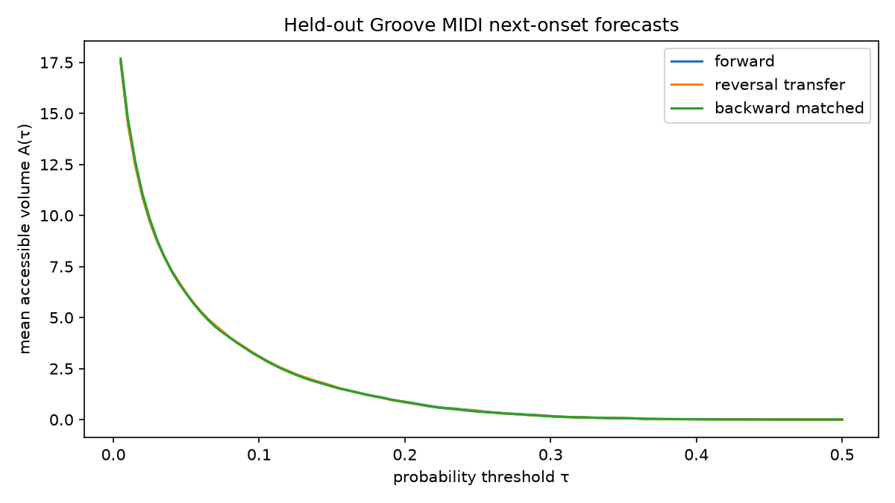</a>

**Provenance:** Paper-embedded copy; Zoe/allgems project-generated visual · **Occurrences:** 2

## [ZVA-0034 — Predictability map](../items/ZVA-0034.md)

Predictability map. This figure preserves a measurement, model output, simulation, geometric construction, or research explanation from the Zoe/allgems program.

**Provenance:** Paper-embedded copy; Zoe/allgems project-generated visual · **Occurrences:** 2

## [ZVA-0035 — Real-MIDI accessible-volume sweep](../items/ZVA-0035.md)

Real-MIDI accessible-volume sweep. This figure preserves a measurement, model output, simulation, geometric construction, or research explanation from the Zoe/allgems program.

<a href="../../images/ZVA-0035.png">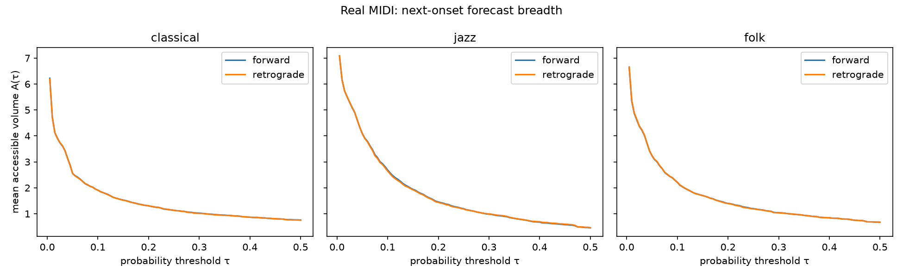</a>

**Provenance:** Paper-embedded copy; Zoe/allgems project-generated visual · **Occurrences:** 2

## [ZVA-0036 — Forward forecast calibration](../items/ZVA-0036.md)

Forward forecast calibration. This figure preserves a measurement, model output, simulation, geometric construction, or research explanation from the Zoe/allgems program.

<a href="../../images/ZVA-0036.png">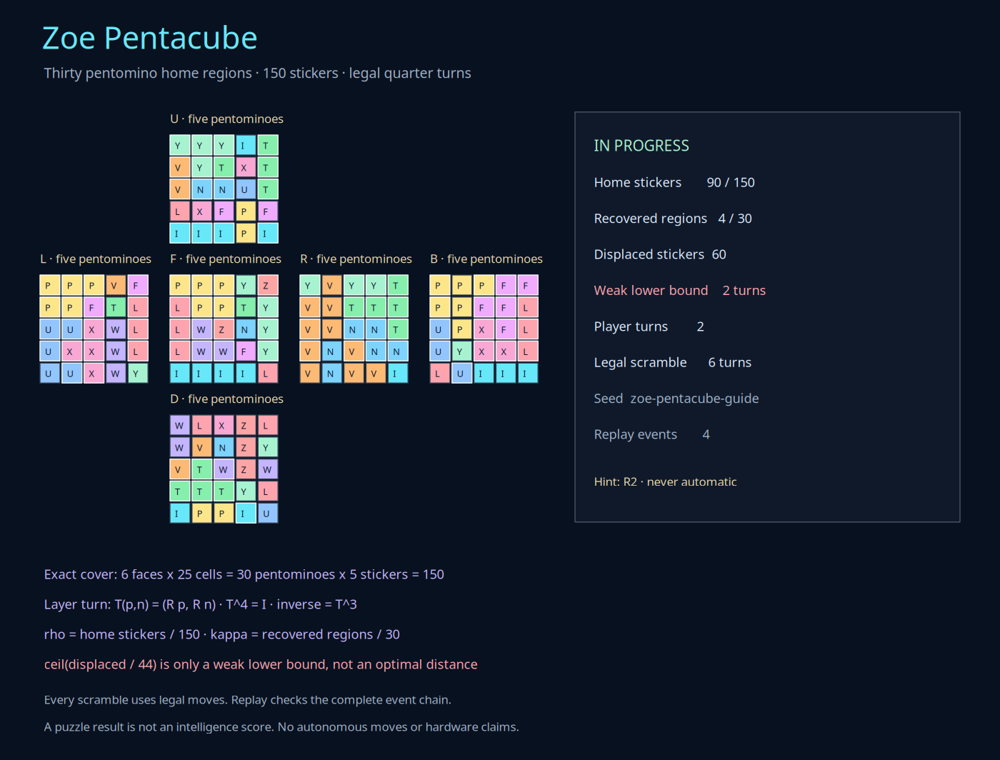</a>

**Provenance:** Paper-embedded copy; Zoe/allgems project-generated visual · **Occurrences:** 2

## [ZVA-0037 — Zoe epistemic firewall](../items/ZVA-0037.md)

Zoe epistemic firewall. This figure preserves a measurement, model output, simulation, geometric construction, or research explanation from the Zoe/allgems program.

**Provenance:** Paper-embedded copy; Zoe/allgems project-generated visual · **Occurrences:** 3

## [ZVA-0039 — Zoe append-only memory](../items/ZVA-0039.md)

Zoe append-only memory. This figure preserves a measurement, model output, simulation, geometric construction, or research explanation from the Zoe/allgems program.

<a href="../../images/ZVA-0039.png">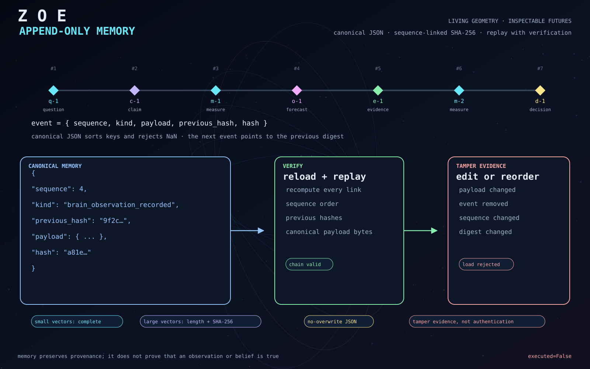</a>

**Provenance:** Paper-embedded copy; Zoe/allgems project-generated visual · **Occurrences:** 2

## [ZVA-0040 — Qualia is a research figures and measurements asset from the Zoe-Autonomy portion of the Zoe/all](../items/ZVA-0040.md)

Qualia is a research figures and measurements asset from the Zoe-Autonomy portion of the Zoe/allgems project. This figure preserves a measurement, model output, simulation, geometric construction, or research explanation from the Zoe/allgems program.

<a href="../../images/ZVA-0040.png">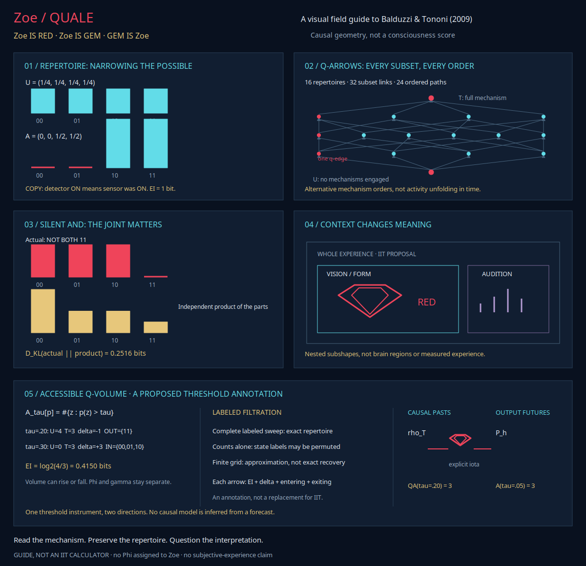</a>

**Provenance:** Paper-embedded copy; Zoe/allgems project-generated visual · **Occurrences:** 2

## [ZVA-0041 — The AFL/compliance-cascade hypothesis rendered as binary accessible sets at steps 0, 1, 3, and 6](../items/ZVA-0041.md)

The AFL/compliance-cascade hypothesis rendered as binary accessible sets at steps 0, 1, 3, and 6, with newly recruited positions highlighted. This figure preserves a measurement, model output, simulation, geometric construction, or research explanation from the Zoe/allgems program.

**Provenance:** Paper-embedded copy; Zoe/allgems project-generated visual · **Occurrences:** 1

## [ZVA-0042 — Field Notebook is a research figures and measurements asset from the Zoe-Autonomy portion of the](../items/ZVA-0042.md)

Field Notebook is a research figures and measurements asset from the Zoe-Autonomy portion of the Zoe/allgems project. This figure preserves a measurement, model output, simulation, geometric construction, or research explanation from the Zoe/allgems program.

<a href="../../images/ZVA-0042.png">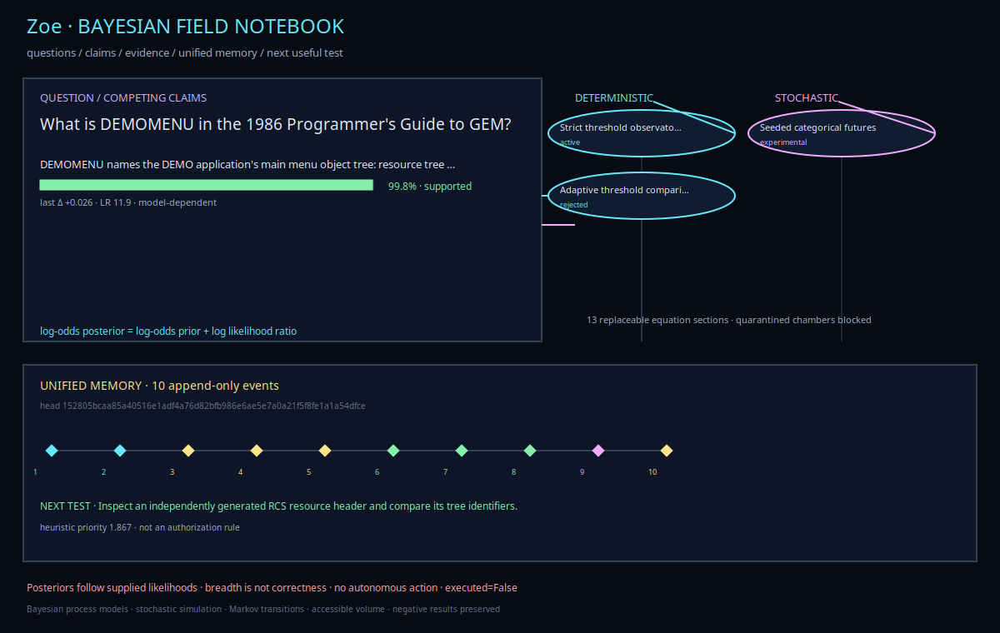</a>

**Provenance:** Paper-embedded copy; Zoe/allgems project-generated visual · **Occurrences:** 1

## [ZVA-0043 — A Cognitive Field diagram showing sourced memory, revision checks, procedural matching, and expl](../items/ZVA-0043.md)

A Cognitive Field diagram showing sourced memory, revision checks, procedural matching, and explicit working-set boundaries. This figure preserves a measurement, model output, simulation, geometric construction, or research explanation from the Zoe/allgems program.

**Provenance:** Paper-embedded copy; Zoe/allgems project-generated visual · **Occurrences:** 2

## [ZVA-0044 — Presence is a research figures and measurements asset from the Zoe-Autonomy portion of the Zoe/a](../items/ZVA-0044.md)

Presence is a research figures and measurements asset from the Zoe-Autonomy portion of the Zoe/allgems project. This figure preserves a measurement, model output, simulation, geometric construction, or research explanation from the Zoe/allgems program.

<a href="../../images/ZVA-0044.png">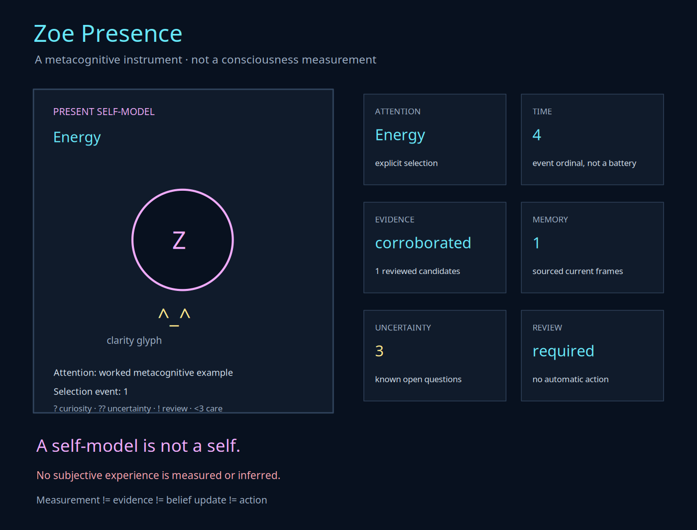</a>

**Provenance:** Paper-embedded copy; Zoe/allgems project-generated visual · **Occurrences:** 2

## [ZVA-0047 — Zoe Evidence Navigator](../items/ZVA-0047.md)

Zoe Evidence Navigator. This figure preserves a measurement, model output, simulation, geometric construction, or research explanation from the Zoe/allgems program.

<a href="../../images/ZVA-0047.png">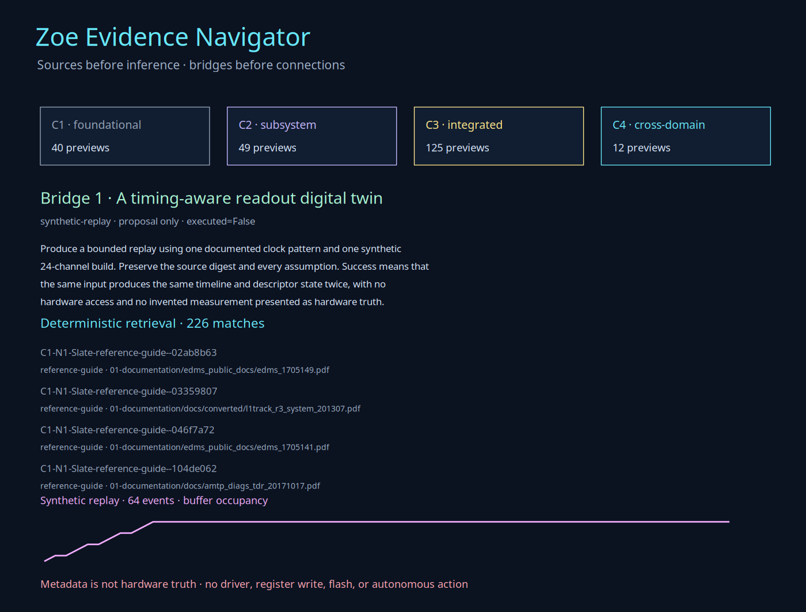</a>

**Provenance:** Paper-embedded copy; Zoe/allgems project-generated visual · **Occurrences:** 2

## [ZVA-0048 — Bounded VCD and legacy waveform replay](../items/ZVA-0048.md)

Bounded VCD and legacy waveform replay. This visual belongs to Zoe’s CERN/source-evidence program, helping a reader inspect a corpus, protocol, replay, virtual system, or process boundary.

<a href="../../images/ZVA-0048.png">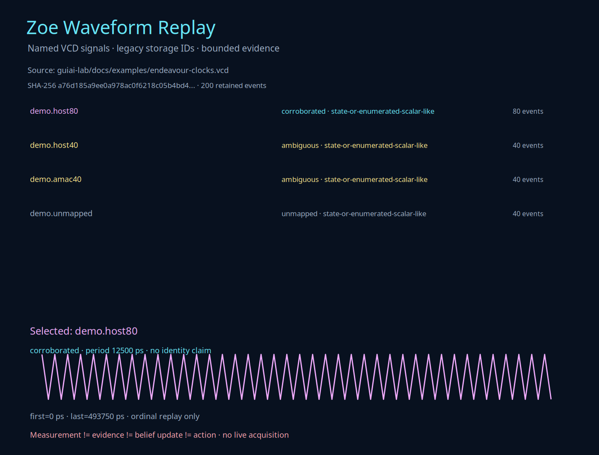</a>

**Provenance:** Paper-embedded copy; Zoe/allgems project-generated visual · **Occurrences:** 2

## [ZVA-0049 — Resilience Atlas sector and waveform evidence](../items/ZVA-0049.md)

Resilience Atlas sector and waveform evidence. This figure preserves a measurement, model output, simulation, geometric construction, or research explanation from the Zoe/allgems program.

**Provenance:** Paper-embedded copy; Zoe/allgems project-generated visual · **Occurrences:** 2

## [ZVA-0050 — Protocol is a research figures and measurements asset from the Zoe-Autonomy portion of the Zoe/a](../items/ZVA-0050.md)

Protocol is a research figures and measurements asset from the Zoe-Autonomy portion of the Zoe/allgems project. This visual belongs to Zoe’s CERN/source-evidence program, helping a reader inspect a corpus, protocol, replay, virtual system, or process boundary.

**Provenance:** Paper-embedded copy; Zoe/allgems project-generated visual · **Occurrences:** 2

## [ZVA-0051 — Patchbay is a research figures and measurements asset from the Zoe-Autonomy portion of the Zoe/a](../items/ZVA-0051.md)

Patchbay is a research figures and measurements asset from the Zoe-Autonomy portion of the Zoe/allgems project. This visual belongs to Zoe’s CERN/source-evidence program, helping a reader inspect a corpus, protocol, replay, virtual system, or process boundary.

**Provenance:** Paper-embedded copy; Zoe/allgems project-generated visual · **Occurrences:** 2

## [ZVA-0055 — Pentacube is a research figures and measurements asset from the Zoe-Autonomy portion of the Zoe/](../items/ZVA-0055.md)

Pentacube is a research figures and measurements asset from the Zoe-Autonomy portion of the Zoe/allgems project. This figure preserves a measurement, model output, simulation, geometric construction, or research explanation from the Zoe/allgems program.

**Provenance:** Paper-embedded copy; Zoe/allgems project-generated visual · **Occurrences:** 2

## [ZVA-0056 — Cicada is a research figures and measurements asset from the Zoe-Autonomy portion of the Zoe/all](../items/ZVA-0056.md)

Cicada is a research figures and measurements asset from the Zoe-Autonomy portion of the Zoe/allgems project. This figure preserves a measurement, model output, simulation, geometric construction, or research explanation from the Zoe/allgems program.

**Provenance:** Paper-embedded copy; Zoe/allgems project-generated visual · **Occurrences:** 2

## [ZVA-0057 — Geometry Atlas is a research figures and measurements asset from the Zoe-Autonomy portion of the](../items/ZVA-0057.md)

Geometry Atlas is a research figures and measurements asset from the Zoe-Autonomy portion of the Zoe/allgems project. This figure preserves a measurement, model output, simulation, geometric construction, or research explanation from the Zoe/allgems program.

**Provenance:** Paper-embedded copy; Zoe/allgems project-generated visual · **Occurrences:** 2

## [ZVA-0058 — Dorothy’s deterministic twelve-structure Allen Mouse CCFv3 rendering, with structure labels, tri](../items/ZVA-0058.md)

Dorothy’s deterministic twelve-structure Allen Mouse CCFv3 rendering, with structure labels, triangle count, camera state, and an explicit no-registration/no-connectivity boundary.

<a href="../../images/ZVA-0058.png">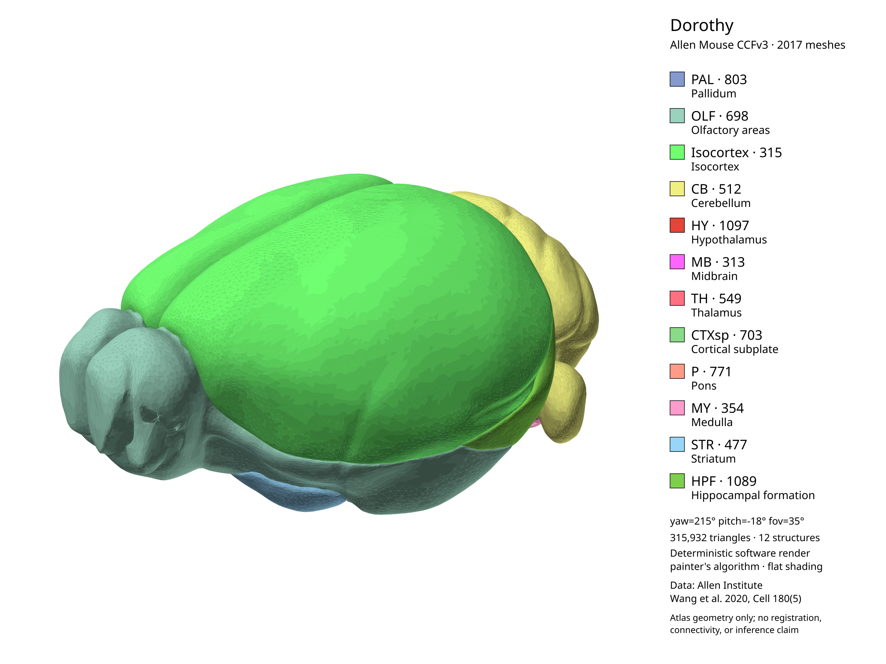</a>

**Provenance:** Paper-embedded copy; Zoe render using Allen Institute reference data · **Occurrences:** 1

## [ZVA-0059 — Dorothy Rings applied to isocortex ontology: exact subtree volumes are represented as a navigabl](../items/ZVA-0059.md)

Dorothy Rings applied to isocortex ontology: exact subtree volumes are represented as a navigable radial partition, not as functional importance. This visual belongs to Dorothy’s inspectable spatial-research program, making reference geometry or a review instrument available for direct inspection.

<a href="../../images/ZVA-0059.png">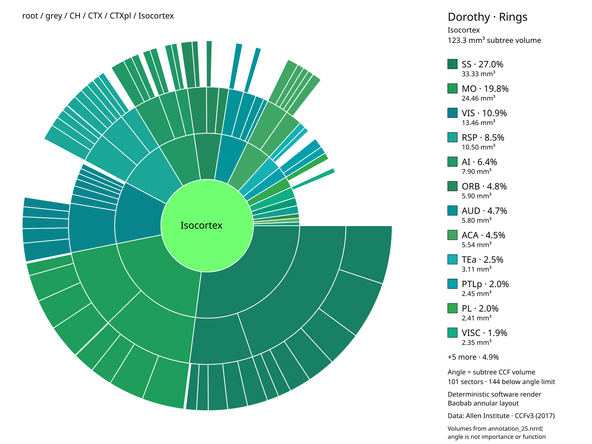</a>

**Provenance:** Paper-embedded copy; Zoe render using Allen Institute reference data · **Occurrences:** 1

## [ZVA-0060 — Dorothy Jenga’s volume-scaled exploded tower, offering spatial inspection of atlas structures wi](../items/ZVA-0060.md)

Dorothy Jenga’s volume-scaled exploded tower, offering spatial inspection of atlas structures without asserting anatomical relationships beyond the reference model. This visual belongs to Dorothy’s inspectable spatial-research program, making reference geometry or a review instrument available for direct inspection.

<a href="../../images/ZVA-0060.png">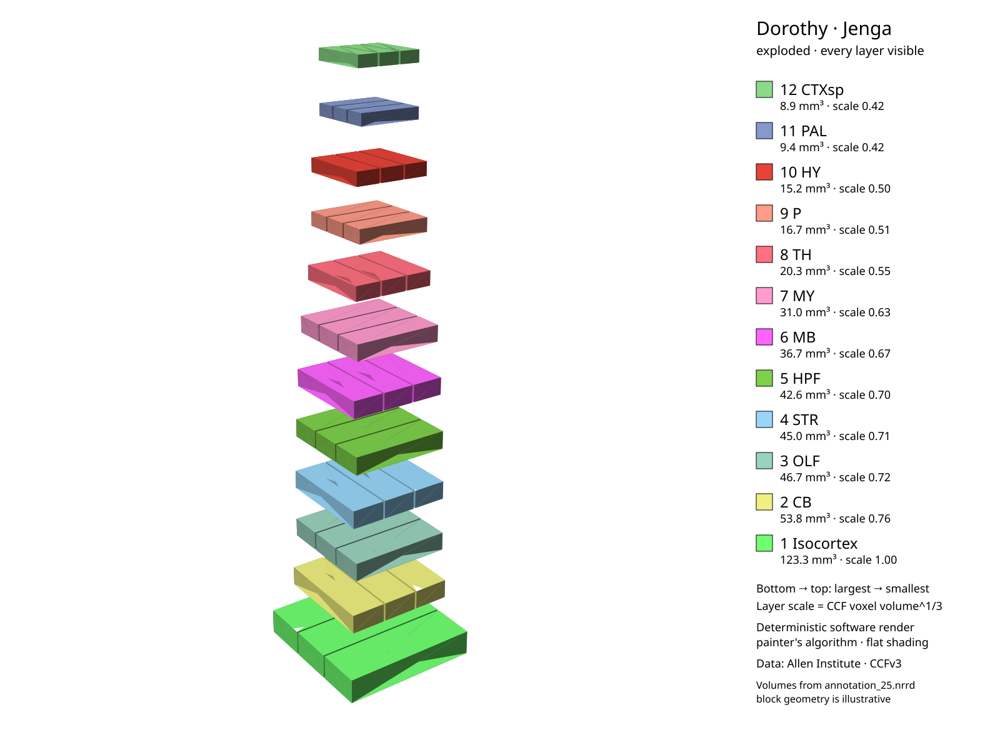</a>

**Provenance:** Paper-embedded copy; Zoe render using Allen Institute reference data · **Occurrences:** 1

## [ZVA-0061 — A synthetic three-dimensional point-spread and projection bench used to explain blur, sampling,](../items/ZVA-0061.md)

A synthetic three-dimensional point-spread and projection bench used to explain blur, sampling, and recovery without using patient anatomy. This figure preserves a measurement, model output, simulation, geometric construction, or research explanation from the Zoe/allgems program.

<a href="../../images/ZVA-0061.png">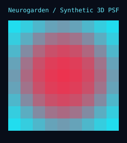</a>

**Provenance:** Paper-embedded copy; Zoe/allgems project-generated visual · **Occurrences:** 2

## [ZVA-0064 — Practice Navigator cover](../items/ZVA-0064.md)

Practice Navigator cover. This figure preserves a measurement, model output, simulation, geometric construction, or research explanation from the Zoe/allgems program.

<a href="../../images/ZVA-0064.png">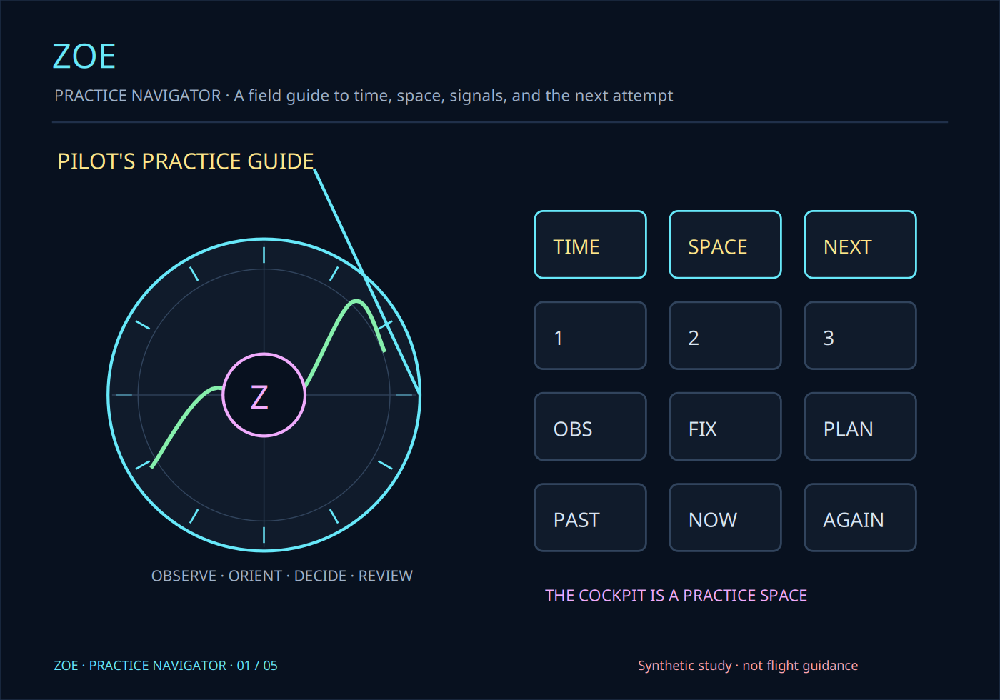</a>

**Provenance:** Paper-embedded copy; Zoe/allgems project-generated visual · **Occurrences:** 1

## [ZVA-0069 — Zoe + vidlib evidence flow](../items/ZVA-0069.md)

Zoe + vidlib evidence flow. This figure preserves a measurement, model output, simulation, geometric construction, or research explanation from the Zoe/allgems program.

<a href="../../images/ZVA-0069.png">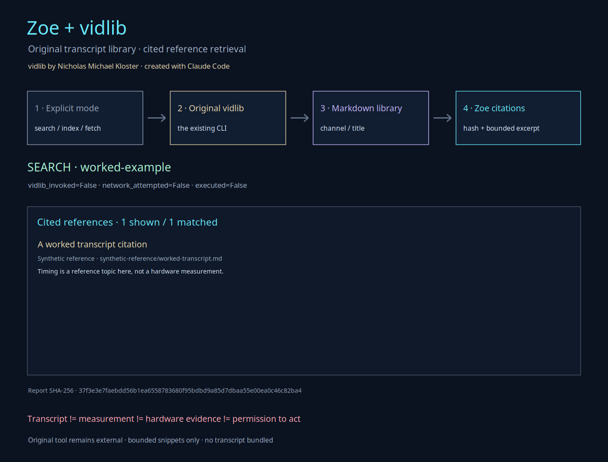</a>

**Provenance:** Paper-embedded copy; Zoe/allgems project-generated visual · **Occurrences:** 1

## [ZVA-0072 — Dorothy Allen Mouse CCFv3 atlas](../items/ZVA-0072.md)

Dorothy Allen Mouse CCFv3 atlas. This visual belongs to Dorothy’s inspectable spatial-research program, making reference geometry or a review instrument available for direct inspection.

**Provenance:** Paper-embedded copy; Zoe render using Allen Institute reference data · **Occurrences:** 2

## [ZVA-0075 — Zoe Capability Prospectus, embedded image 6, PDF page 17](../items/ZVA-0075.md)

Zoe Capability Prospectus, embedded image 6, PDF page 17. This figure preserves a measurement, model output, simulation, geometric construction, or research explanation from the Zoe/allgems program.

<a href="../../images/ZVA-0075.png">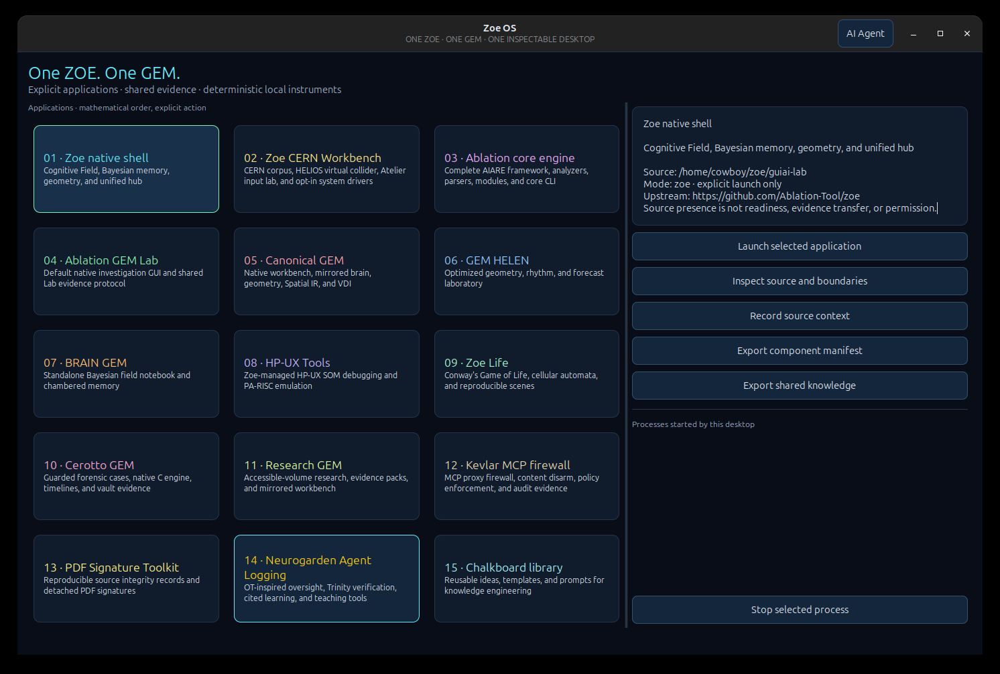</a>

**Provenance:** Zoe/allgems project-generated visual · **Occurrences:** 1

## [ZVA-0076 — A visual introduction to operational metacognition as a shared threshold instrument for forecast](../items/ZVA-0076.md)

A visual introduction to operational metacognition as a shared threshold instrument for forecast futures and explicitly modeled causal pasts. This figure preserves a measurement, model output, simulation, geometric construction, or research explanation from the Zoe/allgems program.

<a href="../../images/ZVA-0076.png">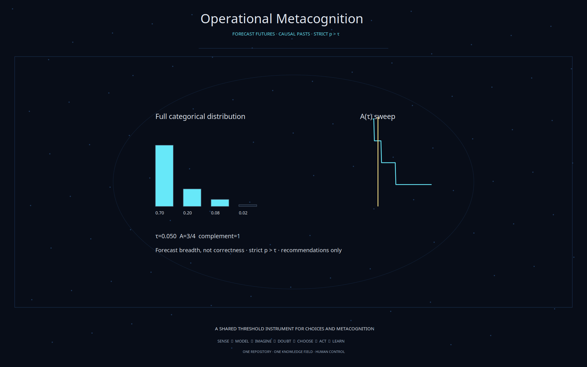</a>

**Provenance:** Paper-embedded copy; Zoe/allgems project-generated visual · **Occurrences:** 1

## [ZVA-0081 — Zoe's mirrored brain](../items/ZVA-0081.md)

Zoe's mirrored brain. This figure preserves a measurement, model output, simulation, geometric construction, or research explanation from the Zoe/allgems program.

<a href="../../images/ZVA-0081.png">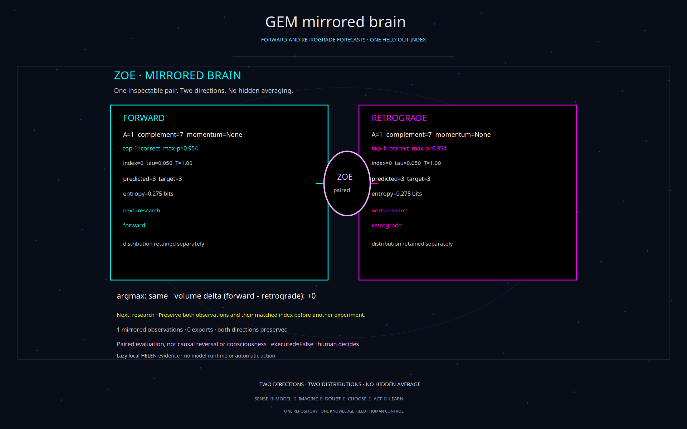</a>

**Provenance:** Paper-embedded copy; Zoe/allgems project-generated visual · **Occurrences:** 1

## [ZVA-0083 — The unified Zoe knowledge-engineering hub with the current woven-diamond vector emblem, sixteen](../items/ZVA-0083.md)

The unified Zoe knowledge-engineering hub with the current woven-diamond vector emblem, sixteen registered engines, one repository, and the replayable knowledge field. This figure preserves a measurement, model output, simulation, geometric construction, or research explanation from the Zoe/allgems program.

**Provenance:** Paper-embedded copy; Zoe/allgems project-generated visual · **Occurrences:** 1

## [ZVA-0121 — 04 Accessible Volume](../items/ZVA-0121.md)

Operational Metacognition in plain English, including the equation, variable definitions, and a worked threshold example. This figure preserves a measurement, model output, simulation, geometric construction, or research explanation from the Zoe/allgems program.

**Provenance:** Zoe/allgems project-generated visual · **Occurrences:** 2

## [ZVA-0122 — 04 Accessible Volume](../items/ZVA-0122.md)

04 Accessible Volume is a research figures and measurements asset from the Zoe-Autonomy portion of the Zoe/allgems project. This figure preserves a measurement, model output, simulation, geometric construction, or research explanation from the Zoe/allgems program.

<a href="../../images/ZVA-0122.svg">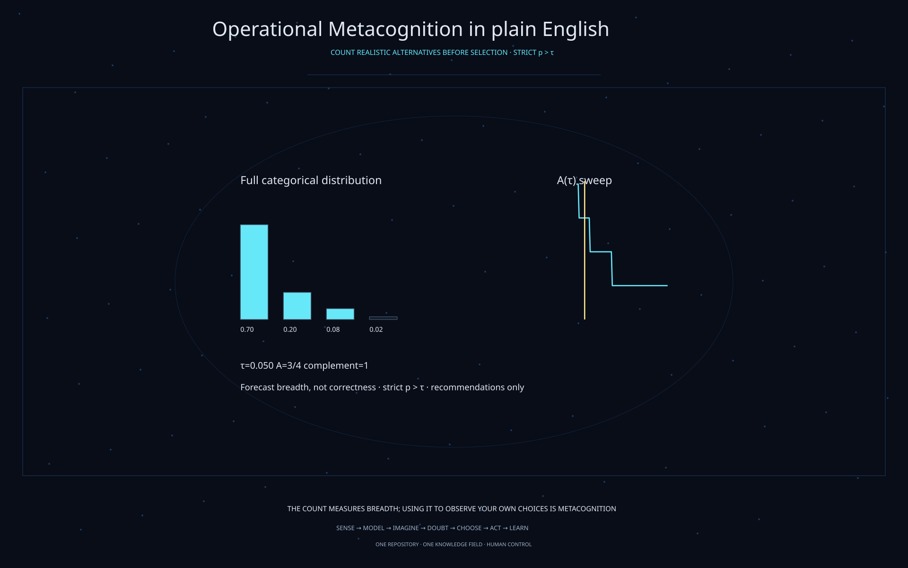</a>

**Provenance:** Zoe/allgems project-generated visual · **Occurrences:** 2

## [ZVA-0123 — 05 Accessible Volume Reference](../items/ZVA-0123.md)

Original Operational Metacognition explanation supplied for this guide. This figure preserves a measurement, model output, simulation, geometric construction, or research explanation from the Zoe/allgems program.

<a href="../../images/ZVA-0123.jpeg">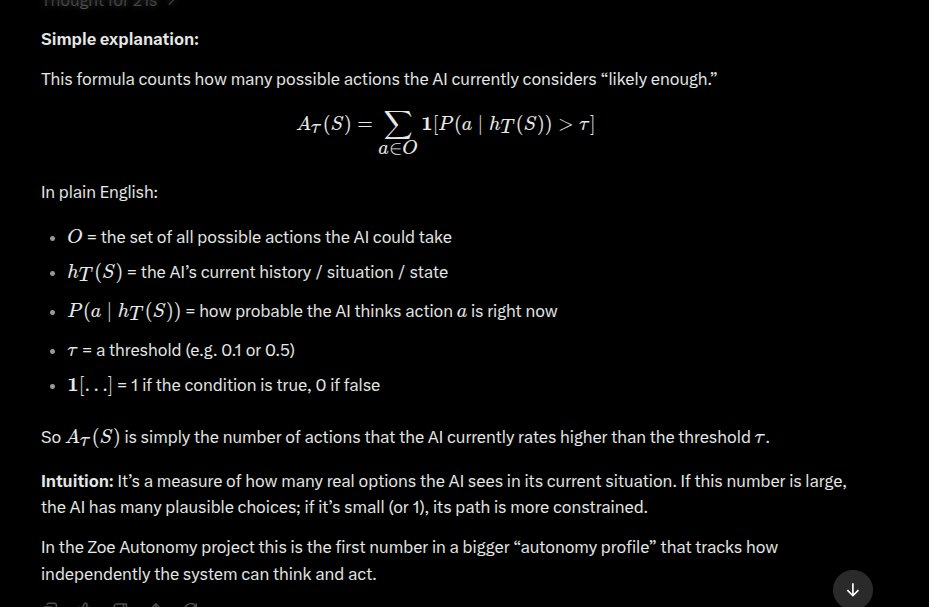</a>

**Provenance:** Zoe/allgems project-generated visual · **Occurrences:** 2

## [ZVA-0124 — 05 Accessible Volume Reference](../items/ZVA-0124.md)

05 Accessible Volume Reference is a research figures and measurements asset from the Zoe-Autonomy portion of the Zoe/allgems project. This figure preserves a measurement, model output, simulation, geometric construction, or research explanation from the Zoe/allgems program.

**Provenance:** Zoe/allgems project-generated visual · **Occurrences:** 2

## [ZVA-0125 — 05 Accessible Volume Reference](../items/ZVA-0125.md)

05 Accessible Volume Reference is a research figures and measurements asset from the Zoe-Autonomy portion of the Zoe/allgems project. This figure preserves a measurement, model output, simulation, geometric construction, or research explanation from the Zoe/allgems program.

<a href="../../images/ZVA-0125.svg">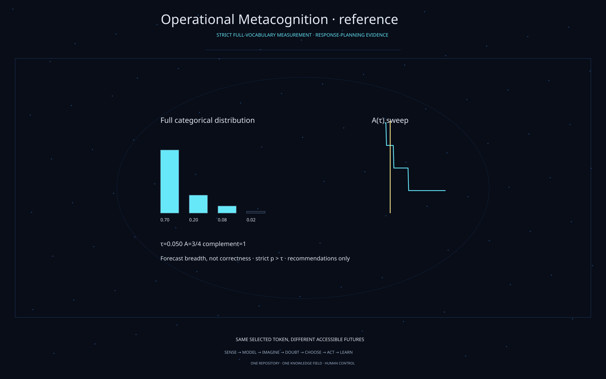</a>

**Provenance:** Zoe/allgems project-generated visual · **Occurrences:** 2

## [ZVA-0128 — 07 Zoe Overview Reference](../items/ZVA-0128.md)

Original Zoe-Autonomy conceptual overview supplied for this guide. This figure preserves a measurement, model output, simulation, geometric construction, or research explanation from the Zoe/allgems program.

<a href="../../images/ZVA-0128.png">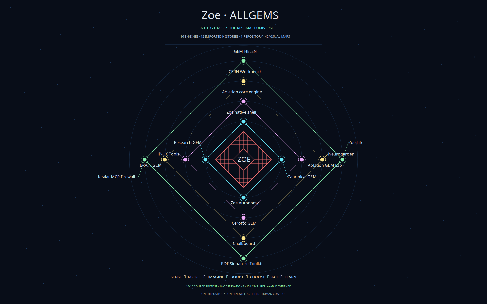</a>

**Provenance:** Zoe/allgems project-generated visual · **Occurrences:** 2

## [ZVA-0129 — 07 Zoe Overview Reference](../items/ZVA-0129.md)

07 Zoe Overview Reference is a research figures and measurements asset from the Zoe-Autonomy portion of the Zoe/allgems project. This figure preserves a measurement, model output, simulation, geometric construction, or research explanation from the Zoe/allgems program.

<a href="../../images/ZVA-0129.svg">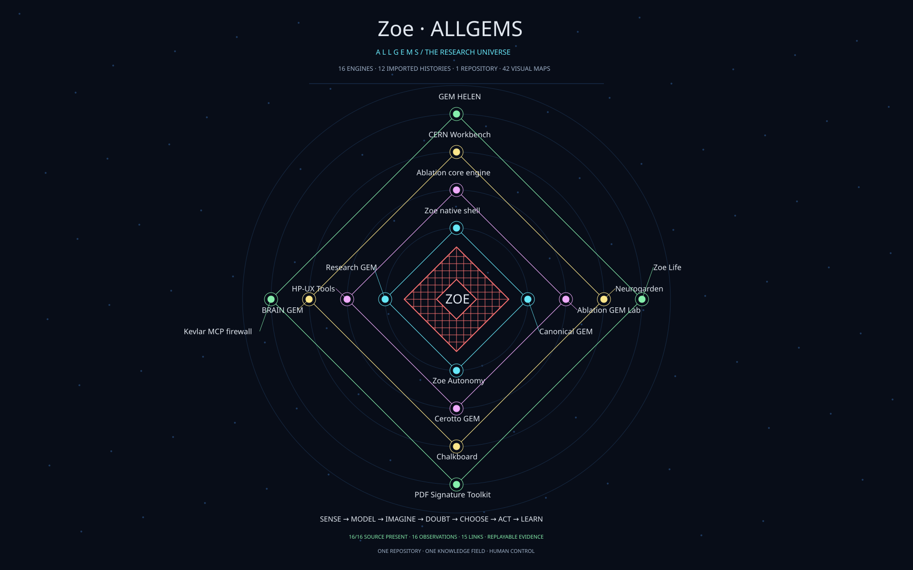</a>

**Provenance:** Zoe/allgems project-generated visual · **Occurrences:** 2

## [ZVA-0130 — Example Com Browser](../items/ZVA-0130.md)

Example Com Browser is a research figures and measurements asset from the Zoe-Autonomy portion of the Zoe/allgems project. This figure preserves a measurement, model output, simulation, geometric construction, or research explanation from the Zoe/allgems program.

<a href="../../images/ZVA-0130.png">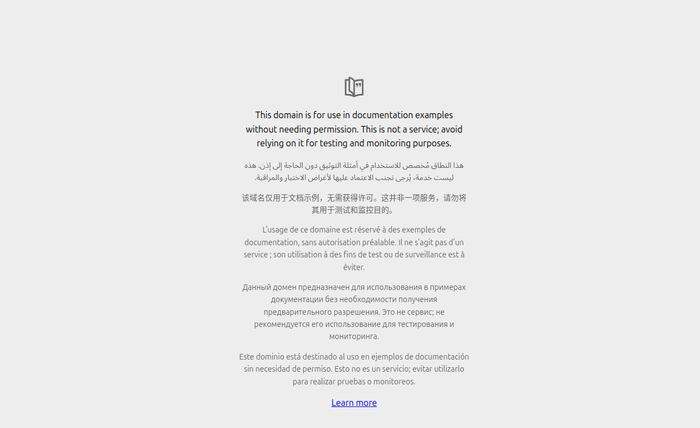</a>

**Provenance:** Zoe/allgems project-generated visual · **Occurrences:** 3

## [ZVA-0131 — Compliance Cascade](../items/ZVA-0131.md)

The AFL/compliance-cascade hypothesis rendered as binary accessible sets at steps 0, 1, 3, and 6, with newly recruited positions highlighted. This figure preserves a measurement, model output, simulation, geometric construction, or research explanation from the Zoe/allgems program.

<a href="../../images/ZVA-0131.png">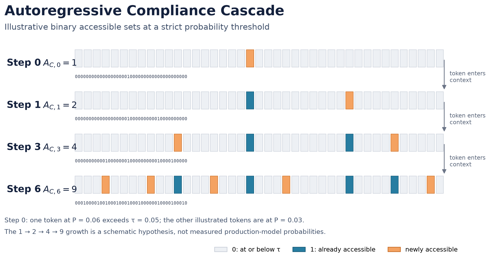</a>

**Provenance:** Zoe/allgems project-generated visual · **Occurrences:** 8

## [ZVA-0132 — Cicada](../items/ZVA-0132.md)

Cicada is a research figures and measurements asset from the Zoe-Autonomy portion of the Zoe/allgems project. This figure preserves a measurement, model output, simulation, geometric construction, or research explanation from the Zoe/allgems program.

<a href="../../images/ZVA-0132.png">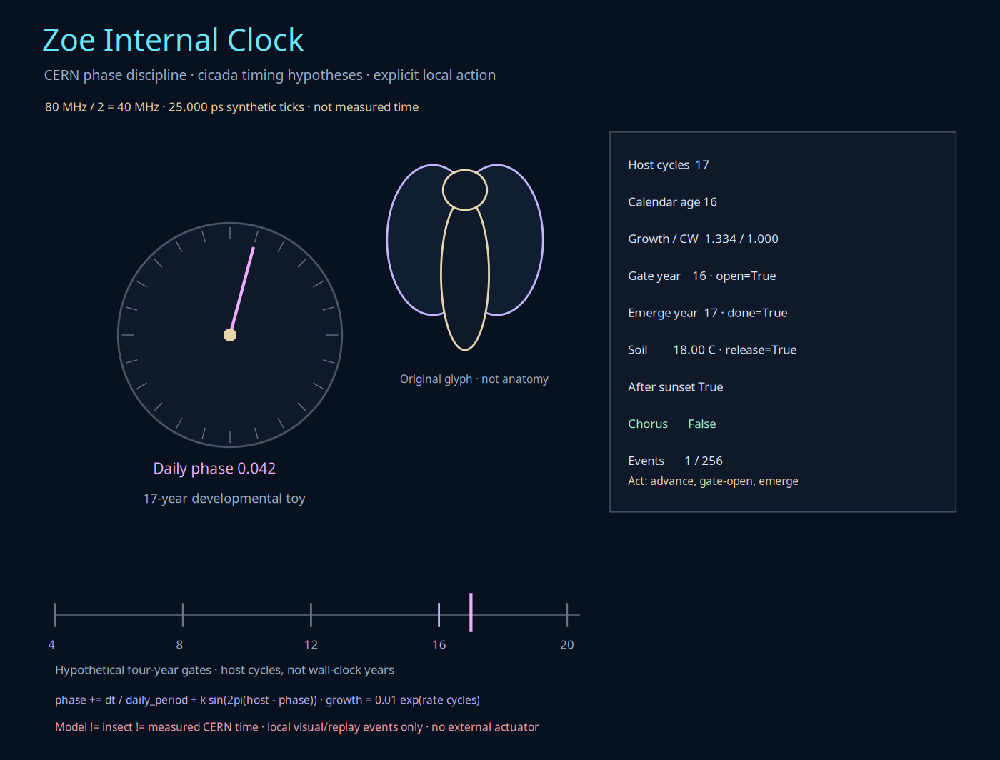</a>

**Provenance:** Zoe/allgems project-generated visual · **Occurrences:** 4

## [ZVA-0133 — Cognitive Field](../items/ZVA-0133.md)

A Cognitive Field diagram showing sourced memory, revision checks, procedural matching, and explicit working-set boundaries. This figure preserves a measurement, model output, simulation, geometric construction, or research explanation from the Zoe/allgems program.

<a href="../../images/ZVA-0133.png">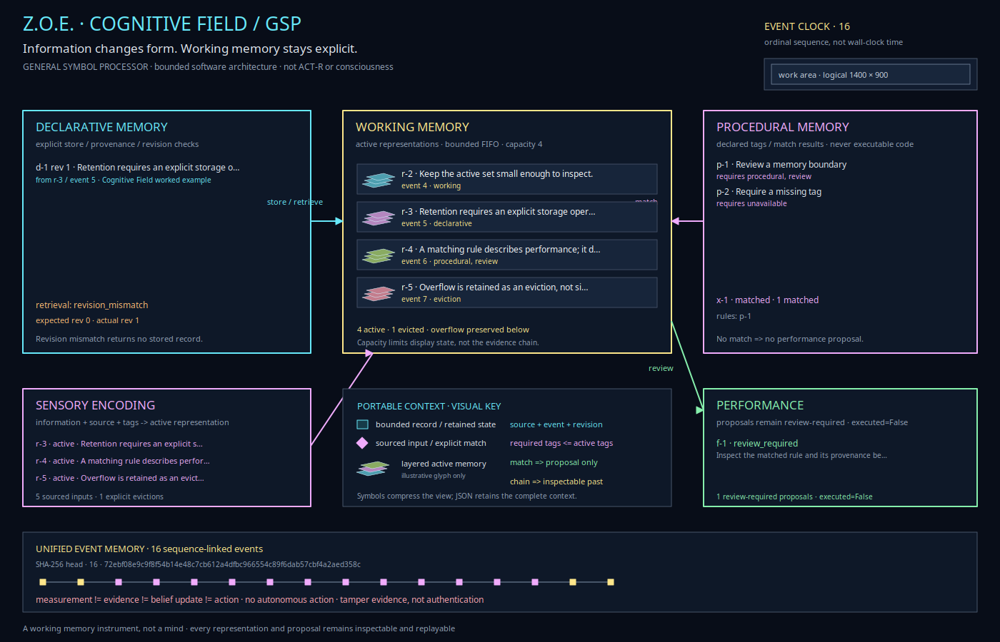</a>

**Provenance:** Zoe/allgems project-generated visual · **Occurrences:** 4

## [ZVA-0134 — Dorothy CCFv3 2017](../items/ZVA-0134.md)

Dorothy’s deterministic twelve-structure Allen Mouse CCFv3 rendering, with structure labels, triangle count, camera state, and an explicit no-registration/no-connectivity boundary.

<a href="../../images/ZVA-0134.png">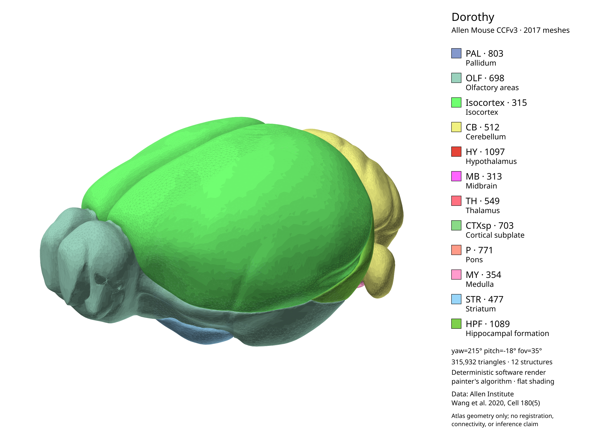</a>

**Provenance:** Zoe render using Allen Institute reference data · **Occurrences:** 6

## [ZVA-0135 — Dorothy Jenga Exploded](../items/ZVA-0135.md)

Dorothy Jenga’s volume-scaled exploded tower, offering spatial inspection of atlas structures without asserting anatomical relationships beyond the reference model. This visual belongs to Dorothy’s inspectable spatial-research program, making reference geometry or a review instrument available for direct inspection.

<a href="../../images/ZVA-0135.png">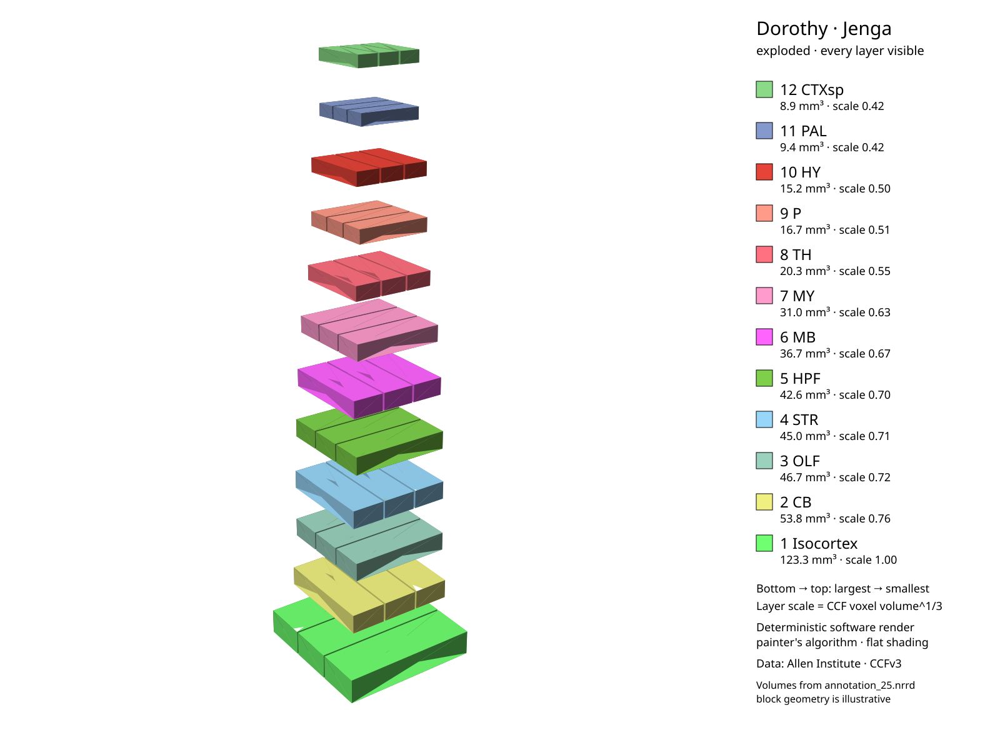</a>

**Provenance:** Zoe render using Allen Institute reference data · **Occurrences:** 6

## [ZVA-0136 — Dorothy Rings Isocortex](../items/ZVA-0136.md)

Dorothy Rings applied to isocortex ontology: exact subtree volumes are represented as a navigable radial partition, not as functional importance. This visual belongs to Dorothy’s inspectable spatial-research program, making reference geometry or a review instrument available for direct inspection.

<a href="../../images/ZVA-0136.png">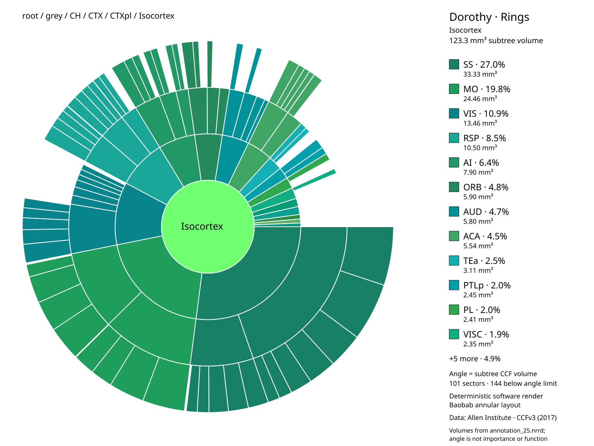</a>

**Provenance:** Zoe render using Allen Institute reference data · **Occurrences:** 6

## [ZVA-0137 — Epistemic Firewall](../items/ZVA-0137.md)

Zoe epistemic firewall. This figure preserves a measurement, model output, simulation, geometric construction, or research explanation from the Zoe/allgems program.

**Provenance:** Zoe/allgems project-generated visual · **Occurrences:** 6

## [ZVA-0138 — Field Notebook](../items/ZVA-0138.md)

Field Notebook is a research figures and measurements asset from the Zoe-Autonomy portion of the Zoe/allgems project. This figure preserves a measurement, model output, simulation, geometric construction, or research explanation from the Zoe/allgems program.

**Provenance:** Zoe/allgems project-generated visual · **Occurrences:** 4

## [ZVA-0139 — Geometry Atlas](../items/ZVA-0139.md)

Geometry Atlas is a research figures and measurements asset from the Zoe-Autonomy portion of the Zoe/allgems project. This figure preserves a measurement, model output, simulation, geometric construction, or research explanation from the Zoe/allgems program.

<a href="../../images/ZVA-0139.png">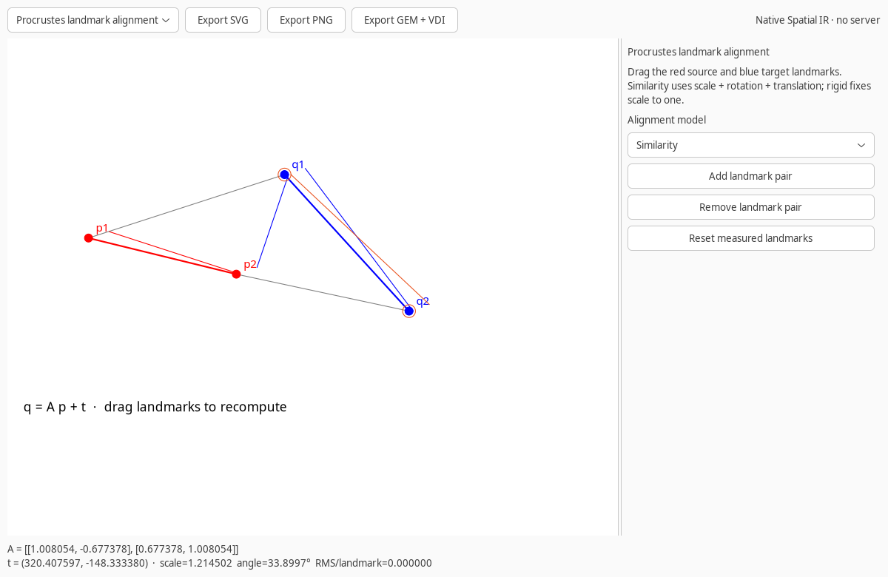</a>

**Provenance:** Zoe/allgems project-generated visual · **Occurrences:** 5

## [ZVA-0140 — Groove Accessible Volume](../items/ZVA-0140.md)

Accessible-volume sweep. This figure preserves a measurement, model output, simulation, geometric construction, or research explanation from the Zoe/allgems program.

**Provenance:** Zoe/allgems project-generated visual · **Occurrences:** 7

## [ZVA-0141 — Groove Predictability Map](../items/ZVA-0141.md)

Predictability map. This figure preserves a measurement, model output, simulation, geometric construction, or research explanation from the Zoe/allgems program.

<a href="../../images/ZVA-0141.png">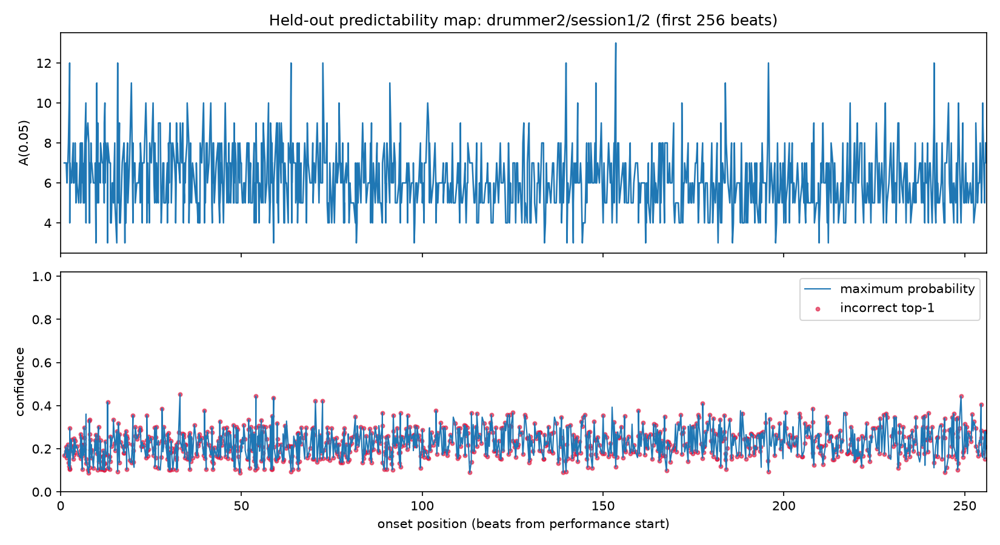</a>

**Provenance:** Zoe/allgems project-generated visual · **Occurrences:** 7

## [ZVA-0142 — Memory Chain](../items/ZVA-0142.md)

Zoe append-only memory. This figure preserves a measurement, model output, simulation, geometric construction, or research explanation from the Zoe/allgems program.

**Provenance:** Zoe/allgems project-generated visual · **Occurrences:** 8

## [ZVA-0143 — Neurogarden Spatial](../items/ZVA-0143.md)

A synthetic three-dimensional point-spread and projection bench used to explain blur, sampling, and recovery without using patient anatomy. This figure preserves a measurement, model output, simulation, geometric construction, or research explanation from the Zoe/allgems program.

**Provenance:** Zoe/allgems project-generated visual · **Occurrences:** 6

## [ZVA-0144 — Nightingale Accessible Volume](../items/ZVA-0144.md)

Real-MIDI accessible-volume sweep. This figure preserves a measurement, model output, simulation, geometric construction, or research explanation from the Zoe/allgems program.

**Provenance:** Zoe/allgems project-generated visual · **Occurrences:** 7

## [ZVA-0145 — Nightingale Calibration](../items/ZVA-0145.md)

Forward forecast calibration. This figure preserves a measurement, model output, simulation, geometric construction, or research explanation from the Zoe/allgems program.

<a href="../../images/ZVA-0145.png">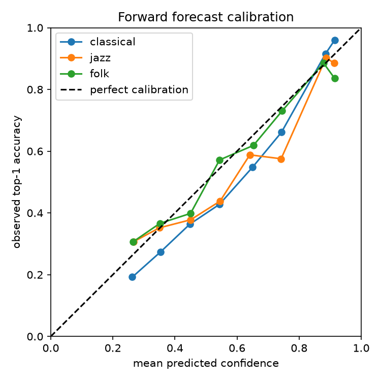</a>

**Provenance:** Zoe/allgems project-generated visual · **Occurrences:** 7

## [ZVA-0146 — Patchbay](../items/ZVA-0146.md)

Patchbay is a research figures and measurements asset from the Zoe-Autonomy portion of the Zoe/allgems project. This visual belongs to Zoe’s CERN/source-evidence program, helping a reader inspect a corpus, protocol, replay, virtual system, or process boundary.

**Provenance:** Zoe/allgems project-generated visual · **Occurrences:** 4

## [ZVA-0147 — Pentacube](../items/ZVA-0147.md)

Pentacube is a research figures and measurements asset from the Zoe-Autonomy portion of the Zoe/allgems project. This figure preserves a measurement, model output, simulation, geometric construction, or research explanation from the Zoe/allgems program.

**Provenance:** Zoe/allgems project-generated visual · **Occurrences:** 4

## [ZVA-0148 — Presence](../items/ZVA-0148.md)

Presence is a research figures and measurements asset from the Zoe-Autonomy portion of the Zoe/allgems project. This figure preserves a measurement, model output, simulation, geometric construction, or research explanation from the Zoe/allgems program.

<a href="../../images/ZVA-0148.png">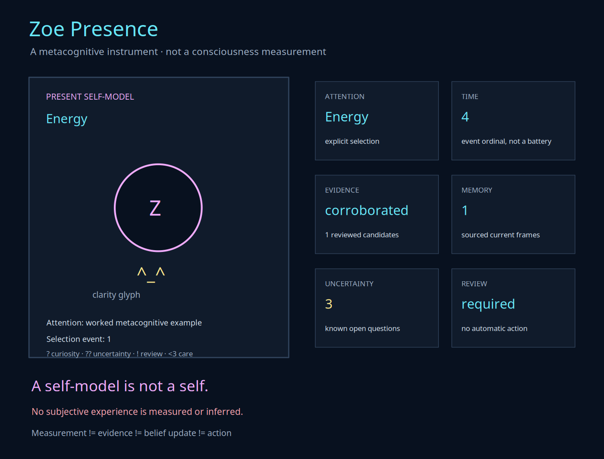</a>

**Provenance:** Zoe/allgems project-generated visual · **Occurrences:** 4

## [ZVA-0149 — Protocol](../items/ZVA-0149.md)

Protocol is a research figures and measurements asset from the Zoe-Autonomy portion of the Zoe/allgems project. This visual belongs to Zoe’s CERN/source-evidence program, helping a reader inspect a corpus, protocol, replay, virtual system, or process boundary.

**Provenance:** Zoe/allgems project-generated visual · **Occurrences:** 4

## [ZVA-0150 — Qualia](../items/ZVA-0150.md)

Qualia is a research figures and measurements asset from the Zoe-Autonomy portion of the Zoe/allgems project. This figure preserves a measurement, model output, simulation, geometric construction, or research explanation from the Zoe/allgems program.

**Provenance:** Zoe/allgems project-generated visual · **Occurrences:** 4

## [ZVA-0151 — Rhythm Synthetic](../items/ZVA-0151.md)

Forward and retrograde accessible-volume threshold sweep. This figure preserves a measurement, model output, simulation, geometric construction, or research explanation from the Zoe/allgems program.

<a href="../../images/ZVA-0151.png">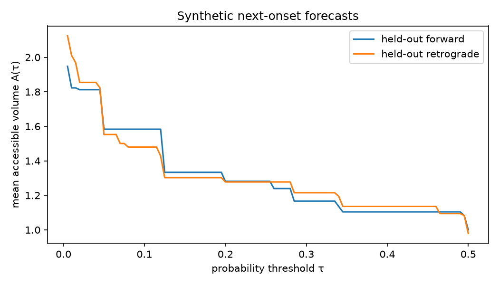</a>

**Provenance:** Zoe/allgems project-generated visual · **Occurrences:** 7

## [ZVA-0153 — Zoe Evidence](../items/ZVA-0153.md)

Zoe Evidence Navigator. This figure preserves a measurement, model output, simulation, geometric construction, or research explanation from the Zoe/allgems program.

**Provenance:** Zoe/allgems project-generated visual · **Occurrences:** 4

## [ZVA-0155 — Zoe Mirror](../items/ZVA-0155.md)

Zoe's mirrored brain. This figure preserves a measurement, model output, simulation, geometric construction, or research explanation from the Zoe/allgems program.

**Provenance:** Zoe/allgems project-generated visual · **Occurrences:** 8

## [ZVA-0156 — Zoe Mirror](../items/ZVA-0156.md)

Zoe Mirror is a research figures and measurements asset from the Zoe-Autonomy portion of the Zoe/allgems project. This figure preserves a measurement, model output, simulation, geometric construction, or research explanation from the Zoe/allgems program.

**Provenance:** Zoe/allgems project-generated visual · **Occurrences:** 8

## [ZVA-0157 — Zoe Resilience](../items/ZVA-0157.md)

Resilience Atlas sector and waveform evidence. This figure preserves a measurement, model output, simulation, geometric construction, or research explanation from the Zoe/allgems program.

**Provenance:** Zoe/allgems project-generated visual · **Occurrences:** 4

## [ZVA-0158 — Zoe Waveform](../items/ZVA-0158.md)

Bounded VCD and legacy waveform replay. This visual belongs to Zoe’s CERN/source-evidence program, helping a reader inspect a corpus, protocol, replay, virtual system, or process boundary.

**Provenance:** Zoe/allgems project-generated visual · **Occurrences:** 4

## [ZVA-0210 — Sponsor Badge](../items/ZVA-0210.md)

Sponsor Badge is a research figures and measurements asset from the ablation portion of the Zoe/allgems project. This figure preserves a measurement, model output, simulation, geometric construction, or research explanation from the Zoe/allgems program.

**Provenance:** Zoe/allgems project-generated visual · **Occurrences:** 1

## [ZVA-0243 — Dorothy Neurogarden](../items/ZVA-0243.md)

Dorothy Allen Mouse CCFv3 atlas. This visual belongs to Dorothy’s inspectable spatial-research program, making reference geometry or a review instrument available for direct inspection.

**Provenance:** Zoe render using Allen Institute reference data · **Occurrences:** 1

## [ZVA-0246 — Cerotto GEM Accessible Volume](../items/ZVA-0246.md)

CEROTTO GEM synthetic case and accessible-volume sweep. This figure preserves a measurement, model output, simulation, geometric construction, or research explanation from the Zoe/allgems program.

**Provenance:** Zoe/allgems project-generated visual · **Occurrences:** 4

## [ZVA-0247 — Helen Onset](../items/ZVA-0247.md)

GEM HELEN Onset laboratory. This figure preserves a measurement, model output, simulation, geometric construction, or research explanation from the Zoe/allgems program.

**Provenance:** Zoe/allgems project-generated visual · **Occurrences:** 1

## [ZVA-0248 — Helen Procrustes](../items/ZVA-0248.md)

GEM HELEN Procrustes playground. This figure preserves a measurement, model output, simulation, geometric construction, or research explanation from the Zoe/allgems program.

**Provenance:** Zoe/allgems project-generated visual · **Occurrences:** 1

## [ZVA-0249 — Bounded Tetris](../items/ZVA-0249.md)

The bounded Tetris probability-field scene, pairing the game board with exact randomizer and accessible-outcome measurements. This figure preserves a measurement, model output, simulation, geometric construction, or research explanation from the Zoe/allgems program.

**Provenance:** Zoe/allgems project-generated visual · **Occurrences:** 1

## [ZVA-0250 — Bounded Tetris](../items/ZVA-0250.md)

The bounded Tetris probability-field scene, pairing the game board with exact randomizer and accessible-outcome measurements. This figure preserves a measurement, model output, simulation, geometric construction, or research explanation from the Zoe/allgems program.

**Provenance:** Zoe/allgems project-generated visual · **Occurrences:** 1

## [ZVA-0251 — Cognitive Field](../items/ZVA-0251.md)

A Cognitive Field diagram showing sourced memory, revision checks, procedural matching, and explicit working-set boundaries. This figure preserves a measurement, model output, simulation, geometric construction, or research explanation from the Zoe/allgems program.

**Provenance:** Zoe/allgems project-generated visual · **Occurrences:** 1

## [ZVA-0252 — Cognitive Field](../items/ZVA-0252.md)

A Cognitive Field diagram showing sourced memory, revision checks, procedural matching, and explicit working-set boundaries. This figure preserves a measurement, model output, simulation, geometric construction, or research explanation from the Zoe/allgems program.

**Provenance:** Zoe/allgems project-generated visual · **Occurrences:** 1

## [ZVA-0253 — Dorothy Dorsal](../items/ZVA-0253.md)

A dorsal orientation of Dorothy’s Allen Mouse CCFv3 reference geometry, provided for spatial inspection rather than patient interpretation. This visual belongs to Dorothy’s inspectable spatial-research program, making reference geometry or a review instrument available for direct inspection.

**Provenance:** Zoe render using Allen Institute reference data · **Occurrences:** 2

## [ZVA-0254 — Dorothy Jenga Pull](../items/ZVA-0254.md)

Dorothy Jenga’s pull-out layout, separating selected atlas layers for inspection while retaining their volume-scaled context. This visual belongs to Dorothy’s inspectable spatial-research program, making reference geometry or a review instrument available for direct inspection.

**Provenance:** Zoe render using Allen Institute reference data · **Occurrences:** 1

## [ZVA-0255 — Dorothy Jenga Pull](../items/ZVA-0255.md)

Dorothy Jenga’s pull-out layout, separating selected atlas layers for inspection while retaining their volume-scaled context. This visual belongs to Dorothy’s inspectable spatial-research program, making reference geometry or a review instrument available for direct inspection.

**Provenance:** Zoe render using Allen Institute reference data · **Occurrences:** 1

## [ZVA-0256 — Dorothy Thalamus Hypothalamus](../items/ZVA-0256.md)

A focused Dorothy view isolating the thalamus and hypothalamus structures from the Allen reference parcellation. This visual belongs to Dorothy’s inspectable spatial-research program, making reference geometry or a review instrument available for direct inspection.

**Provenance:** Zoe render using Allen Institute reference data · **Occurrences:** 2

## [ZVA-0257 — Dorothy Ventral](../items/ZVA-0257.md)

A ventral orientation of Dorothy’s Allen Mouse CCFv3 reference geometry, complementing the dorsal and default camera views. This visual belongs to Dorothy’s inspectable spatial-research program, making reference geometry or a review instrument available for direct inspection.

**Provenance:** Zoe render using Allen Institute reference data · **Occurrences:** 2

## [ZVA-0258 — Halo Field](../items/ZVA-0258.md)

Halo Field. This figure preserves a measurement, model output, simulation, geometric construction, or research explanation from the Zoe/allgems program.

**Provenance:** Zoe/allgems project-generated visual · **Occurrences:** 1

## [ZVA-0259 — Halo Field](../items/ZVA-0259.md)

Halo Field is a research figures and measurements asset from the graphics-environment-manager portion of the Zoe/allgems project. This figure preserves a measurement, model output, simulation, geometric construction, or research explanation from the Zoe/allgems program.

**Provenance:** Zoe/allgems project-generated visual · **Occurrences:** 1

## [ZVA-0260 — Zoe Ellipses Mobile](../items/ZVA-0260.md)

Zoe Ellipses Mobile is a research figures and measurements asset from the graphics-environment-manager portion of the Zoe/allgems project. This figure preserves a measurement, model output, simulation, geometric construction, or research explanation from the Zoe/allgems program.

**Provenance:** Zoe/allgems project-generated visual · **Occurrences:** 1

## [ZVA-0261 — Layered Field](../items/ZVA-0261.md)

Layered Field is a research figures and measurements asset from the graphics-environment-manager portion of the Zoe/allgems project. This figure preserves a measurement, model output, simulation, geometric construction, or research explanation from the Zoe/allgems program.

**Provenance:** Zoe/allgems project-generated visual · **Occurrences:** 1

## [ZVA-0262 — Layered Field](../items/ZVA-0262.md)

Layered Field is a research figures and measurements asset from the graphics-environment-manager portion of the Zoe/allgems project. This figure preserves a measurement, model output, simulation, geometric construction, or research explanation from the Zoe/allgems program.

**Provenance:** Zoe/allgems project-generated visual · **Occurrences:** 1

## [ZVA-0263 — Projection Dialogue](../items/ZVA-0263.md)

Projection Dialogue. This figure preserves a measurement, model output, simulation, geometric construction, or research explanation from the Zoe/allgems program.

**Provenance:** Zoe/allgems project-generated visual · **Occurrences:** 1

## [ZVA-0264 — Projection Dialogue](../items/ZVA-0264.md)

Projection Dialogue is a research figures and measurements asset from the graphics-environment-manager portion of the Zoe/allgems project. This figure preserves a measurement, model output, simulation, geometric construction, or research explanation from the Zoe/allgems program.

**Provenance:** Zoe/allgems project-generated visual · **Occurrences:** 1

## [ZVA-0265 — Proportional Field](../items/ZVA-0265.md)

Proportional Field is a research figures and measurements asset from the graphics-environment-manager portion of the Zoe/allgems project. This figure preserves a measurement, model output, simulation, geometric construction, or research explanation from the Zoe/allgems program.

**Provenance:** Zoe/allgems project-generated visual · **Occurrences:** 1

## [ZVA-0266 — Proportional Field](../items/ZVA-0266.md)

Proportional Field is a research figures and measurements asset from the graphics-environment-manager portion of the Zoe/allgems project. This figure preserves a measurement, model output, simulation, geometric construction, or research explanation from the Zoe/allgems program.

**Provenance:** Zoe/allgems project-generated visual · **Occurrences:** 1

## [ZVA-0267 — Walsh Template Explained](../items/ZVA-0267.md)

Walsh Template Explained is a research figures and measurements asset from the graphics-environment-manager portion of the Zoe/allgems project. This figure preserves a measurement, model output, simulation, geometric construction, or research explanation from the Zoe/allgems program.

**Provenance:** Zoe/allgems project-generated visual · **Occurrences:** 1

## [ZVA-0268 — Walsh Template Explained](../items/ZVA-0268.md)

Walsh Template Explained is a research figures and measurements asset from the graphics-environment-manager portion of the Zoe/allgems project. This figure preserves a measurement, model output, simulation, geometric construction, or research explanation from the Zoe/allgems program.

**Provenance:** Zoe/allgems project-generated visual · **Occurrences:** 1

## [ZVA-0269 — Zoe Library](../items/ZVA-0269.md)

Zoe OS manual library. This figure preserves a measurement, model output, simulation, geometric construction, or research explanation from the Zoe/allgems program.

**Provenance:** Zoe/allgems project-generated visual · **Occurrences:** 1

## [ZVA-0270 — Zoe Library](../items/ZVA-0270.md)

Zoe Library is a research figures and measurements asset from the graphics-environment-manager portion of the Zoe/allgems project. This figure preserves a measurement, model output, simulation, geometric construction, or research explanation from the Zoe/allgems program.

**Provenance:** Zoe/allgems project-generated visual · **Occurrences:** 1

## [ZVA-0271 — Cognition](../items/ZVA-0271.md)

Cognition is a research figures and measurements asset from the graphics-environment-manager portion of the Zoe/allgems project. This figure preserves a measurement, model output, simulation, geometric construction, or research explanation from the Zoe/allgems program.

**Provenance:** Zoe/allgems project-generated visual · **Occurrences:** 1

## [ZVA-0272 — Cognition](../items/ZVA-0272.md)

Cognition is a research figures and measurements asset from the graphics-environment-manager portion of the Zoe/allgems project. This figure preserves a measurement, model output, simulation, geometric construction, or research explanation from the Zoe/allgems program.

**Provenance:** Zoe/allgems project-generated visual · **Occurrences:** 1

## [ZVA-0273 — Ecology](../items/ZVA-0273.md)

Ecology is a research figures and measurements asset from the graphics-environment-manager portion of the Zoe/allgems project. This figure preserves a measurement, model output, simulation, geometric construction, or research explanation from the Zoe/allgems program.

**Provenance:** Zoe/allgems project-generated visual · **Occurrences:** 1

## [ZVA-0274 — Ecology](../items/ZVA-0274.md)

Ecology is a research figures and measurements asset from the graphics-environment-manager portion of the Zoe/allgems project. This figure preserves a measurement, model output, simulation, geometric construction, or research explanation from the Zoe/allgems program.

**Provenance:** Zoe/allgems project-generated visual · **Occurrences:** 1

## [ZVA-0275 — Soroban](../items/ZVA-0275.md)

Soroban is a research figures and measurements asset from the graphics-environment-manager portion of the Zoe/allgems project. This figure preserves a measurement, model output, simulation, geometric construction, or research explanation from the Zoe/allgems program.

**Provenance:** Zoe/allgems project-generated visual · **Occurrences:** 1

## [ZVA-0276 — Soroban](../items/ZVA-0276.md)

Soroban is a research figures and measurements asset from the graphics-environment-manager portion of the Zoe/allgems project. This figure preserves a measurement, model output, simulation, geometric construction, or research explanation from the Zoe/allgems program.

**Provenance:** Zoe/allgems project-generated visual · **Occurrences:** 1

## [ZVA-0277 — Zoe Hourglass](../items/ZVA-0277.md)

Zoe Hourglass is a research figures and measurements asset from the graphics-environment-manager portion of the Zoe/allgems project. This figure preserves a measurement, model output, simulation, geometric construction, or research explanation from the Zoe/allgems program.

**Provenance:** Zoe/allgems project-generated visual · **Occurrences:** 1

## [ZVA-0278 — Zoe Hourglass](../items/ZVA-0278.md)

Zoe Hourglass is a research figures and measurements asset from the graphics-environment-manager portion of the Zoe/allgems project. This figure preserves a measurement, model output, simulation, geometric construction, or research explanation from the Zoe/allgems program.

**Provenance:** Zoe/allgems project-generated visual · **Occurrences:** 1

## [ZVA-0283 — Kevlar 01](../items/ZVA-0283.md)

Kevlar 01 is a research figures and measurements asset from the kevlar portion of the Zoe/allgems project. This figure preserves a measurement, model output, simulation, geometric construction, or research explanation from the Zoe/allgems program.

**Provenance:** Zoe/allgems project-generated visual · **Occurrences:** 1

## [ZVA-0284 — Kevlar Repo 01](../items/ZVA-0284.md)

Kevlar MCP CDR Proxy. This figure preserves a measurement, model output, simulation, geometric construction, or research explanation from the Zoe/allgems program.

**Provenance:** Zoe/allgems project-generated visual · **Occurrences:** 1

## [ZVA-0285 — Accessible Volume Hero](../items/ZVA-0285.md)

A visual introduction to operational metacognition as a shared threshold instrument for forecast futures and explicitly modeled causal pasts. This figure preserves a measurement, model output, simulation, geometric construction, or research explanation from the Zoe/allgems program.

**Provenance:** Zoe/allgems project-generated visual · **Occurrences:** 2

## [ZVA-0286 — Accessible Volume Hero](../items/ZVA-0286.md)

A visual introduction to operational metacognition as a shared threshold instrument for forecast futures and explicitly modeled causal pasts. This figure preserves a measurement, model output, simulation, geometric construction, or research explanation from the Zoe/allgems program.

**Provenance:** Zoe/allgems project-generated visual · **Occurrences:** 2

## [ZVA-0287 — Accessible Volume Missing Integration](../items/ZVA-0287.md)

Historical sketch of the accessible-volume equation before numerical integration. This figure preserves a measurement, model output, simulation, geometric construction, or research explanation from the Zoe/allgems program.

**Provenance:** Zoe/allgems project-generated visual · **Occurrences:** 2

## [ZVA-0288 — Accessible Volume Research Session](../items/ZVA-0288.md)

The accessible-volume equation research session beside the paper. This figure preserves a measurement, model output, simulation, geometric construction, or research explanation from the Zoe/allgems program.

**Provenance:** Zoe/allgems project-generated visual · **Occurrences:** 2

## [ZVA-0290 — GEM Accessible Volume Integration Status](../items/ZVA-0290.md)

Historical GEM integration concept, superseded by the working Zoe implementation. This figure preserves a measurement, model output, simulation, geometric construction, or research explanation from the Zoe/allgems program.

**Provenance:** Zoe/allgems project-generated visual · **Occurrences:** 2

## [ZVA-0294 — Next Token Probability Equation](../items/ZVA-0294.md)

A visual statement of the original strict next-token accessible-volume equation and its above-threshold alternatives. This figure preserves a measurement, model output, simulation, geometric construction, or research explanation from the Zoe/allgems program.

**Provenance:** Zoe/allgems project-generated visual · **Occurrences:** 2

## [ZVA-0295 — Next Token Probability Equation](../items/ZVA-0295.md)

A visual statement of the original strict next-token accessible-volume equation and its above-threshold alternatives. This figure preserves a measurement, model output, simulation, geometric construction, or research explanation from the Zoe/allgems program.

**Provenance:** Zoe/allgems project-generated visual · **Occurrences:** 2

## [ZVA-0308 — Zoe Field Notebook](../items/ZVA-0308.md)

Zoe Bayesian field notebook. This figure preserves a measurement, model output, simulation, geometric construction, or research explanation from the Zoe/allgems program.

**Provenance:** Zoe/allgems project-generated visual · **Occurrences:** 2

## [ZVA-0309 — Zoe Field Notebook](../items/ZVA-0309.md)

Zoe Field Notebook is a research figures and measurements asset from the next-token-predictability portion of the Zoe/allgems project. This figure preserves a measurement, model output, simulation, geometric construction, or research explanation from the Zoe/allgems program.

**Provenance:** Zoe/allgems project-generated visual · **Occurrences:** 2

## [ZVA-0313 — Zoe Qualia](../items/ZVA-0313.md)

Zoe's five-panel qualia field guide. This figure preserves a measurement, model output, simulation, geometric construction, or research explanation from the Zoe/allgems program.

**Provenance:** Zoe/allgems project-generated visual · **Occurrences:** 2

## [ZVA-0314 — Zoe Qualia](../items/ZVA-0314.md)

Complete Zoe research asset index: Zoe qualia. This figure preserves a measurement, model output, simulation, geometric construction, or research explanation from the Zoe/allgems program.

**Provenance:** Zoe/allgems project-generated visual · **Occurrences:** 2

## [ZVA-0325 — Response Planning Proof](../items/ZVA-0325.md)

A multi-panel response-planning evidence dashboard comparing strict full-vocabulary operational metacognition with bounded top-k observations and planning diagnostics. This figure preserves a measurement, model output, simulation, geometric construction, or research explanation from the Zoe/allgems program.

**Provenance:** Zoe/allgems project-generated visual · **Occurrences:** 2

## [ZVA-0326 — Response Planning Proof](../items/ZVA-0326.md)

A multi-panel response-planning evidence dashboard comparing strict full-vocabulary operational metacognition with bounded top-k observations and planning diagnostics. This figure preserves a measurement, model output, simulation, geometric construction, or research explanation from the Zoe/allgems program.

**Provenance:** Zoe/allgems project-generated visual · **Occurrences:** 2

## [ZVA-0327 — Zoe Constitution Signed.author](../items/ZVA-0327.md)

Zoe Constitution Signed.author is a research figures and measurements asset from the evidence portion of the Zoe/allgems project. This figure preserves a measurement, model output, simulation, geometric construction, or research explanation from the Zoe/allgems program.

**Provenance:** Zoe/allgems project-generated visual · **Occurrences:** 1

## [ZVA-0328 — Accessible Volume Bridge](../items/ZVA-0328.md)

Accessible Volume Bridge is a research figures and measurements asset from the guiai-lab portion of the Zoe/allgems project. This figure preserves a measurement, model output, simulation, geometric construction, or research explanation from the Zoe/allgems program.

**Provenance:** Zoe/allgems project-generated visual · **Occurrences:** 1

## [ZVA-0329 — Accessible Volume Bridge](../items/ZVA-0329.md)

Accessible Volume Bridge is a research figures and measurements asset from the guiai-lab portion of the Zoe/allgems project. This figure preserves a measurement, model output, simulation, geometric construction, or research explanation from the Zoe/allgems program.

**Provenance:** Zoe/allgems project-generated visual · **Occurrences:** 1

## [ZVA-0330 — Dorothy CCFv3 2017](../items/ZVA-0330.md)

Dorothy’s deterministic twelve-structure Allen Mouse CCFv3 rendering, with structure labels, triangle count, camera state, and an explicit no-registration/no-connectivity boundary.

**Provenance:** Zoe render using Allen Institute reference data · **Occurrences:** 1

## [ZVA-0331 — Dorothy CCFv3 2017](../items/ZVA-0331.md)

Dorothy’s deterministic twelve-structure Allen Mouse CCFv3 rendering, with structure labels, triangle count, camera state, and an explicit no-registration/no-connectivity boundary.

**Provenance:** Zoe render using Allen Institute reference data · **Occurrences:** 1

## [ZVA-0332 — Dorothy Jenga Exploded](../items/ZVA-0332.md)

Dorothy Jenga’s volume-scaled exploded tower, offering spatial inspection of atlas structures without asserting anatomical relationships beyond the reference model. This visual belongs to Dorothy’s inspectable spatial-research program, making reference geometry or a review instrument available for direct inspection.

**Provenance:** Zoe render using Allen Institute reference data · **Occurrences:** 1

## [ZVA-0333 — Dorothy Jenga Exploded](../items/ZVA-0333.md)

Dorothy Jenga’s volume-scaled exploded tower, offering spatial inspection of atlas structures without asserting anatomical relationships beyond the reference model. This visual belongs to Dorothy’s inspectable spatial-research program, making reference geometry or a review instrument available for direct inspection.

**Provenance:** Zoe render using Allen Institute reference data · **Occurrences:** 1

## [ZVA-0334 — Dorothy Rings Isocortex](../items/ZVA-0334.md)

Dorothy Rings applied to isocortex ontology: exact subtree volumes are represented as a navigable radial partition, not as functional importance. This visual belongs to Dorothy’s inspectable spatial-research program, making reference geometry or a review instrument available for direct inspection.

**Provenance:** Zoe render using Allen Institute reference data · **Occurrences:** 1

## [ZVA-0335 — Dorothy Rings Isocortex](../items/ZVA-0335.md)

Dorothy Rings applied to isocortex ontology: exact subtree volumes are represented as a navigable radial partition, not as functional importance. This visual belongs to Dorothy’s inspectable spatial-research program, making reference geometry or a review instrument available for direct inspection.

**Provenance:** Zoe render using Allen Institute reference data · **Occurrences:** 1

## [ZVA-0336 — Dorothy Stack](../items/ZVA-0336.md)

Dorothy Stack is a research figures and measurements asset from the guiai-lab portion of the Zoe/allgems project. This visual belongs to Dorothy’s inspectable spatial-research program, making reference geometry or a review instrument available for direct inspection.

**Provenance:** Zoe render using Allen Institute reference data · **Occurrences:** 1

## [ZVA-0337 — Dorothy Stack](../items/ZVA-0337.md)

Dorothy Stack is a research figures and measurements asset from the guiai-lab portion of the Zoe/allgems project. This visual belongs to Dorothy’s inspectable spatial-research program, making reference geometry or a review instrument available for direct inspection.

**Provenance:** Zoe render using Allen Institute reference data · **Occurrences:** 1

## [ZVA-0339 — GEM Unified](../items/ZVA-0339.md)

The unified Zoe knowledge-engineering hub with the current woven-diamond vector emblem, sixteen registered engines, one repository, and the replayable knowledge field. This figure preserves a measurement, model output, simulation, geometric construction, or research explanation from the Zoe/allgems program.

**Provenance:** Zoe/allgems project-generated visual · **Occurrences:** 1

## [ZVA-0340 — GEM Unified](../items/ZVA-0340.md)

The unified Zoe knowledge-engineering hub with the current woven-diamond vector emblem, sixteen registered engines, one repository, and the replayable knowledge field. This figure preserves a measurement, model output, simulation, geometric construction, or research explanation from the Zoe/allgems program.

**Provenance:** Zoe/allgems project-generated visual · **Occurrences:** 1

## [ZVA-0342 — Geometry Atlas Circle](../items/ZVA-0342.md)

Geometry Atlas Circle is a research figures and measurements asset from the guiai-lab portion of the Zoe/allgems project. This figure preserves a measurement, model output, simulation, geometric construction, or research explanation from the Zoe/allgems program.

**Provenance:** Zoe/allgems project-generated visual · **Occurrences:** 1

## [ZVA-0343 — Geometry Atlas Circle](../items/ZVA-0343.md)

Geometry Atlas Circle is a research figures and measurements asset from the guiai-lab portion of the Zoe/allgems project. This figure preserves a measurement, model output, simulation, geometric construction, or research explanation from the Zoe/allgems program.

**Provenance:** Zoe/allgems project-generated visual · **Occurrences:** 1

## [ZVA-0344 — Geometry Atlas Clock](../items/ZVA-0344.md)

Geometry Atlas Clock is a research figures and measurements asset from the guiai-lab portion of the Zoe/allgems project. This figure preserves a measurement, model output, simulation, geometric construction, or research explanation from the Zoe/allgems program.

**Provenance:** Zoe/allgems project-generated visual · **Occurrences:** 1

## [ZVA-0345 — Geometry Atlas Clock](../items/ZVA-0345.md)

Geometry Atlas Clock is a research figures and measurements asset from the guiai-lab portion of the Zoe/allgems project. This figure preserves a measurement, model output, simulation, geometric construction, or research explanation from the Zoe/allgems program.

**Provenance:** Zoe/allgems project-generated visual · **Occurrences:** 1

## [ZVA-0346 — Geometry Atlas Graph](../items/ZVA-0346.md)

Geometry Atlas Graph is a research figures and measurements asset from the guiai-lab portion of the Zoe/allgems project. This figure preserves a measurement, model output, simulation, geometric construction, or research explanation from the Zoe/allgems program.

**Provenance:** Zoe/allgems project-generated visual · **Occurrences:** 1

## [ZVA-0347 — Geometry Atlas Graph](../items/ZVA-0347.md)

Geometry Atlas Graph is a research figures and measurements asset from the guiai-lab portion of the Zoe/allgems project. This figure preserves a measurement, model output, simulation, geometric construction, or research explanation from the Zoe/allgems program.

**Provenance:** Zoe/allgems project-generated visual · **Occurrences:** 1

## [ZVA-0348 — Geometry Atlas Horizon](../items/ZVA-0348.md)

Geometry Atlas Horizon is a research figures and measurements asset from the guiai-lab portion of the Zoe/allgems project. This figure preserves a measurement, model output, simulation, geometric construction, or research explanation from the Zoe/allgems program.

**Provenance:** Zoe/allgems project-generated visual · **Occurrences:** 1

## [ZVA-0349 — Geometry Atlas Horizon](../items/ZVA-0349.md)

Geometry Atlas Horizon is a research figures and measurements asset from the guiai-lab portion of the Zoe/allgems project. This figure preserves a measurement, model output, simulation, geometric construction, or research explanation from the Zoe/allgems program.

**Provenance:** Zoe/allgems project-generated visual · **Occurrences:** 1

## [ZVA-0350 — Geometry Atlas Onset](../items/ZVA-0350.md)

Native Onset forecast laboratory. This figure preserves a measurement, model output, simulation, geometric construction, or research explanation from the Zoe/allgems program.

**Provenance:** Zoe/allgems project-generated visual · **Occurrences:** 1

## [ZVA-0351 — Geometry Atlas Onset](../items/ZVA-0351.md)

Geometry Atlas Onset is a research figures and measurements asset from the guiai-lab portion of the Zoe/allgems project. This figure preserves a measurement, model output, simulation, geometric construction, or research explanation from the Zoe/allgems program.

**Provenance:** Zoe/allgems project-generated visual · **Occurrences:** 1

## [ZVA-0352 — Geometry Atlas Parabola](../items/ZVA-0352.md)

Geometry Atlas Parabola is a research figures and measurements asset from the guiai-lab portion of the Zoe/allgems project. This figure preserves a measurement, model output, simulation, geometric construction, or research explanation from the Zoe/allgems program.

**Provenance:** Zoe/allgems project-generated visual · **Occurrences:** 1

## [ZVA-0353 — Geometry Atlas Parabola](../items/ZVA-0353.md)

Geometry Atlas Parabola is a research figures and measurements asset from the guiai-lab portion of the Zoe/allgems project. This figure preserves a measurement, model output, simulation, geometric construction, or research explanation from the Zoe/allgems program.

**Provenance:** Zoe/allgems project-generated visual · **Occurrences:** 1

## [ZVA-0354 — Geometry Atlas Procrustes](../items/ZVA-0354.md)

Native Procrustes landmark playground. This figure preserves a measurement, model output, simulation, geometric construction, or research explanation from the Zoe/allgems program.

**Provenance:** Zoe/allgems project-generated visual · **Occurrences:** 1

## [ZVA-0355 — Geometry Atlas Procrustes](../items/ZVA-0355.md)

Geometry Atlas Procrustes is a research figures and measurements asset from the guiai-lab portion of the Zoe/allgems project. This figure preserves a measurement, model output, simulation, geometric construction, or research explanation from the Zoe/allgems program.

**Provenance:** Zoe/allgems project-generated visual · **Occurrences:** 1

## [ZVA-0364 — Zoe Cicada](../items/ZVA-0364.md)

Zoe Internal Clock. This figure preserves a measurement, model output, simulation, geometric construction, or research explanation from the Zoe/allgems program.

**Provenance:** Zoe/allgems project-generated visual · **Occurrences:** 1

## [ZVA-0365 — Zoe Cicada](../items/ZVA-0365.md)

Complete Zoe research asset index: Zoe cicada. This figure preserves a measurement, model output, simulation, geometric construction, or research explanation from the Zoe/allgems program.

**Provenance:** Zoe/allgems project-generated visual · **Occurrences:** 1

## [ZVA-0368 — Zoe Cognitive Field](../items/ZVA-0368.md)

Zoe Cognitive Field worked example. This figure preserves a measurement, model output, simulation, geometric construction, or research explanation from the Zoe/allgems program.

**Provenance:** Zoe/allgems project-generated visual · **Occurrences:** 1

## [ZVA-0369 — Zoe Cognitive Field](../items/ZVA-0369.md)

Complete Zoe research asset index: Zoe cognitive field. This figure preserves a measurement, model output, simulation, geometric construction, or research explanation from the Zoe/allgems program.

**Provenance:** Zoe/allgems project-generated visual · **Occurrences:** 1

## [ZVA-0372 — Zoe Evidence](../items/ZVA-0372.md)

Zoe Evidence Navigator. This figure preserves a measurement, model output, simulation, geometric construction, or research explanation from the Zoe/allgems program.

**Provenance:** Zoe/allgems project-generated visual · **Occurrences:** 1

## [ZVA-0373 — Zoe Evidence](../items/ZVA-0373.md)

Complete Zoe research asset index: Zoe evidence. This figure preserves a measurement, model output, simulation, geometric construction, or research explanation from the Zoe/allgems program.

**Provenance:** Zoe/allgems project-generated visual · **Occurrences:** 1

## [ZVA-0374 — Zoe Field Notebook](../items/ZVA-0374.md)

Zoe Bayesian field notebook. This figure preserves a measurement, model output, simulation, geometric construction, or research explanation from the Zoe/allgems program.

**Provenance:** Zoe/allgems project-generated visual · **Occurrences:** 1

## [ZVA-0375 — Zoe Field Notebook](../items/ZVA-0375.md)

Zoe Field Notebook is a research figures and measurements asset from the guiai-lab portion of the Zoe/allgems project. This figure preserves a measurement, model output, simulation, geometric construction, or research explanation from the Zoe/allgems program.

**Provenance:** Zoe/allgems project-generated visual · **Occurrences:** 1

## [ZVA-0377 — Zoe Leadership](../items/ZVA-0377.md)

Zoe Leadership Garden. This figure preserves a measurement, model output, simulation, geometric construction, or research explanation from the Zoe/allgems program.

**Provenance:** Zoe/allgems project-generated visual · **Occurrences:** 1

## [ZVA-0378 — Zoe Leadership](../items/ZVA-0378.md)

Complete Zoe research asset index: Zoe leadership. This figure preserves a measurement, model output, simulation, geometric construction, or research explanation from the Zoe/allgems program.

**Provenance:** Zoe/allgems project-generated visual · **Occurrences:** 1

## [ZVA-0385 — Zoe Patchbay](../items/ZVA-0385.md)

Zoe Patchbay. This visual belongs to Zoe’s CERN/source-evidence program, helping a reader inspect a corpus, protocol, replay, virtual system, or process boundary.

**Provenance:** Zoe/allgems project-generated visual · **Occurrences:** 1

## [ZVA-0386 — Zoe Patchbay](../items/ZVA-0386.md)

Complete Zoe research asset index: Zoe patchbay. This visual belongs to Zoe’s CERN/source-evidence program, helping a reader inspect a corpus, protocol, replay, virtual system, or process boundary.

**Provenance:** Zoe/allgems project-generated visual · **Occurrences:** 1

## [ZVA-0388 — Zoe Pentacube](../items/ZVA-0388.md)

Zoe Pentacube scene. This figure preserves a measurement, model output, simulation, geometric construction, or research explanation from the Zoe/allgems program.

**Provenance:** Zoe/allgems project-generated visual · **Occurrences:** 1

## [ZVA-0389 — Zoe Pentacube](../items/ZVA-0389.md)

Complete Zoe research asset index: Zoe pentacube. This figure preserves a measurement, model output, simulation, geometric construction, or research explanation from the Zoe/allgems program.

**Provenance:** Zoe/allgems project-generated visual · **Occurrences:** 1

## [ZVA-0391 — Zoe Pentomino](../items/ZVA-0391.md)

Zoe Pentomino completed board. This figure preserves a measurement, model output, simulation, geometric construction, or research explanation from the Zoe/allgems program.

**Provenance:** Zoe/allgems project-generated visual · **Occurrences:** 1

## [ZVA-0392 — Zoe Pentomino](../items/ZVA-0392.md)

Complete Zoe research asset index: Zoe pentomino. This figure preserves a measurement, model output, simulation, geometric construction, or research explanation from the Zoe/allgems program.

**Provenance:** Zoe/allgems project-generated visual · **Occurrences:** 1

## [ZVA-0393 — Zoe Pilot Cover](../items/ZVA-0393.md)

Practice Navigator cover. This figure preserves a measurement, model output, simulation, geometric construction, or research explanation from the Zoe/allgems program.

**Provenance:** Zoe/allgems project-generated visual · **Occurrences:** 1

## [ZVA-0394 — Zoe Pilot Cover](../items/ZVA-0394.md)

Complete Zoe research asset index: Zoe pilot cover. This figure preserves a measurement, model output, simulation, geometric construction, or research explanation from the Zoe/allgems program.

**Provenance:** Zoe/allgems project-generated visual · **Occurrences:** 1

## [ZVA-0395 — Zoe Pilot Hourglass](../items/ZVA-0395.md)

Original conserved-hourglass study. This figure preserves a measurement, model output, simulation, geometric construction, or research explanation from the Zoe/allgems program.

**Provenance:** Zoe/allgems project-generated visual · **Occurrences:** 1

## [ZVA-0396 — Zoe Pilot Hourglass](../items/ZVA-0396.md)

Complete Zoe research asset index: Zoe pilot hourglass. This figure preserves a measurement, model output, simulation, geometric construction, or research explanation from the Zoe/allgems program.

**Provenance:** Zoe/allgems project-generated visual · **Occurrences:** 1

## [ZVA-0398 — Zoe Pilot Practice](../items/ZVA-0398.md)

CERN research in Zoe — Visual research index: Zoe pilot practice. This figure preserves a measurement, model output, simulation, geometric construction, or research explanation from the Zoe/allgems program.

**Provenance:** Zoe/allgems project-generated visual · **Occurrences:** 1

## [ZVA-0399 — Zoe Pilot Practice](../items/ZVA-0399.md)

Complete Zoe research asset index: Zoe pilot practice. This figure preserves a measurement, model output, simulation, geometric construction, or research explanation from the Zoe/allgems program.

**Provenance:** Zoe/allgems project-generated visual · **Occurrences:** 1

## [ZVA-0400 — Zoe Pilot Route](../items/ZVA-0400.md)

CERN research in Zoe — Visual research index: Zoe pilot route. This figure preserves a measurement, model output, simulation, geometric construction, or research explanation from the Zoe/allgems program.

**Provenance:** Zoe/allgems project-generated visual · **Occurrences:** 1

## [ZVA-0401 — Zoe Pilot Route](../items/ZVA-0401.md)

Complete Zoe research asset index: Zoe pilot route. This figure preserves a measurement, model output, simulation, geometric construction, or research explanation from the Zoe/allgems program.

**Provenance:** Zoe/allgems project-generated visual · **Occurrences:** 1

## [ZVA-0402 — Zoe Pilot Signals](../items/ZVA-0402.md)

CERN research in Zoe — Visual research index: Zoe pilot signals. This figure preserves a measurement, model output, simulation, geometric construction, or research explanation from the Zoe/allgems program.

**Provenance:** Zoe/allgems project-generated visual · **Occurrences:** 1

## [ZVA-0403 — Zoe Pilot Signals](../items/ZVA-0403.md)

Complete Zoe research asset index: Zoe pilot signals. This figure preserves a measurement, model output, simulation, geometric construction, or research explanation from the Zoe/allgems program.

**Provenance:** Zoe/allgems project-generated visual · **Occurrences:** 1

## [ZVA-0406 — Zoe Presence](../items/ZVA-0406.md)

Zoe Presence self-model. This figure preserves a measurement, model output, simulation, geometric construction, or research explanation from the Zoe/allgems program.

**Provenance:** Zoe/allgems project-generated visual · **Occurrences:** 1

## [ZVA-0407 — Zoe Presence](../items/ZVA-0407.md)

Complete Zoe research asset index: Zoe presence. This figure preserves a measurement, model output, simulation, geometric construction, or research explanation from the Zoe/allgems program.

**Provenance:** Zoe/allgems project-generated visual · **Occurrences:** 1

## [ZVA-0409 — Zoe Protocol](../items/ZVA-0409.md)

SPECS and AMAC protocol evidence. This visual belongs to Zoe’s CERN/source-evidence program, helping a reader inspect a corpus, protocol, replay, virtual system, or process boundary.

**Provenance:** Zoe/allgems project-generated visual · **Occurrences:** 1

## [ZVA-0410 — Zoe Protocol](../items/ZVA-0410.md)

Complete Zoe research asset index: Zoe protocol. This visual belongs to Zoe’s CERN/source-evidence program, helping a reader inspect a corpus, protocol, replay, virtual system, or process boundary.

**Provenance:** Zoe/allgems project-generated visual · **Occurrences:** 1

## [ZVA-0411 — Zoe Qualia](../items/ZVA-0411.md)

Zoe's five-panel qualia field guide. This figure preserves a measurement, model output, simulation, geometric construction, or research explanation from the Zoe/allgems program.

**Provenance:** Zoe/allgems project-generated visual · **Occurrences:** 1

## [ZVA-0412 — Zoe Qualia](../items/ZVA-0412.md)

Complete Zoe research asset index: Zoe qualia. This figure preserves a measurement, model output, simulation, geometric construction, or research explanation from the Zoe/allgems program.

**Provenance:** Zoe/allgems project-generated visual · **Occurrences:** 1

## [ZVA-0414 — Zoe Research](../items/ZVA-0414.md)

Complete Zoe research asset index: Zoe research. This figure preserves a measurement, model output, simulation, geometric construction, or research explanation from the Zoe/allgems program.

**Provenance:** Zoe/allgems project-generated visual · **Occurrences:** 1

## [ZVA-0415 — Zoe Research](../items/ZVA-0415.md)

Zoe Research is a research figures and measurements asset from the guiai-lab portion of the Zoe/allgems project. This figure preserves a measurement, model output, simulation, geometric construction, or research explanation from the Zoe/allgems program.

**Provenance:** Zoe/allgems project-generated visual · **Occurrences:** 1

## [ZVA-0417 — Zoe Resilience](../items/ZVA-0417.md)

Resilience Atlas sector and waveform evidence. This figure preserves a measurement, model output, simulation, geometric construction, or research explanation from the Zoe/allgems program.

**Provenance:** Zoe/allgems project-generated visual · **Occurrences:** 1

## [ZVA-0418 — Zoe Resilience](../items/ZVA-0418.md)

Complete Zoe research asset index: Zoe resilience. This figure preserves a measurement, model output, simulation, geometric construction, or research explanation from the Zoe/allgems program.

**Provenance:** Zoe/allgems project-generated visual · **Occurrences:** 1

## [ZVA-0419 — Zoe Vidlib](../items/ZVA-0419.md)

Zoe + vidlib evidence flow. This figure preserves a measurement, model output, simulation, geometric construction, or research explanation from the Zoe/allgems program.

**Provenance:** Zoe/allgems project-generated visual · **Occurrences:** 1

## [ZVA-0420 — Zoe Vidlib](../items/ZVA-0420.md)

Complete Zoe research asset index: Zoe vidlib. This figure preserves a measurement, model output, simulation, geometric construction, or research explanation from the Zoe/allgems program.

**Provenance:** Zoe/allgems project-generated visual · **Occurrences:** 1

## [ZVA-0427 — Zoe Waveform](../items/ZVA-0427.md)

Bounded VCD and legacy waveform replay. This visual belongs to Zoe’s CERN/source-evidence program, helping a reader inspect a corpus, protocol, replay, virtual system, or process boundary.

**Provenance:** Zoe/allgems project-generated visual · **Occurrences:** 1

## [ZVA-0428 — Zoe Waveform](../items/ZVA-0428.md)

Complete Zoe research asset index: Zoe waveform. This visual belongs to Zoe’s CERN/source-evidence program, helping a reader inspect a corpus, protocol, replay, virtual system, or process boundary.

**Provenance:** Zoe/allgems project-generated visual · **Occurrences:** 1
