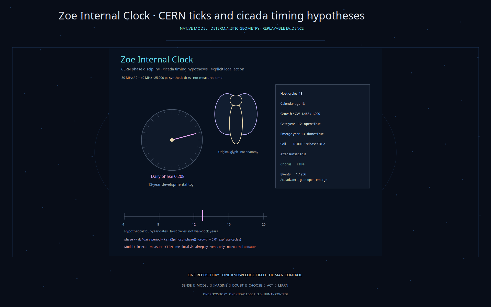

# ZVA-0001 — Cicada

[Visual archive index](../../README.md) · [Full catalog](../README.md) · [Category: Research figures and measurements](../categories/research-figure.md)

## What this image shows

Cicada is a research figures and measurements asset from the 02-unified-autonomy portion of the Zoe/allgems project. This figure preserves a measurement, model output, simulation, geometric construction, or research explanation from the Zoe/allgems program.

## Role in Zoe

This figure preserves a measurement, model output, simulation, geometric construction, or research explanation from the Zoe/allgems program.

## Provenance and evidence boundary

**Provenance:** Zoe/allgems project-generated visual.

The image is preserved with its source context; the visual alone does not prove a scientific or operational claim.

## File identity

- Archive ID: **ZVA-0001**
- Visual family: **cicada**
- Dimensions/format: **1920×1200 PNG**
- Frames: **1**
- Bytes: **132,077**
- SHA-256: `d80dae1463e6c61cf0837d78598612098dc4da056a0aaaa1ea44dec002ccf8a9`
- Original file: [Open full resolution](../../images/ZVA-0001.png)

## Source occurrences

Byte-identical copies are archived once while every known source path remains recorded.

| Source repository/collection | Original path | Canonical link |
|---|---|---|
| paper-source-figures | `02-unified-autonomy/figures/cicada.png` | [Source](https://github.com/Ablation-Tool/research-papers) |

## Related format/size variants

- [ZVA-0002](ZVA-0002.md)
- [ZVA-0132](ZVA-0132.md)
