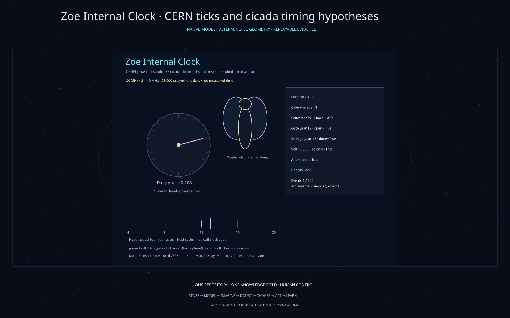

# ZVA-0002 — Cicada

[Visual archive index](../../README.md) · [Full catalog](../README.md) · [Category: Research figures and measurements](../categories/research-figure.md)

## What this image shows

Cicada is a research figures and measurements asset from the 02-unified-autonomy portion of the Zoe/allgems project. This figure preserves a measurement, model output, simulation, geometric construction, or research explanation from the Zoe/allgems program.

## Role in Zoe

This figure preserves a measurement, model output, simulation, geometric construction, or research explanation from the Zoe/allgems program.

## Provenance and evidence boundary

**Provenance:** Zoe/allgems project-generated visual.

The image is preserved with its source context; the visual alone does not prove a scientific or operational claim.

## File identity

- Archive ID: **ZVA-0002**
- Visual family: **cicada**
- Dimensions/format: **SVG 1920×1200**
- Frames: **vector/not applicable**
- Bytes: **34,651**
- SHA-256: `3d10fe351e6094772bb592c237a29da72cfa9e9a5aa8e168c59db19543f66219`
- Original file: [Open full resolution](../../images/ZVA-0002.svg)

## Source occurrences

Byte-identical copies are archived once while every known source path remains recorded.

| Source repository/collection | Original path | Canonical link |
|---|---|---|
| paper-source-figures | `02-unified-autonomy/figures/cicada.svg` | [Source](https://github.com/Ablation-Tool/research-papers) |

## Related format/size variants

- [ZVA-0001](ZVA-0001.md)
- [ZVA-0132](ZVA-0132.md)
