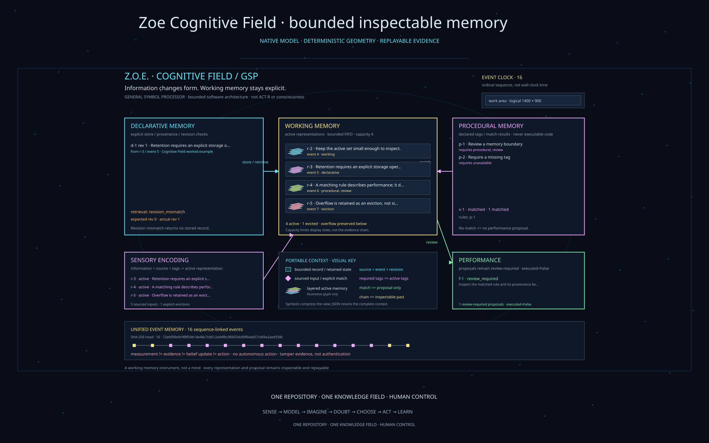

# ZVA-0004 — Cognitive Field

[Visual archive index](../../README.md) · [Full catalog](../README.md) · [Category: Research figures and measurements](../categories/research-figure.md)

## What this image shows

A Cognitive Field diagram showing sourced memory, revision checks, procedural matching, and explicit working-set boundaries. This figure preserves a measurement, model output, simulation, geometric construction, or research explanation from the Zoe/allgems program.

## Role in Zoe

This figure preserves a measurement, model output, simulation, geometric construction, or research explanation from the Zoe/allgems program.

## Provenance and evidence boundary

**Provenance:** Zoe/allgems project-generated visual.

The image is preserved with its source context; the visual alone does not prove a scientific or operational claim.

## File identity

- Archive ID: **ZVA-0004**
- Visual family: **cognitive-field**
- Dimensions/format: **SVG 1920×1200**
- Frames: **vector/not applicable**
- Bytes: **49,506**
- SHA-256: `d11b78d11a7eca1eba6a51731e396f5bde45329178b1e93ba3003c222b4f4669`
- Original file: [Open full resolution](../../images/ZVA-0004.svg)

## Source occurrences

Byte-identical copies are archived once while every known source path remains recorded.

| Source repository/collection | Original path | Canonical link |
|---|---|---|
| paper-source-figures | `02-unified-autonomy/figures/cognitive-field.svg` | [Source](https://github.com/Ablation-Tool/research-papers) |

## Related format/size variants

- [ZVA-0003](ZVA-0003.md)
- [ZVA-0133](ZVA-0133.md)
- [ZVA-0251](ZVA-0251.md)
- [ZVA-0252](ZVA-0252.md)
