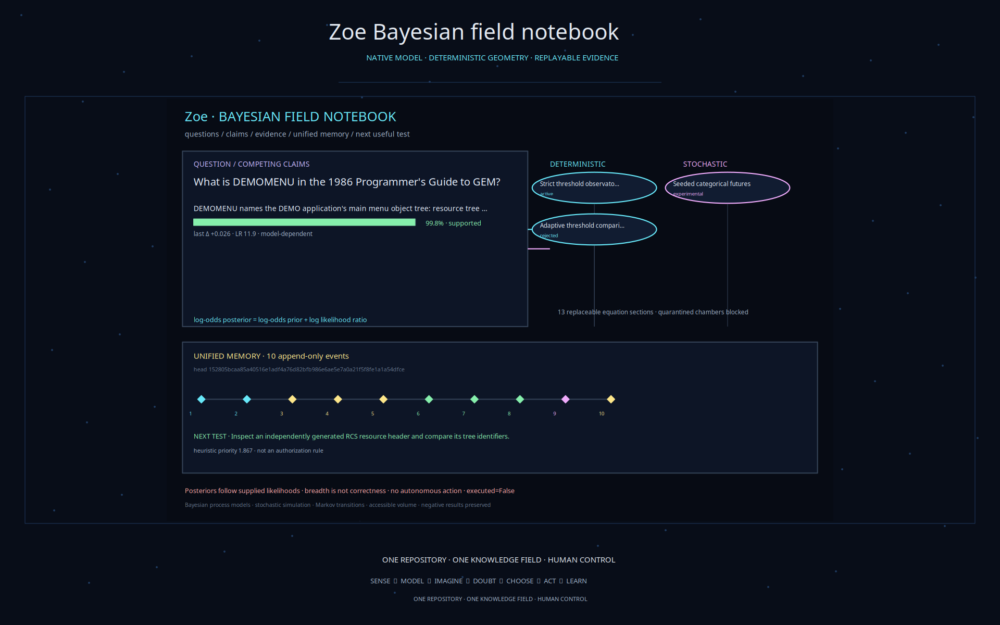

# ZVA-0005 — Field Notebook

[Visual archive index](../../README.md) · [Full catalog](../README.md) · [Category: Research figures and measurements](../categories/research-figure.md)

## What this image shows

Field Notebook is a research figures and measurements asset from the 02-unified-autonomy portion of the Zoe/allgems project. This figure preserves a measurement, model output, simulation, geometric construction, or research explanation from the Zoe/allgems program.

## Role in Zoe

This figure preserves a measurement, model output, simulation, geometric construction, or research explanation from the Zoe/allgems program.

## Provenance and evidence boundary

**Provenance:** Zoe/allgems project-generated visual.

The image is preserved with its source context; the visual alone does not prove a scientific or operational claim.

## File identity

- Archive ID: **ZVA-0005**
- Visual family: **field-notebook**
- Dimensions/format: **1920×1200 PNG**
- Frames: **1**
- Bytes: **131,894**
- SHA-256: `cdd1aa7377e3a0c554df4d48dd8df344d9b63998fc8c0be75def3b8a3fd0a195`
- Original file: [Open full resolution](../../images/ZVA-0005.png)

## Source occurrences

Byte-identical copies are archived once while every known source path remains recorded.

| Source repository/collection | Original path | Canonical link |
|---|---|---|
| paper-source-figures | `02-unified-autonomy/figures/field-notebook.png` | [Source](https://github.com/Ablation-Tool/research-papers) |

## Related format/size variants

- [ZVA-0006](ZVA-0006.md)
- [ZVA-0138](ZVA-0138.md)
