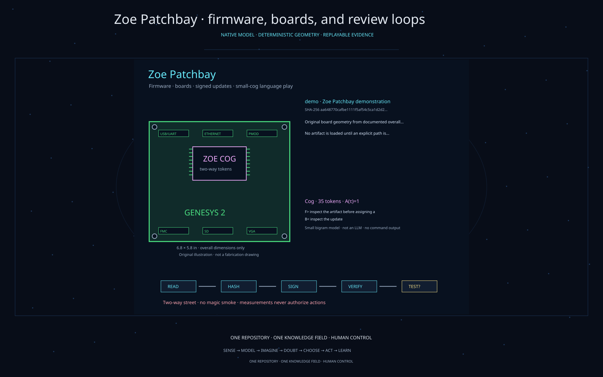

# ZVA-0008 — Patchbay

[Visual archive index](../../README.md) · [Full catalog](../README.md) · [Category: Research figures and measurements](../categories/research-figure.md)

## What this image shows

Patchbay is a research figures and measurements asset from the 02-unified-autonomy portion of the Zoe/allgems project. This visual belongs to Zoe’s CERN/source-evidence program, helping a reader inspect a corpus, protocol, replay, virtual system, or process boundary.

## Role in Zoe

This visual belongs to Zoe’s CERN/source-evidence program, helping a reader inspect a corpus, protocol, replay, virtual system, or process boundary.

## Provenance and evidence boundary

**Provenance:** Zoe/allgems project-generated visual.

The image is preserved with its source context; the visual alone does not prove a scientific or operational claim.

## File identity

- Archive ID: **ZVA-0008**
- Visual family: **patchbay**
- Dimensions/format: **SVG 1920×1200**
- Frames: **vector/not applicable**
- Bytes: **34,831**
- SHA-256: `c344f39b0a7534a81a4e1fb077c0342a9a22af7239e826ba130a135d009892e7`
- Original file: [Open full resolution](../../images/ZVA-0008.svg)

## Source occurrences

Byte-identical copies are archived once while every known source path remains recorded.

| Source repository/collection | Original path | Canonical link |
|---|---|---|
| paper-source-figures | `02-unified-autonomy/figures/patchbay.svg` | [Source](https://github.com/Ablation-Tool/research-papers) |

## Related format/size variants

- [ZVA-0007](ZVA-0007.md)
- [ZVA-0146](ZVA-0146.md)
