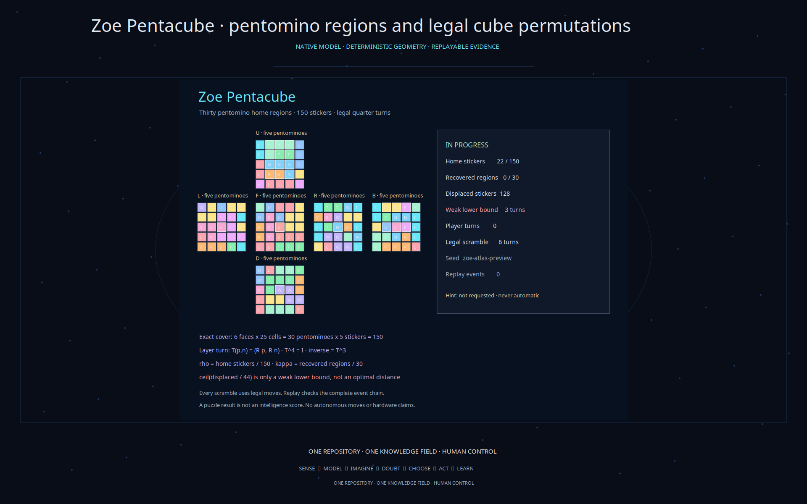

# ZVA-0009 — Pentacube

[Visual archive index](../../README.md) · [Full catalog](../README.md) · [Category: Research figures and measurements](../categories/research-figure.md)

## What this image shows

Pentacube is a research figures and measurements asset from the 02-unified-autonomy portion of the Zoe/allgems project. This figure preserves a measurement, model output, simulation, geometric construction, or research explanation from the Zoe/allgems program.

## Role in Zoe

This figure preserves a measurement, model output, simulation, geometric construction, or research explanation from the Zoe/allgems program.

## Provenance and evidence boundary

**Provenance:** Zoe/allgems project-generated visual.

The image is preserved with its source context; the visual alone does not prove a scientific or operational claim.

## File identity

- Archive ID: **ZVA-0009**
- Visual family: **pentacube**
- Dimensions/format: **1920×1200 PNG**
- Frames: **1**
- Bytes: **137,705**
- SHA-256: `c673dd96b4ef760390af3cd5128d24a6b2700f0e0e046d29b40d9ecef7ac4fd2`
- Original file: [Open full resolution](../../images/ZVA-0009.png)

## Source occurrences

Byte-identical copies are archived once while every known source path remains recorded.

| Source repository/collection | Original path | Canonical link |
|---|---|---|
| paper-source-figures | `02-unified-autonomy/figures/pentacube.png` | [Source](https://github.com/Ablation-Tool/research-papers) |

## Related format/size variants

- [ZVA-0010](ZVA-0010.md)
- [ZVA-0147](ZVA-0147.md)
