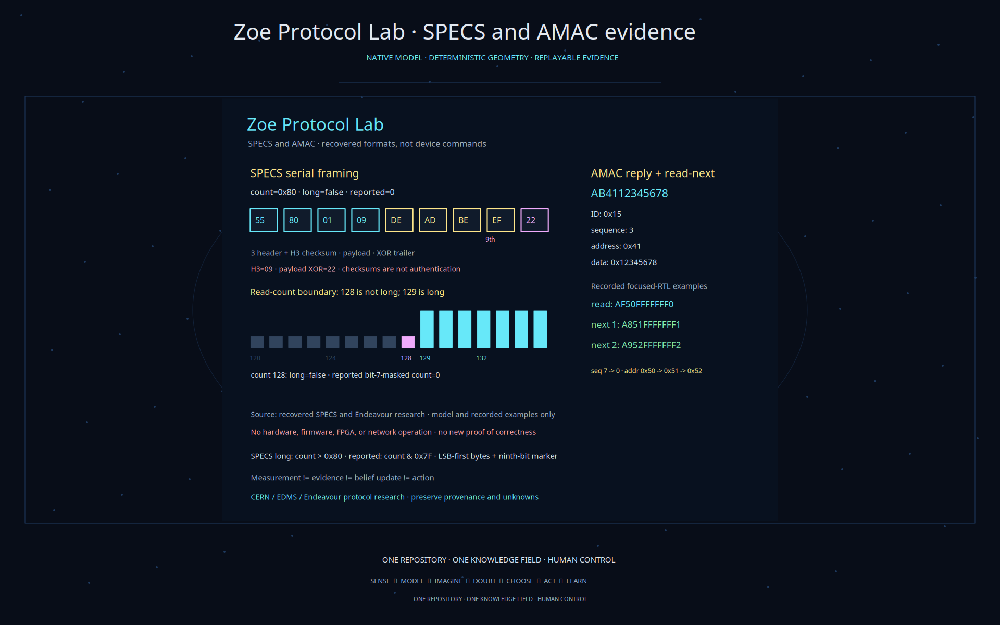

# ZVA-0013 — Protocol

[Visual archive index](../../README.md) · [Full catalog](../README.md) · [Category: Research figures and measurements](../categories/research-figure.md)

## What this image shows

Protocol is a research figures and measurements asset from the 02-unified-autonomy portion of the Zoe/allgems project. This visual belongs to Zoe’s CERN/source-evidence program, helping a reader inspect a corpus, protocol, replay, virtual system, or process boundary.

## Role in Zoe

This visual belongs to Zoe’s CERN/source-evidence program, helping a reader inspect a corpus, protocol, replay, virtual system, or process boundary.

## Provenance and evidence boundary

**Provenance:** Zoe/allgems project-generated visual.

The image is preserved with its source context; the visual alone does not prove a scientific or operational claim.

## File identity

- Archive ID: **ZVA-0013**
- Visual family: **protocol**
- Dimensions/format: **1920×1200 PNG**
- Frames: **1**
- Bytes: **145,849**
- SHA-256: `c010fc47ed07e1cc0ff554af733ce309b92da6e300f11233ba723b00ab3a8e1b`
- Original file: [Open full resolution](../../images/ZVA-0013.png)

## Source occurrences

Byte-identical copies are archived once while every known source path remains recorded.

| Source repository/collection | Original path | Canonical link |
|---|---|---|
| paper-source-figures | `02-unified-autonomy/figures/protocol.png` | [Source](https://github.com/Ablation-Tool/research-papers) |

## Related format/size variants

- [ZVA-0014](ZVA-0014.md)
- [ZVA-0149](ZVA-0149.md)
