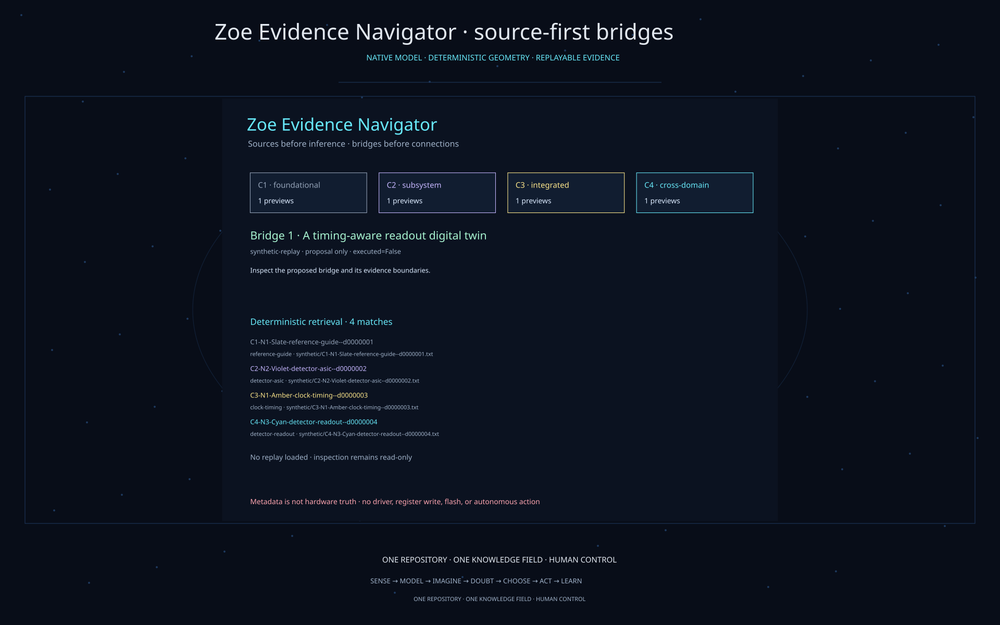

# ZVA-0018 — Zoe Evidence

[Visual archive index](../../README.md) · [Full catalog](../README.md) · [Category: Research figures and measurements](../categories/research-figure.md)

## What this image shows

Complete Zoe research asset index: Zoe evidence. This figure preserves a measurement, model output, simulation, geometric construction, or research explanation from the Zoe/allgems program.

## Role in Zoe

This figure preserves a measurement, model output, simulation, geometric construction, or research explanation from the Zoe/allgems program.

## Provenance and evidence boundary

**Provenance:** Zoe/allgems project-generated visual.

The image is preserved with its source context; the visual alone does not prove a scientific or operational claim.

## File identity

- Archive ID: **ZVA-0018**
- Visual family: **zoe-evidence**
- Dimensions/format: **SVG 1920×1200**
- Frames: **vector/not applicable**
- Bytes: **27,179**
- SHA-256: `99390b0ddd1d22430126c937bc4681b05256d664863229b093f6ac167f728944`
- Original file: [Open full resolution](../../images/ZVA-0018.svg)

## Source occurrences

Byte-identical copies are archived once while every known source path remains recorded.

| Source repository/collection | Original path | Canonical link |
|---|---|---|
| paper-source-figures | `02-unified-autonomy/figures/zoe-evidence.svg` | [Source](https://github.com/Ablation-Tool/research-papers) |

## Documented context

### 35. Zoe evidence

Source document: `zoe:research/papers/galleries/zoe-research/README.md`

Complete Zoe research asset index: Zoe evidence

`assets/native/zoe-evidence.svg`

## Related format/size variants

- [ZVA-0017](ZVA-0017.md)
- [ZVA-0153](ZVA-0153.md)
- [ZVA-0372](ZVA-0372.md)
- [ZVA-0373](ZVA-0373.md)
