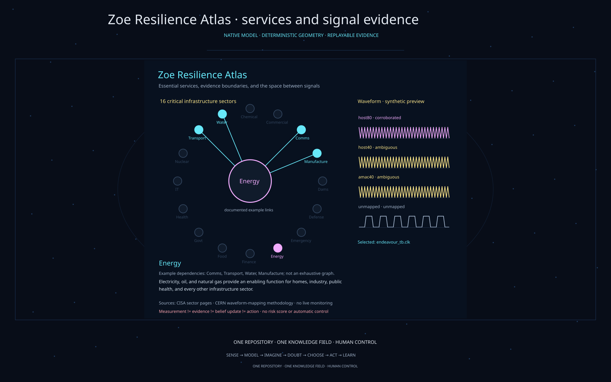

# ZVA-0020 — Zoe Resilience

[Visual archive index](../../README.md) · [Full catalog](../README.md) · [Category: Research figures and measurements](../categories/research-figure.md)

## What this image shows

Complete Zoe research asset index: Zoe resilience. This figure preserves a measurement, model output, simulation, geometric construction, or research explanation from the Zoe/allgems program.

## Role in Zoe

This figure preserves a measurement, model output, simulation, geometric construction, or research explanation from the Zoe/allgems program.

## Provenance and evidence boundary

**Provenance:** Zoe/allgems project-generated visual.

The image is preserved with its source context; the visual alone does not prove a scientific or operational claim.

## File identity

- Archive ID: **ZVA-0020**
- Visual family: **zoe-resilience**
- Dimensions/format: **SVG 1920×1200**
- Frames: **vector/not applicable**
- Bytes: **37,931**
- SHA-256: `ce145e8ebf6a1305ce92e0bbf8cf66fb6c4edd4272390107c689550050154f38`
- Original file: [Open full resolution](../../images/ZVA-0020.svg)

## Source occurrences

Byte-identical copies are archived once while every known source path remains recorded.

| Source repository/collection | Original path | Canonical link |
|---|---|---|
| paper-source-figures | `02-unified-autonomy/figures/zoe-resilience.svg` | [Source](https://github.com/Ablation-Tool/research-papers) |

## Documented context

### 77. Zoe resilience

Source document: `zoe:research/papers/galleries/zoe-research/README.md`

Complete Zoe research asset index: Zoe resilience

`assets/native/zoe-resilience.svg`

## Related format/size variants

- [ZVA-0019](ZVA-0019.md)
- [ZVA-0157](ZVA-0157.md)
- [ZVA-0417](ZVA-0417.md)
- [ZVA-0418](ZVA-0418.md)
