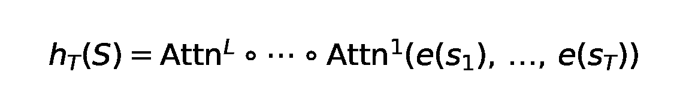

# ZVA-0023 — The transformer hidden-state composition equation used by the Constraint Is Freedom framework

[Visual archive index](../../README.md) · [Full catalog](../README.md) · [Category: Research figures and measurements](../categories/research-figure.md)

## What this image shows

The transformer hidden-state composition equation used by the Constraint Is Freedom framework.

## Role in Zoe

This figure preserves a measurement, model output, simulation, geometric construction, or research explanation from the Zoe/allgems program.

## Provenance and evidence boundary

**Provenance:** Zoe/allgems project-generated visual.

The image is preserved with its source context; the visual alone does not prove a scientific or operational claim.

## File identity

- Archive ID: **ZVA-0023**
- Visual family: **figure-000-page-003**
- Dimensions/format: **1145×183 PNG**
- Frames: **1**
- Bytes: **2,652**
- SHA-256: `2ab5b4ff8699f56987a0ca4e99c480a570ad4591ec3ca8bd9bc315fe018dad59`
- Original file: [Open full resolution](../../images/ZVA-0023.png)

## Source occurrences

Byte-identical copies are archived once while every known source path remains recorded.

| Source repository/collection | Original path | Canonical link |
|---|---|---|
| research-paper-figures | `03-constraint-is-freedom/figures/figure-000-page-003.png` | [Source](https://github.com/Ablation-Tool/research-papers/blob/main/galleries/03-constraint-is-freedom/figures/figure-000-page-003.png) |

## Documented context

### Image 1 — PDF page 3

Source document: `zoe:research/papers/galleries/03-constraint-is-freedom/README.md`

Constraint Is Freedom, embedded image 1, PDF page 3

| 6 | 7 | 1920×1080 | Figure 2: Constraint — Nick. &quot;Hard pass&quot; on API costs produces the better methodology. | Open | | 7 | 8 | 1145×183 | Embedded image; see the rendered page for full context. | Open |

### Image 1 — PDF page 3

Source document: `zoe:research/papers/galleries/06-zoe-native-gem/README.md`

Zoe: A Native GEM for Living Geometry and Inspectable Futures, embedded image 1, PDF page 3

Figure 1: The epistemic firewall separates measurement, evidence, belief updates, and actions while retaining a unified append-only history.

### Constraint Is Freedom

Source document: `research-paper-figures:03-constraint-is-freedom/README.md`

Original embedded figure from Constraint Is Freedom, PDF page 3. The complete page and source PDF remain linked in the research-papers gallery.

### Zoe: A Native GEM for Living Geometry and Inspectable Futures

Source document: `research-paper-figures:06-zoe-native-gem/README.md`

Figure 1: The epistemic firewall separates measurement, evidence, belief updates, and actions while retaining a unified append-only history.

Original embedded figure from Zoe: A Native GEM for Living Geometry and Inspectable Futures, PDF page 3. The complete page and source PDF remain linked in the research-papers gallery.

## Related format/size variants

- [ZVA-0037](ZVA-0037.md)
