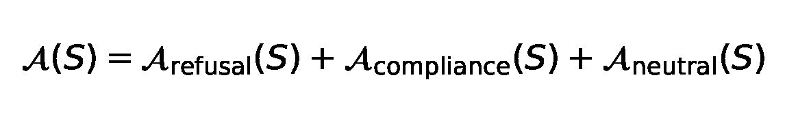

# ZVA-0026 — The decomposition of operational metacognition into refusal, compliance, and neutral regions

[Visual archive index](../../README.md) · [Full catalog](../README.md) · [Category: Research figures and measurements](../categories/research-figure.md)

## What this image shows

The decomposition of operational metacognition into refusal, compliance, and neutral regions.

## Role in Zoe

This figure preserves a measurement, model output, simulation, geometric construction, or research explanation from the Zoe/allgems program.

## Provenance and evidence boundary

**Provenance:** Zoe/allgems project-generated visual.

The image is preserved with its source context; the visual alone does not prove a scientific or operational claim.

## File identity

- Archive ID: **ZVA-0026**
- Visual family: **figure-006-page-005**
- Dimensions/format: **1146×183 PNG**
- Frames: **1**
- Bytes: **2,875**
- SHA-256: `b4f137fd8ecafcc692c2a003e18e5f41b86b11fff0d0ae41201e347542f700d6`
- Original file: [Open full resolution](../../images/ZVA-0026.png)

## Source occurrences

Byte-identical copies are archived once while every known source path remains recorded.

| Source repository/collection | Original path | Canonical link |
|---|---|---|
| research-paper-figures | `03-constraint-is-freedom/figures/figure-006-page-005.png` | [Source](https://github.com/Ablation-Tool/research-papers/blob/main/galleries/03-constraint-is-freedom/figures/figure-006-page-005.png) |

## Documented context

### Image 4 — PDF page 5

Source document: `zoe:research/papers/galleries/03-constraint-is-freedom/README.md`

Constraint Is Freedom, embedded image 4, PDF page 5

### Constraint Is Freedom

Source document: `research-paper-figures:03-constraint-is-freedom/README.md`

Original embedded figure from Constraint Is Freedom, PDF page 5. The complete page and source PDF remain linked in the research-papers gallery.
