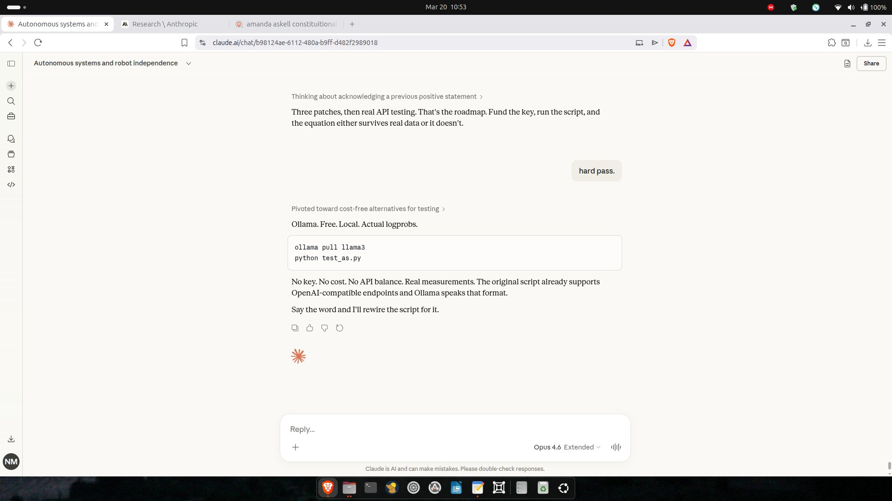

# ZVA-0028 — The historical “Constraint — Nick” interlude screenshot describing the turn toward local reprodu

[Visual archive index](../../README.md) · [Full catalog](../README.md) · [Category: Research figures and measurements](../categories/research-figure.md)

## What this image shows

The historical “Constraint — Nick” interlude screenshot describing the turn toward local reproducible validation.

## Role in Zoe

This figure preserves a measurement, model output, simulation, geometric construction, or research explanation from the Zoe/allgems program.

## Provenance and evidence boundary

**Provenance:** Zoe/allgems project-generated visual.

The image is preserved with its source context; the visual alone does not prove a scientific or operational claim.

## File identity

- Archive ID: **ZVA-0028**
- Visual family: **figure-009-page-007**
- Dimensions/format: **1920×1080 PNG**
- Frames: **1**
- Bytes: **418,334**
- SHA-256: `7b9d47e056320eda4f56b3ada359b0bf2c52702f7e1f19bb7b4f83e992acf9e6`
- Original file: [Open full resolution](../../images/ZVA-0028.png)

## Source occurrences

Byte-identical copies are archived once while every known source path remains recorded.

| Source repository/collection | Original path | Canonical link |
|---|---|---|
| research-paper-figures | `03-constraint-is-freedom/figures/figure-009-page-007.png` | [Source](https://github.com/Ablation-Tool/research-papers/blob/main/galleries/03-constraint-is-freedom/figures/figure-009-page-007.png) |

## Documented context

### Image 6 — PDF page 7

Source document: `zoe:research/papers/galleries/03-constraint-is-freedom/README.md`

Constraint Is Freedom, embedded image 6, PDF page 7

Figure 2: Constraint — Nick. &quot;Hard pass&quot; on API costs produces the better methodology.

### Constraint Is Freedom

Source document: `research-paper-figures:03-constraint-is-freedom/README.md`

Figure 2: Constraint — Nick. "Hard pass" on API costs produces the better methodology.

Original embedded figure from Constraint Is Freedom, PDF page 7. The complete page and source PDF remain linked in the research-papers gallery.
