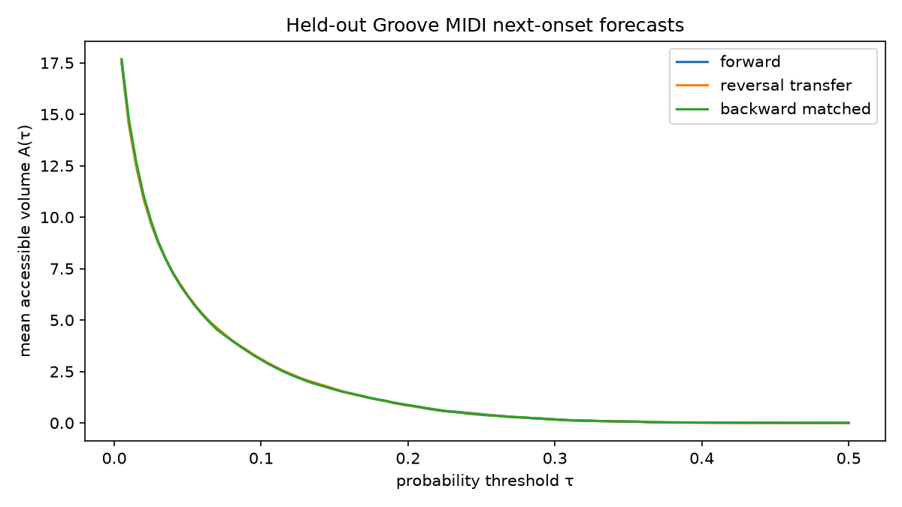

# ZVA-0033 — Accessible-volume sweep

[Visual archive index](../../README.md) · [Full catalog](../README.md) · [Category: Research figures and measurements](../categories/research-figure.md)

## What this image shows

Accessible-volume sweep. This figure preserves a measurement, model output, simulation, geometric construction, or research explanation from the Zoe/allgems program.

## Role in Zoe

This figure preserves a measurement, model output, simulation, geometric construction, or research explanation from the Zoe/allgems program.

## Provenance and evidence boundary

**Provenance:** Paper-embedded copy; Zoe/allgems project-generated visual.

The image is preserved with its source context; the visual alone does not prove a scientific or operational claim.

## File identity

- Archive ID: **ZVA-0033**
- Visual family: **figure-002-page-006**
- Dimensions/format: **1200×675 PNG**
- Frames: **1**
- Bytes: **52,774**
- SHA-256: `9b3a32d6b0bb999728bd639bef9d5d4aac26f2a30cd2cf05f0d0702f31c19ff9`
- Original file: [Open full resolution](../../images/ZVA-0033.png)

## Source occurrences

Byte-identical copies are archived once while every known source path remains recorded.

| Source repository/collection | Original path | Canonical link |
|---|---|---|
| research-paper-figures | `05-accessible-volume-beyond-next-token/figures/figure-002-page-006.png` | [Source](https://github.com/Ablation-Tool/research-papers/blob/main/galleries/05-accessible-volume-beyond-next-token/figures/figure-002-page-006.png) |
| research-paper-figures | `10-accessible-volume-architecture-of-autonomy/figures/figure-002-page-023.png` | [Source](https://github.com/Ablation-Tool/research-papers/blob/main/galleries/10-accessible-volume-architecture-of-autonomy/figures/figure-002-page-023.png) |

## Documented context

### Image 2 — PDF page 6

Source document: `zoe:research/papers/galleries/05-accessible-volume-beyond-next-token/README.md`

Operational Metacognition Beyond the Next Token, embedded image 2, PDF page 6

Figure 2: Groove accessible-volume sweeps for forward, reversal-transfer, and backward-matched conditions.

### Operational Metacognition Beyond the Next Token

Source document: `research-paper-figures:05-accessible-volume-beyond-next-token/README.md`

Figure 2: Groove accessible-volume sweeps for forward, reversal-transfer, and backward-matched conditions.

Original embedded figure from Operational Metacognition Beyond the Next Token, PDF page 6. The complete page and source PDF remain linked in the research-papers gallery.

### Image 2 — PDF page 23

Source document: `zoe:research/papers/galleries/10-accessible-volume-architecture-of-autonomy/README.md`

Operational Metacognition and the Architecture of Autonomy, embedded image 2, PDF page 23

Figure 2: Groove sweeps for forward, reversal-transfer, and backward-matched conditions.

### Operational Metacognition and the Architecture of Autonomy

Source document: `research-paper-figures:10-accessible-volume-architecture-of-autonomy/README.md`

Figure 2: Groove sweeps for forward, reversal-transfer, and backward-matched conditions.

Original embedded figure from Operational Metacognition and the Architecture of Autonomy, PDF page 23. The complete page and source PDF remain linked in the research-papers gallery.
