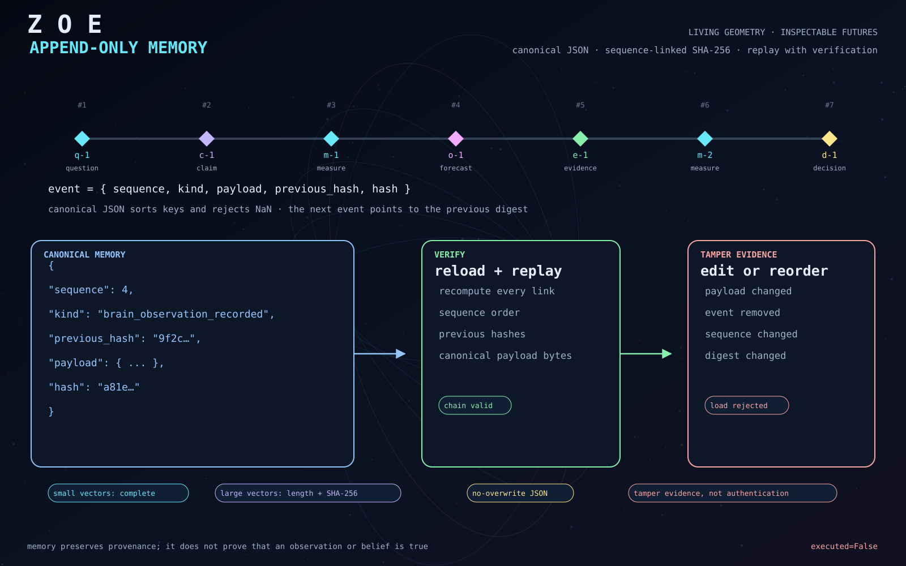

# ZVA-0039 — Zoe append-only memory

[Visual archive index](../../README.md) · [Full catalog](../README.md) · [Category: Research figures and measurements](../categories/research-figure.md)

## What this image shows

Zoe append-only memory. This figure preserves a measurement, model output, simulation, geometric construction, or research explanation from the Zoe/allgems program.

## Role in Zoe

This figure preserves a measurement, model output, simulation, geometric construction, or research explanation from the Zoe/allgems program.

## Provenance and evidence boundary

**Provenance:** Paper-embedded copy; Zoe/allgems project-generated visual.

The image is preserved with its source context; the visual alone does not prove a scientific or operational claim.

## File identity

- Archive ID: **ZVA-0039**
- Visual family: **figure-002-page-008**
- Dimensions/format: **1600×1000 PNG**
- Frames: **1**
- Bytes: **228,014**
- SHA-256: `91e03d0de10d2fbf920ecedfb3871f1003b9cfba840107be82d484d578155f65`
- Original file: [Open full resolution](../../images/ZVA-0039.png)

## Source occurrences

Byte-identical copies are archived once while every known source path remains recorded.

| Source repository/collection | Original path | Canonical link |
|---|---|---|
| research-paper-figures | `06-zoe-native-gem/figures/figure-002-page-008.png` | [Source](https://github.com/Ablation-Tool/research-papers/blob/main/galleries/06-zoe-native-gem/figures/figure-002-page-008.png) |
| research-paper-figures | `10-accessible-volume-architecture-of-autonomy/figures/figure-016-page-042.png` | [Source](https://github.com/Ablation-Tool/research-papers/blob/main/galleries/10-accessible-volume-architecture-of-autonomy/figures/figure-016-page-042.png) |

## Documented context

### Image 3 — PDF page 8

Source document: `zoe:research/papers/galleries/06-zoe-native-gem/README.md`

Zoe: A Native GEM for Living Geometry and Inspectable Futures, embedded image 3, PDF page 8

Figure 3: Append-only memory records distinct event kinds and makes alteration visible without claiming identity or authentication.

### Zoe: A Native GEM for Living Geometry and Inspectable Futures

Source document: `research-paper-figures:06-zoe-native-gem/README.md`

Figure 3: Append-only memory records distinct event kinds and makes alteration visible without claiming identity or authentication.

Original embedded figure from Zoe: A Native GEM for Living Geometry and Inspectable Futures, PDF page 8. The complete page and source PDF remain linked in the research-papers gallery.

### Image 11 — PDF page 42

Source document: `zoe:research/papers/galleries/10-accessible-volume-architecture-of-autonomy/README.md`

Operational Metacognition and the Architecture of Autonomy, embedded image 11, PDF page 42

Figure 11: Append-only Zoe memory records distinct event kinds and makes alteration visible. Hash chaining supplies tamper evidence, not authentication or proof that a recorded claim is true.

### Operational Metacognition and the Architecture of Autonomy

Source document: `research-paper-figures:10-accessible-volume-architecture-of-autonomy/README.md`

Figure 11: Append-only Zoe memory records distinct event kinds and makes alteration visible. Hash chaining supplies tamper evidence, not authentication or proof that a recorded claim is true.

Original embedded figure from Operational Metacognition and the Architecture of Autonomy, PDF page 42. The complete page and source PDF remain linked in the research-papers gallery.
