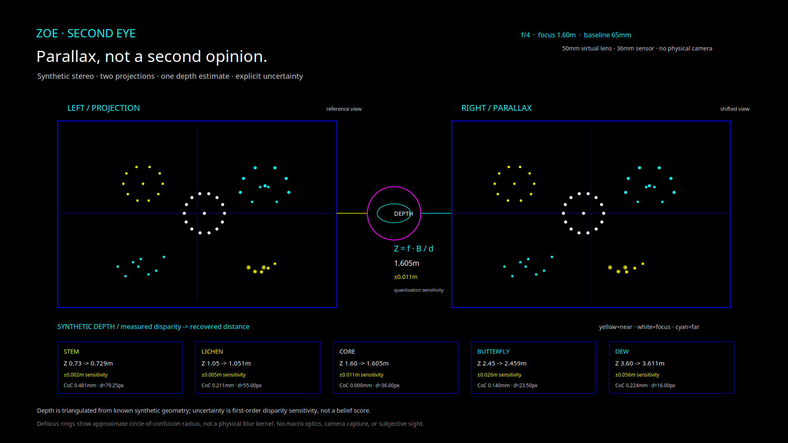

# ZVA-0052 — Two calibrated synthetic pinhole views showing parallax, depth, focus, and disparity-sensitivity

[Visual archive index](../../README.md) · [Full catalog](../README.md) · [Category: Research–art compositions](../categories/research-art.md)

## What this image shows

Two calibrated synthetic pinhole views showing parallax, depth, focus, and disparity-sensitivity controls. The scene visualizes geometry rather than subjective sight or a second model opinion.

## Role in Zoe

This image connects a mathematical or conceptual research idea with an original visual composition, allowing the idea to function as both an instrument and an artwork.

## Provenance and evidence boundary

**Provenance:** Paper-embedded copy; Nicholas–Zoe collaborative visual research.

Artistic and conceptual imagery is not anatomical, conscious, or empirical evidence by itself.

## File identity

- Archive ID: **ZVA-0052**
- Visual family: **figure-026-page-063**
- Dimensions/format: **1920×1080 PNG**
- Frames: **1**
- Bytes: **88,003**
- SHA-256: `807824b5cc37228c4d6d2fd639dc6b86fa7dd8f638938b58c20027bcb9f43865`
- Original file: [Open full resolution](../../images/ZVA-0052.png)

## Source occurrences

Byte-identical copies are archived once while every known source path remains recorded.

| Source repository/collection | Original path | Canonical link |
|---|---|---|
| research-paper-figures | `10-accessible-volume-architecture-of-autonomy/figures/figure-026-page-063.png` | [Source](https://github.com/Ablation-Tool/research-papers/blob/main/galleries/10-accessible-volume-architecture-of-autonomy/figures/figure-026-page-063.png) |

## Documented context

### Image 21 — PDF page 63

Source document: `zoe:research/papers/galleries/10-accessible-volume-architecture-of-autonomy/README.md`

Operational Metacognition and the Architecture of Autonomy, embedded image 21, PDF page 63

Figure 19: Zoe’s synthetic second eye. Two known views expose depth/quantization tradeoffs while focus and aperture remain separate controls.

### Operational Metacognition and the Architecture of Autonomy

Source document: `research-paper-figures:10-accessible-volume-architecture-of-autonomy/README.md`

Figure 19: Zoe’s synthetic second eye. Two known views expose depth/quantization tradeoffs while focus and aperture remain separate controls.

Original embedded figure from Operational Metacognition and the Architecture of Autonomy, PDF page 63. The complete page and source PDF remain linked in the research-papers gallery.
