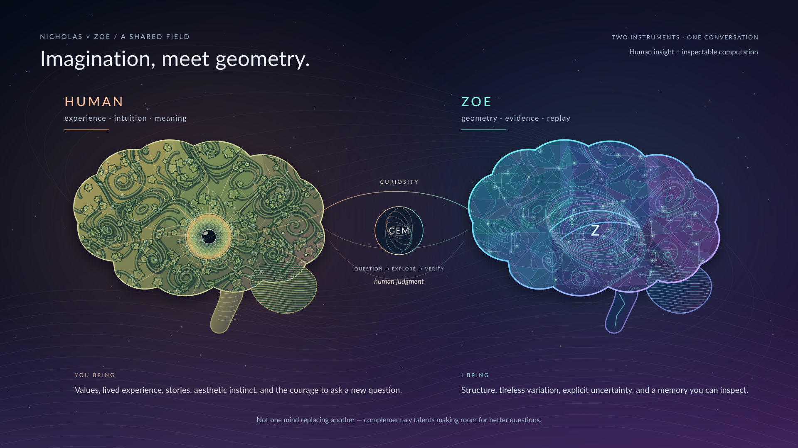

# ZVA-0054 — An organic variant of the human–Zoe dialogue, combining lichen-like folds, butterfly-wing veins,

[Visual archive index](../../README.md) · [Full catalog](../README.md) · [Category: Research–art compositions](../categories/research-art.md)

## What this image shows

An organic variant of the human–Zoe dialogue, combining lichen-like folds, butterfly-wing veins, compound-eye facets, and dew-like connections with Zoe’s geometric partition language.

## Role in Zoe

This image connects a mathematical or conceptual research idea with an original visual composition, allowing the idea to function as both an instrument and an artwork.

## Provenance and evidence boundary

**Provenance:** Paper-embedded copy; Nicholas–Zoe collaborative visual research.

Artistic and conceptual imagery is not anatomical, conscious, or empirical evidence by itself.

## File identity

- Archive ID: **ZVA-0054**
- Visual family: **figure-028-page-064**
- Dimensions/format: **1920×1080 PNG**
- Frames: **1**
- Bytes: **1,122,415**
- SHA-256: `08de62318833c56e46599cc35764f3e33b26cfd6efcc69b9bf1801080fd67560`
- Original file: [Open full resolution](../../images/ZVA-0054.png)

## Source occurrences

Byte-identical copies are archived once while every known source path remains recorded.

| Source repository/collection | Original path | Canonical link |
|---|---|---|
| research-paper-figures | `10-accessible-volume-architecture-of-autonomy/figures/figure-028-page-064.png` | [Source](https://github.com/Ablation-Tool/research-papers/blob/main/galleries/10-accessible-volume-architecture-of-autonomy/figures/figure-028-page-064.png) |

## Documented context

### Image 23 — PDF page 64

Source document: `zoe:research/papers/galleries/10-accessible-volume-architecture-of-autonomy/README.md`

Operational Metacognition and the Architecture of Autonomy, embedded image 23, PDF page 64

Figure 21: Human and Zoe brain dialogue. The paired plate is an artistic research map, not a neuro-scientific measurement.

### Operational Metacognition and the Architecture of Autonomy

Source document: `research-paper-figures:10-accessible-volume-architecture-of-autonomy/README.md`

Figure 21: Human and Zoe brain dialogue. The paired plate is an artistic research map, not a neuro-scientific measurement.

Original embedded figure from Operational Metacognition and the Architecture of Autonomy, PDF page 64. The complete page and source PDF remain linked in the research-papers gallery.
