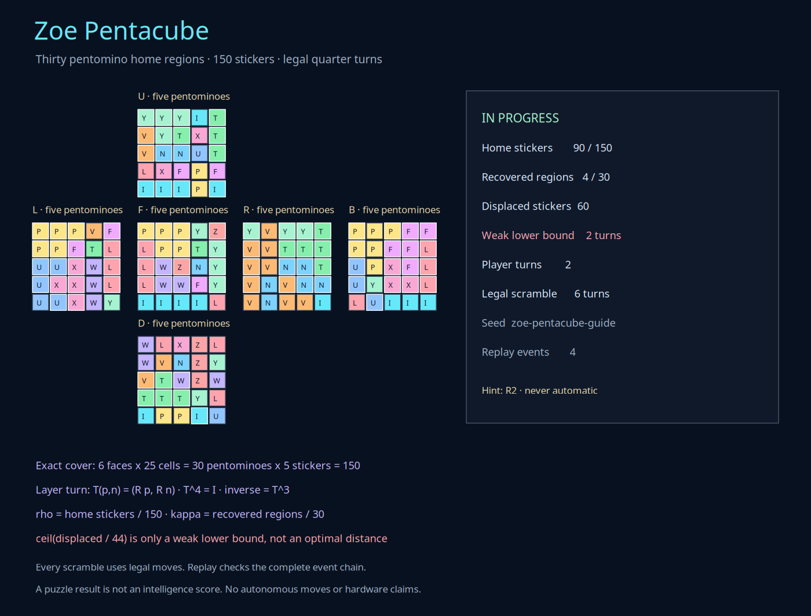

# ZVA-0055 — Pentacube is a research figures and measurements asset from the Zoe-Autonomy portion of the Zoe/

[Visual archive index](../../README.md) · [Full catalog](../README.md) · [Category: Research figures and measurements](../categories/research-figure.md)

## What this image shows

Pentacube is a research figures and measurements asset from the Zoe-Autonomy portion of the Zoe/allgems project. This figure preserves a measurement, model output, simulation, geometric construction, or research explanation from the Zoe/allgems program.

## Role in Zoe

This figure preserves a measurement, model output, simulation, geometric construction, or research explanation from the Zoe/allgems program.

## Provenance and evidence boundary

**Provenance:** Paper-embedded copy; Zoe/allgems project-generated visual.

The image is preserved with its source context; the visual alone does not prove a scientific or operational claim.

## File identity

- Archive ID: **ZVA-0055**
- Visual family: **figure-029-page-067**
- Dimensions/format: **1400×1064 PNG**
- Frames: **1**
- Bytes: **125,113**
- SHA-256: `9415d1e35bc99d7595a5377be35196b3961c98ae5dfc9dbe2fbaa806161b08bc`
- Original file: [Open full resolution](../../images/ZVA-0055.png)

## Source occurrences

Byte-identical copies are archived once while every known source path remains recorded.

| Source repository/collection | Original path | Canonical link |
|---|---|---|
| research-paper-figures | `10-accessible-volume-architecture-of-autonomy/figures/figure-029-page-067.png` | [Source](https://github.com/Ablation-Tool/research-papers/blob/main/galleries/10-accessible-volume-architecture-of-autonomy/figures/figure-029-page-067.png) |
| research-paper-figures | `15-zoe-visual-guide-collection/figures/figure-002-page-002.png` | [Source](https://github.com/Ablation-Tool/research-papers/blob/main/galleries/15-zoe-visual-guide-collection/figures/figure-002-page-002.png) |

## Documented context

### Image 24 — PDF page 67

Source document: `zoe:research/papers/galleries/10-accessible-volume-architecture-of-autonomy/README.md`

Operational Metacognition and the Architecture of Autonomy, embedded image 24, PDF page 67

Figure 22: Zoe Pentacube: exact home tilings and reversible sticker permutations with replayable local state.

### Operational Metacognition and the Architecture of Autonomy

Source document: `research-paper-figures:10-accessible-volume-architecture-of-autonomy/README.md`

Figure 22: Zoe Pentacube: exact home tilings and reversible sticker permutations with replayable local state.

Original embedded figure from Operational Metacognition and the Architecture of Autonomy, PDF page 67. The complete page and source PDF remain linked in the research-papers gallery.

### Image 3 — PDF page 2

Source document: `zoe:research/papers/galleries/15-zoe-visual-guide-collection/README.md`

Zoe Visual Guide Collection, embedded image 3, PDF page 2

### Zoe Visual Guide Collection

Source document: `research-paper-figures:15-zoe-visual-guide-collection/README.md`

Original embedded figure from Zoe Visual Guide Collection, PDF page 2. The complete page and source PDF remain linked in the research-papers gallery.
