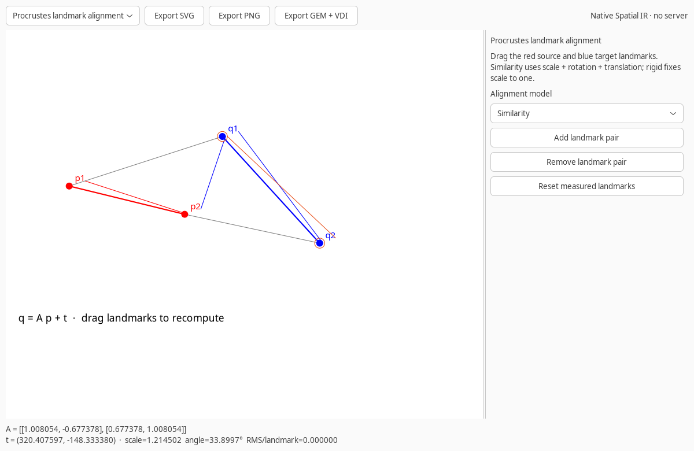

# ZVA-0057 — Geometry Atlas is a research figures and measurements asset from the Zoe-Autonomy portion of the

[Visual archive index](../../README.md) · [Full catalog](../README.md) · [Category: Research figures and measurements](../categories/research-figure.md)

## What this image shows

Geometry Atlas is a research figures and measurements asset from the Zoe-Autonomy portion of the Zoe/allgems project. This figure preserves a measurement, model output, simulation, geometric construction, or research explanation from the Zoe/allgems program.

## Role in Zoe

This figure preserves a measurement, model output, simulation, geometric construction, or research explanation from the Zoe/allgems program.

## Provenance and evidence boundary

**Provenance:** Paper-embedded copy; Zoe/allgems project-generated visual.

The image is preserved with its source context; the visual alone does not prove a scientific or operational claim.

## File identity

- Archive ID: **ZVA-0057**
- Visual family: **figure-031-page-071**
- Dimensions/format: **1200×780 PNG**
- Frames: **1**
- Bytes: **58,276**
- SHA-256: `70a93e9c92197a29775acc6192aaca70552f88f0802397d1f778a2c9bb584ddf`
- Original file: [Open full resolution](../../images/ZVA-0057.png)

## Source occurrences

Byte-identical copies are archived once while every known source path remains recorded.

| Source repository/collection | Original path | Canonical link |
|---|---|---|
| research-paper-figures | `10-accessible-volume-architecture-of-autonomy/figures/figure-031-page-071.png` | [Source](https://github.com/Ablation-Tool/research-papers/blob/main/galleries/10-accessible-volume-architecture-of-autonomy/figures/figure-031-page-071.png) |
| research-paper-figures | `15-zoe-visual-guide-collection/figures/figure-007-page-003.png` | [Source](https://github.com/Ablation-Tool/research-papers/blob/main/galleries/15-zoe-visual-guide-collection/figures/figure-007-page-003.png) |

## Documented context

### Image 26 — PDF page 71

Source document: `zoe:research/papers/galleries/10-accessible-volume-architecture-of-autonomy/README.md`

Operational Metacognition and the Architecture of Autonomy, embedded image 26, PDF page 71

Figure 24: Native Procrustes playground with draggable landmarks and live transform and residual inspection.

### Operational Metacognition and the Architecture of Autonomy

Source document: `research-paper-figures:10-accessible-volume-architecture-of-autonomy/README.md`

Figure 24: Native Procrustes playground with draggable landmarks and live transform and residual inspection.

Original embedded figure from Operational Metacognition and the Architecture of Autonomy, PDF page 71. The complete page and source PDF remain linked in the research-papers gallery.

### Image 8 — PDF page 3

Source document: `zoe:research/papers/galleries/15-zoe-visual-guide-collection/README.md`

Zoe Visual Guide Collection, embedded image 8, PDF page 3

### Zoe Visual Guide Collection

Source document: `research-paper-figures:15-zoe-visual-guide-collection/README.md`

Original embedded figure from Zoe Visual Guide Collection, PDF page 3. The complete page and source PDF remain linked in the research-papers gallery.
