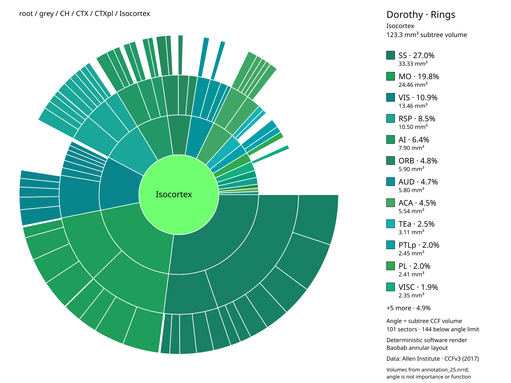

# ZVA-0059 — Dorothy Rings applied to isocortex ontology: exact subtree volumes are represented as a navigabl

[Visual archive index](../../README.md) · [Full catalog](../README.md) · [Category: Research figures and measurements](../categories/research-figure.md)

## What this image shows

Dorothy Rings applied to isocortex ontology: exact subtree volumes are represented as a navigable radial partition, not as functional importance. This visual belongs to Dorothy’s inspectable spatial-research program, making reference geometry or a review instrument available for direct inspection.

## Role in Zoe

This visual belongs to Dorothy’s inspectable spatial-research program, making reference geometry or a review instrument available for direct inspection.

## Provenance and evidence boundary

**Provenance:** Paper-embedded copy; Zoe render using Allen Institute reference data.

Preclinical mouse-atlas geometry only; not patient anatomy, registration, diagnosis, or treatment evidence.

## File identity

- Archive ID: **ZVA-0059**
- Visual family: **figure-033-page-072**
- Dimensions/format: **1600×1200 PNG**
- Frames: **1**
- Bytes: **315,895**
- SHA-256: `41b4aaf4d6a11403a3c3142057d6b42c7f26796c55e0eb565ef7eba3f8db7411`
- Original file: [Open full resolution](../../images/ZVA-0059.png)

## Source occurrences

Byte-identical copies are archived once while every known source path remains recorded.

| Source repository/collection | Original path | Canonical link |
|---|---|---|
| research-paper-figures | `10-accessible-volume-architecture-of-autonomy/figures/figure-033-page-072.png` | [Source](https://github.com/Ablation-Tool/research-papers/blob/main/galleries/10-accessible-volume-architecture-of-autonomy/figures/figure-033-page-072.png) |

## Documented context

### Image 28 — PDF page 72

Source document: `zoe:research/papers/galleries/10-accessible-volume-architecture-of-autonomy/README.md`

Operational Metacognition and the Architecture of Autonomy, embedded image 28, PDF page 72

### Operational Metacognition and the Architecture of Autonomy

Source document: `research-paper-figures:10-accessible-volume-architecture-of-autonomy/README.md`

Original embedded figure from Operational Metacognition and the Architecture of Autonomy, PDF page 72. The complete page and source PDF remain linked in the research-papers gallery.
