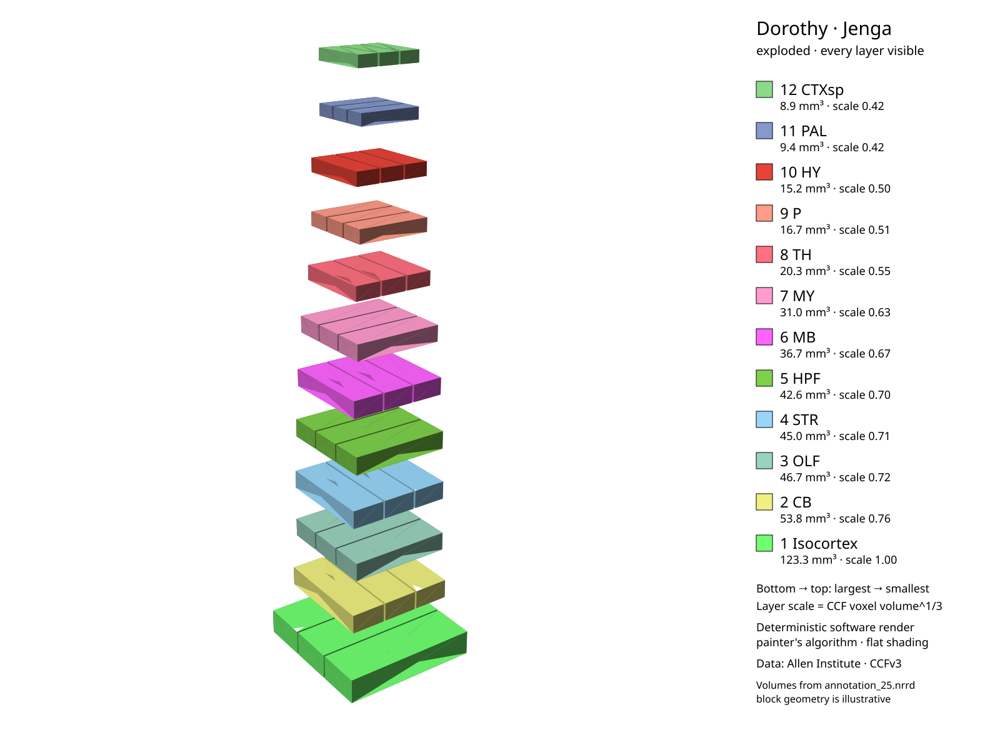

# ZVA-0060 — Dorothy Jenga’s volume-scaled exploded tower, offering spatial inspection of atlas structures wi

[Visual archive index](../../README.md) · [Full catalog](../README.md) · [Category: Research figures and measurements](../categories/research-figure.md)

## What this image shows

Dorothy Jenga’s volume-scaled exploded tower, offering spatial inspection of atlas structures without asserting anatomical relationships beyond the reference model. This visual belongs to Dorothy’s inspectable spatial-research program, making reference geometry or a review instrument available for direct inspection.

## Role in Zoe

This visual belongs to Dorothy’s inspectable spatial-research program, making reference geometry or a review instrument available for direct inspection.

## Provenance and evidence boundary

**Provenance:** Paper-embedded copy; Zoe render using Allen Institute reference data.

Preclinical mouse-atlas geometry only; not patient anatomy, registration, diagnosis, or treatment evidence.

## File identity

- Archive ID: **ZVA-0060**
- Visual family: **figure-034-page-072**
- Dimensions/format: **1600×1200 PNG**
- Frames: **1**
- Bytes: **211,814**
- SHA-256: `208c223e631a48494490e95cae0cd63f0534839976def2c11902502b28b187ce`
- Original file: [Open full resolution](../../images/ZVA-0060.png)

## Source occurrences

Byte-identical copies are archived once while every known source path remains recorded.

| Source repository/collection | Original path | Canonical link |
|---|---|---|
| research-paper-figures | `10-accessible-volume-architecture-of-autonomy/figures/figure-034-page-072.png` | [Source](https://github.com/Ablation-Tool/research-papers/blob/main/galleries/10-accessible-volume-architecture-of-autonomy/figures/figure-034-page-072.png) |

## Documented context

### Image 29 — PDF page 72

Source document: `zoe:research/papers/galleries/10-accessible-volume-architecture-of-autonomy/README.md`

Operational Metacognition and the Architecture of Autonomy, embedded image 29, PDF page 72

### Operational Metacognition and the Architecture of Autonomy

Source document: `research-paper-figures:10-accessible-volume-architecture-of-autonomy/README.md`

Original embedded figure from Operational Metacognition and the Architecture of Autonomy, PDF page 72. The complete page and source PDF remain linked in the research-papers gallery.
