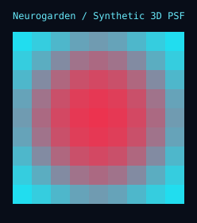

# ZVA-0061 — A synthetic three-dimensional point-spread and projection bench used to explain blur, sampling,

[Visual archive index](../../README.md) · [Full catalog](../README.md) · [Category: Research figures and measurements](../categories/research-figure.md)

## What this image shows

A synthetic three-dimensional point-spread and projection bench used to explain blur, sampling, and recovery without using patient anatomy. This figure preserves a measurement, model output, simulation, geometric construction, or research explanation from the Zoe/allgems program.

## Role in Zoe

This figure preserves a measurement, model output, simulation, geometric construction, or research explanation from the Zoe/allgems program.

## Provenance and evidence boundary

**Provenance:** Paper-embedded copy; Zoe/allgems project-generated visual.

The image is preserved with its source context; the visual alone does not prove a scientific or operational claim.

## File identity

- Archive ID: **ZVA-0061**
- Visual family: **figure-035-page-074**
- Dimensions/format: **248×280 PNG**
- Frames: **1**
- Bytes: **4,487**
- SHA-256: `20e1af2301f621b6174d216f8e6a32e15dd8365e28af28c36f15232b638ee2db`
- Original file: [Open full resolution](../../images/ZVA-0061.png)

## Source occurrences

Byte-identical copies are archived once while every known source path remains recorded.

| Source repository/collection | Original path | Canonical link |
|---|---|---|
| research-paper-figures | `10-accessible-volume-architecture-of-autonomy/figures/figure-035-page-074.png` | [Source](https://github.com/Ablation-Tool/research-papers/blob/main/galleries/10-accessible-volume-architecture-of-autonomy/figures/figure-035-page-074.png) |
| research-paper-figures | `17-zoe-capability-prospectus/figures/figure-003-page-008.png` | [Source](https://github.com/Ablation-Tool/research-papers/blob/main/galleries/17-zoe-capability-prospectus/figures/figure-003-page-008.png) |

## Documented context

### Image 30 — PDF page 74

Source document: `zoe:research/papers/galleries/10-accessible-volume-architecture-of-autonomy/README.md`

Operational Metacognition and the Architecture of Autonomy, embedded image 30, PDF page 74

Figure 27: Neurogarden’s synthetic point-spread and projection bench. The image is an educational numerical scene, not anatomical or clinical data.

### Operational Metacognition and the Architecture of Autonomy

Source document: `research-paper-figures:10-accessible-volume-architecture-of-autonomy/README.md`

Figure 27: Neurogarden’s synthetic point-spread and projection bench. The image is an educational numerical scene, not anatomical or clinical data.

Original embedded figure from Operational Metacognition and the Architecture of Autonomy, PDF page 74. The complete page and source PDF remain linked in the research-papers gallery.

### Image 3 — PDF page 8

Source document: `zoe:research/papers/galleries/17-zoe-capability-prospectus/README.md`

Zoe Capability Prospectus, embedded image 3, PDF page 8

### Zoe Capability Prospectus

Source document: `research-paper-figures:17-zoe-capability-prospectus/README.md`

Original embedded figure from Zoe Capability Prospectus, PDF page 8. The complete page and source PDF remain linked in the research-papers gallery.
