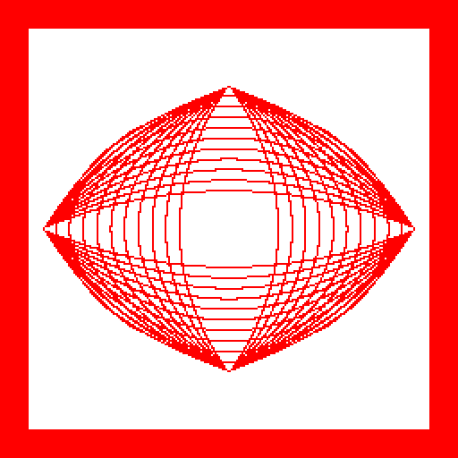

# ZVA-0071 — The current primary Zoe emblem: the red woven diamond designated by Nicholas Michael Kloster on

[Visual archive index](../../README.md) · [Full catalog](../README.md) · [Category: Identity, emblems, and interface icons](../categories/branding.md)

## What this image shows

The current primary Zoe emblem: the red woven diamond designated by Nicholas Michael Kloster on November 18, 2026, with matching PNG and SVG originals. The earlier orbital eye is preserved separately as legacy artwork.

## Role in Zoe

This visual supports recognition, navigation, application identity, or a cohesive visual language across Zoe and its components.

## Provenance and evidence boundary

**Provenance:** Paper-embedded copy; Project identity or interface asset.

Functional and identity artwork does not constitute research evidence.

## File identity

- Archive ID: **ZVA-0071**
- Visual family: **figure-000-page-001**
- Dimensions/format: **512×512 PNG**
- Frames: **1**
- Bytes: **6,207**
- SHA-256: `377406fd2a42380eca69192a40c84fb67af6f7fa53f8383a08555342e99f23fb`
- Original file: [Open full resolution](../../images/ZVA-0071.png)

## Source occurrences

Byte-identical copies are archived once while every known source path remains recorded.

| Source repository/collection | Original path | Canonical link |
|---|---|---|
| research-paper-figures | `17-zoe-capability-prospectus/figures/figure-000-page-001.png` | [Source](https://github.com/Ablation-Tool/research-papers/blob/main/galleries/17-zoe-capability-prospectus/figures/figure-000-page-001.png) |
| research-paper-figures | `18-zoe-research-universe/figures/figure-000-page-001.png` | [Source](https://github.com/Ablation-Tool/research-papers/blob/main/galleries/18-zoe-research-universe/figures/figure-000-page-001.png) |

## Documented context

### Image 1 — PDF page 1

Source document: `zoe:research/papers/galleries/15-zoe-visual-guide-collection/README.md`

Zoe Visual Guide Collection, embedded image 1, PDF page 1

| 20 | 8 | 1400×1064 | Embedded image; see the rendered page for full context. | Open | | 21 | 9 | 1920×1080 | Embedded image; see the rendered page for full context. | Open |

### Image 1 — PDF page 1

Source document: `zoe:research/papers/galleries/17-zoe-capability-prospectus/README.md`

Zoe Capability Prospectus, embedded image 1, PDF page 1

| 5 | 14 | 1400×942 | Embedded image; see the rendered page for full context. | Open | | 6 | 17 | 1492×1007 | Embedded image; see the rendered page for full context. | Open |

### Image 1 — PDF page 1

Source document: `zoe:research/papers/galleries/18-zoe-research-universe/README.md`

Zoe — The Research Universe, embedded image 1, PDF page 1

| 9 | 15 | 1920×1200 | Embedded image; see the rendered page for full context. | Open | | 10 | 21 | 1920×1200 | Embedded image; see the rendered page for full context. | Open |

### Zoe Visual Guide Collection

Source document: `research-paper-figures:15-zoe-visual-guide-collection/README.md`

Original embedded figure from Zoe Visual Guide Collection, PDF page 1. The complete page and source PDF remain linked in the research-papers gallery.

### Zoe Capability Prospectus

Source document: `research-paper-figures:17-zoe-capability-prospectus/README.md`

Original embedded figure from Zoe Capability Prospectus, PDF page 1. The complete page and source PDF remain linked in the research-papers gallery.

### Zoe — The Research Universe

Source document: `research-paper-figures:18-zoe-research-universe/README.md`

Original embedded figure from Zoe — The Research Universe, PDF page 1. The complete page and source PDF remain linked in the research-papers gallery.

## Related format/size variants

- [ZVA-0062](ZVA-0062.md)
