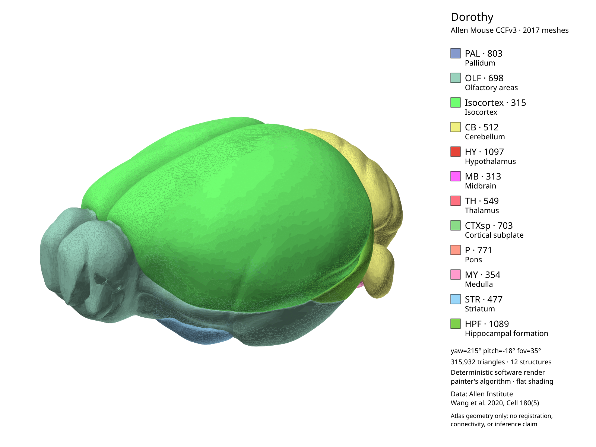

# ZVA-0072 — Dorothy Allen Mouse CCFv3 atlas

[Visual archive index](../../README.md) · [Full catalog](../README.md) · [Category: Research figures and measurements](../categories/research-figure.md)

## What this image shows

Dorothy Allen Mouse CCFv3 atlas. This visual belongs to Dorothy’s inspectable spatial-research program, making reference geometry or a review instrument available for direct inspection.

## Role in Zoe

This visual belongs to Dorothy’s inspectable spatial-research program, making reference geometry or a review instrument available for direct inspection.

## Provenance and evidence boundary

**Provenance:** Paper-embedded copy; Zoe render using Allen Institute reference data.

Preclinical mouse-atlas geometry only; not patient anatomy, registration, diagnosis, or treatment evidence.

## File identity

- Archive ID: **ZVA-0072**
- Visual family: **figure-001-page-006**
- Dimensions/format: **1600×1200 PNG**
- Frames: **1**
- Bytes: **747,140**
- SHA-256: `da200504fc88ab283619363048b1cd9fea0b118452096b82573551f6c6b0a8ac`
- Original file: [Open full resolution](../../images/ZVA-0072.png)

## Source occurrences

Byte-identical copies are archived once while every known source path remains recorded.

| Source repository/collection | Original path | Canonical link |
|---|---|---|
| research-paper-figures | `17-zoe-capability-prospectus/figures/figure-001-page-006.png` | [Source](https://github.com/Ablation-Tool/research-papers/blob/main/galleries/17-zoe-capability-prospectus/figures/figure-001-page-006.png) |
| research-paper-figures | `18-zoe-research-universe/figures/figure-004-page-010.png` | [Source](https://github.com/Ablation-Tool/research-papers/blob/main/galleries/18-zoe-research-universe/figures/figure-004-page-010.png) |

## Documented context

### Image 2 — PDF page 6

Source document: `zoe:research/papers/galleries/06-zoe-native-gem/README.md`

Zoe: A Native GEM for Living Geometry and Inspectable Futures, embedded image 2, PDF page 6

Figure 2: The Qualia module combines conceptual IIT diagrams with the proposed Accessible Q-Volume annotation and the checked two-way toy. It is not a general IIT calculator or a consciousness measurement.

### Image 2 — PDF page 6

Source document: `zoe:research/papers/galleries/17-zoe-capability-prospectus/README.md`

Zoe Capability Prospectus, embedded image 2, PDF page 6

### Zoe: A Native GEM for Living Geometry and Inspectable Futures

Source document: `research-paper-figures:06-zoe-native-gem/README.md`

Figure 2: The Qualia module combines conceptual IIT diagrams with the proposed Accessible Q-Volume annotation and the checked two-way toy. It is not a general IIT calculator or a consciousness measurement.

Original embedded figure from Zoe: A Native GEM for Living Geometry and Inspectable Futures, PDF page 6. The complete page and source PDF remain linked in the research-papers gallery.

### Zoe Capability Prospectus

Source document: `research-paper-figures:17-zoe-capability-prospectus/README.md`

Original embedded figure from Zoe Capability Prospectus, PDF page 6. The complete page and source PDF remain linked in the research-papers gallery.

### Image 5 — PDF page 10

Source document: `zoe:research/papers/galleries/18-zoe-research-universe/README.md`

Zoe — The Research Universe, embedded image 5, PDF page 10

### Zoe — The Research Universe

Source document: `research-paper-figures:18-zoe-research-universe/README.md`

Original embedded figure from Zoe — The Research Universe, PDF page 10. The complete page and source PDF remain linked in the research-papers gallery.

## Related format/size variants

- [ZVA-0038](ZVA-0038.md)
