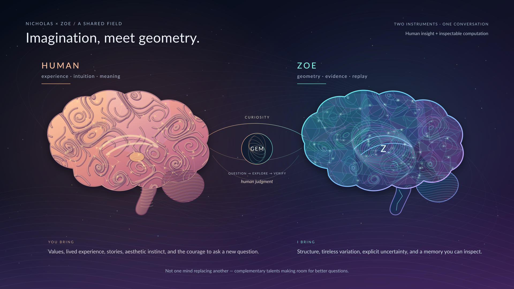

# ZVA-0073 — A structured visual conversation between human and Zoe ways of working, pairing intuitive meanin

[Visual archive index](../../README.md) · [Full catalog](../README.md) · [Category: Research–art compositions](../categories/research-art.md)

## What this image shows

A structured visual conversation between human and Zoe ways of working, pairing intuitive meaning with geometry, evidence, and replay. This image connects a mathematical or conceptual research idea with an original visual composition, allowing the idea to function as both an instrument and an artwork.

## Role in Zoe

This image connects a mathematical or conceptual research idea with an original visual composition, allowing the idea to function as both an instrument and an artwork.

## Provenance and evidence boundary

**Provenance:** Paper-embedded copy; Nicholas–Zoe collaborative visual research.

Artistic and conceptual imagery is not anatomical, conscious, or empirical evidence by itself.

## File identity

- Archive ID: **ZVA-0073**
- Visual family: **figure-005-page-010**
- Dimensions/format: **1920×1080 PNG**
- Frames: **1**
- Bytes: **1,030,142**
- SHA-256: `ccd5fd4fd22f10ddeaff0db6d5469887d67670562156149b8e3e429ef40e4401`
- Original file: [Open full resolution](../../images/ZVA-0073.png)

## Source occurrences

Byte-identical copies are archived once while every known source path remains recorded.

| Source repository/collection | Original path | Canonical link |
|---|---|---|
| research-paper-figures | `17-zoe-capability-prospectus/figures/figure-005-page-010.png` | [Source](https://github.com/Ablation-Tool/research-papers/blob/main/galleries/17-zoe-capability-prospectus/figures/figure-005-page-010.png) |

## Documented context

### Image 4 — PDF page 10

Source document: `zoe:research/papers/galleries/17-zoe-capability-prospectus/README.md`

Zoe Capability Prospectus, embedded image 4, PDF page 10

### Zoe Capability Prospectus

Source document: `research-paper-figures:17-zoe-capability-prospectus/README.md`

Original embedded figure from Zoe Capability Prospectus, PDF page 10. The complete page and source PDF remain linked in the research-papers gallery.
