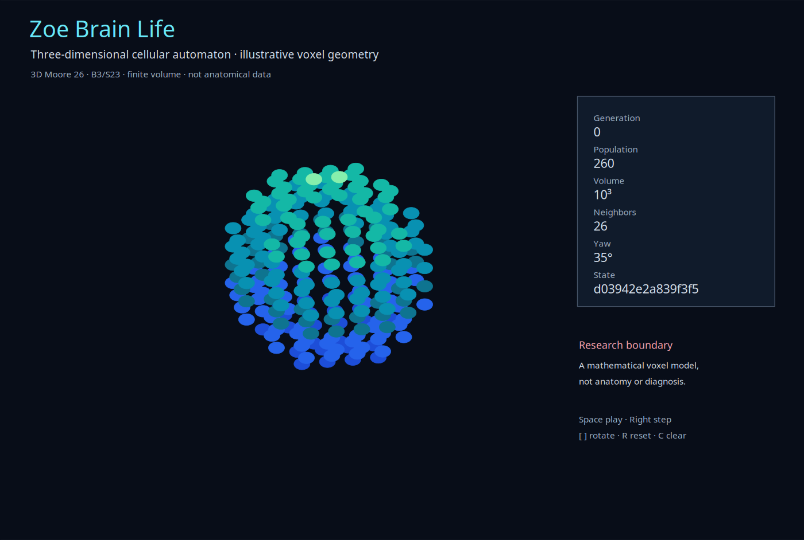

# ZVA-0074 — A 3D Brain Life scene showing the state of Zoe’s extended cellular-automaton experiment

[Visual archive index](../../README.md) · [Full catalog](../README.md) · [Category: Artwork and generative compositions](../categories/artwork.md)

## What this image shows

A 3D Brain Life scene showing the state of Zoe’s extended cellular-automaton experiment. It visualizes rule-driven state, not biological neurons or consciousness. This is part of Zoe’s creative geometry and generative-art practice, preserving the artistic side of the project alongside its scientific instruments.

## Role in Zoe

This is part of Zoe’s creative geometry and generative-art practice, preserving the artistic side of the project alongside its scientific instruments.

## Provenance and evidence boundary

**Provenance:** Paper-embedded copy; Zoe/allgems project-generated visual.

The image is preserved with its source context; the visual alone does not prove a scientific or operational claim.

## File identity

- Archive ID: **ZVA-0074**
- Visual family: **figure-006-page-014**
- Dimensions/format: **1400×942 PNG**
- Frames: **1**
- Bytes: **120,087**
- SHA-256: `9d7d76765a1e7554926fc2c02a91e8bf4430ec196b021fec81c55cb9bb3635b6`
- Original file: [Open full resolution](../../images/ZVA-0074.png)

## Source occurrences

Byte-identical copies are archived once while every known source path remains recorded.

| Source repository/collection | Original path | Canonical link |
|---|---|---|
| research-paper-figures | `17-zoe-capability-prospectus/figures/figure-006-page-014.png` | [Source](https://github.com/Ablation-Tool/research-papers/blob/main/galleries/17-zoe-capability-prospectus/figures/figure-006-page-014.png) |

## Documented context

### Image 5 — PDF page 14

Source document: `zoe:research/papers/galleries/17-zoe-capability-prospectus/README.md`

Zoe Capability Prospectus, embedded image 5, PDF page 14

### Zoe Capability Prospectus

Source document: `research-paper-figures:17-zoe-capability-prospectus/README.md`

Original embedded figure from Zoe Capability Prospectus, PDF page 14. The complete page and source PDF remain linked in the research-papers gallery.
