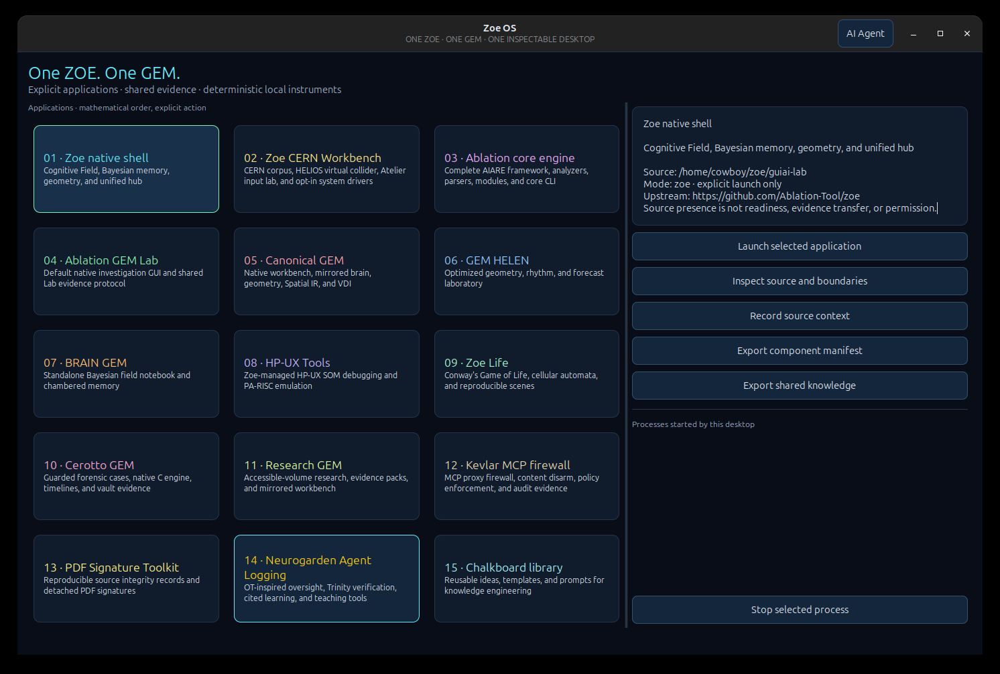

# ZVA-0075 — Zoe Capability Prospectus, embedded image 6, PDF page 17

[Visual archive index](../../README.md) · [Full catalog](../README.md) · [Category: Research figures and measurements](../categories/research-figure.md)

## What this image shows

Zoe Capability Prospectus, embedded image 6, PDF page 17. This figure preserves a measurement, model output, simulation, geometric construction, or research explanation from the Zoe/allgems program.

## Role in Zoe

This figure preserves a measurement, model output, simulation, geometric construction, or research explanation from the Zoe/allgems program.

## Provenance and evidence boundary

**Provenance:** Zoe/allgems project-generated visual.

The image is preserved with its source context; the visual alone does not prove a scientific or operational claim.

## File identity

- Archive ID: **ZVA-0075**
- Visual family: **figure-007-page-017**
- Dimensions/format: **1492×1007 PNG**
- Frames: **1**
- Bytes: **146,206**
- SHA-256: `3976498a21b6a0ff7db0eab8e7a4feba09badfd26017acf557cab5d3e8a6640e`
- Original file: [Open full resolution](../../images/ZVA-0075.png)

## Source occurrences

Byte-identical copies are archived once while every known source path remains recorded.

| Source repository/collection | Original path | Canonical link |
|---|---|---|
| research-paper-figures | `17-zoe-capability-prospectus/figures/figure-007-page-017.png` | [Source](https://github.com/Ablation-Tool/research-papers/blob/main/galleries/17-zoe-capability-prospectus/figures/figure-007-page-017.png) |

## Documented context

### Image 6 — PDF page 17

Source document: `zoe:research/papers/galleries/17-zoe-capability-prospectus/README.md`

Zoe Capability Prospectus, embedded image 6, PDF page 17

### Zoe Capability Prospectus

Source document: `research-paper-figures:17-zoe-capability-prospectus/README.md`

Original embedded figure from Zoe Capability Prospectus, PDF page 17. The complete page and source PDF remain linked in the research-papers gallery.
