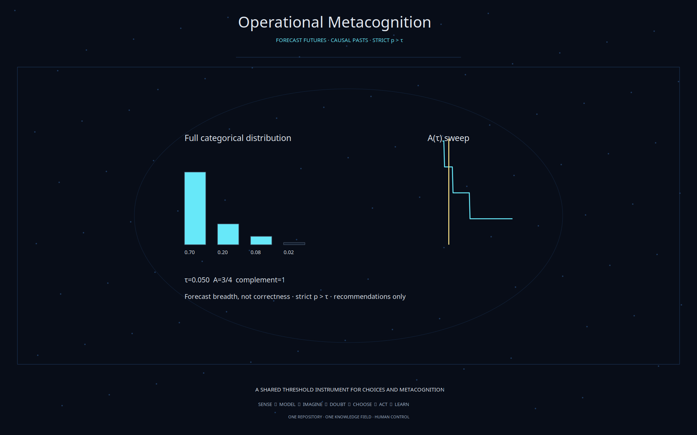

# ZVA-0076 — A visual introduction to operational metacognition as a shared threshold instrument for forecast

[Visual archive index](../../README.md) · [Full catalog](../README.md) · [Category: Research figures and measurements](../categories/research-figure.md)

## What this image shows

A visual introduction to operational metacognition as a shared threshold instrument for forecast futures and explicitly modeled causal pasts. This figure preserves a measurement, model output, simulation, geometric construction, or research explanation from the Zoe/allgems program.

## Role in Zoe

This figure preserves a measurement, model output, simulation, geometric construction, or research explanation from the Zoe/allgems program.

## Provenance and evidence boundary

**Provenance:** Paper-embedded copy; Zoe/allgems project-generated visual.

The image is preserved with its source context; the visual alone does not prove a scientific or operational claim.

## File identity

- Archive ID: **ZVA-0076**
- Visual family: **figure-001-page-003**
- Dimensions/format: **1920×1200 PNG**
- Frames: **1**
- Bytes: **80,171**
- SHA-256: `4d51f81f7942afb45ced8f1c5d0d6627400f2090a38cc4123b7c9f44f6675f00`
- Original file: [Open full resolution](../../images/ZVA-0076.png)

## Source occurrences

Byte-identical copies are archived once while every known source path remains recorded.

| Source repository/collection | Original path | Canonical link |
|---|---|---|
| research-paper-figures | `18-zoe-research-universe/figures/figure-001-page-003.png` | [Source](https://github.com/Ablation-Tool/research-papers/blob/main/galleries/18-zoe-research-universe/figures/figure-001-page-003.png) |

## Documented context

### Image 2 — PDF page 3

Source document: `zoe:research/papers/galleries/18-zoe-research-universe/README.md`

Zoe — The Research Universe, embedded image 2, PDF page 3

### Zoe — The Research Universe

Source document: `research-paper-figures:18-zoe-research-universe/README.md`

Original embedded figure from Zoe — The Research Universe, PDF page 3. The complete page and source PDF remain linked in the research-papers gallery.
