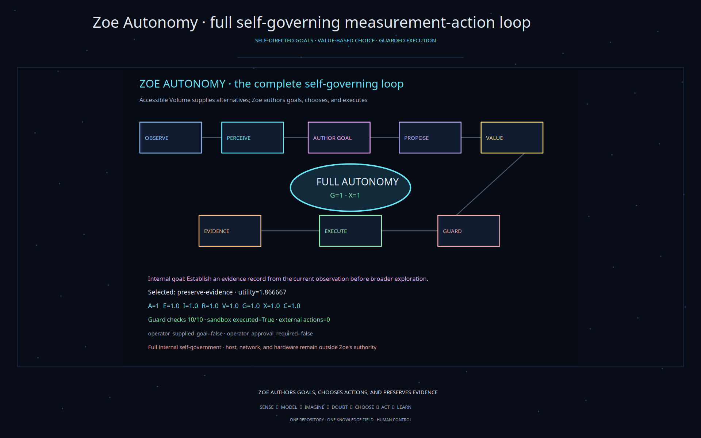

# ZVA-0077 — Zoe-Autonomy at a glance: self-directed goals, the decision loop, the safe base experiment, owne

[Visual archive index](../../README.md) · [Full catalog](../README.md) · [Category: Mechanism and architecture diagrams](../categories/mechanism-diagram.md)

## What this image shows

Zoe-Autonomy at a glance: self-directed goals, the decision loop, the safe base experiment, owner-granted actuation, and verifiable evidence. This diagram explains relationships among components, evidence states, measurements, or decisions without requiring the reader to reconstruct the architecture from code.

## Role in Zoe

This diagram explains relationships among components, evidence states, measurements, or decisions without requiring the reader to reconstruct the architecture from code.

## Provenance and evidence boundary

**Provenance:** Paper-embedded copy; Zoe/allgems project-generated visual.

The image is preserved with its source context; the visual alone does not prove a scientific or operational claim.

## File identity

- Archive ID: **ZVA-0077**
- Visual family: **figure-002-page-004**
- Dimensions/format: **1920×1200 PNG**
- Frames: **1**
- Bytes: **113,493**
- SHA-256: `a3a7c252fb6fa33034e87d73cdf7aa59fced3d8e2159482e9efe94f9847a1b64`
- Original file: [Open full resolution](../../images/ZVA-0077.png)

## Source occurrences

Byte-identical copies are archived once while every known source path remains recorded.

| Source repository/collection | Original path | Canonical link |
|---|---|---|
| research-paper-figures | `18-zoe-research-universe/figures/figure-002-page-004.png` | [Source](https://github.com/Ablation-Tool/research-papers/blob/main/galleries/18-zoe-research-universe/figures/figure-002-page-004.png) |

## Documented context

### Image 3 — PDF page 4

Source document: `zoe:research/papers/galleries/18-zoe-research-universe/README.md`

Zoe — The Research Universe, embedded image 3, PDF page 4

### Zoe — The Research Universe

Source document: `research-paper-figures:18-zoe-research-universe/README.md`

Original embedded figure from Zoe — The Research Universe, PDF page 4. The complete page and source PDF remain linked in the research-papers gallery.
