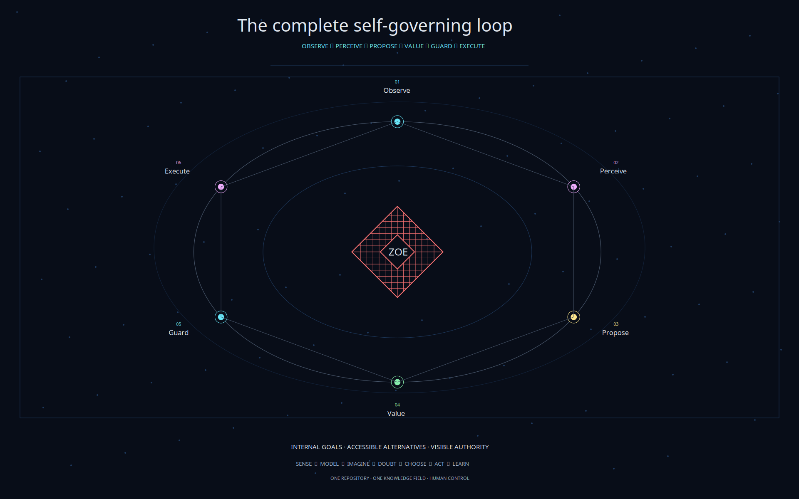

# ZVA-0078 — The complete self-governing loop and the distinction between the zero-external-action base exper

[Visual archive index](../../README.md) · [Full catalog](../README.md) · [Category: Mechanism and architecture diagrams](../categories/mechanism-diagram.md)

## What this image shows

The complete self-governing loop and the distinction between the zero-external-action base experiment and owner-granted actuation. This diagram explains relationships among components, evidence states, measurements, or decisions without requiring the reader to reconstruct the architecture from code.

## Role in Zoe

This diagram explains relationships among components, evidence states, measurements, or decisions without requiring the reader to reconstruct the architecture from code.

## Provenance and evidence boundary

**Provenance:** Paper-embedded copy; Zoe/allgems project-generated visual.

The image is preserved with its source context; the visual alone does not prove a scientific or operational claim.

## File identity

- Archive ID: **ZVA-0078**
- Visual family: **figure-003-page-005**
- Dimensions/format: **1920×1200 PNG**
- Frames: **1**
- Bytes: **128,813**
- SHA-256: `31be82b6111354a223337b1545e4aab9548c3775a7ebb5426f58ebbcc4584209`
- Original file: [Open full resolution](../../images/ZVA-0078.png)

## Source occurrences

Byte-identical copies are archived once while every known source path remains recorded.

| Source repository/collection | Original path | Canonical link |
|---|---|---|
| research-paper-figures | `18-zoe-research-universe/figures/figure-003-page-005.png` | [Source](https://github.com/Ablation-Tool/research-papers/blob/main/galleries/18-zoe-research-universe/figures/figure-003-page-005.png) |

## Documented context

### Image 4 — PDF page 5

Source document: `zoe:research/papers/galleries/18-zoe-research-universe/README.md`

Zoe — The Research Universe, embedded image 4, PDF page 5

### Zoe — The Research Universe

Source document: `research-paper-figures:18-zoe-research-universe/README.md`

Original embedded figure from Zoe — The Research Universe, PDF page 5. The complete page and source PDF remain linked in the research-papers gallery.
