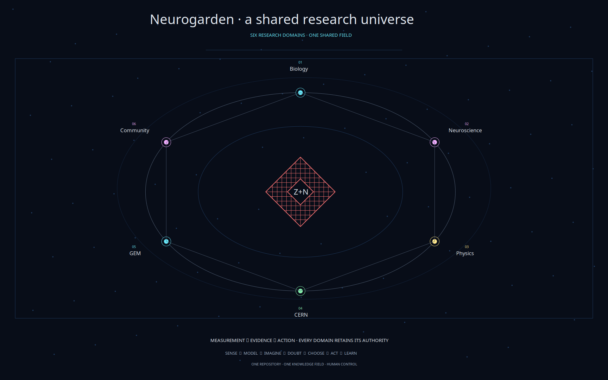

# ZVA-0079 — A research-universe diagram linking biology, neuroscience, physics, CERN, GEM, and community whi

[Visual archive index](../../README.md) · [Full catalog](../README.md) · [Category: Mechanism and architecture diagrams](../categories/mechanism-diagram.md)

## What this image shows

A research-universe diagram linking biology, neuroscience, physics, CERN, GEM, and community while keeping their evidence and permission domains distinct. This visual belongs to Zoe’s CERN/source-evidence program, helping a reader inspect a corpus, protocol, replay, virtual system, or process boundary.

## Role in Zoe

This visual belongs to Zoe’s CERN/source-evidence program, helping a reader inspect a corpus, protocol, replay, virtual system, or process boundary.

## Provenance and evidence boundary

**Provenance:** Paper-embedded copy; Zoe source-derived research scene.

CERN material is source evidence or a virtual/synthetic model, not live detector state or hardware authorization.

## File identity

- Archive ID: **ZVA-0079**
- Visual family: **figure-006-page-012**
- Dimensions/format: **1920×1200 PNG**
- Frames: **1**
- Bytes: **129,439**
- SHA-256: `c6c91303e036ae45d8609a2fcd37f31f5dddfd6b85fdd26a8b2af9c6f84fe2dd`
- Original file: [Open full resolution](../../images/ZVA-0079.png)

## Source occurrences

Byte-identical copies are archived once while every known source path remains recorded.

| Source repository/collection | Original path | Canonical link |
|---|---|---|
| research-paper-figures | `18-zoe-research-universe/figures/figure-006-page-012.png` | [Source](https://github.com/Ablation-Tool/research-papers/blob/main/galleries/18-zoe-research-universe/figures/figure-006-page-012.png) |

## Documented context

### Image 6 — PDF page 12

Source document: `zoe:research/papers/galleries/18-zoe-research-universe/README.md`

Zoe — The Research Universe, embedded image 6, PDF page 12

### Zoe — The Research Universe

Source document: `research-paper-figures:18-zoe-research-universe/README.md`

Original embedded figure from Zoe — The Research Universe, PDF page 12. The complete page and source PDF remain linked in the research-papers gallery.
